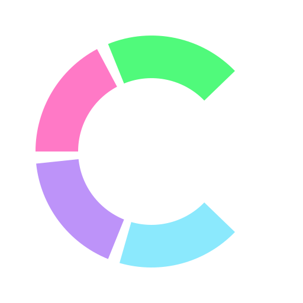
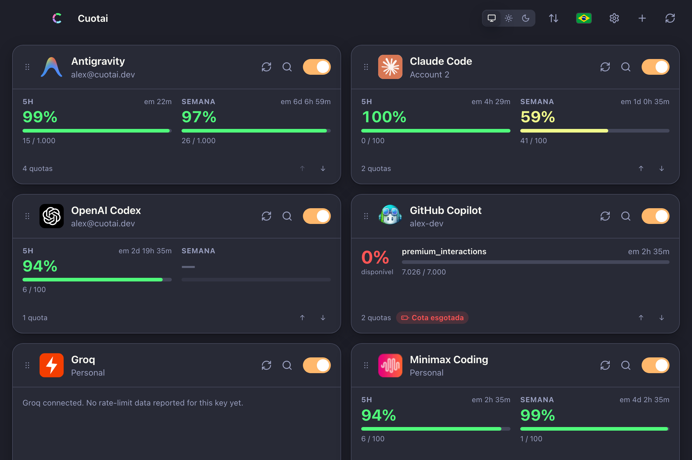
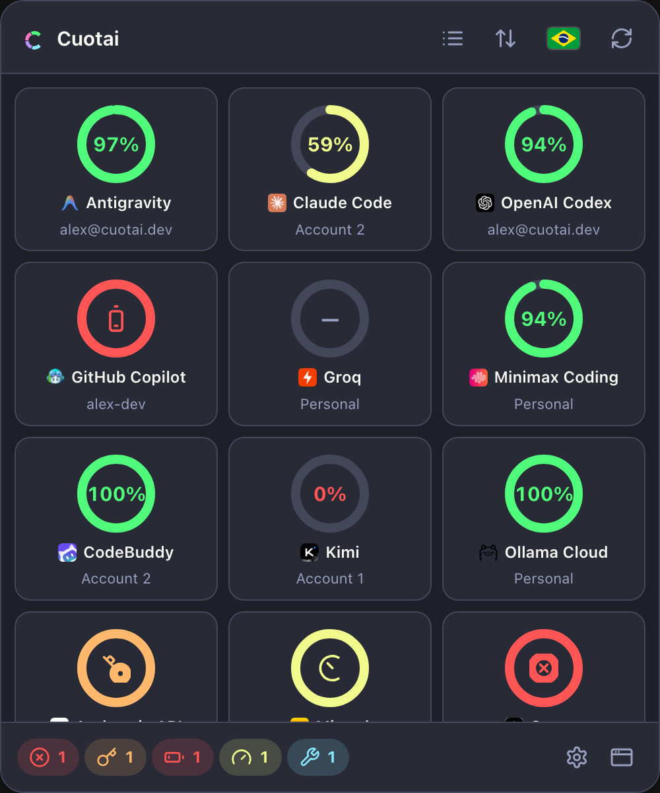

<div align="center">
  
  <h1>Cuotai</h1>
  <p><strong>All your AI quotas, usage limits and costs in one place.</strong></p>
  <p>
    A read-only, multi-account monitor written in Rust, with a <strong>desktop app (Tauri 2)</strong>, an <strong>interactive TUI (Ratatui)</strong> and a <strong>JSON CLI</strong>.
  </p>
  <p>
    <a href="#desktop-app">Desktop</a> •
    <a href="#terminal-tui--cli">TUI &amp; CLI</a> •
    <a href="#supported-providers">36 providers</a> •
    <a href="#getting-started">Getting started</a> •
    <a href="#documentation">Documentation</a> •
    <a href="#license">License</a>
  </p>
</div>

---

## Why Cuotai?

Anyone working with several AI assistants and APIs ends up switching between dozens of web dashboards to find out how much is left of the 5-hour window, the weekly quota or the monthly budget. **Cuotai** brings it all together:

- **100% read-only, zero tokens spent:** it only queries quota, billing and header endpoints. It **never** sends inference requests that would burn your credits to measure a limit.
- **Secure by default:** `cuotai.toml` holds references only. OAuth tokens live in the operating system's native vault (**macOS Keychain**, **Windows Credential Manager**, **Linux Secret Service**) with automatic renewal, or in environment variables.
- **Built-in native login:** sign in through the browser, Device Code or AWS SSO without copying tokens by hand (Claude, ChatGPT/Codex, GitHub Copilot, Gemini CLI, Kiro, Antigravity, Cursor, Kimi, Zed, CodeBuddy and more).
- **Three interfaces, one core (`cuotai-core`):**
  - **Desktop and system tray (Tauri 2):** a detailed main window, a quick menu-bar popover (donut or list view) and a native right-click menu.
  - **Terminal TUI (Ratatui):** a fast dashboard with keyboard and mouse support, instant filtering and a full account wizard.
  - **CLI (`--once` / `--json` / `--json-v1` / `--serve` / `--watch`):** built for scripts, status bars (Waybar, SketchyBar, tmux) and automation.
- **Themes and internationalization:** 14 built-in themes (Dracula, Catppuccin, Tokyo Night, One Dark, GitHub, macOS, Windows 11, Ubuntu, Synthwave, CRT, Win98/XP, Tron), custom themes and languages, and a UI in **Portuguese**, **English** and **Spanish**.

---

## Desktop app

The desktop app watches your accounts in the background with incremental per-account scheduling, drag-and-drop reordering (synced with the TUI) and immediate visual alerts when a quota needs attention or runs out. Each account highlights its most restrictive limit: the tray ring and a `Week · 100%` chip on the card follow the window that blocks you (a weekly limit at 100% wins over a free 5-hour window), the list says "Blocked until 14:30", and Settings offers an optional "Most restrictive first" order that leaves your manual order untouched. Every card, tray entry and menu line also says how old its reading is ("Fresh · 3 min ago", "Aging", "Stale"), and the tray icon tooltip names the oldest one. When a query fails after a success, the card keeps the last valid numbers, dimmed, with a "Stale · 42 min ago" badge and the cause of the failure, until the next successful query; an authentication failure drops them.

**Settings → Appearance** can also group exhausted or blocked accounts in a collapsible "Recharging" section that shows each return time ("Returns Today 14:30", or "Return unknown"). It is off by default and only changes the display: the manual order holds inside each group and the order saved in `cuotai.toml` never changes.

Cards, details and the tray also show the **consumption pace until the reset**: whether what you used so far lasts at a steady rate ("Week: 8 points in reserve · lasts until the reset") or runs out early ("runs out at 16:40, 2h 10m before the reset"), with an "Expected 47% used" mark drawn over each bar in the details. It is a linear estimate, not a promise; windows that just opened, rolling rate limits and metrics without a reset time show nothing. **Settings → Appearance → Show consumption pace** hides it (on by default).

The TUI shows it too: a stage icon (`↓` in reserve, `→` on pace, `↑` above the pace, `✕` limit reached) before each eligible metric on the cards, a pace line per metric in the details, and a `Ritmo:` line under each eligible metric in `--once` (see [the TUI guide](docs/tui.md)). `--json` is unchanged.

**Settings → Notifications** can send a **system notification when a quota resets** (off by default; turning it on asks the system for permission, and a refusal keeps it off with guidance on allowing Cuotai in the system settings). Choose the moment (at the time, or 5, 15 or 60 minutes before), the filter (only if used, only if exhausted, always) and whether "other" windows count; **Send test notification** checks that notices arrive. The app schedules the notices itself, so they come with the window hidden in the tray, but not with the app closed. Each reset is notified once, even across restarts (`<OS local data dir>/cuotai/notified.json` keeps only digests and dates, for 8 days); a reset missed by more than 10 minutes while the app was closed or asleep is not notified late, and several resets of an account at once become one notice. A notice never queries the provider: it follows the time the provider reported and the new balance shows on the next refresh. Its text names only the provider, the account and the metrics, in the language chosen in the app. Each card and its details get a bell to silence one account; the choice is kept per provider and account name in `desktop.json`, so renaming an account turns its bell back on. The tray menu, its tooltip and the tray popover show the next notice ("Next notice: Claude 5h · today, 14:30").

The same section turns on **usage alerts** (off by default, with the same permission request and test button): a system notification when a quota with a limit reaches a threshold of use ("Claude: 90% of the 5-hour window used", with the account, the quota and its reset time), runs out (**Notify exhaustion**) or has slack again in the next window after running out (**Notify recovery**). The thresholds are chips from 10 to 99% (75 and 90 by default); each one notifies once per window, oscillating around it stays silent, and it re-arms only after use falls 5 points below it or a new window starts. Balances, spend, rate limits and missing values never alert, and no alert queries a provider: the app judges each reading its refresh already took, also with the window hidden in the tray. An account's alerts of one refresh become one notification, at most one notification goes out per minute (the rest are grouped into the next), and nothing is resent after a restart (the alert state joins `notified.json`, digests and dates only). The account's bell silences its alerts too, and each quota can be muted from the account details; the card, the tray and the details highlight an account with an active alert. Preferences live in `desktop.json`, never in `cuotai.toml`.

**Settings → Privacy** can show the **providers' public status** (off by default). Turned on, the app reads the public status pages of the providers you configured (the section lists their domains; each page at most once every 5 minutes, without credentials, cookies or account data, though those sites see your IP address and that you use the provider). A card then shows a colored badge with an icon and text when its provider reports degraded performance, a partial or major outage or maintenance, or when its status page could not be read, with **Open status page**; the details show the full status and when it was read, the tray popover lists the affected providers, and the tray icon gets a red dot while any of them reports a partial outage or worse. Providers without a verified public source never show as operational. A failed query during an incident says the failure may not be from your account.

The TUI and the CLI read the same status only when you ask (`--status`, or `CUOTAI_STATUS=1` in the environment); `--no-status` always turns it off, also in scripts that inherit the variable. A card then shows the badge on its top border (`▲ Interrupção parcial`, `? Página de status indisponível`), the details list the provider's full status with the incident, its start, when it was read and the page, and `--once` prints a `Status do provedor:` line under the affected account. `--json` keeps its shape.

**Settings → Integration** runs the same read-only **local server** as `cuotai --serve` from inside the app, off by default. Turned on, it listens on `127.0.0.1` only, on exactly the port you choose (6738 by default), and serves this app's own readings (`/health`, `/v1/snapshot`, `/v1/accounts/{key}`, `/v1/limits`), so reading it never queries a provider. The section shows the effective address (with **Copy address**) or why it is not serving; a taken port, for example by a `cuotai --serve` already running, is named as such there and in a banner on the main window. **Generate token** keeps a bearer token in the system vault (never in the TOML) and requires it; **Copy token** copies it without showing it, **Generate new token** stops the old one at once and **Revoke token** removes it. **Allow web browsers** asks for confirmation first, because any page open in your browser could then read your usage. See [the local server guide](docs/local-server.md).

Every card and its details also say, discreetly, **how that account's usage is read**: `Official` (an interface the vendor documents), `Undocumented` (an internal interface that may change without notice), `Derived` (inferred from metrics or rate-limit headers) or `Unavailable` (no usage query exists), with a one-line summary. An `Unavailable` account shows why instead of a generic error, and when an undocumented interface stops matching, the card says it may have changed and names the public contract Cuotai follows. The same levels appear when you add an account.

<div align="center">
  
  <p><em>The Cuotai desktop main window showing 5-hour and weekly windows, rate limits and account status.</em></p>
</div>

<div align="center">
  
  <p><em>The tray popover in the compact donut view, with an alert summary in the footer.</em></p>
</div>

---

## Supported providers

Cuotai ships **36 integrations**. For parameters, default variables and limitations of each provider, see **[`docs/providers.md`](docs/providers.md)**.

| Category | Providers |
|---|---|
| **Assistants and subscriptions** | **Claude** (`claude`), **OpenAI Codex / ChatGPT** (`chat_gpt`), **GitHub Copilot** (`copilot`), **Cursor** (`cursor` — personal and Teams), **Windsurf** (`windsurf`), **Kiro / AWS** (`kiro`), **Antigravity** (`antigravity`), **Cline** (`cline`), **Zed** (`zed`), **CodeBuddy** (`code_buddy`), **Qoder** (`qoder`), **OpenCode Go** (`open_code_go`) |
| **CLIs and coding plans** | **Gemini CLI** (`gemini_ai`), **Grok CLI / xAI** (`grok`), **Kimi Coding & API** (`kimi`), **MiniMax Token/Coding Plan** (`mini_max`), **Alibaba Coding Plan** (`alibaba_coding_plan`), **Alibaba Token Plan / Qwen Cloud** (`alibaba_token_plan`), **Xiaomi MiMo** (`xiaomi_mimo`), **Ollama Cloud** (`ollama_cloud`), **Qwen Code** (`qwen`) |
| **Cloud billing and admin APIs** | **OpenAI Admin API** (`open_ai_api`), **Anthropic Admin API** (`anthropic_api`), **Google Gemini API Monitoring** (`gemini_api`), **Google Vertex AI** (`vertex_ai`), **AWS Bedrock Cost Explorer** (`aws_bedrock`), **Azure OpenAI Cost Management** (`azure_open_ai`), **Alibaba Cloud BSS** (`alibaba_cloud`), **Mistral Admin** (`mistral`), **Perplexity Computer Analytics** (`perplexity`), **Kimchi** (`kimchi`), **Groq** (`groq`) |
| **Additional catalog** | **Alibaba Model Studio** (`alibaba_model_studio`), **Cloudflare AI** (`cloudflare_ai`), **NVIDIA NIM** (`nvidia_nim`), **Poolside** (`poolside`) |

---

## Getting started

### Prerequisites

- **Rust / Cargo** (2021 edition)
- *(Optional)* **AWS CLI v2** on your `PATH` for `aws_bedrock` accounts
- *(Optional)* **Bailian CLI (`bl`)** for the console login of `alibaba_token_plan`

### 1. Desktop app (Tauri)

```sh
cd apps/desktop/src-tauri
cargo run
```

To build an installable package for your operating system:

```sh
cargo install tauri-cli
cd apps/desktop/src-tauri && cargo tauri build
```

### 2. Terminal TUI and CLI

Run the interactive dashboard in your terminal (it opens the wizard automatically on first run):

```sh
cargo run -p cuotai-tui

# Announce quota resets and usage alerts (75%, 90%, exhausted, available again)
# while the dashboard is open (header banner, bell, OSC 9)
cargo run -p cuotai-tui -- --notify

# Show the providers' public status (off by default; also CUOTAI_STATUS=1)
cargo run -p cuotai-tui -- --status
```

Or install the `cuotai` binary locally:

```sh
cargo install --path crates/cuotai-tui --locked
```

Quick command-line queries (without opening the interactive interface):

```sh
# List the 36 available providers
cargo run -p cuotai-tui -- --list-providers

# Human-readable summary in the terminal (single run)
cargo run -p cuotai-tui -- --config cuotai.toml --once

# Structured JSON snapshot for scripts and status bars
cargo run -p cuotai-tui -- --config cuotai.toml --json

# The versioned export::v1 contract (class, age, binding metric, pace, access level)
cargo run -p cuotai-tui -- --config cuotai.toml --json-v1

# Read-only local server on 127.0.0.1:6738, refreshed in the background (Ctrl+C stops it)
cargo run -p cuotai-tui -- --config cuotai.toml --serve
curl -s http://127.0.0.1:6738/v1/limits

# One NDJSON event per real transition (threshold crossed, exhausted, reset, failure…)
cargo run -p cuotai-tui -- --config cuotai.toml --watch --jsonl | jq -c 'select(.event == "quota_exhausted")'

# Recorded history of every account (or one), without querying providers
cargo run -p cuotai-tui -- --config cuotai.toml --history "Personal Codex" --history-days 30
```

In the JSON output, each metric carries a `kind` (`quota`, `rate_limit`, `balance`, `credits`, `spend` or `usage`) and a `window` (`window_5h`, `daily`, `weekly`, `monthly`, `other` or `null`), classified by the provider adapter. Consumers do not need to parse `label` or `period` to tell quotas, rate limits and windows apart.

`cuotai --json-v1` prints the versioned `export::v1` contract, which Rust integrations can also build from `cuotai-core`: the last known state of every account with its age, freshness, preserved stale reading, binding metric, pace and usage access level, with no credentials, credential variable names or e-mails, and `null` for anything unknown. See [`docs/export-v1.md`](docs/export-v1.md). `cuotai --serve [--port N] [--token-file FILE]` (or, with the core's `serve` feature, `serve::LocalServer`) publishes it read-only on `127.0.0.1:6738` (`/health`, `/v1/snapshot`, `/v1/accounts/{key}`, `/v1/limits`) from the state the refresh cycle already holds, never querying a provider per request, with DNS-rebinding and browser protection and an optional bearer token; it is off until you start it, and stops cleanly on `SIGINT`/`SIGTERM`. See [`docs/local-server.md`](docs/local-server.md).

`cuotai --watch [--interval S] [--events LIST] [--jsonl]` keeps the same refresh cycle in the foreground and emits one event per real transition between consecutive readings (a quota crossed 75% or 90%, ran out, recovered or reset, an account was blocked, a query failed or recovered, authentication is needed, usage changed), never repeating a condition that persists and treating the first reading of each account as its baseline; `--jsonl` writes NDJSON on stdout with every message on stderr, and `--serve` can share the same cycle. Payloads carry no credentials, URLs or raw error messages. See [`docs/events.md`](docs/events.md).

Every successful reading (TUI, desktop app, `--once`, `--json`, `--json-v1`, `--serve` and `--watch`) also enters a local measurement history on this computer only: `<OS local data dir>/cuotai/history/history.sqlite3`, private to your user, holding numbers and window metadata, never credentials, account names or provider text. On opening, each account shows its last recorded reading, marked stale, until the first query answers, and the consumption pace projects from the recent slope. The history keeps 90 days by default (`--history-days 7…365` on the command line, **Settings → History** on the desktop), keeps one sample per hour after 7 days (each window's peak stays) and stays under 64 MiB, warning when it had to delete old samples. The desktop account details draw an area chart of each metric over the last 24 hours, 7 days or 30 days, with the last reading highlighted and a marker at each reset (and a table for screen readers); **Settings → History** turns recording off (on by default; what was recorded stays until you erase it), shows the size on disk, exports to CSV or JSON and erases one account's history or all of it, after a confirmation. The TUI account details draw a sparkline of each metric over the last 24 hours, 7 days or 30 days (keys `1`, `2`, `3`), and `--history [ACCOUNT]` prints the recorded series (`--json` for scripts; `--history-days` picks the days shown, 7 by default).

---

## Documentation

The detailed technical documentation lives in **[`docs/`](docs/)**. Some documents are still being translated from Portuguese to English.

- **[TUI, CLI and account wizard guide (`docs/tui.md`)](docs/tui.md)** — Keyboard and mouse shortcuts (including the Models section, `m`, with local search and `s` to sync models), the step-by-step wizard flow, configuration file precedence and CLI exit codes.
- **[OAuth login, sessions and vault (`docs/oauth.md`)](docs/oauth.md)** — How native browser and Device Code logins work, the assisted Cursor import, OAuth preparation for Google/Azure/AWS SSO and secure storage in the Keychain.
- **[Provider catalog and limitations (`docs/providers.md`)](docs/providers.md)** — The full table of the 36 providers, the usage access matrix (level, credential, plan, scope and evidence of each provider and mode, generated from the core), default environment variables, `9router` compatibility, metric semantics and per-query cost warnings (such as AWS Cost Explorer).
- **[Export contract v1 (`docs/export-v1.md`)](docs/export-v1.md)** — The versioned `export::v1` contract for integrations: fields, stability and deprecation policy, redaction rules, JSON Schema and reference output.
- **[Local HTTP server (`docs/local-server.md`)](docs/local-server.md)** — `cuotai --serve`, the desktop's Settings → Integration and the read-only loopback server of `cuotai-core` (`serve` feature): routes, port and fallback, exit codes, limits, token, DNS-rebinding and browser protection.
- **[Events and `cuotai --watch` (`docs/events.md`)](docs/events.md)** — The edge events between consecutive readings, their payload and failure categories, and `cuotai --watch` with `--jsonl`, `--events` and `--interval`: baselines, shutdown and exit codes.
- **[Architecture, Rust library and verification (`docs/architecture.md`)](docs/architecture.md)** — The split between `cuotai-core`, `cuotai-tui` and `apps/desktop`, using `cuotai-core` as a Rust library, the internationalization contract and the test suite.
- **[Desktop app guide (`apps/desktop/README.md`)](apps/desktop/README.md)** — Details specific to the Tauri 2 shell, themes and the user customization folder.
- **[Configuration example (`cuotai.example.toml`)](cuotai.example.toml)** — A commented reference of every `[[accounts]]` entry and TOML parameter.
- **[Roadmap (`docs/plans/`)](docs/plans/0000_control.md)** — Product requirement documents (PRDs) with their implementation status and dependencies.

---

## Contributing

Contributions are welcome. Read [`CONTRIBUTING.md`](CONTRIBUTING.md) first, and report security issues privately as described in [`SECURITY.md`](SECURITY.md).

---

## License

Cuotai is distributed under the terms of either the [MIT license](LICENSE-MIT) or the [Apache License, Version 2.0](LICENSE-APACHE), at your option. Third-party notices are in [`THIRD_PARTY_NOTICES`](THIRD_PARTY_NOTICES).

Unless you explicitly state otherwise, any contribution intentionally submitted for inclusion in Cuotai, as defined in the Apache-2.0 license, is dual licensed as above, without any additional terms or conditions.
