

  <h1>
    <picture>
      <source media="(prefers-color-scheme: dark)" srcset="apps/desktop/ui/img/logotype-on-dark.svg" />
      <source media="(prefers-color-scheme: light)" srcset="apps/desktop/ui/img/logotype-on-light.svg" />
      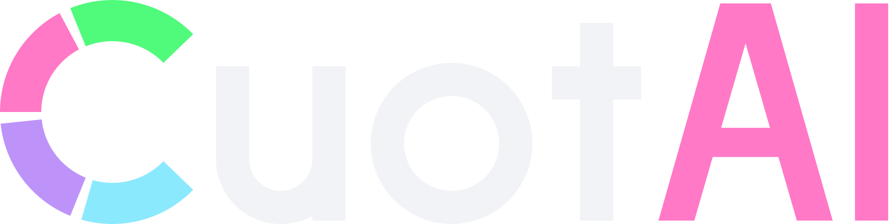
    </picture>
  </h1>
  
<strong>All your AI quotas, usage limits and costs in one place.</strong>

  

    A free, open-source desktop app that shows how much of your 5-hour window, weekly quota or monthly budget is left, across every AI assistant and API you use, and warns you before you run out.
  

  

    <a href="#what-is-cuotai">What it does</a> •
    <a href="#install">Install</a> •
    <a href="#a-tour-of-the-desktop-app">Desktop tour</a> •
    <a href="#terminal-dashboard">Terminal</a> •
    <a href="#themes">Themes</a> •
    <a href="#help-cuotai-grow">Support the project</a> •
    <a href="#documentation">Documentation</a>
  

  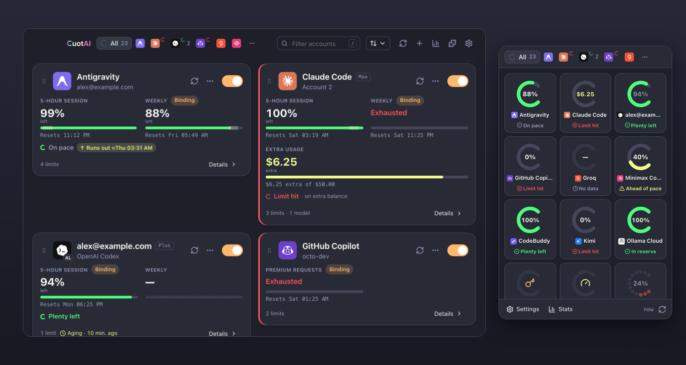
  
<em>The main window and the tray popover, shown here with made-up demo accounts.</em>

---

## What is Cuotai?

If you work with several AI assistants and APIs, you probably hop between dashboards to find out how much is left of the 5-hour window, the weekly quota or the monthly budget. **Cuotai puts all of it in one place** and keeps it fresh in the background, so you know before a limit stops you.

**Why the name?** Cuotai comes from *cuota*, how many Portuguese speakers say "quota", plus *AI*, which is why the logo sets it apart: it keeps an eye on the quotas, usage limits and costs of your AI providers. Its four-color C is a gauge that is never quite closed, the same ring that shows how much quota each account has left.

It is made for developers, teams and heavy users of coding assistants and AI APIs who juggle more than one subscription or key.

**What you get**

- **Every limit in one window.** One card per account with the 5-hour, weekly and monthly windows, rate limits, balances and spend, each with its reset time. Supports **36 services**, including Claude, ChatGPT / Codex, GitHub Copilot, Cursor, Gemini, Kiro, Windsurf, OpenAI and Anthropic admin APIs, AWS Bedrock, Azure OpenAI and many more ([full list](#supported-services)).
- **Pace and "runs out" warnings.** Cuotai compares what you used so far with a steady pace until the reset and tells you when you are on track ("8 points in reserve") or will run out early ("runs out at 16:40, 2h 10m before the reset").
- **Alerts that matter.** Optional system notifications when a quota resets, crosses a threshold you choose, runs out or has slack again. Nothing is sent to anyone: the app just tells you.
- **History and local cost.** Charts of how each quota moved over the last 24 hours, 7 days or 30 days, and an optional estimate of what your Claude Code and Codex CLI token use would cost at API prices, read from your own local logs.
- **Private by design.** Cuotai is read-only and spends no tokens: it only asks your providers for quota and billing numbers, never for an AI answer. Sign-ins and tokens are kept in your operating system's vault (macOS Keychain, Windows Credential Manager, Linux Secret Service), your settings file never contains a secret, and there is no Cuotai account or cloud service in the middle.
- **Runs where you work.** Windows, macOS and Linux, with a tray or menu-bar popover for a quick look. A terminal dashboard and a command line for scripts are included.
- **Yours to shape.** 15 built-in themes (dark and light), your own themes, and an interface in Portuguese, English, Spanish and Italian.
- **Free and open source**, under the MIT or Apache-2.0 license.

## Install

> **Status.** Cuotai is pre-release: the first packaged release has not been published yet, so the package-manager commands below are prepared but **not live**. Until the first release, build it from source ([build guide](docs/building.md)). Nothing here claims a channel is available before it is.

| System | Package manager (planned) | Direct download | Works today |
|---|---|---|---|
| **macOS** (Apple silicon and Intel) | Homebrew: `brew install --cask jmarcon/cuotai/cuotai` (coming soon) | `.dmg` from [Releases](https://github.com/jmarcon/cuotai/releases) (first release pending) | [Build from source](docs/building.md#desktop-app-tauri) |
| **Windows** (x64; ARM64 optional) | winget: `winget install Cuotai.Cuotai` (coming soon) | `.exe` or `.msi` installer from [Releases](https://github.com/jmarcon/cuotai/releases) (first release pending) | [Build from source](docs/building.md#desktop-app-tauri) |
| **Linux** (x64; ARM64 optional) | AUR: `yay -S cuotai-bin` (coming soon) | `.deb`, `.rpm` or `.AppImage` from [Releases](https://github.com/jmarcon/cuotai/releases) (first release pending) | [Build from source](docs/building.md#desktop-app-tauri) |
| **Any system, terminal only** | `cargo install cuotai-tui --locked` or `cargo binstall cuotai-tui` (coming soon, once the crates are published) | CLI archive from [Releases](https://github.com/jmarcon/cuotai/releases) (first release pending) | `cargo install --git https://github.com/jmarcon/cuotai cuotai-tui --locked` |

Also coming soon: Homebrew (`brew install jmarcon/cuotai/cuotai`) and Scoop (`scoop bucket add cuotai && scoop install cuotai`) for the terminal version. The full channel status, with how each one is checked, is in [`docs/installing.md`](docs/installing.md).

**Good to know once builds are published**

- **macOS.** Builds that are not notarized by Apple are blocked the first time you open them: open **System Settings → Privacy & Security** and choose **Open Anyway** (older macOS versions: Control-click the app, choose **Open**, then confirm). Each release's notes say whether its macOS build is signed and notarized ([details](docs/gui-macos.md#first-launch-and-gatekeeper)).
- **Windows.** Installers that are not code-signed trigger a SmartScreen "unknown publisher" warning: choose **More info**, then **Run anyway**. Each release's notes say whether the build is signed ([details](docs/gui-windows.md#first-launch-and-smartscreen)).
- **Linux.** The `.deb` and `.rpm` declare the libraries they need, so your package manager installs them. On GNOME, the tray icon needs the AppIndicator extension ([details](docs/gui-linux.md#tray-icon)).
- **Verify what you downloaded.** Every release ships `SHA256SUMS` (signed) and build provenance: see [how to verify a download](docs/installing.md#verify-your-download).
- **Uninstalling** removes the app only; your accounts file, history and vault entries stay until you delete them ([how](docs/installing.md#uninstalling)).

## A tour of the desktop app

Open Cuotai, press **Add account**, pick a provider and either sign in with your browser or point Cuotai at an environment variable that holds the key. From then on it refreshes in the background.

  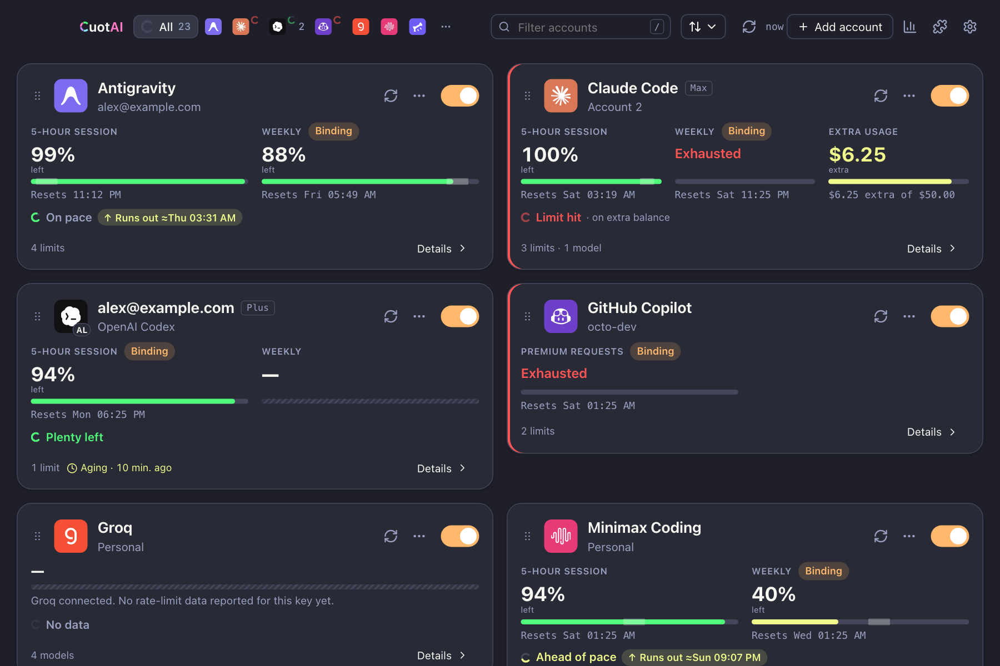

| Feature | What it does |
|---|---|
| **Dashboard** | One card per account, ordered the way you like (drag to reorder, or "most restrictive first"), highlighting the limit that blocks you right now and how old each reading is. |
| **Tray or menu bar** | Left click opens a popover with quota rings or a list; right click opens a quick menu. Closing the window keeps Cuotai running in the tray. |
| **Account details** | Every window with its bar, reset time and pace mark; hide or mute single quotas; browse the provider's model catalog. |
| **Pace and warnings** | Whether you will make it to the reset, as an estimate. |
| **Notifications and alerts** | Opt-in system notices for resets, thresholds (75% and 90% by default), exhaustion and recovery, with a test button. |
| **History** | Area charts of each metric over 24 hours, 7 days or 30 days, with export to CSV or JSON. |
| **Local cost** | Opt-in token and estimated API-price cost for Claude Code and Codex CLI, from local logs only. |
| **Provider status** | Opt-in badge when a provider reports an incident, so you know a failure may not be your account. |
| **Themes and languages** | 15 themes in dark and light, custom themes, four languages. |
| **Updates** | An optional daily check that sends only the version, system and architecture. |

  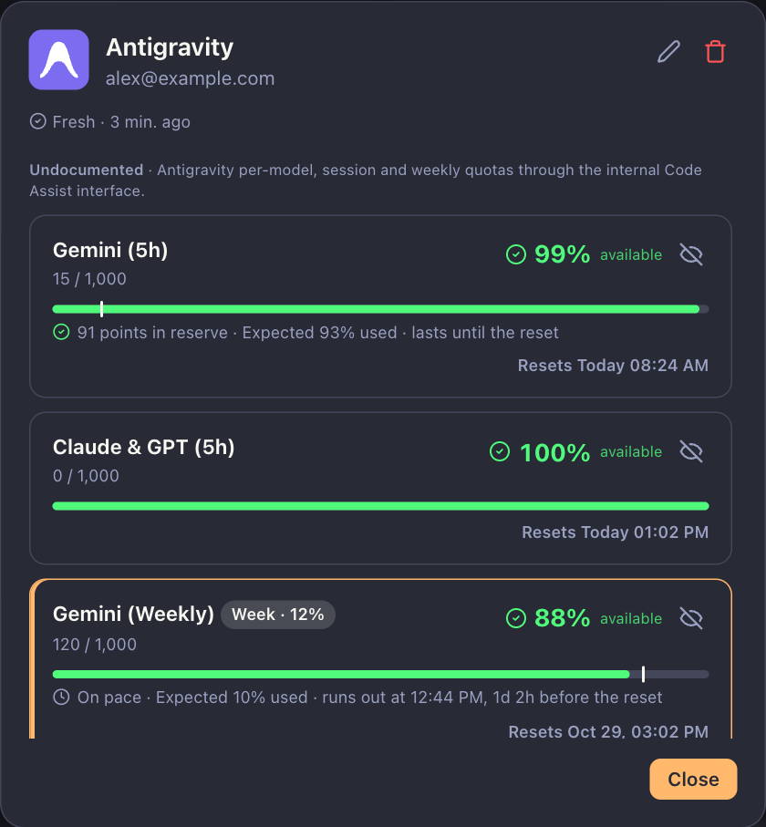
  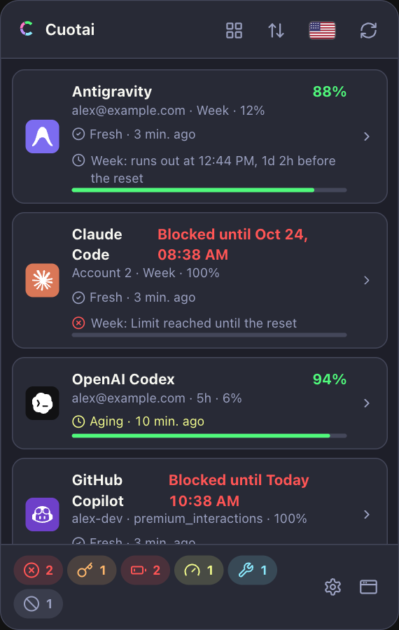

**Guides for your system**, with screenshots, where things are stored, notification permissions and how to uninstall:

- [Cuotai on macOS](docs/gui-macos.md): menu bar, Keychain, Gatekeeper.
- [Cuotai on Windows](docs/gui-windows.md): notification area, Credential Manager, SmartScreen.
- [Cuotai on Linux](docs/gui-linux.md): AppIndicator, Secret Service, `.deb` / `.rpm` / AppImage.

The complete list of desktop features and every setting is in the [desktop feature reference](docs/gui-features.md).

## Terminal dashboard

Prefer to stay in the terminal? The same engine powers an interactive dashboard with keyboard and mouse support, instant filtering and a built-in account wizard. Run `cuotai`, press `a` to add an account, and use `--once` or `--json` for scripts and status bars.

  
  
<em>The terminal dashboard with demo accounts. Its on-screen captions are in Portuguese; the guide quotes them with English glosses.</em>

Keyboard shortcuts, the account wizard, filters, the command line and its exit codes are in the [terminal guide](docs/tui.md); scripting recipes (`--json`, `--serve`, `--watch`, hooks, history and cost commands) are in [advanced usage](docs/advanced.md).

## Themes

Fifteen built-in themes, every one with a dark and a light mode. The picker is in **Settings → Appearance**, and the mode switch (system, light, dark) sits in the top bar.

<table>
  <tr>
    <td align="center">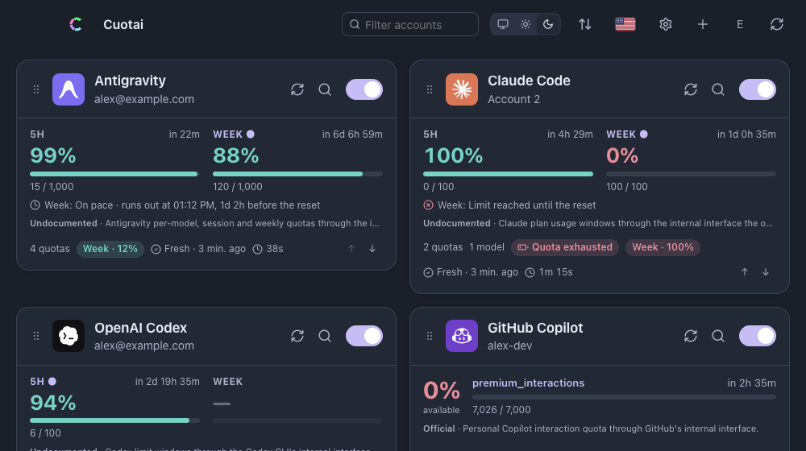 Cuotai, dark (the app's own theme)</td>
    <td align="center">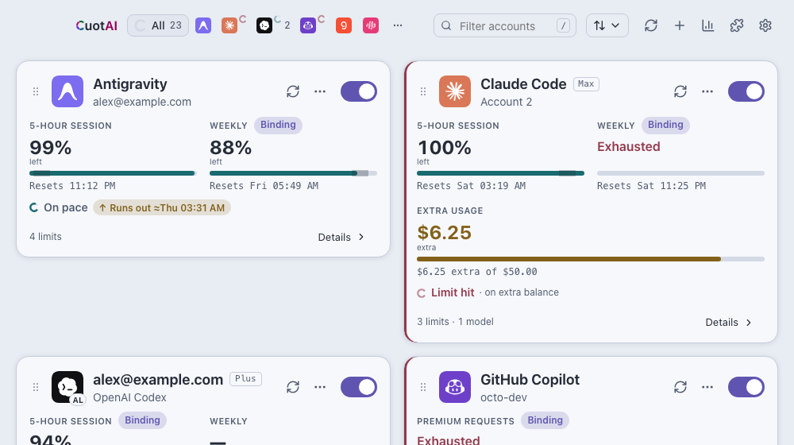 Cuotai, light</td>
    <td align="center">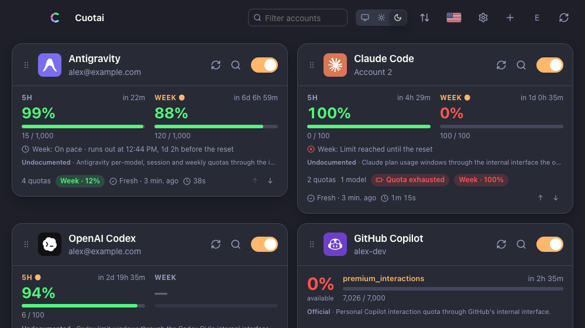 Dracula (default)</td>
  </tr>
  <tr>
    <td align="center">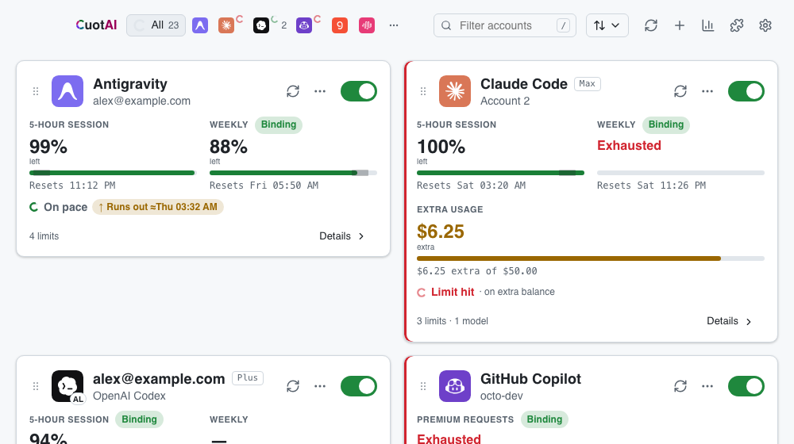 GitHub, light</td>
    <td align="center">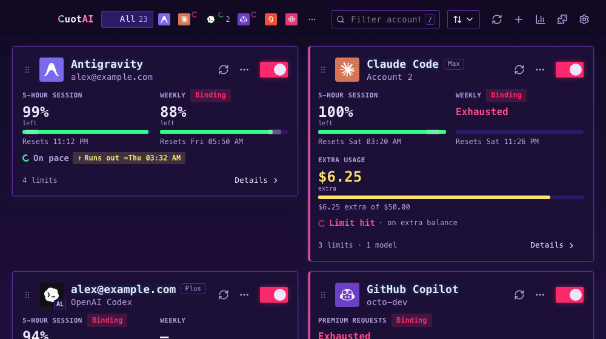 Old Terminal (synthwave)</td>
    <td align="center">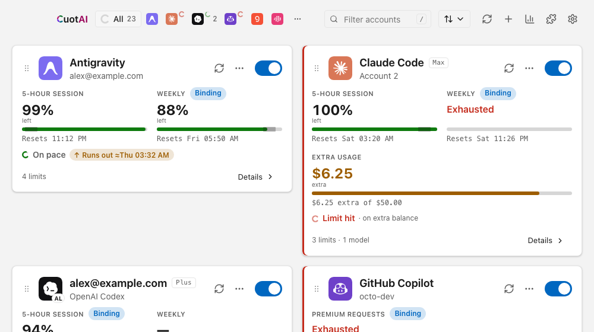 Windows 11, light</td>
  </tr>
</table>

See all of them, in both modes, and learn how to add your own in [`docs/themes.md`](docs/themes.md).

## Supported services

Cuotai ships **36 integrations**. For what each one reads, the credential it needs and its limitations, see [`docs/providers.md`](docs/providers.md).

| Category | Services |
|---|---|
| **Assistants and subscriptions** | Claude, OpenAI Codex / ChatGPT, GitHub Copilot, Cursor (personal and Teams), Windsurf, Kiro / AWS, Antigravity, Cline, Zed, CodeBuddy, Qoder, OpenCode Go |
| **CLIs and coding plans** | Gemini CLI, Grok CLI / xAI, Kimi Coding and API, MiniMax Token / Coding Plan, Alibaba Coding Plan, Alibaba Token Plan / Qwen Cloud, Xiaomi MiMo, Ollama Cloud, Qwen Code |
| **Cloud billing and admin APIs** | OpenAI Admin API, Anthropic Admin API, Google Gemini API Monitoring, Google Vertex AI, AWS Bedrock Cost Explorer, Azure OpenAI Cost Management, Alibaba Cloud BSS, Mistral Admin, Perplexity Computer Analytics, Kimchi, Groq |
| **Additional catalog** | Alibaba Model Studio, Cloudflare AI, NVIDIA NIM, Poolside |

Some providers expose usage only through interfaces the vendor does not document, and a few cost money per query (AWS Cost Explorer). Cuotai labels every account **Official**, **Undocumented**, **Derived** or **Unavailable** so you know how much to trust each reading, and `docs/providers.md` keeps the limitations in writing.

## Help Cuotai grow

Cuotai is a one-person, open-source project and every bit of help counts. Support happens on GitHub:

- **Star the repository** so more people find it.
- **Report a bug or ask for something** in [Issues](https://github.com/jmarcon/cuotai/issues). There are templates for bugs, provider problems and **new provider requests** (tell us which service you need and what its usage page or API looks like). Use [private reporting](SECURITY.md) for security issues, and never paste a real key or token.
- **Translate or improve a language.** The interface is available in Portuguese, English, Spanish and Italian, and you can add another language as a single JSON file ([how](apps/desktop/ui/locales/README.md)). Proofreading an existing language is welcome too.
- **Contribute a theme, a fix or a provider.** Read [`CONTRIBUTING.md`](CONTRIBUTING.md) first.
- **Tell others** if it saved you from hitting a limit mid-task.

There is no sponsorship page yet; if one appears it will be linked here.

## Documentation

All technical documentation lives in **[`docs/`](docs/)**.

**Using the app**

- [Cuotai on macOS](docs/gui-macos.md) · [on Windows](docs/gui-windows.md) · [on Linux](docs/gui-linux.md): install, first run, system specifics, uninstall.
- [Desktop feature reference](docs/gui-features.md): every desktop feature and setting.
- [Themes](docs/themes.md): the gallery and how to add your own.
- [Installing and verifying](docs/installing.md): channels and their status, verifying a download, uninstalling.
- [Terminal dashboard, command line and account wizard](docs/tui.md): shortcuts, wizard, configuration precedence, exit codes.
- [Providers, credentials and limitations](docs/providers.md) and [native sign-in and the vault](docs/oauth.md).
- [Platform support](docs/platforms.md): what works on macOS, Windows and Linux.

**Automation and integration**

- [Advanced usage](docs/advanced.md): the configuration file, JSON output, local cost and history from the command line.
- [Local HTTP server](docs/local-server.md), [events and `--watch` hooks](docs/events.md), [export contract v1](docs/export-v1.md), [executable extensions](docs/extensions.md) and [system widgets](docs/widgets.md).
- [Configuration example](cuotai.example.toml): a commented reference of every account and TOML parameter.

**For contributors and maintainers**

- [Building from source](docs/building.md) and [architecture, Rust library and verification](docs/architecture.md).
- [Desktop shell notes](apps/desktop/README.md).
- [Roadmap and product plans](docs/plans/0000_control.md), [changelog](CHANGELOG.md).
- [Releasing](docs/releasing.md), [release policy](docs/release-policy.md), [updater security](docs/updater-security.md) and [package-manager templates](packaging/README.md).

## License

Cuotai is distributed under the terms of either the [MIT license](LICENSE-MIT) or the [Apache License, Version 2.0](LICENSE-APACHE), at your option. Third-party notices are in [`THIRD_PARTY_NOTICES`](THIRD_PARTY_NOTICES).

Unless you explicitly state otherwise, any contribution intentionally submitted for inclusion in Cuotai, as defined in the Apache-2.0 license, is dual licensed as above, without any additional terms or conditions.
