

  <h1>
    <picture>
      <source media="(prefers-color-scheme: dark)" srcset="apps/desktop/ui/img/logotype-on-dark.svg" />
      <source media="(prefers-color-scheme: light)" srcset="apps/desktop/ui/img/logotype-on-light.svg" />
      
    </picture>
  </h1>
  
<strong>All your AI quotas, usage limits and costs in one place.</strong>

  

    A free, open-source desktop app that shows how much of your 5-hour window, weekly quota or monthly budget is left, across every AI assistant and API you use, and warns you before you run out.
  

  

    <a href="#what-is-cuotai">What it does</a> •
    <a href="#install">Install</a> •
    <a href="#a-tour-of-the-desktop-app">Desktop tour</a> •
    <a href="#terminal-dashboard">Terminal</a> •
    <a href="#themes">Themes</a> •
    <a href="#help-cuotai-grow">Support the project</a> •
    <a href="#documentation">Documentation</a> •
    <a href="https://www.julianomarcon.com.br/cuotai/">Website</a>
  

  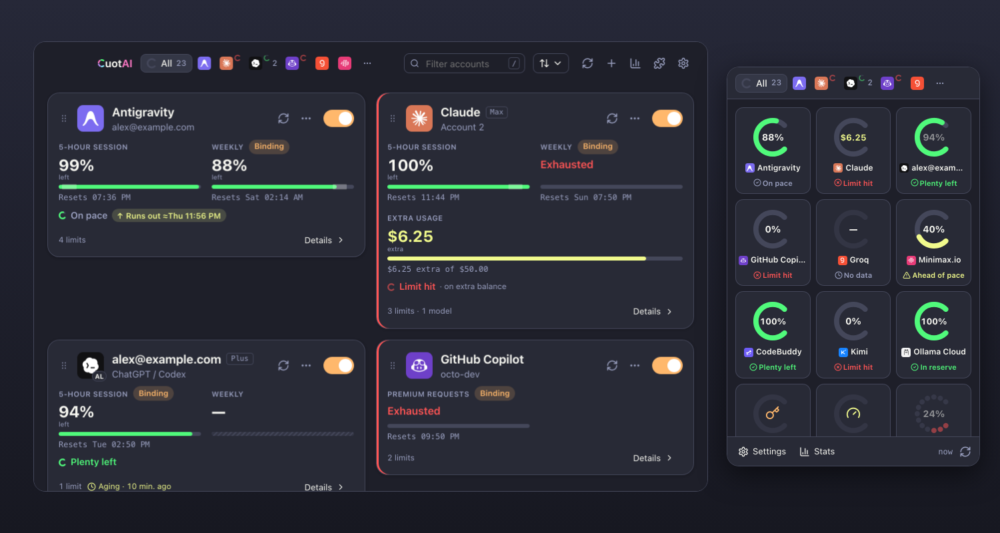
  
<em>The main window and the tray popover, shown here with made-up demo accounts.</em>

---

## What is Cuotai?

If you work with several AI assistants and APIs, you probably hop between dashboards to find out how much is left of the 5-hour window, the weekly quota or the monthly budget. **Cuotai puts all of it in one place** and keeps it fresh in the background, so you know before a limit stops you.

**Why the name?** Cuotai comes from *cuota*, how many Portuguese speakers say "quota", plus *AI*, which is why the logo sets it apart: it keeps an eye on the quotas, usage limits and costs of your AI providers. Its four-color C is a gauge that is never quite closed, the same ring that shows how much quota each account has left.

It is made for developers, teams and heavy users of coding assistants and AI APIs who juggle more than one subscription or key.

**What you get**

- **Every limit in one window.** One card per account with its 5-hour, weekly and monthly windows, rate limits, balances and spend, each with its reset time. **42 services** are supported, including Claude, ChatGPT / Codex, GitHub Copilot, Cursor, Gemini, Kiro, Windsurf, the OpenAI and Anthropic admin APIs, AWS Bedrock and Azure OpenAI ([full list](#supported-services)).
- **Pace and "runs out" warnings.** Cuotai compares what you used with a steady pace until the reset and tells you whether you are on track ("8 points in reserve") or will run out early ("runs out at 16:40, 2h 10m before the reset").
- **Paid extra usage.** When an account keeps working past its plan and bills the excess (Claude extra usage, Cursor and Grok on-demand, Kiro overage), Cuotai shows the spend apart from the plan limits. It only reads; it never changes billing settings.
- **Alerts that matter.** Optional system notifications when a quota resets, crosses a threshold you choose, runs out or has room again (and, if you turn it on, a warning 15, 30 or 60 minutes before the recent pace would run a quota out: a linear estimate from recent readings), with quiet hours, texts that leave account names out, and optional channels you own (webhook, ntfy, Slack, Discord).
- **Which account has room right now.** Put accounts that can replace each other in a group and Cuotai marks the best one, as advice only: it never switches accounts for you.
- **History and local cost.** Charts of each quota over 24 hours, 7 days or 30 days, and an optional estimate of what your Claude Code, Codex CLI and Gemini CLI token use would cost at API prices, read from your own local logs.
- **Fed by the agent itself.** Claude Code's status line and Codex CLI's local logs can feed your Claude and Codex accounts with no network request, and show each live session's context share and cost estimate.
- **Careful with paid queries.** Services that bill per query (AWS Bedrock through Cost Explorer) are read once an hour by default, shared by every Cuotai window and command. Refreshing such a card by hand is a billed query that asks first and runs at most every 15 minutes; before that, Cuotai says when the next one is possible.
- **Private by design.** Cuotai is read-only and spends no tokens: it asks your providers only for quota and billing numbers. Sign-ins and keys stay in your system's vault (macOS Keychain, Windows Credential Manager, Linux Secret Service), the settings file never holds a secret, and there is no Cuotai account or cloud service in the middle ([privacy inventory](docs/privacy.md)).
- **Your own gateways too.** A self-hosted 9router or LiteLLM proxy shows each connection inside it as a card of its own.
- **Runs where you work.** Windows, macOS and Linux, with a tray or menu-bar popover for a quick look, plus a terminal dashboard and a command line for scripts (`--json`, a local HTTP server, `--watch` hooks, status-bar recipes and extensions).
- **Yours to shape.** 15 built-in themes in dark and light, your own themes, and an interface in 14 languages.
- **Free and open source**, under the MIT or Apache-2.0 license.

## Install

Every release is on [GitHub Releases](https://github.com/jmarcon/cuotai/releases), the Homebrew tap and the Scoop bucket.

| System | Direct download | Package manager |
|---|---|---|
| **macOS** (Apple silicon and Intel) | `.dmg` from [Releases](https://github.com/jmarcon/cuotai/releases), signed and notarized | `brew tap jmarcon/cuotai && brew trust jmarcon/cuotai`, then `brew install --cask jmarcon/cuotai/cuotai-app` |
| **Windows** (x64, optional ARM64) | `.exe` or `.msi` from [Releases](https://github.com/jmarcon/cuotai/releases) | winget (coming soon) |
| **Linux** (x64, optional ARM64) | `.deb`, `.rpm` or `.AppImage` from [Releases](https://github.com/jmarcon/cuotai/releases) | AUR (coming soon) |
| **Terminal only**, any system | CLI archive from [Releases](https://github.com/jmarcon/cuotai/releases) | Homebrew (macOS): `brew install jmarcon/cuotai/cuotai` (after the tap and trust steps); Scoop (Windows): `scoop bucket add cuotai https://github.com/jmarcon/scoop-cuotai`, then `scoop install cuotai/cuotai`; or `cargo install --git https://github.com/jmarcon/cuotai --tag vX.Y.Z cuotai-tui --locked`, with `vX.Y.Z` the [latest release](https://github.com/jmarcon/cuotai/releases/latest) tag |

**Supported systems:** macOS 12 (Monterey) or later (the widgets need macOS 14 Sonoma), Windows 11, and Linux with the glibc of Ubuntu 22.04 or newer. Windows 10 should work but is untested.

You can also [build from source](docs/building.md). [`docs/installing.md`](docs/installing.md) has the status of every channel, what each download contains and how to uninstall (your accounts file, history and vault entries stay until you delete them).

**Good to know**

- **Windows.** The installers are **not code-signed yet**, so SmartScreen warns about an "unknown publisher": choose **More info**, then **Run anyway** ([details](docs/gui-windows.md#first-launch-and-smartscreen)).
- **macOS.** If a build is ever not notarized, macOS blocks it the first time: open **System Settings › Privacy & Security** and choose **Open Anyway** ([details](docs/gui-macos.md#first-launch-and-gatekeeper)). Each release's notes say what is signed.
- **Linux.** The `.deb` and `.rpm` pull in the libraries they need. On GNOME, the tray icon needs the AppIndicator extension ([details](docs/gui-linux.md#tray-icon)).
- **Verify what you downloaded** with the signed `SHA256SUMS` and the build provenance of every release ([how](docs/installing.md#verify-your-download)).

## A tour of the desktop app

Open Cuotai, press **Add account**, pick a provider and either sign in with your browser or paste your API key. Cuotai checks it with the provider, keeps it in your system's vault and refreshes in the background from then on.

  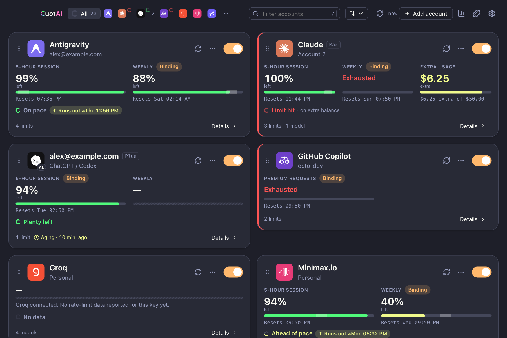

| Where | What you see |
|---|---|
| **Dashboard** | One card per account, in your order or "most restrictive first", with the limit that blocks you right now, the pace and how old each reading is. |
| **Tray or menu bar** | Left click opens a popover in a list, rings or compact view; right click opens a quick menu. The menu-bar title can show your tightest limit. Closing the window keeps Cuotai running there. |
| **Account details** | Every window with its bar, reset time and pace mark, a history chart, per-quota hide and mute, and the provider's model catalog. |
| **Stats** | Limit hits, average peak, extra spent, peak per day and when each limit comes back, from the history kept on your computer. |
| **Settings** | General (theme, language, startup), Dashboard, Menu bar, Alerts, Data & privacy, and under Advanced: Integrations, Local cost, Extensions and Files. |

  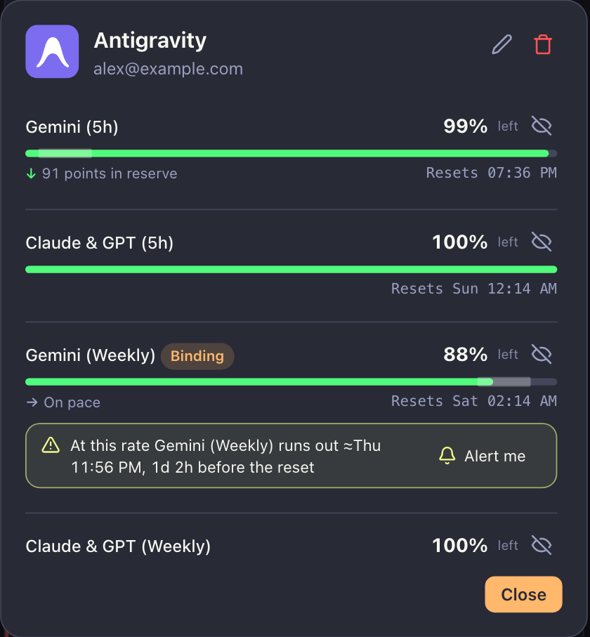
  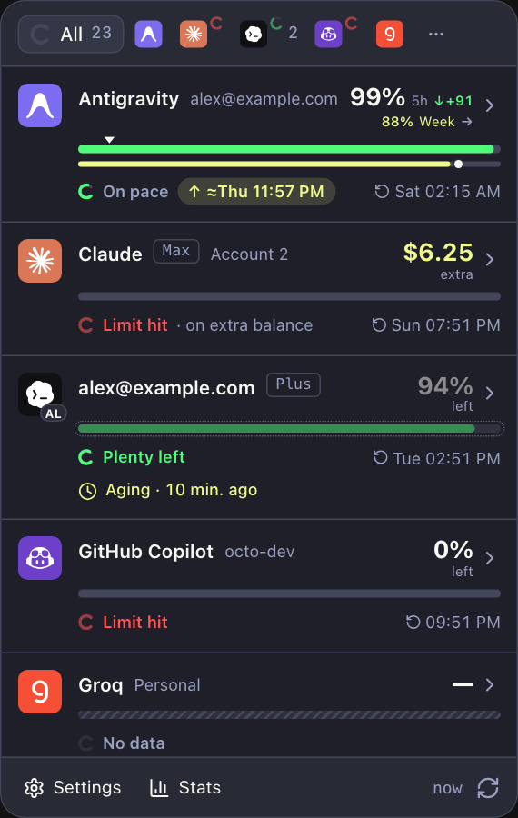

Guides with screenshots, file locations, notification permissions and uninstall steps: [macOS](docs/gui-macos.md) · [Windows](docs/gui-windows.md) · [Linux](docs/gui-linux.md). Every feature and setting is in the [desktop feature reference](docs/gui-features.md).

## Terminal dashboard

Prefer to stay in the terminal? The same engine powers an interactive dashboard with keyboard and mouse support, instant filtering and a built-in account wizard. Run `cuotai`, press `a` to add an account, and use `--once` or `--json` for scripts and status bars.

  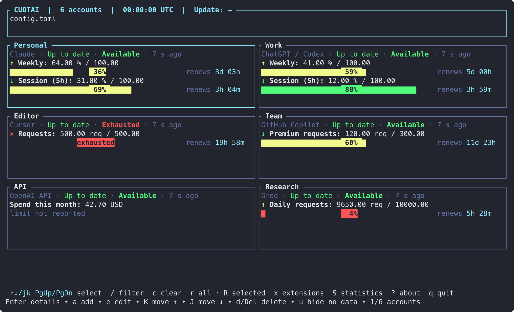
  
<em>The terminal dashboard in English, with placeholder accounts. Its captions follow your language.</em>

Keyboard shortcuts, the account wizard, filters, the command line and its exit codes are in the [terminal guide](docs/tui.md); scripting recipes (`--json`, `--serve`, `--watch`, hooks, history and cost commands) are in [advanced usage](docs/advanced.md).

## Themes

Fifteen built-in themes, every one with a dark and a light mode. The picker and the mode switch (system, light, dark) are in **Settings › General**.

<table>
  <tr>
    <td align="center">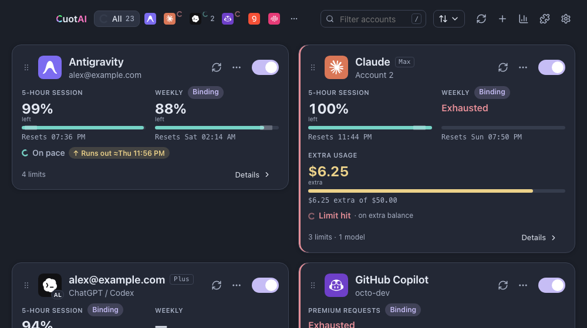 Cuotai, dark (the app's own theme, default for new installs)</td>
    <td align="center">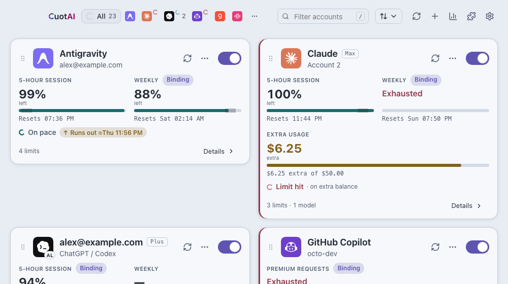 Cuotai, light</td>
    <td align="center">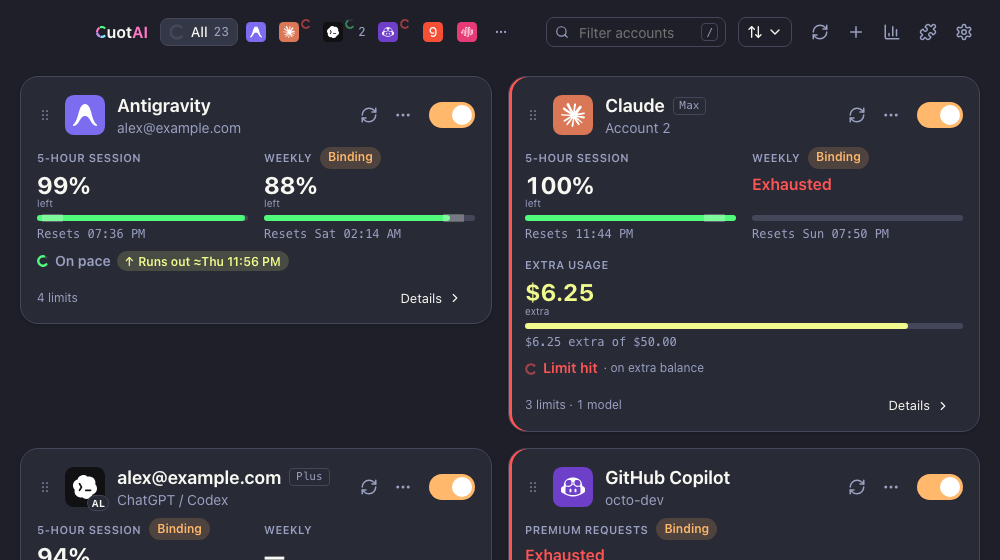 Dracula</td>
  </tr>
  <tr>
    <td align="center">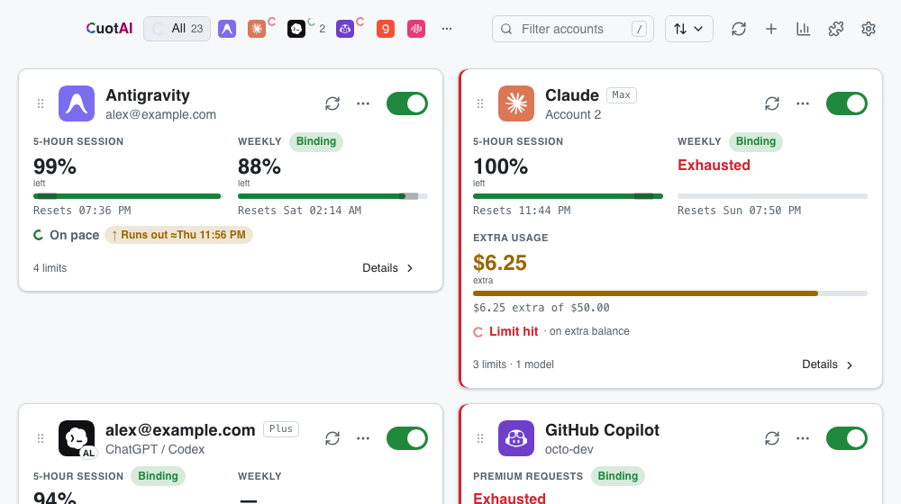 GitHub, light</td>
    <td align="center">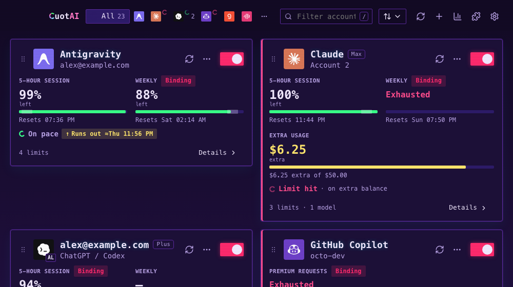 Old Terminal (synthwave)</td>
    <td align="center">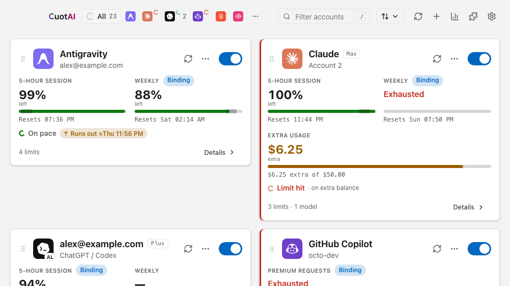 Windows 11, light</td>
  </tr>
</table>

See all of them, in both modes, and learn how to add your own in [`docs/themes.md`](docs/themes.md).

## Supported services

Cuotai ships **42 integrations**. For what each one reads, the credential it needs and its limitations, see [`docs/providers.md`](docs/providers.md).

| Category | Services |
|---|---|
| **Assistants and subscriptions** | Claude, OpenAI Codex / ChatGPT, GitHub Copilot, Cursor (personal and Teams), Windsurf, Kiro / AWS, Antigravity, Cline, Zed, CodeBuddy, Qoder, OpenCode Go |
| **CLIs and coding plans** | Gemini CLI, Grok CLI / xAI, Kimi Coding and API, MiniMax Token / Coding Plan, Alibaba Coding Plan, Alibaba Token Plan / Qwen Cloud, Xiaomi MiMo, Ollama Cloud, Qwen Code |
| **Cloud billing and admin APIs** | OpenAI Admin API, Anthropic Admin API, Google Gemini API Monitoring, Google Vertex AI, AWS Bedrock Cost Explorer, Azure OpenAI Cost Management, Alibaba Cloud BSS, Mistral Admin, Perplexity Computer Analytics, Kimchi, Groq, ElevenLabs, Meta Model API, JetBrains AI (organization) |
| **Aggregators and routers** | OpenRouter; 9router and LiteLLM proxy (the quotas or budgets of the connections inside your own instance) |
| **Additional catalog** | Alibaba Model Studio, Cloudflare AI, NVIDIA NIM, Poolside |

Some providers expose usage only through interfaces the vendor does not document, and AWS Cost Explorer costs money per query; [`docs/providers.md`](docs/providers.md) records how each integration is read and how far to trust it.

## Help Cuotai grow

Cuotai is a one-person, open-source project and every bit of help counts. Support happens on GitHub:

- **Star the repository** so more people find it.
- **Get help.** [`SUPPORT.md`](SUPPORT.md) says where to ask and what response to expect.
- **Report a bug or ask for something** in [Issues](https://github.com/jmarcon/cuotai/issues). There are templates for bugs, provider problems and **new provider requests** (tell us which service you need and what its usage page or API looks like). Use [private reporting](SECURITY.md) for security issues, and never paste a real key or token.
- **Translate or improve a language.** The interface is available in 14 languages, and you can add another one as a single JSON file ([how](apps/desktop/ui/locales/README.md)). English is the source language: every text is written in English first and translated from it. Ten languages are machine drafts, so a native speaker's proofreading is the most useful help you can give.
- **Contribute a theme, a fix or a provider.** Read [`CONTRIBUTING.md`](CONTRIBUTING.md) first.
- **Tell others** if it saved you from hitting a limit mid-task.

There is no sponsorship page yet; if one appears it will be linked here.

## Documentation

All technical documentation lives in **[`docs/`](docs/)**.

**Using the app**

- [Cuotai on macOS](docs/gui-macos.md) · [on Windows](docs/gui-windows.md) · [on Linux](docs/gui-linux.md): install, first run, system specifics, uninstall.
- [Desktop feature reference](docs/gui-features.md): every desktop feature and setting.
- [Themes](docs/themes.md): the gallery and how to add your own.
- [Installing and verifying](docs/installing.md): channels and their status, verifying a download, uninstalling.
- [Terminal dashboard, command line and account wizard](docs/tui.md): shortcuts, wizard, configuration precedence, exit codes.
- [Providers, credentials and limitations](docs/providers.md) and [native sign-in and the vault](docs/oauth.md).
- [Platform support](docs/platforms.md): what works on macOS, Windows and Linux.
- [Privacy and data inventory](docs/privacy.md): every network flow Cuotai can start and every file and vault entry it keeps, with how to erase them.

**Automation and integration**

- [Advanced usage](docs/advanced.md): the configuration file, JSON output, local cost and history from the command line.
- [Local HTTP server](docs/local-server.md), [notification channels (webhook, ntfy, Slack, Discord)](docs/notifications.md), [events and `--watch` hooks](docs/events.md), [export contract v1](docs/export-v1.md), [executable extensions](docs/extensions.md) and [system widgets](docs/widgets.md).
- [Configuration example](cuotai.example.toml): a commented reference of every account and TOML parameter; [the accounts file across versions](docs/configuration.md) and [local state and downgrades](docs/local-state.md).

**For contributors and maintainers**

- [Building from source](docs/building.md) and [architecture, Rust library and verification](docs/architecture.md).
- [Desktop shell notes](apps/desktop/README.md).
- [Roadmap and product plans](docs/plans/0000_control.md), [changelog](CHANGELOG.md).
- [Releasing](docs/releasing.md), [release policy](docs/release-policy.md), [updater security](docs/updater-security.md) and [package-manager templates](packaging/README.md).

## License

Cuotai is distributed under the terms of either the [MIT license](LICENSE-MIT) or the [Apache License, Version 2.0](LICENSE-APACHE), at your option. Third-party notices are in [`THIRD_PARTY_NOTICES`](THIRD_PARTY_NOTICES).

Unless you explicitly state otherwise, any contribution intentionally submitted for inclusion in Cuotai, as defined in the Apache-2.0 license, is dual licensed as above, without any additional terms or conditions.
