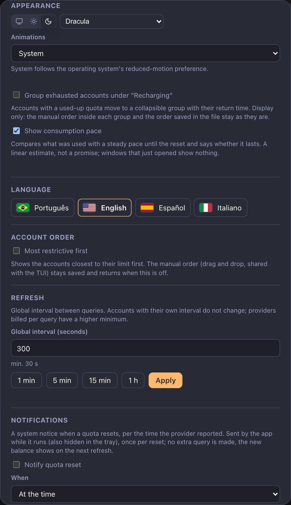
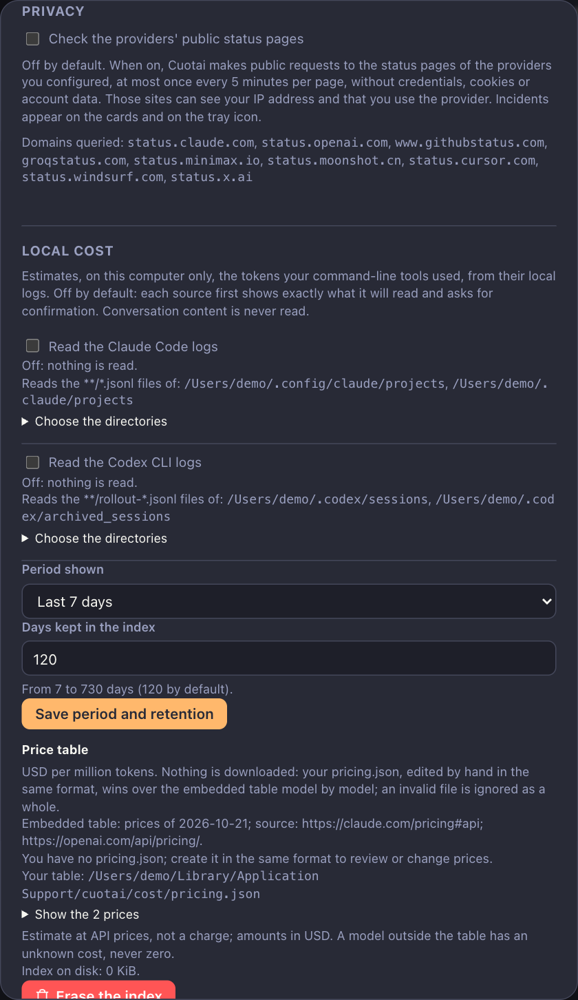
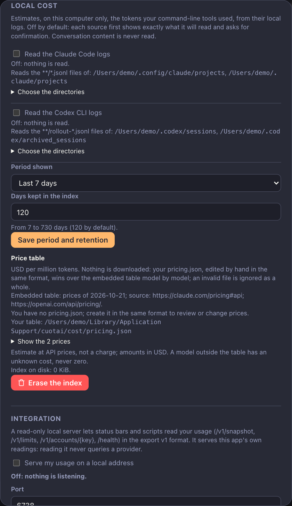
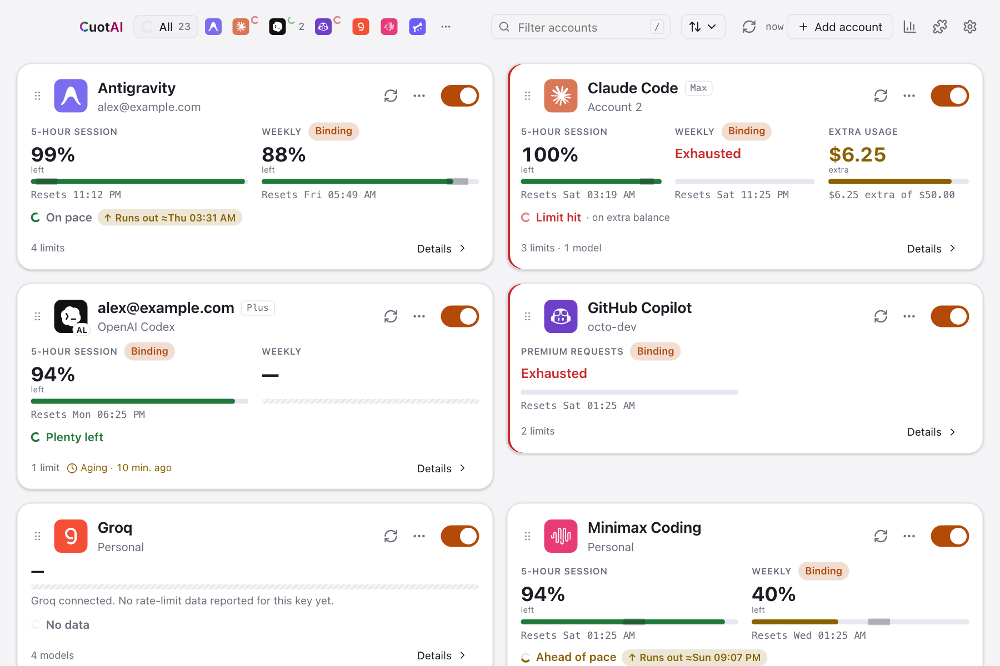

# Desktop app: feature reference

This is the complete list of what the Cuotai desktop app does today, with every setting that changes its behavior. For installation and first steps on your system, start with the guide for your operating system: [macOS](gui-macos.md), [Windows](gui-windows.md) or [Linux](gui-linux.md). Screenshots here show the browser demo of the interface with made-up accounts (`example.com` addresses), not real data.

Everything the app shows comes from `cuotai-core`, the same engine the terminal dashboard and the command line use. The app is read-only: it asks your providers for quota, usage and billing numbers and never sends a request that spends credits.

  
  
<em>The main window: one card per account, each highlighting its most restrictive limit.</em>

**Settings** opens in a window of its own, beside the dashboard, so a change shows in the main window and the tray at once. Open it with the gear in the main window or the tray popover, **Settings** in the tray menu, or `⌘,` (macOS) / `Ctrl+,` (Windows, Linux); opening it again brings the same window to the front. A sidebar lists its pages: **General**, **Dashboard**, **Alerts**, **Data & privacy**, an **Advanced** group (**Integrations**, **Local cost**, **Files**) and **About**. The window remembers its size, position and last page.

## Contents

- [Dashboard and background refresh](#dashboard-and-background-refresh)
- [Consumption pace](#consumption-pace)
- [Reset notices and usage alerts](#reset-notices-and-usage-alerts)
- [Providers' public status](#providers-public-status)
- [How each account's usage is read](#how-each-accounts-usage-is-read)
- [Account details and history](#account-details-and-history)
- [Local cost](#local-cost)
- [Tray popover and tray menu](#tray-popover-and-tray-menu)
- [Themes and languages](#themes-and-languages)
- [Integration: local server and hooks](#integration-local-server-and-hooks)

## Dashboard and background refresh

The desktop app watches your accounts in the background with incremental per-account scheduling, drag-and-drop reordering (synced with the TUI) and immediate visual alerts when a quota needs attention or runs out. Each account highlights its most restrictive limit: the tray ring and a `Week · 100%` chip on the card follow the window that blocks you (a weekly limit at 100% wins over a free 5-hour window), the list says "Blocked until 14:30", and Settings offers an optional "Most restrictive first" order that leaves your manual order untouched. Every card, tray entry and menu line also says how old its reading is ("Fresh · 3 min ago", "Aging", "Stale"), and the tray icon tooltip names the oldest one. When a query fails after a success, the card keeps the last valid numbers, dimmed, with a "Stale · 42 min ago" badge and the cause of the failure, until the next successful query; an authentication failure drops them.

**Settings › Dashboard** can also group exhausted or blocked accounts in a collapsible "Recharging" section that shows each return time ("Returns Today 14:30", or "Return unknown"). It is off by default and only changes the display: the manual order holds inside each group and the order saved in `cuotai.toml` never changes.

  
  
<em>Settings → Appearance: color mode, theme, animations, the "Recharging" group and the consumption pace.</em>

## Consumption pace

Cards, details and the tray also show the **consumption pace until the reset**: whether what you used so far lasts at a steady rate ("Week: 8 points in reserve · lasts until the reset") or runs out early ("runs out at 16:40, 2h 10m before the reset"), with an "Expected 47% used" mark drawn over each bar in the details. It is a linear estimate, not a promise; windows that just opened, rolling rate limits and metrics without a reset time show nothing. **Settings › Dashboard › Show consumption pace** hides it (on by default).

The TUI shows it too: a stage icon (`↓` in reserve, `→` on pace, `↑` above the pace, `✕` limit reached) before each eligible metric on the cards, a pace line per metric in the details, and a `Ritmo:` line under each eligible metric in `--once` (see [the TUI guide](tui.md)). `--json` is unchanged.

## Reset notices and usage alerts

**Settings › Alerts** can send a **system notification when a quota resets** (off by default; turning it on asks the system for permission, and a refusal keeps it off with guidance on allowing Cuotai in the system settings). Choose the moment (at the time, or 5, 15 or 60 minutes before), the filter (only if used, only if exhausted, always) and whether "other" windows count; **Send test notification** checks that notices arrive. The app schedules the notices itself, so they come with the window hidden in the tray, but not with the app closed. Each reset is notified once, even across restarts (`<OS local data dir>/cuotai/notified.json` keeps only digests and dates, for 8 days); a reset missed by more than 10 minutes while the app was closed or asleep is not notified late, and several resets of an account at once become one notice. A notice never queries the provider: it follows the time the provider reported and the new balance shows on the next refresh. Its text names only the provider, the account and the metrics, in the language chosen in the app. Each card and its details get a bell to silence one account; the choice is kept per provider and account name in `desktop.json`, so renaming an account turns its bell back on. The tray menu, its tooltip and the tray popover show the next notice ("Next notice: Claude 5h · today, 14:30").

The same section turns on **usage alerts** (off by default, with the same permission request and test button): a system notification when a quota with a limit reaches a threshold of use ("Claude: 90% of the 5-hour window used", with the account, the quota and its reset time), runs out (**Notify exhaustion**) or has slack again in the next window after running out (**Notify recovery**). The thresholds are chips from 10 to 99% (75 and 90 by default); each one notifies once per window, oscillating around it stays silent, and it re-arms only after use falls 5 points below it or a new window starts. Balances, spend, rate limits and missing values never alert, and no alert queries a provider: the app judges each reading its refresh already took, also with the window hidden in the tray. An account's alerts of one refresh become one notification, at most one notification goes out per minute (the rest are grouped into the next), and nothing is resent after a restart (the alert state joins `notified.json`, digests and dates only). The account's bell silences its alerts too, and each quota can be muted from the account details; the card, the tray and the details highlight an account with an active alert. Preferences live in `desktop.json`, never in `cuotai.toml`.

  
  
<em>Settings → Notifications (and, below it, History).</em>

## Providers' public status

**Settings › Data & privacy** can show the **providers' public status** (off by default). Turned on, the app reads the public status pages of the providers you configured (the section lists their domains; each page at most once every 5 minutes, without credentials, cookies or account data, though those sites see your IP address and that you use the provider). A card then shows a colored badge with an icon and text when its provider reports degraded performance, a partial or major outage or maintenance, or when its status page could not be read, with **Open status page**; the details show the full status and when it was read, the tray popover lists the affected providers, and the tray icon gets a red dot while any of them reports a partial outage or worse. Providers without a verified public source never show as operational. A failed query during an incident says the failure may not be from your account.

The TUI and the CLI read the same status only when you ask (`--status`, or `CUOTAI_STATUS=1` in the environment); `--no-status` always turns it off, also in scripts that inherit the variable. A card then shows the badge on its top border (`▲ Interrupção parcial`, `? Página de status indisponível`), the details list the provider's full status with the incident, its start, when it was read and the page, and `--once` prints a `Status do provedor:` line under the affected account. `--json` keeps its shape.

  
  
<em>Settings → Privacy: the provider status switch lists the domains it would read.</em>

## How each account's usage is read

Every card and its details also say, discreetly, **how that account's usage is read**: `Official` (an interface the vendor documents), `Undocumented` (an internal interface that may change without notice), `Derived` (inferred from metrics or rate-limit headers) or `Unavailable` (no usage query exists), with a one-line summary. An `Unavailable` account shows why instead of a generic error, and when an undocumented interface stops matching, the card says it may have changed and names the public contract Cuotai follows. The same levels appear when you add an account. The per-provider matrix is in [`providers.md`](providers.md#usage-access-matrix).

## Account details and history

The magnifier on a card opens the account details: every quota with its bar, the pace mark, the reset time, buttons to hide or mute a single quota, the models catalog and the history.

  
  
<em>Account details: every window with its pace mark and reset time.</em>

Every successful reading (TUI, desktop app, `--once`, `--json`, `--json-v1`, `--serve` and `--watch`) also enters a local measurement history on this computer only: `<OS local data dir>/cuotai/history/history.sqlite3`, private to your user, holding numbers and window metadata, never credentials, account names or provider text. On opening, each account shows its last recorded reading, marked stale, until the first query answers, and the consumption pace projects from the recent slope. The history keeps 90 days by default (`--history-days 7…365` on the command line, **Settings › Data & privacy** on the desktop), keeps one sample per hour after 7 days (each window's peak stays) and stays under 64 MiB, warning when it had to delete old samples. The desktop account details draw an area chart of each metric over the last 24 hours, 7 days or 30 days, with the last reading highlighted and a marker at each reset (and a table for screen readers); **Settings › Data & privacy** turns recording off (on by default; what was recorded stays until you erase it), shows the size on disk, exports to CSV or JSON and erases one account's history or all of it, after a confirmation. The TUI account details draw a sparkline of each metric over the last 24 hours, 7 days or 30 days (keys `1`, `2`, `3`), and `--history [ACCOUNT]` prints the recorded series (`--json` for scripts; `--history-days` picks the days shown, 7 by default).

## Local cost

**Settings › Advanced › Local cost** reads the local session logs of Claude Code and Codex CLI to count their tokens per day and per model, off by default and per source: turning a source on first shows a dialog with exactly the directories read, what for and that only numbers (time, model, token counts, an anonymous session digest) are extracted, and nothing is read until you accept it. A low-priority background scan then reads only what grew, pauses in energy-saving mode and never delays the quota refresh; the section shows what it found (logs followed, invalid lines ignored, or no access), the period shown and the index retention (120 days by default), and turning a source off or **Erase the index** removes everything derived. The same sources are managed with `cuotai --cost-*` (see [`advanced.md`](advanced.md#local-cost-from-the-command-line)); the estimated cost at API prices arrives with PRD 0015 RF3 and RF4.

  
  
<em>Settings → Local cost (and, below it, Integration).</em>

## Tray popover and tray menu

Closing the main window only hides it: Cuotai keeps running and refreshing from the tray (macOS menu bar, Windows notification area, Linux status notifier). A left click on the tray icon opens a quick popover; a right click opens a native text menu with the accounts and actions. The popover offers a donut view (more accounts per screen) or a list view, a sort control, a refresh button, the language flag, and a footer that summarizes alerts and failures. It closes when it loses focus.

  
  
  
<em>The tray popover in the donut view and in the list view.</em>

The tray icon, its tooltip, the right-click menu and the popover also carry the update notice ("Update 0.72.0 available"), the next reset notice and, when status is on, the red outage dot. Details that depend on the operating system are in the platform guides.

## Themes and languages

The app ships 15 themes, each with a dark and a light mode, and follows the system appearance by default. The interface is available in Portuguese, English, Spanish and Italian, and you can add your own themes and languages without recompiling. See [`themes.md`](themes.md) for every built-in theme and how to add yours.

  
  
<em>The same window in light mode.</em>

## Integration: local server and hooks

**Settings › Advanced › Integrations** runs the same read-only **local server** as `cuotai --serve` from inside the app, off by default. Turned on, it listens on `127.0.0.1` only, on exactly the port you choose (6738 by default), and serves this app's own readings (`/health`, `/v1/snapshot`, `/v1/accounts/{key}`, `/v1/limits`), so reading it never queries a provider. The section shows the effective address (with **Copy address**) or why it is not serving; a taken port, for example by a `cuotai --serve` already running, is named as such there and in a banner on the main window. **Generate token** keeps a bearer token in the system vault (never in the TOML) and requires it; **Copy token** copies it without showing it, **Generate new token** stops the old one at once and **Revoke token** removes it. **Allow web browsers** asks for confirmation first, because any page open in your browser could then read your usage. See [the local server guide](local-server.md).

**Settings › Advanced › Integrations › Hooks** runs your own commands on account events from inside the app, off by default: an editor for the rules of the `hooks.toml` next to the accounts' file (name, events and the command as one field per argument, never a shell string), shared with `cuotai --watch --hooks`. Turning hooks on, or saving changed rules while they are on, shows a dialog with the exact commands, and nothing runs until you confirm it. The confirmed rules run on the events of the app's own readings (no extra query); **Test** sends a rule a sample event marked `"sample": true`, **Latest runs** lists the local run log, and a file changed outside the app asks again (with a banner on the main window). See [`events.md`](events.md#hooks-in-the-desktop-app).

Other desktop details (the accounts file, the add-account dialog, the Models section, configuration conflicts, how the shell is built) are in [`apps/desktop/README.md`](../apps/desktop/README.md).
