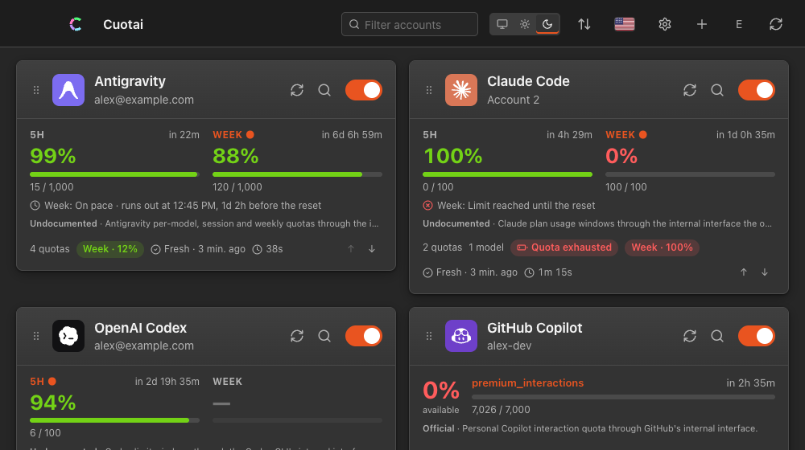
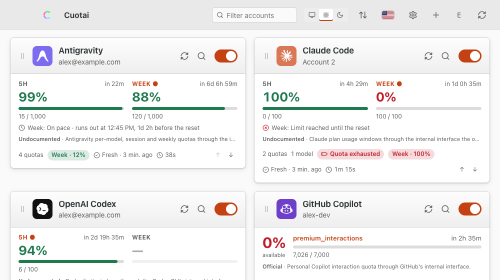

# Cuotai on Linux

A walkthrough of the Cuotai desktop app on Linux: installing it, adding accounts, the tray icon, notifications, the Secret Service credential vault and where everything is stored. The features themselves are described in full in the [desktop feature reference](gui-features.md); this page covers what is specific to Linux. Screenshots show the browser demo with made-up accounts, here with the app's "Ubuntu" theme (it imitates a desktop look; it is not a native capture).

<div align="center">
  
  
</div>

## Install

Cuotai is pre-release: the first packaged release is not published yet, so check [`installing.md`](installing.md#channel-status) for what is live. When it is:

- **Debian, Ubuntu and derivatives:** download `Cuotai_<version>_amd64.deb` from [GitHub Releases](https://github.com/jmarcon/cuotai/releases) and run `sudo apt install ./Cuotai_<version>_amd64.deb`; apt installs the libraries the package declares.
- **Fedora and derivatives:** download `Cuotai_<version>_amd64.rpm` and run `sudo dnf install ./Cuotai_<version>_amd64.rpm`.
- **Arch:** `yay -S cuotai-bin` from the AUR (planned, not live yet; it repackages the release `.deb`).
- **Any distribution:** `Cuotai_<version>_amd64.AppImage`: `chmod +x` it and run it. Some distributions need FUSE 2 installed to run AppImages. ARM64 PCs use the `_aarch64` files when the release includes them.
- **Terminal version only:** the `cuotai-<version>-x86_64-unknown-linux-gnu.tar.gz` (or `-musl`) archive, Homebrew (`brew install jmarcon/cuotai/cuotai`, planned) or `cargo install`.
- **From source today:** see [`building.md`](building.md#desktop-app-tauri).

[Verify the download](installing.md#verify-your-download) first if you like (`sha256sum -c` also works instead of `shasum -a 256 -c`). The Linux files are not individually signed; trust comes from the signed `SHA256SUMS`.

## Add your first account

1. Press **Add account** (or the **+** in the top bar).
2. Choose the **provider** and give the account a unique **name**.
3. Choose how to authenticate. Where the provider supports it, pick **browser sign-in** and press **Sign in**: Cuotai opens your browser with `xdg-open` (if that fails it shows the address to copy), you approve, and the token is stored in the Secret Service keyring. Otherwise, type the **name** of an environment variable that holds the key.
4. Press **Save**. The card appears and fills in on the next refresh.

> **Environment variables.** An app started from the application menu does not inherit variables you `export` in a shell. Either use the browser sign-in, start Cuotai from a terminal where the variable is exported, or define it for your whole session (for example in `~/.config/environment.d/cuotai.conf` as `NAME=value`, then log out and back in).

## The dashboard

<div align="center">
  
</div>

Each card shows an account's windows (5-hour, weekly, monthly), the percentage still available, the reset time, the pace line, how old the reading is and badges such as "Quota exhausted". Drag the handle to reorder accounts, use the toggle to pause one, the refresh button to query one now, and the filter box to search. The toolbar has the color mode, the sort menu, the language flag, Settings, Add account and Refresh all.

## Tray icon

Cuotai lives in the **system tray** through a status-notifier (AppIndicator) icon. Closing the main window only hides it: the app keeps running and refreshing.

- **KDE Plasma, XFCE, Cinnamon, MATE, Budgie** and most other desktops show the icon out of the box.
- **GNOME** removed the legacy tray, so the icon only appears if you install an AppIndicator extension, for example **AppIndicator and KStatusNotifierItem Support** (`gnome-shell-extension-appindicator`), and enable it. Without it, the app still runs but you have no tray icon: open it from the application menu, or enable the extension. Cuotai loads the AppIndicator library at run time, and if tray creation fails the app stops at start-up with the error instead of running invisibly.
- **Left click** the icon: the popover with one ring per account (donut view) or a list. The footer chips count failures, authentication problems and exhausted quotas. It closes when you click elsewhere. Some desktops only show the context menu on any click; if so use its **Open** entry.
- **Right click**: a text menu with each account's state, the next reset notice, **Open**, **Settings** and **Quit**.
- The icon's **tooltip** names the oldest reading (where the desktop shows tooltips), and a **red dot** means a provider you use reports a partial or major outage (only if you turned provider status on).
- **Quit** from that menu stops Cuotai and its notifications for good.

<div align="center">
  
  
</div>

The panel and the native menu are drawn by your desktop, so they do not appear in the screenshots; the popover above is the app's own window.

## Widgets

Cuotai ships no native Linux widget. With **Settings → Widgets** on, the app writes `~/.local/share/cuotai/widget.json`, and panels read it. [widgets.md](widgets.md#linux-waybar) has an example **Waybar** module, a short `jq` script:

<div align="center">
  
</div>

That is a real Waybar screenshot (headless sway, example data). There is no GNOME Shell extension or Plasma widget; a panel tool that shows a command's output can run the same script.

## Details, history and local cost

The magnifier on a card opens the details: each window with its bar, expected-use mark and reset time, a history chart (24 hours, 7 or 30 days), quota hide/mute buttons and the model catalog. **Settings → Local cost** can count Claude Code and Codex CLI tokens from their local logs (`~/.config/claude`, `~/.claude` or `CLAUDE_CONFIG_DIR`, and `~/.codex` or `CODEX_HOME`), only after you accept a dialog that lists the exact folders.

<div align="center">
  
  
</div>

## Notifications

Turn them on in **Settings → Notifications** (reset notices, and optionally usage alerts with thresholds, exhaustion and recovery). Notifications go through the desktop's notification service over D-Bus, so a notification daemon must be running (every mainstream desktop environment ships one). Turning a switch on asks the system for permission; if it is refused, the switch stays off and Cuotai tells you where to fix it:

- Check your desktop's notification settings (for example **Settings → Notifications → Cuotai** on GNOME, **System Settings → Notifications** on KDE) and that **Do Not Disturb** is off.
- Press **Send test notification** in Cuotai to confirm they arrive.

Notices come while the window is hidden in the tray, but not after you Quit. The app never queries a provider to notify you.

<div align="center">
  
</div>

## Themes and languages

**Settings → Appearance** has the theme picker, the light/dark/system switch and the animation setting. All [15 themes](themes.md) work in both modes, including an Ubuntu look. The language list (Portuguese, English, Spanish, Italian) is in the same dialog.

## Launch at login

Cuotai has no built-in "start at login" switch. Use your desktop's session settings (GNOME **Tweaks → Startup Applications**, KDE **System Settings → Autostart**), or drop a file such as `~/.config/autostart/cuotai.desktop` with `Type=Application`, `Name=Cuotai` and an `Exec=` line pointing at the installed binary (`/usr/bin/Cuotai` for the `.deb` / `.rpm` packages) or the AppImage.

## Updates

**Settings → Updates** checks once a day (you can turn it off) and sends only the version, system and architecture. Copies installed by a system package (`.deb`, `.rpm`, AUR) are updated by your package manager and the in-app updater shows the manager to use; reinstall the newer package, or fetch the newer AppImage.

## Credential vault: Secret Service

OAuth sign-ins, pasted web sessions and the local-server token are stored through the **Secret Service** API, provided by **GNOME Keyring** or **KWallet** (entries named `cuotai.oauth` and `cuotai.serve`); the accounts file never holds a secret and there is no plaintext fallback. It needs a running D-Bus session and a provider. If none is available, Cuotai says "No Secret Service provider available; start GNOME Keyring or KWallet (with a D-Bus session) and try again." On a minimal window manager, install `gnome-keyring` (or enable KWallet's Secret Service) and start it with your session; until then, environment-variable credentials still work. You can inspect or delete entries with **Passwords and Keys** (Seahorse) or KWalletManager.

## Where things are

| What | Location |
|---|---|
| Accounts file | `~/.config/cuotai/config.toml` (or the file chosen in Settings → Accounts file, or `CUOTAI_CONFIG`) |
| Desktop preferences (`desktop.json`), user themes and languages | `~/.config/cuotai/` (`themes/`, `locales/`; `CUOTAI_USER_DIR` overrides) |
| History, local cost index, notification state, extensions | `~/.local/share/cuotai/` (`history/`, `cost/`, `notified.json`, `extensions/`) |
| Widget snapshot (only if you turn it on) | `~/.local/share/cuotai/widget.json` ([`widgets.md`](widgets.md); readable by Waybar, GNOME and KDE panels) |
| The program | `/usr/bin/Cuotai` for `.deb` / `.rpm` / AUR; wherever you put the AppImage |
| Secrets | Secret Service keyring, entries `cuotai.oauth` and `cuotai.serve` |

The paths follow the XDG base directories when those variables are set.

## Uninstall

Quit Cuotai from the tray menu (or `pkill Cuotai`), then remove it with your package manager: `sudo apt remove cuotai`, `sudo dnf remove cuotai`, `sudo pacman -R cuotai-bin` (the exact package name of the `.deb` / `.rpm` is shown by `dpkg -l | grep -i cuotai` or `rpm -qa | grep -i cuotai`), or just delete the AppImage. That keeps your accounts, history and keyring entries on purpose. To erase them too:

```sh
rm -rf ~/.config/cuotai ~/.local/share/cuotai
```

and delete the `cuotai.oauth` and `cuotai.serve` entries in your keyring tool. See [`installing.md`](installing.md#uninstalling).

## Troubleshooting

- **No tray icon on GNOME.** Install and enable the AppIndicator extension, as above.
- **An account says "missing configuration".** The environment variable it names is not visible to the app; see the note above.
- **"No Secret Service provider available".** Start GNOME Keyring or KWallet in your session.
- **The AppImage does not start.** Install FUSE 2 (`libfuse2`) or run it with `--appimage-extract-and-run`.
- Something else? Open an [issue](https://github.com/jmarcon/cuotai/issues) (never paste a real token), and see [`platforms.md`](platforms.md) for what is verified on Linux; real GNOME and KDE tray behavior is not exercised in CI.
