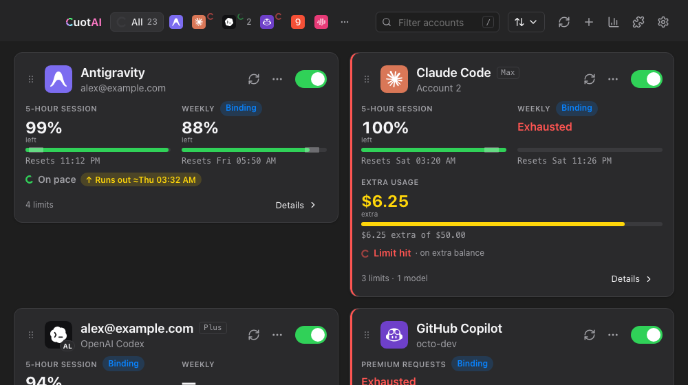
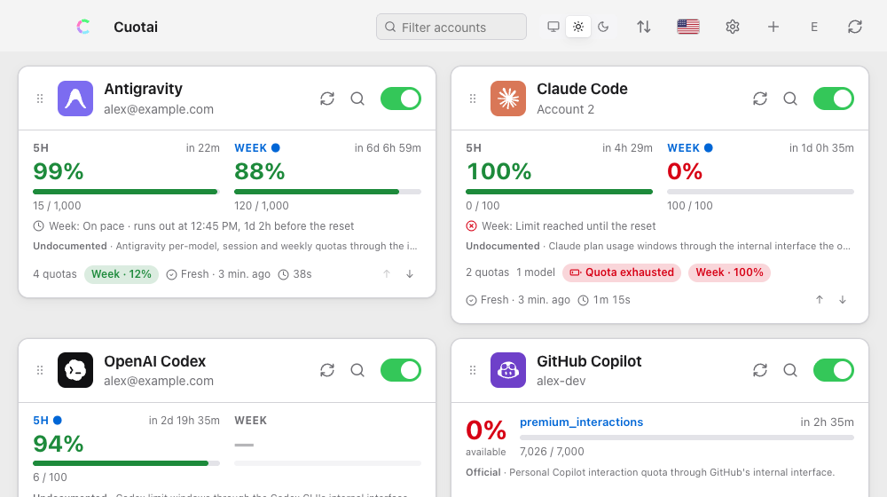
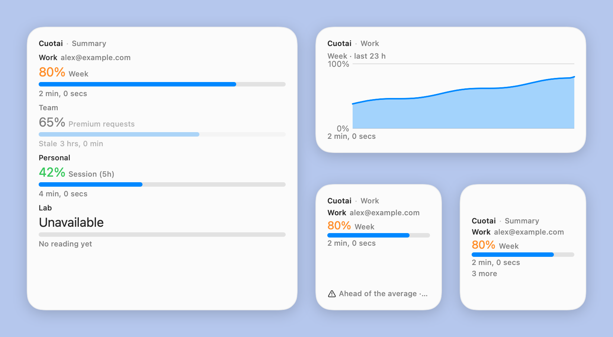
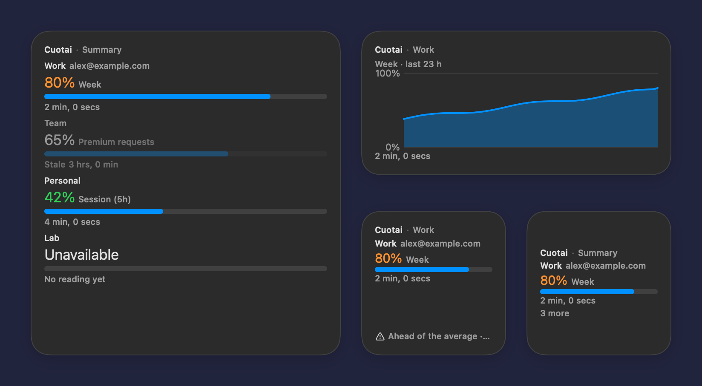

# Cuotai on macOS

A walkthrough of the Cuotai desktop app on macOS: installing it, the first launch, adding accounts, the menu-bar popover, notifications and where everything is stored. The features themselves are described in full in the [desktop feature reference](gui-features.md); this page covers what is specific to macOS. Screenshots show the browser demo with made-up accounts, here with the app's "macOS" theme (it imitates the system look; it is not a native capture).

<div align="center">
  
  
</div>

## Install

Cuotai 0.81.0 is on [GitHub Releases](https://github.com/jmarcon/cuotai/releases) and the Homebrew tap; [`installing.md`](installing.md#channel-status) lists every channel:

- **Homebrew:** `brew install --cask jmarcon/cuotai/cuotai-app`.
- **Direct download:** the `Cuotai_<version>_universal.dmg` from [GitHub Releases](https://github.com/jmarcon/cuotai/releases). It is one universal build for Apple silicon and Intel. Open the disk image and drag **Cuotai** to **Applications**. [Verify the download](installing.md#verify-your-download) first if you like.
- **From source today:** see [`building.md`](building.md#desktop-app-tauri).

### First launch and Gatekeeper

If the release you installed is signed and notarized, it opens like any other app. If its notes say it is **not** (the macOS build is signed and notarized only when the maintainer's Apple credentials were available for that release), macOS blocks it the first time:

1. Try to open Cuotai once, so macOS records the attempt.
2. Open **System Settings → Privacy & Security**, scroll to the message about Cuotai and choose **Open Anyway**; confirm with your password or Touch ID.
3. On older macOS versions you can instead Control-click the app, choose **Open**, and confirm.

You only do this once per installed copy. Cuotai never asks you to disable Gatekeeper.

## Add your first account

1. Press **Add account** (or the **+** in the top bar).
2. Choose the **provider** and give the account a **name** (it must be unique).
3. Choose how to authenticate. Where the provider supports it, pick **browser sign-in** and press **Sign in**: Cuotai opens your browser, you approve, and the token is stored in the Keychain. Otherwise, paste the provider's **API key** (or the token or secret the form asks for) into the masked field (the eye button shows what you typed). Where the provider can be queried, Cuotai checks it with one read-only query before saving, and keeps it in the Keychain; the accounts file stores only a reference. When you edit the account later the key shows as **Saved in the system vault** with a **Replace** button; leave the field blank to keep it. How each provider's usage is read is documented in [`providers.md`](providers.md#usage-access-matrix).
4. Press **Save**. The card appears and fills in on the next refresh.

> **Accounts set up in the terminal.** An account created with the terminal app may read its key from the terminal setup, which an app started from the Dock, Spotlight or Finder usually cannot see. The edit dialog then shows **Key set up in the terminal** and offers **Move key into Cuotai**, which copies the key into the Keychain after you confirm. If the app cannot read it, use **Replace** and paste the key instead.

## The dashboard

<div align="center">
  
</div>

Each card shows an account's windows (5-hour, weekly, monthly), the percentage still available, the reset time, the pace line ("on pace · runs out at 12:44 PM, 1d 2h before the reset"), how old the reading is and badges such as "Quota exhausted". Drag the handle to reorder accounts, use the toggle to pause one, the refresh button to query one now, and the filter box to search. The toolbar has the color mode (system, light, dark), the sort menu, the language flag, Settings, Add account and Refresh all.

## Menu bar

Cuotai lives in the **menu bar**. Closing the main window (red button or Cmd-W) only hides it: the app keeps running and refreshing. The Dock icon stays while it runs.

- **Left click** the menu-bar icon: the popover with one ring per account (donut view) or a list. The footer chips count failures, authentication problems, exhausted quotas and so on. Click an account to open its details, or the buttons at the bottom to open Settings or the main window. The popover closes when you click elsewhere.
- **Right click** (or Control-click): a text menu with each account's state, the next reset notice, **Open**, **Settings** and **Quit**.
- The icon's **tooltip** names the oldest reading, and a **red dot** on the icon means a provider you use reports a partial or major outage (only if you turned provider status on).
- **Quit** from that menu (or Cmd-Q) stops Cuotai and its notifications for good.

<div align="center">
  
  
</div>

The native menu and the system menu bar are drawn by macOS, so they do not appear in the screenshots; the popover above is the app's own window.

## Widgets

Cuotai has three WidgetKit widgets: **Summary** (small, medium, large), **Account** (one pinned account; small, medium) and **History** (medium). They only read the `widget.json` the app writes while **Settings › Advanced › Integrations › Widgets** is on.

<div align="center">
  
  
</div>

The extension ships inside the app, so there is nothing else to install. To add a widget, turn the option on, then right-click the desktop and choose **Edit Widgets**, or open **Edit Widgets** at the bottom of Notification Center, and search for Cuotai. Releases before 0.82.1 embedded an extension that crashed at launch, so the gallery did not list it.

These images are the widgets' SwiftUI views rendered off-screen from an example file, not a desktop capture. Every family, the states and how the images are made are in [widgets.md](widgets.md#widgets).

## Details, history and local cost

The magnifier on a card opens the details: each window with its bar, expected-use mark and reset time, a history chart (24 hours, 7 or 30 days), quota hide/mute buttons and the model catalog. **Settings › Advanced › Local cost** can count Claude Code and Codex CLI tokens from their local logs; on macOS it reads `~/.config/claude` and `~/.claude` (or `CLAUDE_CONFIG_DIR`) and `~/.codex` (or `CODEX_HOME`), only after you accept a dialog that lists the exact folders. If macOS asks whether Cuotai may access files in a protected folder, that is the OS prompt for those directories; declining just leaves the source without data.

<div align="center">
  
  
</div>

## Notifications

Turn them on in **Settings › Alerts** (reset notices, and optionally usage alerts with thresholds, exhaustion and recovery). Turning a switch on makes macOS ask whether Cuotai may send notifications. If you refused, or later changed your mind, the switch stays off and Cuotai tells you where to fix it:

- Open **System Settings → Notifications → Cuotai** and allow notifications (choose Banners or Alerts as you prefer).
- Check that a Focus mode is not silencing them.
- Press **Send test notification** in Cuotai to confirm they arrive.

Notices come while the window is hidden in the menu bar, but not after you Quit. The app never queries a provider to notify you.

<div align="center">
  
</div>

## Themes and languages

**Settings › General** has the theme picker, the light/dark/system switch and the animation setting. All [15 themes](themes.md) work in both modes. The language list (14 languages, each with its flag and its own name) is on the same page; the app follows your system language the first time.

## Launch at login

Turn on **Settings › General › Startup › Open at login**. Cuotai then adds a login item (a LaunchAgent) and starts in the menu bar, without opening its window. The switch shows what macOS reports, so removing the item under **System Settings → General → Login Items & Extensions** turns it off here too. If you move the app, turn the switch off and on again so the item points at the new location.

## Updates

**Settings › About › Updates** checks once a day (you can turn it off) and sends only the version, system and architecture. A Homebrew install is updated with `brew upgrade --cask cuotai-app` and the in-app updater tells you so. An app running from the mounted disk image cannot update itself: drag it to Applications first.

## Credential vault: Keychain

OAuth sign-ins, pasted web sessions and the local-server token are stored in your **login Keychain** (entries named `cuotai.oauth` and `cuotai.serve`); the accounts file never holds a secret and there is no plaintext fallback. The first save may prompt for your login password, and if the Keychain is locked or access is denied Cuotai says so (unlock the login keychain and try again). You can inspect or delete the entries in **Keychain Access**.

## Where things are

| What | Location |
|---|---|
| Accounts file | `~/Library/Application Support/cuotai/config.toml` (or the file chosen in Settings › Advanced › Files, or `CUOTAI_CONFIG`) |
| Desktop preferences (`desktop.json`), user themes and languages | `~/Library/Application Support/cuotai/` (`themes/`, `locales/`; `CUOTAI_USER_DIR` overrides) |
| History, local cost index, notification state, extensions | `~/Library/Application Support/cuotai/` (`history/`, `cost/`, `notified.json`, `extensions/`) |
| Widget snapshot (only if you turn it on) | `~/Library/Application Support/cuotai/widget.json` ([`widgets.md`](widgets.md)) |
| Secrets | Keychain, items `cuotai.oauth` and `cuotai.serve` |

## Uninstall

Quit Cuotai from the menu-bar menu, then drag it from Applications to the Trash, or run `brew uninstall --cask cuotai-app` (and `brew zap --cask cuotai-app` for its caches). That keeps your accounts, history and Keychain entries on purpose. To erase them too:

```sh
rm -rf ~/Library/Application\ Support/cuotai
security delete-generic-password -s cuotai.oauth
security delete-generic-password -s cuotai.serve
```

(`security delete-generic-password` removes one matching entry per run; repeat it until it reports nothing found.) See [`installing.md`](installing.md#uninstalling).

## Troubleshooting

- **The menu-bar icon is missing.** On a crowded menu bar macOS may hide it behind the notch or under other items; quit some other menu-bar apps or hold Cmd and drag icons to make room.
- **An account says "missing configuration".** The account has no key the app can read yet: open **Edit**, then paste the key (or use **Move key into Cuotai**, see the note above).
- **"Keychain unavailable".** Unlock the login keychain (Keychain Access) and retry.
- Something else? Open an [issue](https://github.com/jmarcon/cuotai/issues) (never paste a real token), and see [`platforms.md`](platforms.md) for what is verified on macOS.
