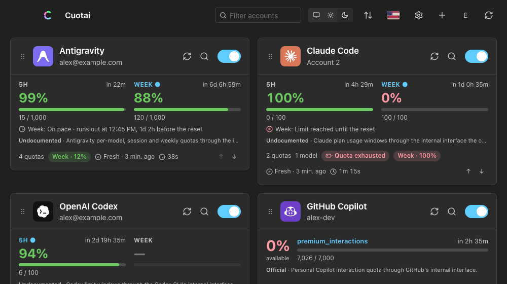
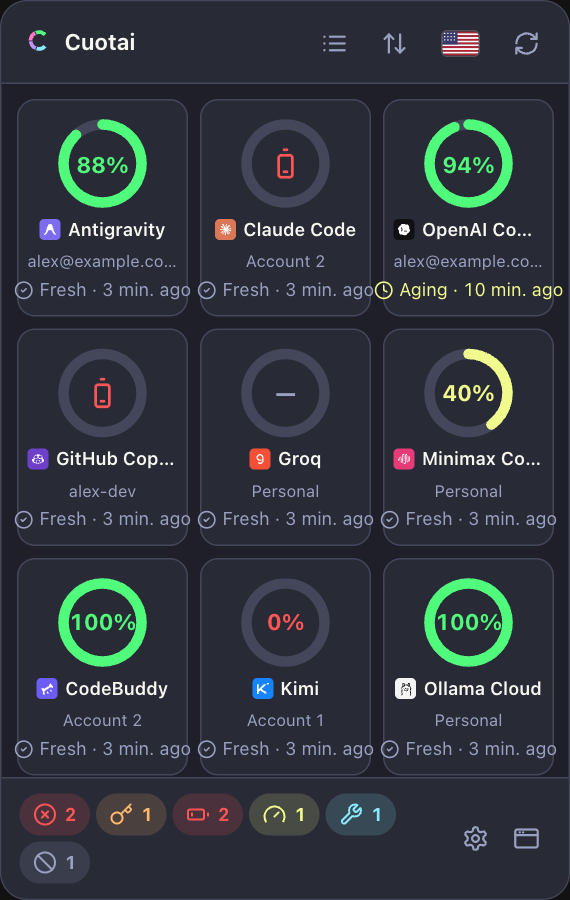
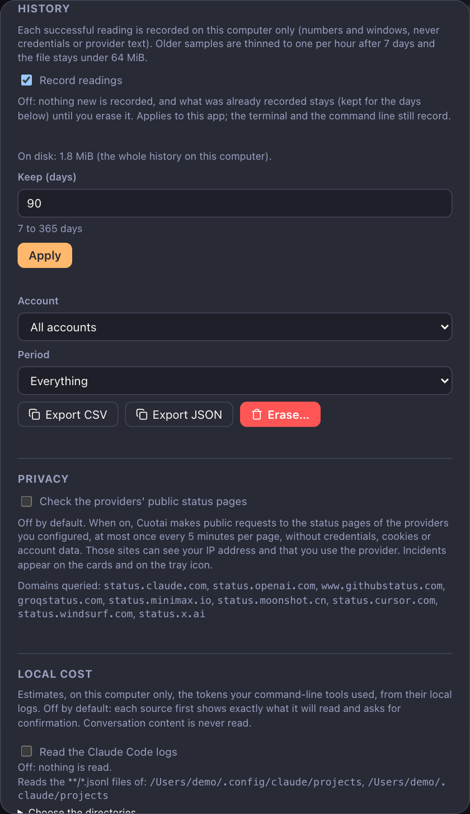
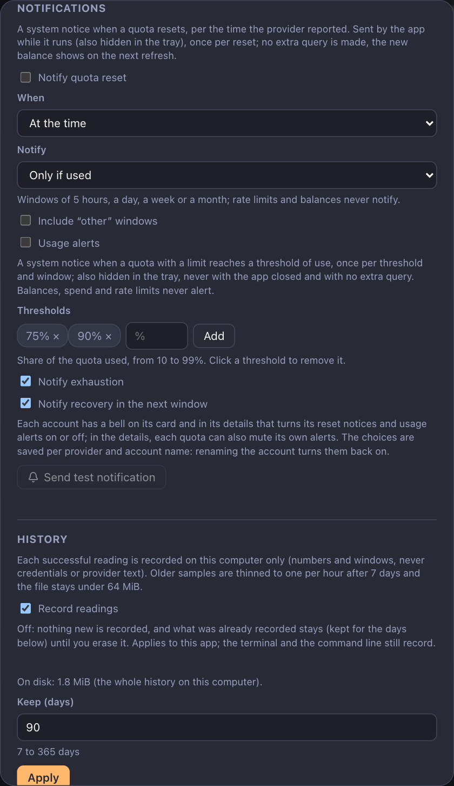

# Cuotai on Windows

A walkthrough of the Cuotai desktop app on Windows: installing it, the first launch, adding accounts, the notification-area popover, notifications and where everything is stored. The features themselves are described in full in the [desktop feature reference](gui-features.md); this page covers what is specific to Windows. Screenshots show the browser demo with made-up accounts, here with the app's "Windows 11" theme (it imitates the system look; it is not a native capture).

<div align="center">
  
  
</div>

## Install

Cuotai is pre-release: the first packaged release is not published yet, so check [`installing.md`](installing.md#channel-status) for what is live. When it is:

- **winget:** `winget install Cuotai.Cuotai` (planned, not live yet; the first submission to the winget repository is a manual step).
- **Direct download:** from [GitHub Releases](https://github.com/jmarcon/cuotai/releases), either `Cuotai_<version>_x64-setup.exe` (the installer; installs for the current user, no administrator rights needed) or `Cuotai_<version>_x64_en-US.msi`. ARM64 PCs may use `Cuotai_<version>_arm64-setup.exe` when the release includes it. [Verify the download](installing.md#verify-your-download) first if you like (`Get-FileHash` in PowerShell, compared with `SHA256SUMS`).
- **Terminal version only:** Scoop (`scoop bucket add cuotai`, then `scoop install cuotai`; planned) or the `cuotai-<version>-x86_64-pc-windows-msvc.zip` archive.
- **From source today:** see [`building.md`](building.md#desktop-app-tauri).

### First launch and SmartScreen

If the installer is Authenticode-signed (only when a code-signing certificate was available for that release; the release notes say), Windows runs it normally. If it is **not**, SmartScreen shows "Windows protected your PC / unknown publisher":

1. Choose **More info**.
2. Choose **Run anyway**.

Nothing about this weakens Windows; it only reflects that the file has no publisher signature. Verifying the checksum first tells you the file is the one the project built.

## Add your first account

1. Press **Add account** (or the **+** in the top bar).
2. Choose the **provider** and give the account a unique **name**.
3. Choose how to authenticate. Where the provider supports it, pick **browser sign-in** and press **Sign in**: Cuotai opens your default browser, you approve, and the token is stored in Credential Manager. Otherwise, type the **name** of an environment variable that holds the key.
4. Press **Save**. The card appears and fills in on the next refresh.

> **Environment variables.** Set a variable under **Settings → System → About → Advanced system settings → Environment Variables** (or `setx NAME value` in a terminal), then **quit and restart Cuotai**: a running app does not see variables created after it started, and a terminal's `set NAME=value` only applies to programs started from that terminal.

## The dashboard

<div align="center">
  
</div>

Each card shows an account's windows (5-hour, weekly, monthly), the percentage still available, the reset time, the pace line, how old the reading is and badges such as "Quota exhausted". Drag the handle to reorder accounts, use the toggle to pause one, the refresh button to query one now, and the filter box to search. The toolbar has the color mode, the sort menu, the language flag, Settings, Add account and Refresh all.

## Notification area

Cuotai lives in the **notification area** (the system tray). Closing the main window with the X only hides it: the app keeps running and refreshing.

- Windows may keep a new tray icon in the overflow flyout (the **^** arrow near the clock). To keep Cuotai visible, open **Settings → Personalization → Taskbar → Other system tray icons** and turn Cuotai on (Windows 10: **Select which icons appear on the taskbar**).
- **Left click** the icon: the popover with one ring per account (donut view) or a list, above the taskbar. The footer chips count failures, authentication problems and exhausted quotas. It closes when you click elsewhere.
- **Right click**: a text menu with each account's state, the next reset notice, **Open**, **Settings** and **Quit**.
- The icon's **tooltip** names the oldest reading, and a **red dot** means a provider you use reports a partial or major outage (only if you turned provider status on).
- **Quit** from that menu stops Cuotai and its notifications for good.

<div align="center">
  
  
</div>

The taskbar and the native menu are drawn by Windows, so they do not appear in the screenshots; the popover above is the app's own window.

## Details, history and local cost

The magnifier on a card opens the details: each window with its bar, expected-use mark and reset time, a history chart (24 hours, 7 or 30 days), quota hide/mute buttons and the model catalog. **Settings → Local cost** can count Claude Code and Codex CLI tokens from their local logs, in your user profile (`%USERPROFILE%\.claude`, `%USERPROFILE%\.config\claude` or `CLAUDE_CONFIG_DIR`, and `%USERPROFILE%\.codex` or `CODEX_HOME`), only after you accept a dialog that lists the exact folders.

<div align="center">
  
  
</div>

## Notifications

Turn them on in **Settings → Notifications** (reset notices, and optionally usage alerts with thresholds, exhaustion and recovery). Turning a switch on asks the system for permission; if notifications are blocked, the switch stays off and Cuotai tells you where to fix it:

- Open **Settings → System → Notifications**, make sure notifications are on, find **Cuotai** in the list and allow it.
- Check that **Do not disturb** or **Focus** is not silencing them.
- Press **Send test notification** in Cuotai to confirm they arrive.

Notices come while the window is hidden in the tray, but not after you Quit. The app never queries a provider to notify you.

<div align="center">
  
</div>

## Themes and languages

**Settings → Appearance** has the theme picker, the light/dark/system switch and the animation setting (it also follows the Windows "reduce animations" preference when set to System). All [15 themes](themes.md) work in both modes, including Windows 11, Windows 98 and Windows XP looks. The language list (Portuguese, English, Spanish, Italian) is in the same dialog.

## Launch at sign-in

Cuotai has no built-in "start with Windows" switch. To start it with Windows, press **Win + R**, run `shell:startup`, and put a shortcut to Cuotai (copy it from the Start menu) in the folder that opens.

## Updates

**Settings → Updates** checks once a day (you can turn it off) and sends only the version, system and architecture. A copy installed by Scoop or winget is updated by that tool and the in-app updater shows the command; for winget installs set `CUOTAI_UPDATER=off` for now so the app does not also offer its own update (a durable marker is still pending, see [`releasing.md`](releasing.md#uninstall-keeps-your-data-rf82)).

## Credential vault: Credential Manager

OAuth sign-ins, pasted web sessions and the local-server token are stored in **Windows Credential Manager** (entries named `cuotai.oauth` and `cuotai.serve`); the accounts file never holds a secret and there is no plaintext fallback. If Credential Manager is unavailable, Cuotai says so (check that the service is running). You can inspect or delete the entries in **Control Panel → Credential Manager → Windows Credentials**.

## Where things are

| What | Location |
|---|---|
| Accounts file | `%APPDATA%\cuotai\config.toml` (or the file chosen in Settings → Accounts file, or `CUOTAI_CONFIG`) |
| Desktop preferences (`desktop.json`), user themes and languages | `%APPDATA%\cuotai\` (`themes\`, `locales\`; `CUOTAI_USER_DIR` overrides) |
| History, local cost index, notification state, extensions | `%LOCALAPPDATA%\cuotai\` (`history\`, `cost\`, `notified.json`, `extensions\`) |
| Widget snapshot (only if you turn it on) | `%LOCALAPPDATA%\cuotai\widget.json` ([`widgets.md`](widgets.md)) |
| The program | `%LOCALAPPDATA%\Cuotai` for the default current-user installer |
| Secrets | Credential Manager, entries `cuotai.oauth` and `cuotai.serve` |

Extensions on Windows must be real executables (no batch or PowerShell wrappers); see [`extensions.md`](extensions.md#running-on-macos-linux-and-windows).

## Uninstall

Quit Cuotai from the tray menu, then uninstall it from **Settings → Apps → Installed apps**, or with `winget uninstall Cuotai.Cuotai` / `scoop uninstall cuotai`. That keeps your accounts, history and Credential Manager entries on purpose. To erase them too, in PowerShell:

```powershell
Remove-Item -Recurse -Force "$env:APPDATA\cuotai", "$env:LOCALAPPDATA\cuotai"
```

and delete the `cuotai.oauth` and `cuotai.serve` entries in Credential Manager. See [`installing.md`](installing.md#uninstalling).

## Troubleshooting

- **The tray icon is missing.** Look in the overflow flyout (the **^** arrow) and pin it as described above.
- **An account says "missing configuration".** The environment variable it names was not set when the app started; set it and restart Cuotai.
- **Credential Manager unavailable.** Make sure the Credential Manager service is running and retry.
- Something else? Open an [issue](https://github.com/jmarcon/cuotai/issues) (never paste a real token), and see [`platforms.md`](platforms.md) for what is verified on Windows.
