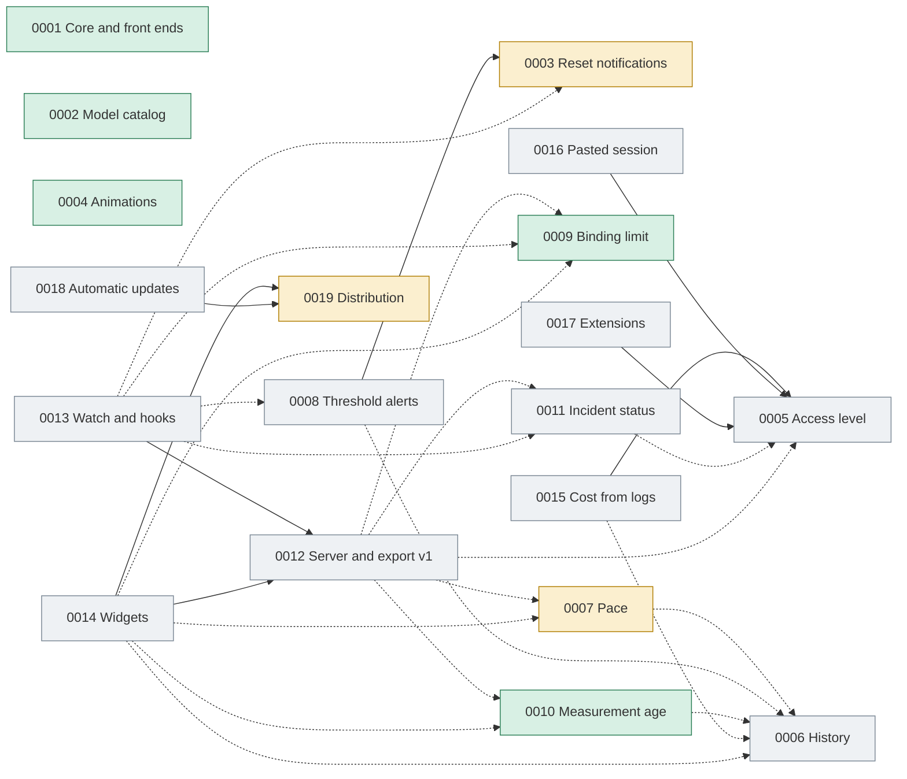

# Plan control (PRDs)

This file is the living index of `docs/plans`: it shows what has been implemented, what is in progress and how the plans depend on one another. Update it **in the same commit** that changes a plan's status.

| Field | Value |
|---|---|
| Last updated | 2026-10-20 |
| Cuotai version at that date | 0.31.0 |
| Plans | 19 (5 implemented, 3 in progress, 11 proposed) |

## 1. How to maintain it

- **Possible statuses:** `Proposed` (written, no code), `In progress` (part of the RFs delivered), `Implemented` (all RFs delivered and verified), `Superseded` or `Cancelled` (with the reason in the Notes column).
- **Terminology:** "RF" (from the Portuguese *requisito funcional*) means functional requirement. The acronym is kept so references in code, commits and plans stay stable.
- **When delivering an RF:** record the version and the commit in the plan itself, in the "Implementation status" section (as in PRD 0002); then update this file's row and the "Delivered by version" table (section 3).
- **Commit traceability:** the commit that delivers an RF carries the footer `Refs: PRD 0006 RF2` (one line per requirement). When PRD 0019 RF7 is implemented, `CHANGELOG.md` becomes the source of these deliveries and section 3 of this file points to it.
- **Strong dependency** means the plan cannot be delivered without the other (the cited RF must exist). **Weak dependency** means it works without the other, but is better with it.
- New plans get the next free number and enter here in the same change.
- **Language:** plans are written in English (see `AGENTS.md`).

## 2. Current situation

| ID | Plan | Status | Delivered | Depends on (strong) | Depends on (weak) | Notes |
|---|---|---|---|---|---|---|
| [0001](0001_core-support-for-graphical-frontends.md) | Core support for graphical front ends | Implemented | 0.7.x | — | — | Foundation of the desktop app and the descriptor contract. |
| [0002](0002_on-demand-model-catalog.md) | On-demand model catalog | Implemented | RF1 to RF6, 0.8.0 to 0.14.0 | — | — | After delivery, every provider except Alibaba Cloud started trying to list models (commit `2ae1e79`). |
| [0003](0003_quota-reset-notifications.md) | Quota reset notifications | In progress | RF1 (0.24.0) | — | — | RF1 delivered: the pure `resets::upcoming` planner and `Account::key` (provider slug + name, reused by 0012 RF1.1) in the core. Defines `Notifier`, permission and `notified.json`, reused by 0008. |
| [0004](0004_animations-and-visual-effects.md) | Animations and visual effects | Implemented | RF1 (0.17.0, `6725548`), RF2 (0.18.0, `d89c1b1`), RF3 (0.19.0, `59f9f22`), RF4 (0.20.0) | — | — | Motion tokens, dashboard effects, dialogs, tray and the TUI animation engine. |
| [0005](0005_usage-access-level.md) | Usage access level | Proposed | — | — | — | Prerequisite of 0015, 0016 and 0017. |
| [0006](0006_local-measurement-history.md) | Local measurement history | Proposed | — | — | — | Foundation of 0007 (projection), 0008, 0010 and 0014. |
| [0007](0007_pace-until-reset.md) | Pace until the reset | In progress | RF1, RF2 (0.23.0), RF3 (0.31.0) | — | 0006 | RF1 and RF2 delivered: `pace::assess` and its localized labels in the core; `pace::Point` is the sample 0006 RF3 returns. Without history it uses the average since the start of the window. RF3: the desktop shows the pace under the card bar, per metric in the details (expected mark over the bar) and in the tray, with an on-by-default switch in Settings → Appearance. RF4 (TUI and CLI) pending. |
| [0008](0008_usage-threshold-alerts.md) | Usage threshold alerts | Proposed | — | 0003 (RF2 and RF3) | 0006 | Reuses 0003's deliverer, permission and preferences. |
| [0009](0009_binding-limit-indicator.md) | Binding limit indicator | Implemented | RF1, RF4 (0.22.0), RF2 (0.26.0), RF3 (0.27.0) | — | — | `metrics::binding` and its localized summary in the core, read by the desktop (ring, list, card chip, highlighted metric, opt-in "most restrictive first" order) and by the TUI (card leads with the binding metric, details marker) and `--once` (one summary line per account). Consumed by 0007, 0012 and 0014; 0012 RF1.1 adds it to `export::v1`. |
| [0010](0010_measurement-age-and-stale-reading.md) | Measurement age and stale reading | Implemented | RF1 (0.21.0), RF2 (0.25.0), RF3 (0.28.0), RF5 (0.29.0), RF4 (0.30.0) | — | 0006 | RF1 and RF2 delivered in the core: `freshness::age`/`assess` and the per-account last valid reading (`RefreshCycle::last_good_report`). RF3: the desktop shows the age and freshness on cards, tray, menu and icon tooltip, and the preserved reading as stale with the failure cause. RF5: the TUI cards and details and `--once` show the relative age (details also in UTC and local time) and the preserved reading marked `(desatualizada)`; `--json` unchanged. RF4: optional, display-only "Recharging" group on the desktop (Settings → Appearance, off by default) with the return time. RF2.3 holds per session only until 0006 RF2 persists the reading and loads it on opening (the plan's own "without history" branch). |
| [0011](0011_provider-incident-status.md) | Provider incident status | Proposed | — | — | 0005 | Needs verified public sources per provider. |
| [0012](0012_local-http-server-and-export-contract.md) | Local HTTP server and `export::v1` contract | Proposed | — | — | 0005, 0007, 0009, 0010, 0011 | The `v1` contract is additive: new fields enter as the plans are delivered. |
| [0013](0013_watch-and-event-hooks.md) | `watch` and event hooks | Proposed | — | 0012 (RF1) | 0003, 0008, 0009, 0011 | Hooks run user commands; consent is mandatory. |
| [0014](0014_system-widgets.md) | System widgets (macOS) | Proposed | — | 0012 (RF1), 0019 | 0006, 0007, 0009, 0010 | Needs an Apple developer account; packaging prototype first. |
| [0015](0015_estimated-cost-from-local-logs.md) | Estimated cost from local logs | Proposed | — | 0005 | 0006 | Never reads conversation content. |
| [0016](0016_user-pasted-session.md) | User-pasted session | Proposed | — | 0005 | — | Alternative to automatic cookie import, which the project does not adopt. |
| [0017](0017_manifest-and-script-extensions.md) | Manifest and script extensions | Proposed | — | 0005 | — | An extension never receives Cuotai's credentials. |
| [0018](0018_automatic-updates.md) | Automatic updates for the desktop app | Proposed | — | 0019 (RF2 and RF3) | 0019 (RF7) | Needs a Tauri updater signing key pair. Release notes come from `CHANGELOG.md`. |
| [0019](0019_packaging-and-distribution.md) | Packaging, license, changelog and distribution | In progress | RF1 (0.17.2), RF7.1 to RF7.3 and RF7.6 (`CHANGELOG.md`, no bump), RF2 partial (0.27.1) | — | — | Prerequisite of 0014 and 0018. RF1 delivered: `MIT OR Apache-2.0` license, `CONTRIBUTING.md`, `SECURITY.md`, issue templates and `deny.toml`. `CHANGELOG.md` exists with the history up to 0.20.0. RF2: `.github/workflows/ci.yml` (fmt, Clippy, tests of both workspaces on Linux, macOS and Windows, plus `cargo deny`) verified locally; **owner-blocked:** a green GitHub Actions run on the three runners and a failing pull request with broken Clippy need the workflow pushed to GitHub. RF7.4, RF7.5, RF7.7 and RF7.8 (CI checks, release extraction, in-product display, link with this file) are still open. |

## 3. Delivered by version

[`CHANGELOG.md`](../../CHANGELOG.md) is the full record of every version (PRD 0019, RF7). This table stays as the plan-requirement view of it until the RF7.8 CI check compares the two sources. Only versions with evidence in the repository enter (the PRDs' status tables and the commits that raise the version).

| Version | Plan | Requirements delivered |
|---|---|---|
| 0.7.x | 0001 | All RFs (core support for graphical front ends). |
| 0.8.0 | 0002 | RF1 (shareable configuration path), first part. |
| 0.9.0 | 0002 | RF2 (per-account model contract in the core). |
| 0.10.0 | 0002 | RF3 (SQLite persistence and manual sync). |
| 0.11.0 | 0002 | RF4 (verified adapters and the provider matrix). |
| 0.12.0 | 0002 | RF5 (Models section in the TUI). |
| 0.13.0 | 0002 | RF6 (Models section in the desktop app). |
| 0.14.0 | 0002 | RF1 (completion: TOML choice in the desktop app and different-files warning). |
| 0.17.0 | 0004 | RF1 (motion foundation: tokens, reduced motion and incremental dashboard update). |
| 0.17.1 | — | No plan requirement: security update (`rustls` 0.23.46 and `yoke-derive` 0.8.4). |
| 0.17.2 | 0019 | RF1 (license, `CONTRIBUTING.md`, `SECURITY.md`, issue templates, `deny.toml`; RF1.4 partial). |
| 0.18.0 | 0004 | RF2 (desktop dashboard effects: counting, level highlight, FLIP, exit, skeleton and micro-interactions). |
| 0.18.1 | — | No plan requirement: HTTPS-only transport guard for every credential-bearing request (providers and OAuth), prompted by the CodeQL code-scanning alerts. |
| 0.19.0 | 0004 | RF3 (dialog open/close motion with focus return, tray entrance and ring continuity, theme and language cross-fade). |
| 0.20.0 | 0004 | RF4 (TUI effects: animated bars with 1/8 cells, class blink, braille spinner, screen wipe, `--no-animations` and SSH/`TERM=dumb` opt-out). |
| 0.21.0 | 0010 | RF1 (core measurement age and `Fresh`/`Aging`/`Stale` freshness, clock-adjusted age reads zero). |
| 0.22.0 | 0009 | RF1 and RF4 (core binding metric: exhausted with the latest return or tightest remaining fraction, `binding_ratio`/`cmp_binding`, localized summary in `en-US`/`es`). |
| 0.23.0 | 0007 | RF1 and RF2 (core pace: expected use at a uniform pace, ±5-point `Reserve`/`OnPace`/`Ahead`/`Exhausted` stages with a tone, linear exhaustion projection from recent samples or the window average, localized labels in `en-US`/`es`). |
| 0.24.0 | 0003 | RF1 (core reset planner: eligibility, used/exhausted/always filters, lead time, same-minute grouping, 2-minute drift identity, stable account key). |
| 0.25.0 | 0010 | RF2 (core last valid reading per account: kept on non-auth failures with its original age, replaced on success, discarded on authentication failure or account edit, carried by moves and removals; per session until 0006). |
| 0.26.0 | 0009 | RF2 (desktop binding limit: tray ring and list "blocked until", card chip and highlighted metric, opt-in "most restrictive first" order from the core's `cmp_binding` that never rewrites the manual order). |
| 0.27.0 | 0009 | RF3 (TUI card leads with the binding metric, details marker and summary line, `--once` per-account summary line; `--json` and exit codes unchanged). |
| 0.27.1 | 0019 | RF2 partial (CI workflow on push and pull request for Linux, macOS and Windows with fmt, Clippy and the tests of both workspaces, `cargo deny`, pinned actions and read-only token; Windows icon and test manifest for the desktop build; per-OS coverage in `docs/architecture.md`; green hosted run pending on the owner). |
| 0.28.0 | 0010 | RF3 (desktop measurement age: relative age with Fresh/Aging/Stale icon and text on cards, tray tiles and rows, details and tray menu; icon tooltip with the oldest reading; preserved reading dimmed and still with a "Stale · N min ago" badge and the failure cause, removed by the next success). |
| 0.29.0 | 0010 | RF5 (TUI and CLI measurement age: relative age on cards, details with UTC and local time, `--once` headings; a failure with a preserved reading shows the old metrics still and marked `(desatualizada)` with their original age; `--json` unchanged). |
| 0.30.0 | 0010 | RF4 (desktop "Recharging" group: optional in Settings → Appearance, off by default; exhausted or blocked accounts in a collapsible section with "Returns …"/"Return unknown"; the manual order holds inside each group and the TOML order is never rewritten). |
| 0.31.0 | 0007 | RF3 (desktop pace: `get_view` carries each eligible metric's core `Pace` and texts plus the tightest metric with a pace; card line, per-metric details with the expected-consumption mark and projected exhaustion time, tray tooltip and list; "Show consumption pace" in Settings → Appearance, saved in `desktop.json`, on by default). |

## 4. Dependency graph

Solid arrows are strong dependencies; dashed ones, weak. The arrow points from a plan to what it depends on.

### What each plan unblocks

| Plan | Unblocks (strong) | Benefits (weak) |
|---|---|---|
| 0003 | 0008 | 0013 |
| 0005 | 0015, 0016, 0017 | 0011, 0012 |
| 0006 | — | 0007, 0008, 0010, 0014, 0015 |
| 0007 | — | 0012, 0014 |
| 0008 | — | 0013 |
| 0009 | — | 0012, 0013, 0014 |
| 0010 | — | 0012, 0014 |
| 0011 | — | 0012, 0013 |
| 0012 | 0013, 0014 | — |
| 0019 | 0014, 0018 | — |

## 5. Suggested delivery order

The waves respect the strong dependencies; within each wave the order is by priority (impact against competitors, according to the 2026-10-19 market analysis).

| Wave | Plans | Why |
|---|---|---|
| 0 (under way) | 0003 | Infrastructure reused by the others (0004 is done). |
| 1 (no dependencies) | 0019 (RF1: license, done), 0006, 0007, 0009, 0005, 0012, 0011 | They unblock almost everything; 0006 and 0007 close the biggest gap against competitors (history and pace). |
| 2 | 0008, 0010, 0018, 0013, 0016, 0015, 0017 | They depend on items from wave 0 or 1. |
| 3 | 0014 | Depends on 0012's contract and 0019's pipeline, plus an Apple developer account. |

Critical path of distribution: **0019 → 0018**. Critical path of integrations: **0012 → 0013 and 0014**. Critical path of alerts: **0003 → 0008**.

## 6. Decisions for the project owner

| Decision | Affects | Notes |
|---|---|---|
| ~~Repository license~~ | 0019 (RF1) | **Decided on 2026-10-19: `MIT OR Apache-2.0`**, holder "Cuotai contributors". |
| ~~Documentation language~~ | 0019 (RF1.4) | **Decided on 2026-10-19: English** for the README, `docs/`, plans, commits, pull requests and issues. Done: every plan, PRD 0004 included, is in English. |
| Apple developer account and Developer ID certificate | 0014, 0018, 0019 | Needed for notarization and for widgets (*app group*). |
| Windows Authenticode certificate | 0019 | Without it, the installer ships unsigned, declared in the release notes. |
| Cookie policy | 0016 | Recommendation: keep manual pasting and do not import cookies from browsers. |
| Local server on by default or not | 0012 | Recommendation: off by default, loopback only. |

## 7. History of this file

| Date | Change |
|---|---|
| 2026-10-19 | Control created with PRDs 0001 to 0019. |
| 2026-10-19 | Changelog added as a requirement (PRD 0019, RF7); new "Delivered by version" section and the `Refs:` footer in commits. |
| 2026-10-19 | PRD 0019 RF1 delivered in 0.17.2 (`MIT OR Apache-2.0` license); documentation-language decision (English) recorded. |
| 2026-10-19 | PRD 0004 RF2 delivered in 0.18.0. |
| 2026-10-19 | Documentation and plans translated to English (except PRD 0004); plan files renamed to English slugs; commits are written in English from now on. |
| 2026-10-19 | PRD 0004 RF3 delivered in 0.19.0. |
| 2026-10-19 | PRD 0004 RF4 delivered in 0.20.0; plan 0004 implemented. |
| 2026-10-19 | PRD 0004 translated to English; every plan is now in English. |
| 2026-10-19 | `CHANGELOG.md` created with the reconstructed history from 0.1.0 to 0.20.0 (PRD 0019 RF7.1 to RF7.3 and RF7.6). |
| 2026-10-19 | PRD 0010 RF1 delivered in 0.21.0; plan 0010 in progress. |
| 2026-10-19 | PRD 0009 RF1 and RF4 delivered in 0.22.0; plan 0009 in progress. |
| 2026-10-19 | PRD 0007 RF1 and RF2 delivered in 0.23.0; plan 0007 in progress. |
| 2026-10-19 | PRD 0003 RF1 delivered in 0.24.0; plan 0003 in progress. |
| 2026-10-19 | PRD 0010 RF2 delivered in 0.25.0 (per session until PRD 0006 RF2 persists the reading); plan 0010 in progress. |
| 2026-10-19 | PRD 0009 RF2 delivered in 0.26.0; plan 0009 in progress (RF3 pending). |
| 2026-10-19 | PRD 0009 RF3 delivered in 0.27.0; plan 0009 implemented. |
| 2026-10-19 | PRD 0019 RF2 delivered as partial in 0.27.1 (CI workflow; the green GitHub run on three systems and the failing Clippy pull request wait for the owner to push); plan 0019 stays in progress. |
| 2026-10-20 | PRD 0010 RF3 delivered in 0.28.0; plan 0010 stays in progress (RF4 and RF5 pending). |
| 2026-10-20 | PRD 0010 RF5 delivered in 0.29.0; plan 0010 stays in progress (RF4 pending). |
| 2026-10-20 | PRD 0010 RF4 delivered in 0.30.0; plan 0010 implemented. |
| 2026-10-20 | PRD 0007 RF3 delivered in 0.31.0; plan 0007 stays in progress (RF4 pending). |
