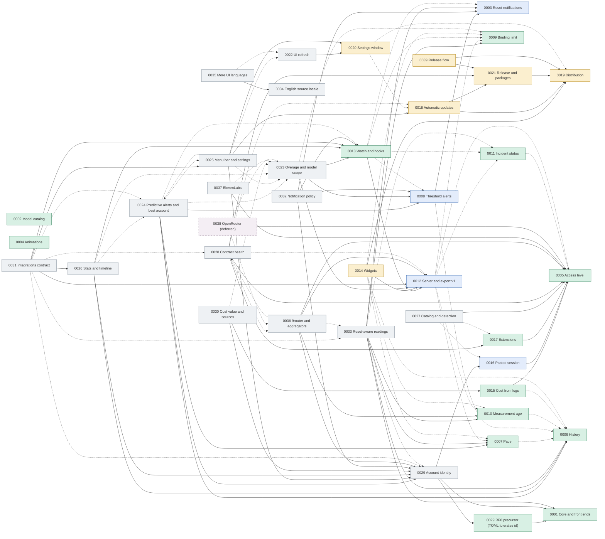

# Plan control (PRDs)

This file is the living index of `docs/plans`: it shows what has been implemented, what is in progress and how the plans depend on one another. Update it **in the same commit** that changes a plan's status.

| Field | Value |
|---|---|
| Last updated | 2026-10-24 |
| Cuotai version at that date | 0.80.0 |
| Plans | 39 (12 implemented, 4 awaiting owner verification, 9 in progress, 14 proposed) |

## 1. How to maintain it

- **Possible statuses:** `Proposed` (written, no code), `In progress` (part of the RFs delivered), `Awaiting owner verification` (every RF delivered and covered by automated tests; only a manual owner smoke or a live account check remains, listed in §2.1), `Implemented` (all RFs delivered and verified), `Superseded` or `Cancelled` (with the reason in the Notes column). A reserved number appears as `Reserved` until its PRD is written. A plan placed in the backlog keeps its status and is marked "deferred" in §5.
- **Terminology:** "RF" (from the Portuguese *requisito funcional*) means functional requirement. The acronym is kept so references in code, commits and plans stay stable.
- **When delivering an RF:** write the token `vNEXT` where the version goes, in the plan's "Implementation status" and in this file's §2 row, and carry `Refs:` trailers in the commit (PRD 0039 RF6). `cargo xtask release prepare` replaces `vNEXT` with the released version and appends the "Delivered by version" rows (section 3); do not edit section 3 by hand.
- **Commit traceability:** the commit that delivers an RF carries the trailer `Refs: PRD 0006 RF2` (one line per requirement, PRD 0039 RF1). `CHANGELOG.md` is the source of the deliveries (PRD 0019 RF7) and section 3 is generated from the `Refs:` trailers at release time.
- **Requirement ids:** an RF (`RF2`, `RF7.4`) or a review id made of capital letters, a dash and digits (`FIX-08`, `INT-04`, `SES-01`); the commit gate of PRD 0039 rejects any other shape in `Refs:`.
- **Fix requirements of delivered plans** (decision J) do not change the plan's status; while one is open, the plan's Notes cell names it and wave 5a lists it.
- **Strong dependency** means the plan cannot be delivered without the other (the cited RF must exist). **Weak dependency** means it works without the other, but is better with it.
- New plans get the next free number and enter here in the same change.
- **Language:** plans are written in English (see `AGENTS.md`).

## 2. Current situation

| ID | Plan | Status | Delivered | Depends on (strong) | Depends on (weak) | Notes |
|---|---|---|---|---|---|---|
| [0001](0001_core-support-for-graphical-frontends.md) | Core support for graphical front ends | Implemented | 0.7.x; review fix FIX-08 (0.80.0) | — | — | Foundation of the desktop app and the descriptor contract. FIX-08 validates the metered refresh floor per account and reports the responsible field and account. |
| [0002](0002_on-demand-model-catalog.md) | On-demand model catalog | Implemented | RF1 to RF6, 0.8.0 to 0.14.0; RF1.2 notice lifetime, 0.80.0 | — | — | After delivery, every provider except Alibaba Cloud started trying to list models (commit `a5c3d1f`). |
| [0003](0003_quota-reset-notifications.md) | Quota reset notifications | Awaiting owner verification | RF1 (0.24.0), RF2, RF3 partial (0.41.0), RF4 (0.44.0) | — | — | RF1: the pure `resets::upcoming` planner and `Account::key` (provider slug + name, reused by 0012 RF1.1) in the core. RF2: core `resets::plan` and `Ledger` (`notified.json`, digests and dates, 8 days), desktop `Notifier` and backend timer. RF3: Settings → Notifications (off by default), per-account bell, permission request, test notification and the next notice in the tray. RF4: `cuotai --notify` (off by default) reuses `resets::plan` for a header banner, one `BEL` and OSC 9 on iTerm2/WezTerm/Ghostty only, per session with no persistence; `--once`/`--json`/`--history` reject the flag. **Owner verification (RF3, §2.1):** smoke on the packaged macOS app with a human granting and denying the system permission and a real notice arriving with the window hidden; Windows and Linux when available. Reused by 0008. Extended by 0029 (account id), 0031 (`quota_reset_soon`), 0032 (lock-screen names, cross-process dedup) and 0033 (refresh 30 s after a reset). |
| [0004](0004_animations-and-visual-effects.md) | Animations and visual effects | Implemented | RF1 (0.17.0, `4c89fad`), RF2 (0.18.0, `d5d3274`), RF3 (0.19.0, `251b5bc`), RF4 (0.20.0) | — | — | Motion tokens, dashboard effects, dialogs, tray and the TUI animation engine. |
| [0005](0005_usage-access-level.md) | Usage access level | Implemented | RF1, RF2 (0.33.0), RF3 (0.34.0), RF4 (0.35.0), RF5 (0.35.1) | — | — | Prerequisite of 0015, 0016 and 0017. RF1 and RF2 delivered in the core: `access::describe` (level, credential class, plan, scope, `metered`, evidence with `verified_on`, localized summary/hint/risk/reason) for the 36 providers and their switching modes, exhaustive on `Provider`, with `access.*` texts in `en-US`/`es`. RF3: the TUI wizard and the desktop dialog show the level in the picker, the credential notes under the credential help, the cost warning from the descriptor (`Provider::cost_advisory` removed) and a "Save anyway" confirmation for `Unavailable`, all from `account_edit::draft_access`. RF4: TUI and desktop cards and details show "level · summary" and the core's `UsageAccess::explain` (an `Unavailable` reason, a changed undocumented interface with its reference) in place of the generic failure; `UsageAccess` serializes for `export::v1`, where it enters as `access` with 0012 RF1.1; `--json` unchanged. RF5: `docs/providers.md` carries the usage access matrix (level, credential, plan, scope, evidence per provider and mode) generated from `access::describe` by a core test that fails on drift with regeneration instructions (`CUOTAI_REGENERATE_DOCS=1`); the new-provider guides in `AGENTS.md`, `docs/architecture.md` and `CONTRIBUTING.md` list the access descriptor as mandatory. Owner decision 2026-10-25 (vNEXT): the level and summary leave the UI (picker, cards, details, editor notes); the picker lists clean names sorted by name and hides providers without any usage query (`access::has_usage_query`); transparency lives in `docs/providers.md`. |
| [0006](0006_local-measurement-history.md) | Local measurement history | Implemented | RF1, RF3 (0.37.0), RF2, RF4 (0.38.0), RF6 (0.39.0), RF5 (0.40.0) | — | — | Foundation of 0007 (projection), 0008, 0010 and 0014. RF1 and RF3: `history::HistoryStore` (private `history.sqlite3`, WAL, versioned schema, digests only, `NULL` for missing values) and the network-free `latest`, `series`, `windows` and `bounds`. RF2: `Monitor::with_history` records every `Ready` reading from a worker thread with a bounded queue (dropped readings and storage failures shown as warnings), compacting repeats within 15 minutes; wired into the TUI, the desktop and `--once`/`--json`, it also restores the last reading as stale on opening (0010 RF2.3) and feeds the recent slope of the pace (0007 RF1.5). RF4: retention (90 days, 7 to 365 via `--history-days` or `desktop.json`), hourly reduction after 7 days keeping each window's peak, a 64 MiB ceiling with a visible warning, CSV/JSON export and per-account or total erasure with confirmation in Settings → History. RF6: core `HistoryStore::account_history` / `MetricHistory` (points, windows, trend, sparkline levels) and `HistoryRange`; TUI details sparkline per metric over 24 h, 7 d or 30 d (`1`/`2`/`3`) degrading to minimum, maximum and last on narrow terminals; `cuotai --history [ACCOUNT] [--history-days N] [--json]` with exit 0/2/1. RF5: the Tauri command `account_history(index, generation, range, metric_key)` returns the core's placed `MetricHistory::chart` (bucket peaks, end point, resets) and window instances, refused as `stale` for another generation; the desktop details draw a compact area chart per metric (24 h, 7 d, 30 d) with an equivalent screen-reader table, an explained empty state and reduced motion respected; Settings → History adds the recording switch (`Monitor::set_history_recording`, `desktop.json`) and the size on disk (`HistoryStore::size_on_disk`). |
| [0007](0007_pace-until-reset.md) | Pace until the reset | Implemented | RF1, RF2 (0.23.0), RF3 (0.31.0), RF4 (0.32.0) | — | 0006 | RF1 and RF2 delivered: `pace::assess` and its localized labels in the core; `pace::Point` is the sample 0006 RF3 returns. Without history it uses the average since the start of the window. RF3: the desktop shows the pace under the card bar, per metric in the details (expected mark over the bar) and in the tray, with an on-by-default switch in Settings → Appearance. RF4: the TUI cards show a stage icon per eligible metric, the details a pace line per metric, and `--once` a `Ritmo:` line; `--json` is unchanged and pace enters `export::v1` with 0012. |
| [0008](0008_usage-threshold-alerts.md) | Usage threshold alerts | Awaiting owner verification | RF1 (0.42.0), RF2, RF3 partial (0.43.0), RF4 (0.45.0) | 0003 (RF2 and RF3) | 0006 | Reuses 0003's deliverer, permission and preferences. RF1: the pure `alerts::evaluate` in the core (thresholds 10–99%, 75 and 90 by default, exhaustion and recovery, once per window instance with the 2-minute drift, the highest of several, 5-point hysteresis, no notice of a past crossing on the first reading unless the previous recorded reading is at most 10 minutes older and still below it) and `AlertState` (digests and dates). RF2: the state persisted in 0003's `notified.json` (8 days), the desktop backend judging every report the cycle applies (the restored 0006 reading as the first `prev`), one notification per account and refresh, at most one per minute with the excess grouped, `alerts::notice` texts. RF3: Settings → Notifications "Usage alerts" (off by default), threshold chips 10–99, exhaustion and recovery switches in `desktop.json`, 0003's permission request, test button and bell reused, per-metric mute in the details, highlighted card, tray and details. RF4: `cuotai --notify` also judges every report the TUI's cycle applies with `alerts::evaluate` (core defaults, session-only `AlertState`) and shows the `alerts::notice` text in 0003's header banner with the same single `BEL` and OSC 9, at most one alert pass per minute; `--once`/`--json`/`--history` still reject the flag. **Owner verification (RF3, §2.1):** smoke on the packaged macOS app with a human granting and denying the system permission, a real alert with the window hidden and preferences surviving a restart; Windows and Linux when available. |
| [0009](0009_binding-limit-indicator.md) | Binding limit indicator | Implemented | RF1, RF4 (0.22.0), RF2 (0.26.0), RF3 (0.27.0) | — | — | `metrics::binding` and its localized summary in the core, read by the desktop (ring, list, card chip, highlighted metric, opt-in "most restrictive first" order) and by the TUI (card leads with the binding metric, details marker) and `--once` (one summary line per account). Consumed by 0007, 0012 and 0014; 0012 RF1.1 adds it to `export::v1`. |
| [0010](0010_measurement-age-and-stale-reading.md) | Measurement age and stale reading | Implemented | RF1 (0.21.0), RF2 (0.25.0), RF3 (0.28.0), RF5 (0.29.0), RF4 (0.30.0) | — | 0006 | RF1 and RF2 delivered in the core: `freshness::age`/`assess` and the per-account last valid reading (`RefreshCycle::last_good_report`). RF3: the desktop shows the age and freshness on cards, tray, menu and icon tooltip, and the preserved reading as stale with the failure cause. RF5: the TUI cards and details and `--once` show the relative age (details also in UTC and local time) and the preserved reading marked `(desatualizada)`; `--json` unchanged. RF4: optional, display-only "Recharging" group on the desktop (Settings → Appearance, off by default) with the return time. RF2.3 holds per session only until 0006 RF2 persists the reading and loads it on opening (the plan's own "without history" branch). |
| [0011](0011_provider-incident-status.md) | Provider incident status | Implemented | RF1 (0.46.0), RF2, RF3 (0.47.0), RF4 (0.48.0), RF5 (0.49.0); review fix GEM-01 (0.80.0) | — | 0005 | Core verified-source registry: exhaustive 36-provider mapping, 16 scoped public sources and 20 explicit `None`, Statuspage v2 and verified native AWS/Google formats, anonymized captures and boundary tests; source/terms audit in `docs/providers.md`. Core status client: opt-in `IncidentMonitor` (off by default) on the `Monitor`'s HTTP client and semaphore, credential-free identified requests, 5 s timeout, 1 MiB cap, per-URL 5-minute cache with coalescing and stale fallback, normalized scoped states with sanitized incident title/start/link; failed queries during an incident gain an explanatory note (plus wait-before-reauthenticating for authentication) without changing `Status`. RF4: Settings → Privacy opt-in switch (off by default, `desktop.json`) with the explanation and the queried domains; card badge and "Open status page" through the allow-listed `open_external`; details, tray popover and an outage dot on the tray icon. RF5: TUI/CLI opt-in with `--status` or `CUOTAI_STATUS=1`, `--no-status` overriding both; card badge, details status block and a `--once` line; `--json` unchanged; `incident` in `export::v1`. Owner decision: opt-in, off until enabled; `--no-status` remains an override. GEM-01 removes the unscoped Google Cloud mapping for `gemini_api`, so Cloud Monitoring health can no longer be presented as Gemini API health. |
| [0012](0012_local-http-server-and-export-contract.md) | Local HTTP server and `export::v1` contract | Awaiting owner verification | RF1 (0.36.0), RF2, RF3 (0.50.0), RF4 (0.51.0), RF5 partial (0.52.0); review fix INT-04 (0.78.0) | — | 0005, 0007, 0009, 0010, 0011 | The `v1` contract is additive: new fields enter as the plans are delivered. RF1 delivered in the core: `export::v1::Export::from_cycle` with key, class, current report, age, freshness, the preserved `last_good` reading with `stale` (0010), `binding` (0009), `pace` per metric (0007), `access` (0005) and, since 0.49.0, the provider's `incident` (0011 RF5). Redacted notes and `source`, e-mail only with "include identity", `null` for missing values; `docs/export-v1.md`, a JSON Schema and a reference output guarded by tests. Owner decision: the server is off by default, loopback only, suggested port 6738. RF2 and RF3 delivered in the core: `serve::LocalServer` behind the `serve` feature (off by default), `httparse`, port 6738 (IANA-unassigned, checked) with fallback to the next nine, `GET`-only `/health`, `/v1/snapshot`, `/v1/accounts/{key}` and `/v1/limits` from the front end's cycle without queries (`503` + `Retry-After` before data), JSON with `no-store`, bounded connections, sizes and time; loopback bind unless an explicit flag plus token, loopback `Host` only, browser `Origin` refused unless "allow browsers", optional bearer token in the OS vault, access log without headers or query. RF4: `cuotai --serve [--port N] [--token-file FILE]` in the foreground without a TUI or terminal over a headless refresh cycle (no query per request), loopback only, explicit `--port` without fallback, URL on stdout and the access log on stderr, clean `SIGINT`/`SIGTERM` shutdown, exit 0/2 (no healthy account until shutdown)/1 (local error, invalid arguments included); `--json-v1` prints the `Export`; `--once`/`--json` unchanged. RF5: desktop Settings → Integration (off by default, `serve` in `desktop.json`): switch, exact port (6738 by default, no fallback), token generated into the OS vault, copied without display, renewed and revoked, "allow browsers" behind its warning, effective address; served from the app's own cycle (a feed published on every state change, no second cycle); state, bind errors and a port held by another Cuotai server (core `serve::is_cuotai_server`) in Settings and a main-window banner. **Owner verification (RF5, §2.1):** the acceptance smoke on the packaged app in the owner's profile with the token in the login Keychain (turn on, `curl` with the token, revoke, turn off); the debug binary, the core vault and a real Keychain round trip were verified locally. |
| [0013](0013_watch-and-event-hooks.md) | `watch` and event hooks | Implemented | RF1 (0.53.0), RF2 (0.54.0), RF3 (0.55.0), RF4 (0.56.0); review fixes FIX-01, FIX-02 (0.77.1) | 0012 (RF1) | 0003, 0008, 0009, 0011 | Hooks run user commands; consent is mandatory. RF1: the pure core `events::diff` over two consecutive `export::v1` accounts with an in-memory `EventState` (restart = new baselines): eleven stable edge events reusing `alerts::evaluate` (0008), the new `resets::passed` (0003), the binding metric (0009) and the provider status (0011); the first reading is a baseline, `usage_updated` at most once per 600 s per account, failures as a category only (deadlines now `query.timeout`, told apart from `offline`); `docs/events.md`. RF2: `cuotai --watch [--interval S] [--events list] [--jsonl]` over the core's new `headless::Driver` (shared with `--serve` in one process) and `watch::Watcher`: NDJSON or readable lines, `--interval` 60–86 400 s rejected below (never adjusted) with per-account intervals and the 300 s Bedrock floor kept, clean `SIGINT`/`SIGTERM`/`SIGHUP`, exit 0/2/1. RF3: `cuotai --watch --hooks` with the core `hooks` module: `hooks.toml` next to the accounts' TOML (argument-vector commands, no shell, unknown keys rejected), off by default and run only after a typed terminal confirmation of the exact commands kept as a SHA-256 of the rules per file (any change asks again; without a terminal a local error before any query), the event on stdin and in `CUOTAI_*` variables, `env_clear` plus `PATH`/`HOME`/`LANG`, the temporary directory as cwd, a 10 s (≤ 60 s) timeout that kills, 16 KiB of output, 4 at once with a 64-run queue that drops the oldest and warns, failures isolated from the cycle, and a payload-free `runs.log`. RF4: desktop Settings → Integration → Hooks (off by default): a rule editor saved through the core `hooks::Document` over the revision read, the exact-command confirmation dialog sharing the CLI's consent, the confirmed rules run over the app's own cycle (no query), a **Test** sample (`sample: true`) and the latest runs from `runs.log`; changed files stop the rules and ask again. |
| [0014](0014_system-widgets.md) | System widgets (macOS) | In progress | RF1, RF4, RF5 (0.71.0); RF2.1/RF2.3 and RF3.1 owner-blocked | 0012 (RF1), 0019 | 0006, 0007, 0009, 0010 | Core `widget_snapshot` (atomic, `0600`, 256 KiB cap), the desktop publisher and Settings → Widgets delivered; the WidgetKit sources are written and type-checked, but the `.appex` packaging/signing and the app group wait for the Apple developer account (PRD 0019). RF5 (`widget.json` for Windows/Linux) stays, owner decision G of 2026-10-23 (review item WID-01 is obsolete). |
| [0015](0015_estimated-cost-from-local-logs.md) | Estimated cost from local logs | Implemented | RF1, RF2 (0.57.0), RF3 (0.58.0), RF4 (0.59.0) | 0005 | 0006 | Never reads conversation content. RF4: core `cost::summarize`/`Scanner::summary` give every front end one `CostSummary` (per source today, yesterday and the span, by day and by model, state and an explained note); desktop "Local usage" block on every Claude and ChatGPT / Codex card (or a card of its own), details with an accessible bar chart and tables, Settings → Local cost directories and price table; TUI details section and `cuotai --cost [--days N] [--json]`; `local_cost` in `export::v1`. RF1 and RF2: core `cost` module, off by default, with per-source consent recorded as the digest of the `Disclosure` (exact directories, purpose, only numbers extracted) in a private `settings.json`; Claude Code and Codex CLI adapters behind a `Source` trait (formats confirmed against ccusage and openai/codex) that extract only time, model, token counts and a session digest, invalid lines counted, no access as a state; the incremental `cost.sqlite3` index (per-file control, growth, truncation and rotation, request dedup) filled by a bounded, low-priority background `CostWorker` that pauses in energy-saving mode; period and 120-day retention; turning off or erasing removes everything derived. Surfaces: `cuotai --cost-sources/--cost-enable/--cost-disable/--cost-erase/--cost-scan/--cost-period/--cost-retention-days` and the desktop's Settings → Local cost. RF3: an embedded per-model table of API prices in USD per million tokens with its effective date and source, overridden model by model by the user's manual `pricing.json` (owner decision: no download; an invalid file is ignored as a whole), the pure `cost::estimate` (total of the priced part, per model, tokens, unknown share, tables used; unknown models never zero; exact integer sums rounded half up) and the "estimate at API prices, not a charge" notice; `cuotai --cost-prices [--json]` lists the prices in effect. Extended by 0030 (plan value, new sources, price age). |
| [0016](0016_user-pasted-session.md) | User-pasted session | Awaiting owner verification | RF1 (0.60.0), RF2, RF3 (0.61.0), RF4 (0.62.0), RF5 partial (0.63.0); review fix FIX-06 (0.77.1); review fixes SES-01, SES-02 (0.80.0) | 0005 | — | Alternative to automatic cookie import, which the project does not adopt; owner decision: manual paste only. RF1: core `user_session` descriptors (cookie names, hosts, delivery) for Xiaomi MiMo and Alibaba Coding/Token Plan, `[accounts.session]` with a `credential_ref` and the stored slots, the session in the `TokenStore` vault entry keyed by reference, provider and slot, read by queries through `Credentials`; `session_env` keeps working and the TUI wizard (F3 twice) and the desktop dialog ("Move to the vault" twice) migrate it with explicit consent. RF2 and RF3: `user_session::reduce` keeps only the accepted cookies of a `Cookie:` line, list, inspector table or cURL (fragments reassembled, errors naming cookies only), the TUI "Colar sessão" step and the desktop "Web session" box paste (masked), preview, test (`Monitor::test_session`) and save it, replacing the same vault entry; `providers::send_session` sends it only over HTTPS to its declared hosts and never through a redirect, a rejected session reads "session expired or revoked", and a known expiry reaches `Report::session_expires_at`, the cards ("expires in N days") and an `AlertKind::SessionExpiring` alert under 3 days. RF4: `user_session::notice`/`paste_notice` put the `UserSession` level and the "full login session" warning on the cards (TUI and desktop), the TUI details and both paste steps, and `user_session::stage_forget` behind "Forget this session" (TUI summary F5 twice, desktop dialog button twice) deletes the vault entry and the reference, restored when the save is refused; `docs/providers.md` and `docs/oauth.md` describe the flow, what is stored and discarded, and the risks. Removing an account does not delete its session entry yet (the docs say to forget it first). RF5: the Xiaomi MiMo and Alibaba Coding/Token Plan adapters read every session through its descriptor (`providers::web_session`), from the vault or from the `session_env`-style variable kept as an alternative, refusing a session without its required cookies before any request; Alibaba reports say which source answered; field help, hints and guidance point to the paste first; the `docs/providers.md` matrix lists the vault session; an `access` test ties every `UserSession` interface to a descriptor (RF5.2). **Owner verification (RF5, §2.1):** a live Alibaba Coding Plan and Qwen Cloud Token Plan console session to confirm that the reduced cookie set (`login_aliyunid_*`, `csrf`, `cna`, `sec_token`) is enough before any of them is marked required; CodexBar sends the whole console cookie jar. Fix requirements of the 2026-10-21 review: SES-01 ("Paste a new session" on a card or details whose session was rejected, opening the paste step of that account) and SES-02 (a pasted session is saved only after the core's test query, or with an explicit "Save anyway" after a transport failure; only the descriptor's cookies reach the vault, Alibaba and migrated variables included) delivered in 0.80.0. |
| [0017](0017_manifest-and-script-extensions.md) | Manifest and script extensions | Implemented | RF1 (0.64.0), RF2 (0.65.0), RF2.4, RF3, RF4 (0.66.0), RF5 (0.67.0); review fixes FIX-03, FIX-04, FIX-05 (0.77.1) | 0005 | — | Core-managed extension accounts now have consent, integrity/revocation, shared runner/backoff, safe lifecycle states and isolated refreshes; TUI and desktop list/manage/test/enable/disable/create/remove extensions, cards show `Extension`, and `docs/extensions.md` plus three-locale lifecycle/card tests and CLI smoke cover the flow. |
| [0018](0018_automatic-updates.md) | Automatic updates for the desktop app | In progress | RF1.1, RF1.4, RF2, RF3, RF4.3 (0.74.0); RF1.2, RF1.3, RF4.1, RF4.2 (0.75.0); reviewer hardening across RF1–RF4 (0.75.1); shared install-source adoption (0.77.0); RF2.6 (0.80.0) | 0019 (RF2), 0021 (RF1–RF4, which supersede 0019 RF3) | 0019 (RF7) | Daily signed-update check with consent, Settings → Updates and About in four languages; since 0.77.0 its package ownership, disable reason and upgrade command come from the same typed core detector the CLI exposes. RF2.6 persists the one-time answer and hard-gates the scheduler, manual command and request boundary: Yes starts the daily schedule, No stays off, close records nothing and asks next launch, legacy opt-outs stay off, and managed installs are not asked. The production signed release, cross-OS update smoke, live package-manager installs, normal winget ownership marker and `release` environment protection remain open or owner-blocked. |
| [0019](0019_packaging-and-distribution.md) | Packaging, license, changelog and distribution | In progress | RF1 (0.17.2), RF7.1 to RF7.3 and RF7.6 (`CHANGELOG.md`, no bump), RF2 partial (0.27.1), RF3 superseded and delivered via 0021 RF1–RF4 (0.68.0), RF5 and RF6 (0.69.0, docs/CI, no bump), RF7.3 draft, RF7.4, RF7.5, RF7.7 and RF7.8 (0.69.0), RF4 superseded and delivered via 0021 RF5 (0.70.0) | — | — | Prerequisite of 0014 and 0018. RF2 is still owner-blocked for hosted proof. RF6.2's SBOM-attachment proof waits for a real published release (owner). The desktop About -> What's new screen remains open (RF7.7). Amended by PRD 0039: RF7.3 (maintenance flow) and the first bullet of RF7.4 (pull-request gate) are superseded by the `Changelog:` trailers, the commit gate and `release prepare`. |
| [0020](0020_settings-window-redesign.md) | Settings window redesign | In progress | RF1, RF2 (0.80.0) | — | 0018, 0019 | Usability and design of settings: RF1 opens Settings in its own single-instance, non-modal window (size, position and last page restored) from every entry point, with page and anchor links; RF2 adds the DS-CMP-SEG-5 sidebar from one page registry (General, Dashboard, Alerts, Data & privacy, Advanced: Integrations, Local cost, Files; About) with every control of the old dialog mapped to a page; the Menu bar and Extensions pages, rows, apply-at-once, search and the `desktop.json` move of the `localStorage` preferences remain open. Replaces the 12-section popup dialog. Amended on 2026-10-23: the sidebar follows `docs/design-system.md` DS-CMP-SEG-5 (RF2.5, superseding RF2.1), and the `localStorage` preferences move to `desktop.json` with a one-time migration (RF7.2, review item SET-01). |
| [0021](0021_release-pipeline-and-package-managers.md) | Release pipeline and package-manager publishing | In progress | RF1–RF4 (0.68.0, hardened in 0.75.1–0.75.3); RF5.1–RF5.7, RF7.2, RF7.3 and RF8.2 (0.70.0); RF8.1 desktop partial (0.74.0/0.75.1) and shared core/desktop/CLI implementation (0.77.0); RF9.2 and RF9.5 (0.75.2, hardened in 0.75.3); RF9.3 and RF9.4 (repository operations, no product version bump); RF6.1–RF6.3 (0.80.0); RF8.3 pending | 0019 (RF2, RF7.1 to RF7.3) | 0018, 0019 (RF7.5) | RF8.1 now has one offline typed classifier and CLI report for every durable path proof. Normal winget ownership remains owner-blocked on a durable installer marker, and live package-manager acceptance remains an owner run. The monthly/manual RF9.3 workflow continues to guard reviewed external-policy bytes and semantic action pins. Reconciled on 2026-10-23: the review's phase split is not adopted; open items were RF6 (DIST-09 CLI artifact smoke, wave 5a; delivered in 0.80.0: CLI, macOS, Windows and Linux smoke jobs gate `publish`, and golden format tests cover `SHA256SUMS`, `signing-state.json` and `latest.json`), the RF5 owner actions and the optional APT/RPM repository (RF9.3 was delivered meanwhile). Amended by PRD 0039: the tagged commit is the `chore(release)` commit of `release prepare`, tagged with `release tag` (RF1.1); retroactive tags declined (RF1.3, D10). |
| [0022](0022_ui-refresh-and-design-system-adoption.md) | UI refresh and design-system adoption | In progress | RF17.1, RF17.2, RF17.4, RF17.6 and RF17.7 (0.80.0) | 0020 (RF1, RF2; for RF9) | 0004, 0023, 0024, 0025, 0026, 0027, 0028, 0029, 0034 | RF17.1 initializes every tray render dependency before subscribing to a cached updater status, preventing the module-load crash, with a browser-free smoke through the production tray module. RF17.2 replaces the update banner's raw ISO timestamp with a localized date-only release date including the year, with browser-free rendered coverage in all four built-in locales. RF17.4 makes the updater own its complete Settings section so the localized Updates heading renders exactly once, with browser-free rendered coverage in all four built-in locales. RF17.6 applies the stored or detected locale synchronously in both HTML roots before first paint; shared boot and runtime selection keep `<html lang>` and rendered strings synchronized, with executable bootstrap and production-render coverage. RF17.7 changes the en-US remaining-share unit and its direct quota compositions from "available" to "left", with rendered coverage in all four built-in locales and UI-owned catalog parity. The remaining RFs stay open. Adopts `docs/design-system.md` in every desktop screen (19 RFs): tokens and new roles, continuous meters with the pace corridor, figure block, status-line overflow order, time chips, ring glyph and tab rings, honest-data marks, monogram, tray views and density presets (renders 0025 RF9), header/footer simplification, settings and language selector, messages and new-feature surfaces, charts, motion, accessibility, 14-locale architecture and an `en-XA` pseudo-locale, Cuotai as the new-install default (with migration record), strict contrast, TUI colors, the remaining RF17 fixes and a reproducible screenshot pipeline. |
| [0023](0023_paid-extra-usage-and-overage-alerts.md) | Paid extra usage (overage) detection and alerts | In progress | RF1, RF2 (partial) and RF10 (vNEXT) | 0008 (for RF4), 0012 (for RF6), 0013 (for RF5) | 0009, 0022 | Normalized `billing = overage` on metrics, overage state per account, "extra usage started" alert once per billing cycle, `overage_started`/`overage_ended` events and an additive `overage` object in `export::v1`. RF1.4 fixes a bug: Claude extra usage (and Grok on-demand, Kiro overage) is a capped `Quota` today and can become the binding limit, get a pace and fire threshold alerts. Extends 0008, 0009, 0012 and 0013; supersedes the 0008 §4 "alerting about accumulated spend" non-goal for overage only. Amended 2026-10-23: RF10 `Metric::scope` (MET-01) shares the RF1 predicate so a model-scoped exhaustion never blocks the account; `billing` is additive (decision L); Claude extra usage is in US dollars (decision R), with the dollars-versus-cents scale still to verify against the owner's account (RF2.6, §2.1). |
| [0024](0024_predictive-pace-alerts-and-suggestions.md) | Pace-based predictive alerts and action suggestions | In progress | review fix FIX-11 (0.80.0) | 0006, 0007, 0008; 0029 RF1 (for RF7) | 0010, 0013, 0022, 0023, 0025, 0031, 0032 | Time chips from core keys (DS-CMP-TIME, points by default, percent as a user setting relative to the expected use, decision M), `AlertKind::ProjectedExhaustion` off by default with the stricter union of criteria (decision B: recent source with a 30-minute span or 20 % of the window, Fresh reading, two confirmations, margin hysteresis; FIX-11, FIX-12), `quota_exhaustion_projected`, and the advisory "best account now" in TOML groups (decision C, replacing the same-provider suggestion). Extends 0007, 0008 and 0012. FIX-11 delivered: every surface evaluates the pace at the reading's `checked_at` through `pace::assess_reading` and shows none unless the reading is `Fresh`; `docs/tui.md` now describes the recent-slope source and that rule (DOC-03). |
| [0025](0025_menu-bar-presentation-and-opinionated-settings.md) | Menu-bar presentation and an opinionated settings surface | Proposed | — | 0020 (RF1, RF2; for RF4, RF5 and RF9); 0029 (for RF2); 0018 RF2.6 (for RF6.5) | 0008, 0009, 0010, 0011, 0022, 0023, 0024 | Core `tray::summary` with four styles (`TightestPercent` monochrome by default, with a colored variant option, decision N), menu-bar account selection and order with a live preview, the Menu bar page and the Advanced group per DS-CMP-SEG-5, a custom display mode (Detailed / Standard / Minimal / Custom, RF9), and a first-run step that turns on the recommended notices (consent for 0024's predictive alert) and asks the update question (0018 RF2.6, decision F). RF8 `--status-line` moved to 0031. |
| [0026](0026_usage-statistics-reset-timeline-and-event-journal.md) | Usage statistics, reset timeline and event journal | In progress | RF1, RF2 (vNEXT) | 0006; 0013 and 0029 (for RF3) | 0009, 0022, 0023, 0024, 0028, 0031 | Core `stats::summarize`, `resets::timeline`, a secret-free event journal keyed by the 0029 account id, desktop Stats view (DS-CMP-STATS-1), "limits come back" timeline, TUI screen and `--stats`/`--timeline`/`--events-log`. `/v1/stats` is served by 0031 (decision P). Extends 0006, 0009 and 0013. |
| [0027](0027_provider-catalog-search-and-local-credential-detection.md) | Provider catalog, search and local-credential detection | In progress | RF1, RF2 (vNEXT) | 0005 | 0016, 0017, 0022, 0025, 0036 | Core catalog entry per provider and mode grouped by **sign-in method** (DS-CMP-LIST-6; categories stay search terms), core search for both editors, a searchable desktop grid/list and TUI type-to-filter, and consent-gated, presence-only detection of local tools (Gemini CLI, Copilot CLI, OpenCode, Cursor CLI and others, with "to verify" entries; decision Q) that offers the existing import or login flow. Extends 0005. |
| [0028](0028_provider-contract-health-and-support.md) | Provider contract health and support | Proposed | — | 0005; 0017 (for RF7); 0021 RF8.1 (for RF8) | 0011, 0012, 0013, 0018, 0019, 0022, 0036 | Redacted schema-drift paths, a secret-free "Report a problem" draft, a generated issue template, a **local** contract canary on the owner's machine with a CI fixture dry run and a `verified_on` patch for the owner to commit (decisions A and K; CAN-01..05), a fixture anonymizer, per-interface `verified_on` (90/180 days) and `access.risk.subscription_token`, extension overrides, vault secrets, `min_cuotai` and `x-*` (EXT-01), the opt-in CLI update notice reusing the core install-source detector delivered in 0.77.0 (DIST-12), GitHub-only support (decision O), model listing gated on evidence with the static 9router lists removed (CAT-01, CAT-02) and a per-adapter label snapshot. Extends 0002, 0005, 0006, 0011, 0012, 0017, 0019 and 0021. |
| [0029](0029_stable-account-identity.md) | Stable account identity | In progress | RF0 (0.80.0); RF1, RF2, RF4 partial (vNEXT) | 0001, 0016 | — | RF1 adds stable `id`s (derived for existing accounts, written on the next save) and RF2 keys every account state by it with one-time migrations; RF4 partial exposes `id`/`account_id` in export, events, widget and `/v1/accounts/{id_or_key}`. RF0 makes account TOML tolerate the future `id` key and a missing `name`, preserves existing ids through `ConfigFile` edits without generating them, and keeps typo rejection; this precursor makes later downgrades safe. Random stable `id` generation, migration of every `Account::key` consumer (bell, `notified.json`, history, alert marks, `desktop.json`, `/v1/accounts/{key}`), `id` beside `key` in `export::v1`, the remaining session/OAuth cleanup, vault index, and display-name work remain. RF5's session part (FIX-06) was delivered in 0.77.1 under 0016. RF1–RF4 follow in wave 5b. RF2 is a prerequisite of 0025 RF2, 0026 RF3 and 0032 RF1.3; RF1 is a prerequisite of 0024 RF7, 0030 RF1 and 0036 RF5. |
| [0030](0030_cost-plan-value-sources-and-price-age.md) | Cost: plan value, sources and price age | Proposed | — | 0015; 0029 RF1 (for RF1) | 0023, 0027 | Plan value against the API-price estimate, new local log sources, price-table age, unpriced models and a `pricing.json` template, the 1-hour cache-write column (FIX-13), the largest `output_tokens` per request (FIX-14), and a display-only manual `fx_rate`. Extends 0015. |
| [0031](0031_integrations-and-automation-contract.md) | Integrations and automation contract | In progress | RF5, RF8, RF9, RF10 (vNEXT) | 0012, 0013; 0025 RF1 (for RF2, the status line); 0026 RF1 (for RF11, `/v1/stats`) | 0024, 0028, 0029, 0033 | Recipes (Waybar, SketchyBar, tmux), shell completions, the worst-case summary in `/v1/limits` (the `--serve` token required by default, decision H, was delivered in 0.78.0 as 0012 INT-04), the v1 support window and open enums, generation cache and ETag, new events (`session_expiring`, `quota_reset_soon`), `provider_incident` dedup (FIX-15), `--status-line` (moved from 0025 RF8), exact port and `HEAD`, exit 0 on a signal stop with `--strict-exit`, and `/v1/stats` with its security rules (decision P). RF5, RF8, RF9 and RF10 delivered: open enums, the 90-day support window and `/health` `schemas`, `provider_incident` per provider, an exact port and `HEAD`, and exit 0 on a signal stop (`--strict-exit` keeps 2). |
| [0032](0032_notification-delivery-policy.md) | Notification delivery policy | Proposed | — | 0003, 0008, 0013; 0029 RF2 (for RF1.3) | 0020, 0022, 0025 | Quiet hours with a digest (DEC-03), the "crossed while closed" marker (ALR-01), hiding account names on the lock screen, cross-process dedup through the shared ledger, one core-owned alert-preferences source and the recovery rule without `resets_at`. |
| [0033](0033_reset-aware-and-source-dated-readings.md) | Reset-aware and source-dated readings | In progress | RF5.1–RF5.2; review fixes FIX-09, FIX-10 (0.80.0) | 0001, 0003, 0006, 0007, 0009, 0010 | 0011, 0029 | Metered accounts now default to a 3600 s cadence; configured 300–899 s overrides run at 900 s with a localized account-report note, while smaller values retain the field/account-specific rejection. FIX-09 expires provider-status readings after 30 minutes to an explicit unknown state without erasing the retained reading, keeps the last-check age visible on every incident surface, marks the additive export object as expired, and excludes stale statuses from the tray outage dot. FIX-10 rejects history readings more than five minutes ahead of the UTC wall clock before they can replace the last good reading, retains older source-dated readings, and excludes out-of-bound future rows from restore. RF2 (vNEXT) ignores restored readings older than 24 h and collapses expired metrics of preserved readings in the core, export and TUI dashboard (desktop text pending). The cross-process last-query lock and record (RF5.3), form cadence/cost text (RF5.4), reset query, optional `as_of`, and labelled chip/pace remain. |
| [0034](0034_english-source-locale.md) | English source locale | Proposed | — | — | — | Core `Localized` fallback in en-US, pt-BR becomes a catalog, the TUI age text localized (I18N-01, decision E); `AGENTS.md`, `text.rs` docs and `docs/architecture.md` updated in the same delivery; `export::v1` fallback values change (documented). |
| [0035](0035_additional-ui-languages.md) | Additional UI languages | Proposed | — | 0034 (RF2, RF3) | 0020, 0022 | zh-CN, fr, de, ja, ko, hi-IN, id-ID, ru, tr and vi in the core, desktop and TUI catalogs, with completeness tests, plural rules, locale formatting, CJK/Devanagari/Vietnamese typography, length budgets and a review process. |
| [0036](0036_9router-and-aggregator-providers.md) | 9router and aggregator/routing providers | Proposed | — | 0005, 0010, 0012, 0029 (for RF5) | 0011, 0022, 0024, 0027, 0028, 0033 | A 9router account shows the quotas of every connection added in 9router in a dedicated section, generalized to other aggregation and routing services. Wave 5f (the owner runs 9router locally, so live verification is feasible). |
| [0037](0037_elevenlabs-provider.md) | ElevenLabs provider | Partially implemented (RF11 and RF8 pending) | vNEXT | 0005 | 0006, 0007, 0008, 0009, 0011, 0023, 0027, 0028 | ElevenLabs credits as a monthly quota with its reset, plus extra usage. Wave 5f (the owner has an account). |
| [0038](0038_openrouter-provider.md) | OpenRouter provider | Proposed | — | 0005 | 0023, 0027, 0028, 0036 | OpenRouter's own credits and key limits. **Deferred by the owner on 2026-10-23** (backlog, §5); its open questions stay open until it is resumed. |
| [0039](0039_release-flow-and-changelog-automation.md) | Release flow and changelog automation | In progress | RF1–RF4, RF6, RF8, RF9, RF11 and RF5 partial (0.80.0); RF7 owner action; RF10 deferred | 0019 (RF2, RF7), 0021 (RF1, RF4, RF9) | — | Versions and `CHANGELOG.md` are produced at release time instead of in every commit: feature/fix commits carry a `Changelog:` trailer (plus `Refs:` and `BREAKING CHANGE:`) and never touch the five version locations; `cargo xtask release prepare` computes the next SemVer from the commits since the last release, writes every version location, both lockfiles, the section with real short hashes and the plans' `vNEXT` tokens, and produces a release PR; the owner tags after merge and `release.yml` runs unchanged. Adds a PR flow with a `main` ruleset, CI on pull requests and `main` only, a `release-preflight` job, and extends (does not duplicate) the documentation-only skip of `6638c69`. Supersedes 0019 RF7.3 and RF7.4's first bullet. **Wave: before the next feature wave (5b)**, because it changes how every delivery is versioned; owner decisions D1–D13 in its §13. |

### 2.1 Owner verification checklist

Every item below waits only for the owner: the code is delivered and covered by automated tests. When an item passes, record the date and the version in the plan's "Implementation status", move the plan to `Implemented` here if nothing else remains, and add a line to section 8.

| Plan | Item | Procedure | Done when |
|---|---|---|---|
| 0003 RF3 | Notification permission on the packaged app | Install the packaged macOS build (not `tauri dev`); Settings → Alerts → turn on reset notices; grant the system prompt; set a quota whose `resets_at` is a few minutes ahead (a fake `bl` provider or a real 5-hour window); hide the window and wait; then repeat with a fresh profile and **deny** the prompt and confirm the guidance appears. Windows and Linux when a machine is available. | A real notice arrives with the window hidden; denial shows the guidance and sends nothing. |
| 0008 RF3 | Usage alert on the packaged app | Same build and profile; turn on usage alerts (75 %, 90 %); drive an account across 90 % (fake provider); hide the window; restart the app and check the preferences survived. | One alert arrives with the window hidden; preferences survive the restart. |
| 0012 RF5 | Local server token in the login Keychain | Packaged app in the owner's profile: Settings → Integrations → turn on the server; copy the token; `curl -H "Authorization: Bearer <token>" http://127.0.0.1:6738/v1/limits`; revoke and repeat (expect 401); turn off (connection refused). | All four steps behave as described; the token never appears on screen. |
| 0016 RF5 | Live Alibaba session cookies | With a live Alibaba Coding Plan and a Qwen Cloud Token Plan console session, paste the session in the editor and run the test query; repeat with only `login_aliyunid_*`, `csrf`, `cna` and `sec_token`. | The reduced cookie set answers; the result (cookies required) is recorded in `docs/providers.md`. |
| 0018 | Signed update from an older version | After the `release` environment secrets exist (`docs/updater-security.md`). The updater endpoint is `releases/latest/download/latest.json`, and GitHub's "latest" release never is a pre-release, so an rc never offers an update (rc.1 → rc.2 cannot be tested) and an rc build carries the plain `X.Y.Z` version: the first provable update is **`v0.80.0` → `v0.80.1`**. Publish the signed release, install the previous version on macOS, Windows and Linux, update in place; repeat with a tampered signature and with the network cut. Turn on the `release` environment protection. Check one Homebrew, Scoop, winget or AUR install hands over to its manager. | The update applies with consent; tampered and offline cases fail safely; managed installs show the manager's command. |
| 0019 RF2 | Green hosted CI | The green half is available: PR #7's runs passed on Linux, macOS and Windows (record the run link). Open a pull request with a deliberate Clippy warning and confirm it fails. | Both runs behave; links recorded in the plan. |
| 0021 RF9.1 | Release environment before the first tag | Create the `release` environment with a required reviewer, the updater private key and the secrets listed in `docs/releasing.md` (Apple and Windows signing may stay absent for the rc; the release notes then declare unsigned artifacts). | A secretless dispatch passes and a tag pipeline no longer stops at the required-credential gate. |
| 0039 RF7 | Rulesets on `main` and `v*` (owner or orchestrator, after PR #7 merges) | Apply the `gh api` commands of `docs/releasing.md` ("Branch and tag protection"): `main` with the admin bypass in `pull_request` mode, `v*` creation limited to the admin role, and `v*` update and deletion with no bypass; enable "Allow auto-merge" if agents may ship. | A direct push to `main` is refused for everyone, only the admin role can create `v*` tags, and no one can move or delete one. |
| 0039 RF5 | First release candidate | When 0029 RF0 (the `feat` that makes the release 0.80.0) and the other 5a lanes have landed: fork rehearsal of RF5.1, then `cargo xtask release prepare --branch`, the release PR, `cargo xtask release tag --rc` and the push of `v0.80.0-rc.1`; run the 0003, 0008, 0012 and 0019 RF6.2 items above on its artifacts. | The rc is a GitHub pre-release reaching no package manager; the items above are recorded with the rc version. |
| 0019 RF6.2 | SBOM attached to a real release | After the first real tag, download the release assets and check the CycloneDX SBOM is attached and verifies. | The SBOM is present and verifies. |
| 0014 RF2.1, RF2.3, RF3.1 | Widgets | Needs the Apple developer account: create the app group, sign the `.appex`, install the packaged app and add the widget. | The widget shows the snapshot; recorded in the plan. |
| 0023 RF2.6 (when delivered) | Claude extra-usage scale | With extra usage enabled on the owner's Claude account, compare one live `extra_usage` response with the amount the Claude web console shows at the same moment. | The scale (dollars or cents) is recorded in `docs/providers.md` and the adapter converts accordingly. |
| 0028 RF4 (when delivered) | Local canary | Install the scheduled task of `docs/canary.md` on the owner's machine; after two daily runs review the report and commit the `verified_on` patch. | Two runs without alerts; the evidence patch is committed by the owner. |

## 3. Delivered by version

[`CHANGELOG.md`](../../CHANGELOG.md) is the full record of every version (PRD 0019, RF7). Since 0.69.0 the RF7.8 CI check (`cargo xtask changelog-check`) compares the two sources on every pull request and `main` push. Rows up to 0.79.0 (internal versions, never published) were written by hand. `CHANGELOG.md` summarizes those versions in one "Pre-release history" section, so these rows, the plans and `git log` are their per-version detail; the check resolves them through that section's range. **From the first release on, do not edit this table by hand:** `cargo xtask release prepare` (`release::render::update_control`) appends one row per plan cited by the `Refs:` trailers of the released commits, shaped `| X.Y.Z | NNNN | RF1, RF2 (abc1234, def5678). |` (requirements in first-appearance order, short hashes of the citing commits), replaces the rows of the same version on a refresh, and rewrites only the "Last updated" and "Cuotai version at that date" header cells; the "Plans" count, section 2 and the history stay curated by the delivering commits.

| Version | Plan | Requirements delivered |
|---|---|---|
| 0.7.x | 0001 | All RFs (core support for graphical front ends). |
| 0.8.0 | 0002 | RF1 (shareable configuration path), first part. |
| 0.9.0 | 0002 | RF2 (per-account model contract in the core). |
| 0.10.0 | 0002 | RF3 (SQLite persistence and manual sync). |
| 0.11.0 | 0002 | RF4 (verified adapters and the provider matrix). |
| 0.12.0 | 0002 | RF5 (Models section in the TUI). |
| 0.13.0 | 0002 | RF6 (Models section in the desktop app). |
| 0.14.0 | 0002 | RF1 (completion: TOML choice in the desktop app and different-files warning). |
| 0.17.0 | 0004 | RF1 (motion foundation: tokens, reduced motion and incremental dashboard update). |
| 0.17.1 | — | No plan requirement: security update (`rustls` 0.23.46 and `yoke-derive` 0.8.4). |
| 0.17.2 | 0019 | RF1 (license, `CONTRIBUTING.md`, `SECURITY.md`, issue templates, `deny.toml`; RF1.4 partial). |
| 0.18.0 | 0004 | RF2 (desktop dashboard effects: counting, level highlight, FLIP, exit, skeleton and micro-interactions). |
| 0.18.1 | — | No plan requirement: HTTPS-only transport guard for every credential-bearing request (providers and OAuth), prompted by the CodeQL code-scanning alerts. |
| 0.19.0 | 0004 | RF3 (dialog open/close motion with focus return, tray entrance and ring continuity, theme and language cross-fade). |
| 0.20.0 | 0004 | RF4 (TUI effects: animated bars with 1/8 cells, class blink, braille spinner, screen wipe, `--no-animations` and SSH/`TERM=dumb` opt-out). |
| 0.21.0 | 0010 | RF1 (core measurement age and `Fresh`/`Aging`/`Stale` freshness, clock-adjusted age reads zero). |
| 0.22.0 | 0009 | RF1 and RF4 (core binding metric: exhausted with the latest return or tightest remaining fraction, `binding_ratio`/`cmp_binding`, localized summary in `en-US`/`es`). |
| 0.23.0 | 0007 | RF1 and RF2 (core pace: expected use at a uniform pace, ±5-point `Reserve`/`OnPace`/`Ahead`/`Exhausted` stages with a tone, linear exhaustion projection from recent samples or the window average, localized labels in `en-US`/`es`). |
| 0.24.0 | 0003 | RF1 (core reset planner: eligibility, used/exhausted/always filters, lead time, same-minute grouping, 2-minute drift identity, stable account key). |
| 0.25.0 | 0010 | RF2 (core last valid reading per account: kept on non-auth failures with its original age, replaced on success, discarded on authentication failure or account edit, carried by moves and removals; per session until 0006). |
| 0.26.0 | 0009 | RF2 (desktop binding limit: tray ring and list "blocked until", card chip and highlighted metric, opt-in "most restrictive first" order from the core's `cmp_binding` that never rewrites the manual order). |
| 0.27.0 | 0009 | RF3 (TUI card leads with the binding metric, details marker and summary line, `--once` per-account summary line; `--json` and exit codes unchanged). |
| 0.27.1 | 0019 | RF2 partial (CI workflow on push and pull request for Linux, macOS and Windows with fmt, Clippy and the tests of both workspaces, `cargo deny`, pinned actions and read-only token; Windows icon and test manifest for the desktop build; per-OS coverage in `docs/architecture.md`; green hosted run pending on the owner). |
| 0.28.0 | 0010 | RF3 (desktop measurement age: relative age with Fresh/Aging/Stale icon and text on cards, tray tiles and rows, details and tray menu; icon tooltip with the oldest reading; preserved reading dimmed and still with a "Stale · N min ago" badge and the failure cause, removed by the next success). |
| 0.29.0 | 0010 | RF5 (TUI and CLI measurement age: relative age on cards, details with UTC and local time, `--once` headings; a failure with a preserved reading shows the old metrics still and marked `(desatualizada)` with their original age; `--json` unchanged). |
| 0.30.0 | 0010 | RF4 (desktop "Recharging" group: optional in Settings → Appearance, off by default; exhausted or blocked accounts in a collapsible section with "Returns …"/"Return unknown"; the manual order holds inside each group and the TOML order is never rewritten). |
| 0.31.0 | 0007 | RF3 (desktop pace: `get_view` carries each eligible metric's core `Pace` and texts plus the tightest metric with a pace; card line, per-metric details with the expected-consumption mark and projected exhaustion time, tray tooltip and list; "Show consumption pace" in Settings → Appearance, saved in `desktop.json`, on by default). |
| 0.32.0 | 0007 | RF4 (TUI and CLI pace: stage icon per eligible metric on the cards, a pace line per metric in the details with the outlook and expected use, a `Ritmo:` line under each eligible metric in `--once`; `--json` unchanged). |
| 0.33.0 | 0005 | RF1 and RF2 (core usage access descriptor: `access::describe` per account with `Official`/`Undocumented`/`Derived`/`Unavailable`, credential class, plan requirement, scope, `metered`, verified evidence and a mandatory reason for `Unavailable`; `access.*` ids in the `en-US`/`es` core catalogs, none in the desktop catalogs). |
| 0.34.0 | 0005 | RF3 (TUI wizard and desktop dialog: level label per provider in the picker, credential hint/risk/plan/reason under the credential help, the per-query cost warning derived from the descriptor, and an explicit "Save anyway" before saving an `Unavailable` account; texts from the core in pt, en-US and es). |
| 0.35.0 | 0005 | RF4 (TUI and desktop cards and details: discreet level and summary, the reason of an `Unavailable` account and "the interface may have changed" with its reference for an `Undocumented` schema mismatch in place of the generic failure; serializable descriptor for `export::v1`; `--json` unchanged). |
| 0.35.1 | 0005 | RF5 (generated `docs/providers.md` usage access matrix verified against `access::describe` by a drift test; access descriptor listed as a mandatory step in the new-provider guides). |
| 0.36.0 | 0012 | RF1 (core `export::v1` contract built from the `RefreshCycle` without queries: key, class, current report, age and freshness, preserved stale reading, binding metric, pace per metric and access descriptor; redacted notes and source, e-mail only with "include identity", `null` for missing values; `docs/export-v1.md`, JSON Schema and reference-output tests). |
| 0.37.0 | 0006 | RF1 and RF3 (core measurement history: private `history.sqlite3` in WAL with a busy timeout, versioned forward-migrated schema, idempotent per account, metric and time, isolated by configuration and account-identity digests, `NULL` for missing values, removed accounts marked for pruning, storage errors exposed; network-free `latest` with the original time, `series`, `windows` with reset detection and `bounds`). |
| 0.38.0 | 0006 | RF2 and RF4 (recording from the refresh off its critical path with a bounded queue, 15-minute compaction and visible warnings, in the TUI, the desktop and `--once`/`--json`; last reading restored as stale on opening (0010 RF2.3) and recent-slope pace (0007 RF1.5); 90-day retention configurable from 7 to 365 days, hourly reduction keeping window peaks, 64 MiB ceiling, CSV/JSON export and confirmed erasure). |
| 0.39.0 | 0006 | RF6 (TUI details sparkline per metric over 24 h, 7 d or 30 d with keys `1`/`2`/`3`, blanks for gaps and a minimum/maximum/last text fallback on narrow terminals; `cuotai --history [ACCOUNT] [--history-days N] [--json]` printing each metric's series, summary and window instances without queries, exit 0/2/1; core `HistoryStore::account_history`, `MetricHistory` and `HistoryRange`). |
| 0.40.0 | 0006 | RF5 (desktop details: a compact area chart per metric over 24 h, 7 d or 30 d with the last point, reset markers, gaps, an equivalent screen-reader table, an explained empty state and reduced motion respected, from the generation-guarded Tauri command `account_history`; Settings → History recording switch and size on disk; core `MetricHistory::chart`, `Monitor::set_history_recording` and `HistoryStore::size_on_disk`). |
| 0.41.0 | 0003 | RF2 (backend-scheduled reset notices: core `resets::plan` with the 10-minute missed window and one grouped notice per account, `ResetEvent::notice` texts, `Ledger` in `notified.json`; desktop `Notifier` over `tauri-plugin-notification` 2.7.0 and `run_notices` with `sleep_until`) and RF3 partial (Settings → Notifications, per-account bell, permission request with guidance, test notification, next notice in the tray menu, tooltip and popover; the packaged-app permission smoke waits for the owner). |
| 0.42.0 | 0008 | RF1 (core threshold evaluator: `alerts::evaluate` over the previous and new readings with an injected clock, capped quotas only, thresholds 10–99% with 75/90 by default, exhaustion always evaluated, once per window instance with the 2-minute `resets_at` tolerance, only the highest of several, re-armed 5 points below or by a new window, `Recovered` after a notified exhaustion, no burst on the first reading; `AlertState` with digests and dates). |
| 0.43.0 | 0008 | RF2 (usage alerts persisted with 0003's `notified.json`, judged by the desktop backend after each report the refresh cycle applies, one notification per account per refresh and at most one per minute, `alerts::notice` texts in pt-BR/en-US/es) and RF3 partial (Settings → Notifications usage alerts with threshold chips, exhaustion and recovery switches, 0003's permission, test and bell reused, per-metric mute, highlighted card, tray and details; the packaged-app permission smoke waits for the owner). |
| 0.44.0 | 0003 | RF4 (TUI `--notify`, off by default: the core planner on the loop's 1 s tick over the current or last valid reading, a header banner kept for an hour, one `BEL` per pass, OSC 9 only on iTerm2, WezTerm and Ghostty outside tmux/screen, once per session and never for a reset before the session opened; `--once`/`--json`/`--history` reject the flag). |
| 0.45.0 | 0008 | RF4 (TUI `--notify` usage alerts: every report the TUI's refresh cycle applies judged by `alerts::evaluate` against the reading it replaces, with the core defaults and a session-only state; the `alerts::notice` text in the header banner, one `BEL` per pass and OSC 9 on iTerm2/WezTerm/Ghostty, one line per account, at most one alert pass per minute, removed accounts forgotten, no persistence and no query; `--once`/`--json` unchanged). |
| 0.46.0 | 0011 | RF1 (pure `incidents::source`, verified public endpoints/formats/use policies and exact component selectors, shared platform URLs, explicit `None` for unverified sources, anonymized real fixtures and a per-provider table test; source matrix and exclusions in `docs/providers.md`; no status polling or frontend changes yet). |
| 0.47.0 | 0011 | RF2, RF3 (core `IncidentMonitor`: opt-in, off by default, shared HTTP client and query semaphore, identified credential-free requests with a 5 s timeout and 1 MiB cap, per-URL 5-minute cache with single-flight coalescing and stale fallback, all five formats normalized per scope with sanitized incident title/start/link, queried only for configured providers; `note.incident.ongoing`/`note.incident.auth_wait` on failed queries during a `Degraded`-or-worse incident without changing `Status`; no frontend change yet). |
| 0.48.0 | 0011 | RF4 (desktop provider status: Settings → Privacy switch, off by default, explaining the public requests and listing the domains of the configured providers; card badge with tone, icon and the core's state text plus "Open status page" through the allow-listed `open_external`; full status in the details; tray popover rows, tiles and a footer chip; a red outage dot on the tray icon for a partial outage or worse; core `IncidentState::label`, `StatusSource::host`, `Monitor::status_domains` and `incidents::is_status_link`). |
| 0.49.0 | 0011 | RF5 (TUI and CLI provider status: opt-in `--status`/`CUOTAI_STATUS=1`, off by default, `--no-status` overriding both; card badge on the top border for an incident, maintenance or an unreadable page, the full status in the details, a `Status do provedor:` line in `--once` beside the RF3 notes; `--json` unchanged; `export::v1` gains `incident`). |
| 0.50.0 | 0012 | RF2 and RF3 (core `serve::LocalServer` behind the off-by-default `serve` feature: loopback on port 6738 with fallback to the next nine, `GET`-only `/health`, `/v1/snapshot`, `/v1/accounts/{key}` and `/v1/limits` read from the front end's refresh cycle without provider queries, `503` with `Retry-After` before the first reading, JSON with `Cache-Control: no-store`, bounded connections, head, URL and time; non-loopback bind only with an explicit flag and a token, loopback `Host` against DNS rebinding, browser `Origin`/`Sec-Fetch-Site` refused and no CORS unless "allow browsers", optional bearer token generated by Cuotai in the OS vault, no secrets in answers or the access log). |
| 0.51.0 | 0012 | RF4 (`cuotai --serve [--port N] [--token-file FILE]`: the core's local server in the foreground without the TUI or a terminal, over a headless refresh cycle like the dashboard's, never querying per request; default port 6738 with fallback, explicit `--port` exact, bearer token from a file, address on stdout and access log on stderr, clean `SIGINT`/`SIGTERM` shutdown with the port closed, exit 0, 2 when no account was healthy until shutdown, 1 for local errors including invalid arguments; `--json-v1` prints the full `export::v1`; `--once`/`--json` unchanged). |
| 0.52.0 | 0012 | RF5 partial (desktop Settings → Integration: the local server off by default, loopback on exactly the chosen port (6738 by default), served from the app's own refresh cycle without a second cycle or per-request queries; token generated into the OS vault, copied without display, renewed and revoked, a missing or refused token keeps it off; "allow browsers" behind its confirmed warning; effective address, bind errors and a conflict with another Cuotai server such as `cuotai --serve` (core `serve::is_cuotai_server`) shown in Settings and a main-window banner; the packaged-app smoke with the owner's Keychain waits for the owner). |
| 0.53.0 | 0013 | RF1 (core event engine: pure `events::diff` over two consecutive `export::v1` accounts with an in-memory `EventState`; `quota_threshold_crossed`, `quota_exhausted`, `quota_recovered` from `alerts::evaluate`, `quota_reset` from the new `resets::passed`, `account_blocked`/`account_unblocked` from the binding metric, `refresh_failed`/`refresh_recovered`/`auth_required`, `provider_incident`, `usage_updated` at most once per 600 s; the first reading is a baseline and a persisting condition never repeats; payloads with `schema`, account, metric, current and previous values and only a failure category, never credentials, URLs, notes or raw messages; deadlines reported as `query.timeout`; `docs/events.md`). |
| 0.54.0 | 0013 | RF2 (`cuotai --watch [--interval S] [--events list] [--jsonl]`: the core's refresh cycle without the TUI through the new `headless::Driver`, shared with `--serve` in the same process so a reading is queried once; `watch::Watcher` compares each export with the previous one and emits the selected events (`--events`, payload names, unknown ones rejected); `--jsonl` writes one NDJSON payload per line flushed at once with messages on stderr, otherwise one readable `Event::summary` line per transition in `CUOTAI_LANG`; `--interval` 60–86 400 s, smaller rejected, accounts with their own interval keep it and AWS Bedrock never below 300 s; clean `SIGINT`/`SIGTERM`/`SIGHUP` shutdown, exit 0, 2 when an account's latest reading failed, 1 for local errors; tested against `wiremock` with an accelerated clock, a binary test with a fake `bl` and a `jq` smoke). |
| 0.55.0 | 0013 | RF3 (`cuotai --watch --hooks`: core `hooks::Hooks` reads `hooks.toml` beside the accounts' TOML with argument-vector commands; `hooks::Consent` keeps the SHA-256 of the confirmed rules per file and is the only way to the `Confirmed` set `hooks::Runner` needs; the CLI lists the exact commands and asks for a typed confirmation in a terminal, a local error without one; hooks get the event on stdin and in `CUOTAI_EVENT`/`CUOTAI_ACCOUNT`/`CUOTAI_PROVIDER`/`CUOTAI_METRIC`, an environment of `PATH`/`HOME`/`LANG` only, the temporary directory as cwd, a timeout that kills, 16 KiB of captured output, at most 4 at once and a bounded queue that drops the oldest with a warning; every run goes to a payload-free `runs.log`) |
| 0.56.0 | 0013 | RF4 (desktop Settings → Integration → Hooks, off by default: rule editor over core `hooks::Document` with revision check and kept comments, confirmation dialog with the core's exact listing shared with `cuotai --watch --hooks`, the confirmed rules run on the app's own refresh cycle without queries, **Test** with `Rule::sample` (`sample: true`), latest runs from `RunLog::latest`, a changed file stops the rules with a main-window banner). |
| 0.57.0 | 0015 | RF1 and RF2 (local cost sources and index, off by default: per-source consent by the digest of the exact disclosure in `cuotai --cost-enable` and Settings → Local cost; Claude Code and Codex CLI adapters extracting only time, model, token counts and a session digest, invalid lines counted, no access as a state; the incremental private `cost.sqlite3` with growth, truncation and rotation, a bounded low-priority background scan that pauses in energy-saving mode, period, 120-day retention, and complete removal by turning a source off or erasing). |
| 0.58.0 | 0015 | RF3 (local cost prices and computation: embedded per-model API price table in USD per million tokens with effective date and source, the user's manual `pricing.json` overriding it model by model and ignored as a whole when invalid, `cuotai --cost-prices [--json]`, the pure `cost::estimate` with unknown models never priced at zero, exact sums rounded half up and the "estimate at API prices, not a charge" notice). |
| 0.59.0 | 0015 | RF4 (local cost display: core `CostSummary` with today, yesterday and the saved period or `--days N`, by day and by model, unknown prices never zero; desktop "Local usage" block in the same place on every account of the tool or a card of its own, details with an accessible bar chart and its table plus a table per model, Settings → Local cost directories (a new list turns the source off and erases its data) and price table; TUI account details section; `cuotai --cost [--days N] [--json]` with exit 0/2/1; `local_cost` in `export::v1` for `--json-v1`, `--serve` and the desktop's local server). |
| 0.60.0 | 0016 | RF1 (core `UserSession` credential: per-provider `user_session` descriptors with cookie names, hosts and delivery; `[accounts.session]` with a random `credential_ref` and the stored slots, validated and never shared; the session in the OAuth `TokenStore` vault, development SQLite included, under a key bound to reference, provider and slot, read by queries through `Credentials`; `session_env` accounts unchanged, migrated to the vault only after an explicit confirmation in the TUI wizard and the desktop dialog, with rollback when the TOML save fails; the value never in the TOML, `Debug`, errors or reports). |
| 0.61.0 | 0016 | RF2 and RF3 (guided paste reduced by the core to the descriptor's cookies from a `Cookie:` line, list, inspector table or cURL, numbered fragments reassembled and errors naming cookies only; TUI wizard paste step and desktop dialog paste box, masked, cleared on close, with a read-only test query; the paste stored in the account's existing vault entry; sessions sent only over HTTPS to their declared hosts and never through a redirect; "session expired or revoked; paste a new one" on rejection; known expiry on the cards and a near-expiry usage alert). |
| 0.62.0 | 0016 | RF4 (the `UserSession` level and the "full login session" risk warning from the core on the TUI and desktop cards, the TUI details and both paste steps, in pt-BR, en-US and es; "Forget this session" on the TUI wizard summary and in the desktop dialog, two steps, deleting the account's vault entry and its reference with the session restored when the save is refused; the flow, what is stored and discarded, and the risks in `docs/providers.md` and `docs/oauth.md`). |
| 0.63.0 | 0016 | RF5 partial (Xiaomi MiMo, Alibaba Coding Plan and Alibaba Token Plan read their sessions through the `UserSession` descriptor from the vault or the kept `session_env` variable, with the required cookies checked before any request and messages naming only cookies or the variable; vault or variable named in Alibaba notes; guidance, field help and the `UserSession` hint point to the paste first; the `docs/providers.md` matrix shows the vault session; RF5.2 evidence rule enforced by an `access` test; live confirmation of the Alibaba cookie names owner-blocked). |
| 0.64.0 | 0017 | RF1 (`extensions::discover` over `<data dir>/cuotai/extensions/<id>/manifest.toml` with field validation, a command confined to the extension's folder, rejections with localized reasons and duplicate ids rejected; `Discovery::catalog` with "Extension: {name}", the `Extension` access level and its warning, kept out of the account editors until RF3 and RF4). |
| 0.65.0 | 0017 | RF2 partial (`extensions::output::check` against the schema-1 output contract with size, count, number, date, name and unit limits, markup cleaning and truncation, `source = "extension:<id>"`, invalid outputs as `Error` reports with the `invalid_output` failure category and field-only violations, a non-`ready` status never trusted beyond a plain error; RF2.4 `--extension-check` moves to RF3 and RF4). |
| 0.66.0 | 0017 | RF2.4, RF3 and RF4 (approved extension execution through the bounded, no-shell runner with manifest argv, extension-directory working directory, closed stdin, reduced environment allowlist, output/concurrency/time/process-tree limits and no claim of OS sandboxing; explicit consent with command/directory/environment/interval disclosure; SHA-256 manifest and executable digests with reapproval after changes; `cuotai --extension-check` normalized output and violations; network and file access remain unrestricted by Cuotai). RF5 remains pending. |
| 0.67.0 | 0017 | RF5 (core Manager/Consent/Runner extension-account integration with exact disclosure, consent/integrity/revocation, shared runner/backoff, lifecycle/error states and refresh isolation; TUI and desktop lifecycle actions and `Extension` cards; extension documentation, three-locale tests and real CLI smoke). |
| 0.68.0 | 0021; 0019 | 0021 RF1–RF4 (deterministic tag/version gate and dry run; cross-platform artifacts; honest signing/checksum/provenance/SBOM state; draft-to-verified release and public verification). PRD 0019 RF3 is superseded and delivered through these requirements; RF5–RF8 and package-manager publishing remain pending. |
| 0.69.0 | 0019 | RF5 (platform support matrix in `docs/platforms.md`, per-OS TUI smoke test in CI with a no-network fixture, localized-explanation audit) and RF6 (`docs/release-policy.md`: versioning, support and reproducibility; RF6.2 partial — SBOM-attachment proof waits for a real release); docs/CI part without a version bump of its own. RF7.3 (`changelog-draft`), RF7.4 (CI changelog check and pull-request gate), RF7.5 (release/updater notes from the shared parser), RF7.7 (core `changelog::entries()`, TUI What's new, `cuotai --changelog`; desktop screen open) and RF7.8 (plan-link check). |
| 0.70.0 | 0021; 0019 | 0021 RF5.1–RF5.7 (one `package-manifests` renderer for the Homebrew cask/formula, winget, Scoop and AUR manifests, per-channel validation and opt-in channel jobs that can never fail the release; RF5.4 partial — crates.io token and first publication are owner actions), RF7.2 and RF7.3 (README installation section, `packaging/README.md`), RF8.2 (uninstall keeps user data, proven in CI). PRD 0019 RF4 is superseded and delivered through 0021 RF5. |
| 0.71.0 | 0014 | RF1 (core widget snapshot: compact `export::v1` subset, atomic `0600` write, 256 KiB deterministic truncation, stale keeps the original age, unavailable never borrows data), RF2.2, RF4 (Settings → Widgets in three languages, off by default, delete on disable), RF5.1 (`widget.json` for Waybar/GNOME/KDE), RF3.2–RF3.5 partial (WidgetKit sources type-checked; `.appex` packaging, app group and signing owner-blocked). |
| 0.71.1 | 0014 | Build fix: the macOS-only app-group constant of the widget snapshot compiles only on macOS, restoring the Windows and Linux desktop builds (RF2.1). |
| 0.74.0 | 0018; 0021 | Desktop in-app updater (0018 RF1.1, RF1.4, RF2, RF3, RF4.3 with 0021 RF8.1 partial): `tauri-plugin-updater` 2.14.0 pinned with the public key in `tauri.conf.json` and no capability permission (the web UI only calls shell commands); a daily check on opening and every 24 h that sends nothing but the version, OS and architecture, off by preference, environment, build key or a detected package-manager path (zero requests proven by a counting server); a notice with the release notes in the window and the tray, download with progress and cancel, a localized failure with the manual link, a restart that stops the cycle and is blocked during a login; Settings → Updates and About in pt-BR/en-US/es; HTTPS-only endpoint and a certificate failure as an error; `docs/updater-security.md` with the key custody, leak and loss procedures. Open or owner-blocked: normal winget ownership needs a durable marker, plus the production signed release, cross-OS smoke, live package-manager installs and environment protection. |
| 0.75.0 | 0018; 0021 | Updater artifacts from the release pipeline (0018 RF1.2, RF1.3, RF4.1, RF4.2 with 0021 RF2): `xtask updater-manifest` renders one multi-platform `latest.json` with a deterministic generic owner per architecture; updater signatures are produced where each artifact's bytes are final — the macOS archive after notarization, the Windows installers after Authenticode, the Linux packages while bundling through the release-time `tauri.updater.conf.json` overlay; the Linux build jobs joined the `release` environment, which they were missing; a run without the key still bundles and reports the updater as unavailable. |
| 0.75.1 | 0018; 0021 | Updater hardening (0018 RF1–RF4; 0021 RF1–RF4 and RF8.1 partial): one signing record carries both platform/checksum and detached updater proofs; unsigned dispatch and partially signed tag paths remain distinct; branch rehearsals use a secretless environment; artifact URLs are restricted to this repository's HTTPS releases; cancellation and the restart/login gate retain pending verified bytes; persisted dates, Scoop boundaries, Linux guidance, the preference switch and real TLS/four-locale coverage are corrected. Normal winget ownership remains pending on a durable installer/receipt marker. |
| 0.75.2 | 0021 | RF9.2 and RF9.5 (least-privilege workflow permissions and step-owned environment secrets; fork-safe triggers; routine dispatch preflight plus explicit full artifact rehearsal; bounded optional matrix, Cargo caches and timeouts; early required-credential gate; fixture-tested `cargo xtask workflow-check` in CI and release preflight). |
| 0.75.3 | 0021 | RF9.2 and RF9.5 hardening: both secretless dispatch modes avoid production credential evaluation, tag pushes retain the required-credential gate, and `workflow-check` rejects dynamic whole-secret-context expressions while accepting owned named secret references. Also updates `ctutils` to 0.4.4 to resolve RUSTSEC-2026-0385. RF9.3 repository operations landed afterwards without a product version bump: a monthly/manual, byte-stability-gated policy-hash and action-release monitor with one fully paginated, deduplicated review issue. |
| 0.76.0 | 0021 | RF9.3 (monthly/manual external-rules and action-pin monitor, listed in the 0.76.0 changelog section although it shipped as repository operations). |
| 0.77.0 | 0021; 0018 | 0021 RF8.1 implementation: one typed `cuotai-core` install-source classifier covers direct/AppImage, DMG/translocation/read-only, Homebrew Caskroom/Cellar, exact Scoop, winget package cache, Linux package roots and Cargo; the desktop consumes it without changing updater policy, while offline `cuotai --install-source` reports the source, disable reason and upgrade command. Normal current-user winget remains owner-blocked on a durable marker because its NSIS path is identical to a manual install. |
| 0.77.1 | 0013; 0016; 0017 | Security fixes from the 2026-10-21 review: hooks kill their whole process tree on timeout, exit and stop (shared `process_tree`, 0013 FIX-01) and run in a private `0700` working directory (FIX-02); extension approvals move to `<data>/cuotai/consent/extensions.json` with a one-time migration (0017 FIX-03), cover the whole folder and show a script's interpreter (FIX-04, re-approval required), and refuse folders other users can write (FIX-05); removing an account or switching its provider deletes its vault web session with rollback on a failed save (0016 FIX-06). |
| 0.78.0 | 0012 | INT-04 from the 2026-10-21 review: `cuotai --serve` requires a bearer token by default (generated once in `<data>/cuotai/serve/token`, `0600`, path announced), warns when a `--token-file` is readable by others, and serves tokenless only with the explicit `--no-token` and its warning; **breaking** for clients that read the CLI server without a token. |
| 0.80.0 | 0001 | FIX-08 (fb47c70). |
| 0.80.0 | 0002 | RF1.2 (dd1a572, f98e6cf). |
| 0.80.0 | 0011 | GEM-01 (dc679dc, 0d3357a). |
| 0.80.0 | 0016 | SES-01, SES-02 (1027d8e). |
| 0.80.0 | 0018 | RF1.1, RF3.1, RF2.6 (1e019d1, cbd10db, b6fcb9d, 364240b, 2bc2d82). |
| 0.80.0 | 0020 | RF1, RF2 (5c65747, 4a378ba, 4d356e7). |
| 0.80.0 | 0021 | RF6.1, RF6.2, RF6.3, RF3.2 (768cac3, 04cc112). |
| 0.80.0 | 0022 | RF17.7, RF17.4, RF17.2, RF17.6, RF17.1 (a1303ca, 9d0cf1b, e64e330, a36fe2b, b7159f9, 38933a4, 7ee13f1, 9cc16f2). |
| 0.80.0 | 0024 | FIX-11 (e160b91). |
| 0.80.0 | 0029 | RF0 (e534fa2, 295234b). |
| 0.80.0 | 0033 | RF5.1, RF5.2, FIX-10, FIX-09 (f71d389, 2594a4c, 6936672, 3b1f76f, b4434ea, d8608c3). |
| 0.80.0 | 0039 | RF9, RF1, RF2, RF3, RF4, RF5, RF6, RF8, RF7, RF11 (22cc865, 72fa1d4, 85f40a9, dfeb71a, 04aafd9, c939877, fcaddb9, 5a7d906, 64d274a, d16f098, 481a1ef, 1d8203c, bfba877, 5425eee). |

## 4. Dependency graph

Solid arrows are strong dependencies; dashed ones, weak. The arrow points from a plan to what it depends on.

The graph draws every strong edge of section 2 and only the weak edges that affect a wave; section 2 is the complete list. PRD 0022 (UI refresh) is also a weak dependency of the desktop visuals of 0023, 0024, 0026–0028, 0032 and 0036; only its edges to 0020, 0025 and 0035 are drawn, for readability.

### What each plan unblocks

| Plan | Unblocks (strong) | Benefits (weak) |
|---|---|---|
| 0001 | 0029, 0033 | — |
| 0003 | 0008, 0032, 0033 | 0013 |
| 0005 | 0015, 0016, 0017, 0027, 0028, 0036, 0037, 0038 | 0011, 0012 |
| 0006 | 0024, 0026, 0033 | 0007, 0008, 0010, 0014, 0015 |
| 0007 | 0024, 0033 | 0012, 0014 |
| 0008 | 0023 (RF4), 0024, 0032 | 0013 |
| 0009 | 0033 | 0012, 0013, 0014, 0023 |
| 0010 | 0033, 0036 | 0012, 0014 |
| 0011 | — | 0012, 0013, 0033 |
| 0012 | 0013, 0014, 0023 (RF6), 0031, 0036 | 0028 |
| 0013 | 0023 (RF5), 0026 (RF3), 0031, 0032 | 0024 |
| 0015 | 0030 | — |
| 0016 | 0029 | 0027 |
| 0017 | 0028 (RF7) | 0027 |
| 0018 | 0025 (RF6.5, through RF2.6) | 0020 |
| 0019 | 0014, 0018, 0021, 0039 | 0020 |
| 0020 | 0022 (RF9), 0025 (RF4, RF5, RF9) | — |
| 0022 | — | 0023, 0024, 0025, 0026, 0027, 0028, 0032, 0035, 0036 |
| 0021 | 0018, 0028 (RF8), 0039 | — |
| 0023 | — | 0024, 0025, 0026, 0030, 0037, 0038 |
| 0024 | — | 0025, 0026, 0031 |
| 0025 | 0031 (status line) | 0024 |
| 0026 | 0031 (`/v1/stats`) | — |
| 0028 | — | 0031, 0036 |
| 0029 | 0024 (RF7), 0025 (RF2), 0026 (RF3), 0030 (RF1), 0032 (RF1.3), 0036 (RF5) | 0022, 0031, 0033 |
| 0033 | — | 0031, 0036 |
| 0034 | 0035 | — |
| 0036 | — | 0028, 0038 |

### Extensions between plans

New plans that add requirements to delivered or proposed ones, without rewriting them. Each extended plan carries an "Extended by" line in its header.

| Plan | Extended by | What is added (and which non-goal is superseded, if any) |
|---|---|---|
| 0001 | 0029, 0034 | Stable account `id` (0029); English core fallback (0034). Fix requirement FIX-08 (metered floor per account) recorded in the plan. |
| 0002 | 0028, 0036, 0038 | Model listing gated on evidence, static 9router lists and the Copilot token exchange removed (0028 RF10); aggregator and OpenRouter adapters. |
| 0003 | 0029, 0031, 0032, 0033 | Ledger keyed by id; `quota_reset_soon`; lock-screen names and cross-process dedup; one refresh 30 s after a reset, superseding the §4 "query at the reset" non-goal (0033). |
| 0004 | 0022 | Reduced-motion change marker, polite `aria-live`, TUI `NO_COLOR` and theme colors. |
| 0005 | 0027, 0028, 0036, 0037, 0038 | Catalog entry by sign-in method (0027); per-interface `verified_on`, drift paths and `access.risk.subscription_token` (0028); aggregator credential class (0036); new descriptors. |
| 0006 | 0026, 0028, 0029, 0033 | Aggregates and the journal table, narrowing the §4 "history of errors" non-goal to failure categories (0026); label snapshot and aliases (0028 RF11); series keyed by id; reset-aware restore and future samples rejected (0033). |
| 0007 | 0024, 0033 | Time chips in points or percent; supersedes the §4 "recommending a switch" non-goal for same-provider or grouped accounts (advisory only); "hysteresis" wording corrected (DOC-06); both chips name their metric (0033). |
| 0008 | 0023, 0024, 0029, 0032, 0036 | `OverageStarted`/`OverageCapReached` and `ProjectedExhaustion`; supersede the §4 pace-notice non-goal and, for overage only, the accumulated-spend non-goal; one core preferences source, the closed-app marker and quiet hours (0032); pool alert (0036). |
| 0009 | 0023, 0026, 0033, 0036 | Overage and model-scoped metrics excluded from the binding metric (MET-01); binding returns on a timeline; labelled chips; binding per sub-account. |
| 0010 | 0033 | Optional `as_of` (narrowing the §4 `Report` non-goal), reset-aware restore, metered cadence. |
| 0011 | 0022, 0028, 0031, 0033, 0037, 0038 | Template-compatible outage badge on the menu-bar icon (0022 RF17.8 with 0025 RF3.1); status component check in the canary; incident state in `/v1/limits`; stale incident expiry (FIX-09). Fix requirement for the `gemini_api` scope recorded in the plan. |
| 0012 | 0023, 0024, 0028, 0029, 0031, 0036 | Additive `overage`, `billing`, `scope`, `group`, `best`, `delta_ratio`, `failure`, `id` and `sub_accounts`; token by default, exact port, `HEAD`, ETag, v1 window and `/v1/stats` (0031). |
| 0013 | 0023, 0024, 0026, 0031, 0032, 0036 | Events `overage_started`, `overage_ended`, `quota_exhaustion_projected`, `session_expiring`, `quota_reset_soon`; persisted journal; signal exit codes and hook hardening (0031); `quiet` hook filter (0032). |
| 0014 | 0023 | Overage object in the widget snapshot. |
| 0015 | 0030 | Plan value, new sources, price age, `fx_rate`; DOC-02 wording corrected (no price download). |
| 0016 | 0029 | Vault session removed with the account (FIX-06). Fix requirements ("Paste a new session", test before save) recorded in the plan. |
| 0017 | 0028 | Manifest `overrides`, vault `[[secrets]]` (EXT-01), `min_cuotai` and ignored `x-*` tables. Fix requirements FIX-03, FIX-04, FIX-05 recorded in the plan. |
| 0018 | 0025, 0028 | RF2.6 "ask before the first check" (superseding RF2.1's default), asked in 0025's first run; the core install-source detector is already delivered (0.77.0) and serves 0028's CLI notice. |
| 0019 | 0028 | `SUPPORT.md` beside the RF1 community files (GitHub only). |
| 0020 | 0022, 0025 | Menu bar page, Advanced group and display mode; supersedes the §4 "no new settings" non-goal for the listed preferences (0025); RF2.1 superseded by DS-CMP-SEG-5 and RF7.2 amended for `desktop.json` (SET-01). |
| 0021 | 0028 | RF8.1's install-source detector (in the core since 0.77.0) is reused by 0028's opt-in CLI update notice (DIST-12). |

## 5. Suggested delivery order

The waves respect the strong dependencies; within each wave the order is by priority, and the lanes of one wave touch different files so they can run as parallel branches (no version conflicts since PRD 0039). Waves 0–3 are history; wave 4 (market parity, 2026-10-22) is replaced by wave 5d. Waves 5a–5f were set by the owner on 2026-10-23 (review item PROC-02) and re-sequenced by the 2026-10-23 plan review: the cutover first, release blockers before the first release candidate, foundations in parallel lanes, and core parity work no longer waiting for the desktop refresh.

| Wave | Plans | Why |
|---|---|---|
| 0 (done) | 0003 | Infrastructure reused by the others (0004 is done). |
| 1 (done) | 0019 (RF1), 0006, 0007, 0009, 0005, 0012, 0011 | They unblocked almost everything. |
| 2 (done but owner checks) | 0008, 0010, 0018, 0013, 0016, 0015, 0017, 0021 | Delivered; owner verifications in §2.1. |
| 3 | 0014 | Waits for the Apple developer account (see the last row). |
| 4 (2026-10-22) | *replaced by 5d* | — |
| 5a′ (process, first) | 0039 cutover (PR #7: RF1–RF4, RF6, RF8, RF9); owner in parallel: 0039 RF7 rulesets, 0021 RF9.1 release environment and updater key, the deliberate-Clippy half of 0019 RF2 | Every later branch delivers with trailers and `vNEXT`, so the 5a fixes can run as parallel branches without bump conflicts. |
| 5a (release blockers → `v0.80.0-rc.1`) | Lanes: **config** 0029 RF0 with 0001 FIX-08 and 0033 RF5.1–RF5.2 (the same `Config::validate`/metered-floor code); **updater UI** 0018 RF2.6 (its one-time dialog) with 0022 RF17.1, RF17.2, RF17.4, RF17.6, RF17.7 (tray crash when the updater state is cached, raw ISO date, duplicate heading, `lang`, "left"); **release** 0021 RF6 (DIST-09 artifact smoke, RF6.3 format tests); **providers** 0011 GEM-01, 0016 SES-01 and SES-02; **desktop backend** FIX-09 (0033) and FIX-11 (0024); **history** FIX-10 (0033); **docs** DOC-03 (`docs/tui.md` pace wording) and DOC-04 (`CUOTAI_CONFIG` in `AGENTS.md`/`README.md`). Delivered already: INT-04 (0.78.0), FIX-01..06 (0.77.1), DOC-01, DOC-02; FIX-11 and DOC-03 (0.80.0). | The first public build must not phone home before asking, blank the tray, over-query a billed provider or store a whole cookie jar; RF0 in the first public release makes every public downgrade target tolerate `id` (no separate precursor release) and is the `feat` that makes the release 0.80.0 (PRD 0039 D9). Then `release prepare`, `v0.80.0-rc.1`, the §2.1 smokes on its artifacts, `v0.80.0`. |
| 5b (foundations, parallel lanes) | **identity** 0029 RF5 rest, RF1, RF2, RF3, RF4; **metrics** 0023 RF1, RF10 (MET-01) and RF2; **contract** 0031 RF5 (INT-05 policy), RF8 (FIX-15), RF9, RF10; **readings** 0033 RF2 (RES-01); **cost** 0030 RF5 and RF7 (FIX-13, FIX-14); **locale** 0034 RF1, RF4–RF6 (land it first in the wave or after the others: it touches every core fallback); **desktop** 0020 RF1–RF2 | 0029 and 0034 are the two foundations everything later keys or writes strings on, and both are 1.0 criteria; 0023 RF1 fixes the overage misclassification that 0024 and 0026 would inherit; 0031 RF5 must exist before `export::v1` is frozen. |
| 5c (desktop UI) | 0020 rest, then 0022 (RF1–RF4, RF12, RF13, RF15 and the rest of RF17 alongside 0020; RF9 after 0020 RF1–RF2); 0019 RF7.7 (desktop What's new) | Runs in parallel with the core part of 5d (different files: `apps/desktop/ui` versus `crates/cuotai-core`); the desktop surfaces of 5d follow 0022 RF1–RF4. |
| 5d (market parity) | 0023 RF3–RF8; 0024 RF1–RF5, then RF6 and RF7 (after 0029 RF1 and 0023 RF10); 0028 RF1, RF2, RF3, RF6, RF10 (CAT-01, CAT-02), then RF4 (local canary); 0026 RF1, RF2, then RF3 (after 0029 RF2); 0027 RF1, RF2 | They close the 2026-10-22 parity gaps (section 7); core and TUI parts first, desktop surfaces after 0022 RF1–RF4. |
| 5e | 0025 (after 0020 RF1–RF2, 0029 RF2 and 0018 RF2.6; visuals with 0022 RF8 and RF17.8); 0032 (after 0029 RF2); 0031 rest (RF2 after 0025 RF1, RF11 after 0026 RF1); 0033 RF1, RF3, RF4, RF5.3; 0030 rest; 0027 RF3–RF7 | Menu bar, notification policy, the rest of the integration contract, reset-aware readings and cost; each after its strong prerequisites. |
| 5f (providers and languages) | 0037 (independent: it can be pulled into any earlier wave as its own lane), 0036 (RF5 after 0029), 0035 (phase 0 after 0034 RF4; phases 1 and 2 after 0022 RF1) | New providers verifiable live by the owner; new languages on the English source. |
| Backlog / deferred | 0038 | OpenRouter, deferred by the owner on 2026-10-23; status stays Proposed and its open questions stay open until it is resumed. |
| After the Apple account | 0014 (RF2.1, RF2.3, RF3.1) | Needs the Apple developer account and signing. |

Critical path to the first release: **PR #7 (0039 cutover) → the 5a lanes (0029 RF0 with FIX-08; 0018 RF2.6 with 0022 RF17.1; 0021 RF6) and, in parallel, the owner's 0021 RF9.1 release environment → `release prepare` → `v0.80.0-rc.1` → §2.1 smokes → `v0.80.0`.** Critical path to 1.0: **Apple Developer ID and Windows certificate (owner, longest lead; start now) → signed release → 0018 signed-update smoke across two signed releases**, in parallel with **0029 RF1 → RF2 → RF3/RF4**, **0034** and **0031 RF5** before the `export::v1` freeze. Critical path of integrations: **0012 → 0013 and 0014 → 0031**. Critical path of alerts: **0003 → 0008 → 0023 RF1 → 0024 → 0032**. Critical path of settings: **0020 RF1–RF2 → 0022 RF9 and 0025 RF4, RF5, RF9** (0025 → 0022 is weak). Critical path of identity: **0029 RF0 (in the first public release) → 0029 RF1, RF2 before 0024 RF7, 0025 RF2, 0026 RF3, 0030 RF1, 0032 RF1.3 and 0036 RF5**. Critical path of statistics: **0026 RF1 → 0031 RF11 (`/v1/stats`)**. Critical path of languages: **0034 → 0035**.

### 5.1 Criteria for version 1.0

Version 1.0 ships only when all of these hold (owner decision of 2026-10-23):

1. **Signed distribution:** macOS notarized with a Developer ID, Windows signed, the updater signed, and the release pipeline (0021) publishing them.
2. **No open P1:** every P1 item of the 2026-10-21 review is delivered. The review itself is not in the repository, so this is the complete list: 0001 FIX-08, 0011 GEM-01, 0016 SES-01 and SES-02, 0018 RF2.6, 0021 RF6 (DIST-09), 0022 RF17.1, RF17.2, RF17.4, RF17.6 and RF17.7, 0024 FIX-11, 0029 RF0–RF5, 0031 RF8 (FIX-15), 0033 RF2 (RES-01), RF5.1–RF5.2, FIX-09 and FIX-10, and DOC-03, DOC-04; already delivered: INT-04 (0.78.0), FIX-01 to FIX-06 (0.77.1), DOC-01, DOC-02.
3. **`export::v1` frozen:** additive changes only from then on, with the support window and open enums of PRD 0031 RF5; PRD 0034 (English fallback values, a breaking change) lands before the freeze.
4. **PRD 0029 RF0–RF5 delivered:** stable account identity, so history, alerts and preferences survive renames in 1.x (RF6, the vault index, and RF7 may follow).
5. **Owner checks of shipped features passed:** every §2.1 item of a shipped feature (0003 RF3, 0008 RF3, 0012 RF5, 0018 with the `v0.80.0` → `v0.80.1` update, 0019 RF2 and RF6.2, 0021 RF9.1, 0039 RF5 and RF7), except 0014 (widgets wait for the Apple developer account) and the 0016 RF5 live-cookie check (it needs a live Alibaba console session). Accepted by the owner on 2026-10-23.

## 6. Decisions for the project owner

| Decision | Affects | Notes |
|---|---|---|
| ~~Repository license~~ | 0019 (RF1) | **Decided on 2026-10-19: `MIT OR Apache-2.0`**, holder "Cuotai contributors". |
| ~~Documentation language~~ | 0019 (RF1.4) | **Decided on 2026-10-19: English** for the README, `docs/`, plans, commits, pull requests and issues. Done: every plan, PRD 0004 included, is in English. |
| Apple developer account and Developer ID certificate | 0014, 0018, 0019, 0021 | Needed for notarization and for widgets (*app group*). |
| Windows Authenticode certificate | 0019, 0021 | Without it, the installer ships unsigned, declared in the release notes. |
| ~~Cookie policy~~ | 0016 | **Decided on 2026-10-21: manual paste only**; Cuotai never imports cookies from browsers (recorded with PRD 0016 RF1 in 0.60.0). |
| ~~Local server on by default or not~~ | 0012 | **Decided on 2026-10-20: off by default, loopback only**, suggested port 6738 (checked for conflicts when RF2 is implemented). |
| ~~Reset notices on by default or not~~ | 0003 (RF3) | **Decided on 2026-10-20: off by default**; nothing is notified until the user turns on Settings → Notifications (delivered in 0.41.0). |
| ~~Provider status on by default or not~~ | 0011 | **Decided on 2026-10-20: opt-in, off until enabled**, with `--no-status` as an override; RF1 only registers verified sources, without making requests. |

### 6.1 Decisions log (2026-10-21 review and 2026-10-23 refinements)

Recorded on 2026-10-23 (review item PROC-03). The 2026-10-21 decisions come from the requirements review of the plans against 0.67.0; the 2026-10-23 rows refine them (decisions A–R) and add new requirements.

| Date | Decision | Affects |
|---|---|---|
| 2026-10-21 | Accounts get a stable internal identity; the name becomes a label. | 0029 |
| 2026-10-21 | Model catalog policy: only providers with documented or live-verified listing interfaces list models; the static 9router lists go; the Copilot token exchange goes. | 0028 RF10, 0002 |
| 2026-10-21 | `cuotai --serve` requires a token by default. | 0031 |
| 2026-10-21 | Quiet hours per weekday with a digest; exhaustion breaks the silence. | 0032 |
| 2026-10-21 | Refresh an account once shortly after a reset notice, never a metered one. | 0033 |
| 2026-10-21 | `export::v1` stays supported for at least 90 days after a v2. | 0031 |
| 2026-10-21 | The desktop updater asks before its first check. | 0018 RF2.6, 0025 RF6.5 |
| 2026-10-21 | The core `Localized` fallback becomes en-US. | 0034 |
| 2026-10-21 | New status "Awaiting owner verification" and a single owner checklist. | §1, §2.1 |
| 2026-10-23 | A: the contract canary is local (owner's machine, vault tokens, shapes only); CI keeps only a fixture dry run. | 0028 RF4 |
| 2026-10-23 | B: the pace alert uses the union of criteria (recent source with ≥ 30 min of samples or ≥ 20 % of the window, Fresh, ≥ 3 samples, ≥ 25 % used, two confirmations, margin hysteresis); off by default; the first-run **Turn on** is consent; `--notify` never enables it. | 0024 RF2, 0025 RF6.6 |
| 2026-10-23 | C: "best account now" in TOML groups (no group = same provider), non-Fresh demoted or excluded, model-scoped metrics excluded, reset-aware ranking, `best` in `/v1/limits`, `group` in `AccountExport`. | 0024 RF7 |
| 2026-10-23 | D: the ≥ 30-minute sample span applies to the alert only; the displayed pace keeps its rule with a "recent" marker. | 0024 |
| 2026-10-23 | E: the English source locale is its own PRD, updating `AGENTS.md` in the same delivery. | 0034 |
| 2026-10-23 | F: the updater asks before the first check, in the first-run step. | 0018 RF2.6, 0025 RF6.5 |
| 2026-10-23 | G: `widget.json` for Windows and Linux stays (0014 RF5). | 0014 |
| 2026-10-23 | H: `--serve` token required by default (`0600` file, `--no-token` opt-out), minor bump with a migration note. | 0031 |
| 2026-10-23 | I: refresh 30 s after a reset notice, never for metered accounts. | 0033 RF1 |
| 2026-10-23 | J: fix requirements for delivered plans with no new PRD in the area are dated rows in the original plan. | 0001, 0011, 0016, 0017 |
| 2026-10-23 | K: the canary emits a `verified_on` report or patch; the owner commits it. | 0028 RF4.4 |
| 2026-10-23 | L: `Metric::billing` (and `scope`) are additive, non-breaking: minor bump, no `BREAKING CHANGE` footer. | 0023 |
| 2026-10-23 | M: pace deviation in points by default, percent (relative to expected use, "20% faster than pace") as a user setting; the core provides both values. | 0024 RF1.3 |
| 2026-10-23 | N: menu-bar default style "Tightest %" as a monochrome template, with a colored variant in Settings. | 0025 RF3.6 |
| 2026-10-23 | O: support only through GitHub (Issues and Discussions), no e-mail; triage target 3 days; `verified_on` stale at 90 days, failing at 180. | 0028 RF6, RF9 |
| 2026-10-23 | P: `/v1/stats` in the local server with the security rules (token, loopback, redaction, no secrets, rate limit). | 0031, 0026 |
| 2026-10-23 | Q: Gemini CLI and other CLIs with detectable local credentials in the presence-only, consent-gated detection table. | 0027 RF6 |
| 2026-10-23 | R: Claude extra usage is in US dollars; the dollars-versus-cents scale is still verified against the owner's account. | 0023 RF2.6 |
| 2026-10-23 | The account name is optional, required only when two accounts share a provider. | 0029 |
| 2026-10-23 | Ten more UI languages: zh-CN, fr, de, ja, ko, hi-IN, id-ID, ru, tr, vi. | 0035 |
| 2026-10-23 | 9router support with a dedicated section, generalized to aggregators; ElevenLabs and OpenRouter as dedicated provider PRDs. | 0036, 0037, 0038 |
| 2026-10-23 | **OpenRouter deferred by the owner**; its open questions stay open until it is resumed (backlog, §5). | 0038 |
| 2026-10-23 | Custom display mode (Detailed, Standard, Minimal, Custom) for rows in the tray and the main window. | 0025 RF9 |
| 2026-10-23 | The desktop settings sidebar follows DS-CMP-SEG-5; the provider catalog is grouped by sign-in method (DS-CMP-LIST-6). | 0020, 0025, 0027 |
| 2026-10-23 | Bedrock metered cadence: 3600 s default, 900 s floor, a cross-process last-query lock. | 0033, 0001 FIX-08 |
| 2026-10-23 | A README for end users (GUI first) with technical content moved to `docs/`; Cuotai's own pastel theme; commit identity uses the GitHub noreply address only. | README, themes, `AGENTS.md` (outside the plans) |
| 2026-10-23 | PRD 0029 gains an RF0 precursor release (the TOML tolerates `id` and a missing `name`), so the identity release is additive: minor bump, no `BREAKING CHANGE` footer. | 0029 |
| 2026-10-23 | Every recommendation in the open questions of PRDs 0029–0035 is accepted by the owner. | 0029, 0030, 0031, 0032, 0033, 0034, 0035 |
| 2026-10-23 | Cuotai's own theme merged in 0.76.0; it becomes the default for new installs together with PRD 0022. | 0022, themes |
| 2026-10-23 | No GitHub release or tag exists yet: every install channel (GitHub Releases, Homebrew, winget, Scoop, AUR, crates.io) is still pending, and the updater has nothing to check against. | 0018, 0019, 0021, 1.0 criteria (§5.1) |
| 2026-10-23 | Criteria for 1.0 (§5.1). | all |
| 2026-10-23 | The CuotAI logotype stays out of the tray overview header (filter tabs only); it appears in the main-window topbar and in drill-in headers (Stats, Settings, details). | 0022 RF7.3 |

## 7. Market parity map (2026-10-22, updated 2026-10-23)

Claims of a paid macOS menu-bar monitor (WhatsMyUsage) compared with Cuotai at 0.75.x, and the plan requirement that delivers each one. "Delivered" rows cite the existing plan.

| Market claim | Cuotai today | Delivered by |
|---|---|---|
| Tells you when you'll run out, in plain words | Delivered: `pace::assess`, `projected_exhaustion_at`, `pace.runs_out_at` | 0007 RF1–RF4; Cuotai's own time chips ("↑ Runs out ≈18:53", "10 pts ahead" or "20% faster than pace", "↺ Returns 19:30") in 0024 RF1 and RF6 |
| Warns you from your pace 15/30/60 minutes ahead | Partial: fixed thresholds only | 0024 RF2–RF5 (off by default, stricter criteria) |
| Notices the moment paid extra usage starts and keeps a $ meter running | Partial and inconsistent per provider; Claude extra usage misclassified | 0023 RF1–RF8 (bug fix in RF1.4; Claude in US dollars, RF2.6) |
| Limit hit · on extra $6.25 card state | Missing | 0023 RF3.3 and RF7.1 |
| Opinionated settings: four tabs, sensible defaults | 0020 proposes seven pages | 0020 RF2.5 and 0025 RF5 (DS-CMP-SEG-5 everyday pages plus Advanced) and RF6 (first-run defaults) |
| No data-source pickers | Every connection mode offered equally | 0027 RF5 and 0025 RF5.4 |
| Native feel | Static tray icon, no title | 0025 RF3 (monochrome template, optional colored variant) |
| Menu-bar styles (Meters, Logos + %, Tightest %, Icon only) with account choice, order and live preview | Missing | 0025 RF1–RF4 |
| Compact or detailed rows | Fixed row layout | 0025 RF9 (display presets and Custom) |
| Reset timeline "limits come back" 24 h / 7 d | Missing (only the "Recharging" group, 0010 RF4) | 0026 RF2 and RF5 |
| Stats: limit hits 7 d, average peak, extra spent, peak per day 7 d / 30 d, by account, recent events, history kept N days | History per metric only (0006) | 0026 RF1, RF3, RF4 and RF6; `/v1/stats` in 0031 |
| Searchable Add-account catalog with a one-line auth hint | Plain `<select>` | 0027 RF1–RF4 (grouped by sign-in method) |
| Quick setup from tools already on the machine | Cursor import on request only | 0027 RF6–RF7 (presence only, consent-gated, more CLIs) |
| Maintained like a product: vendor API changes fixed fast | Users find breakage | 0028 RF1, RF4 (local canary), RF5, RF6, RF7, RF10 and RF11 |
| Support by e-mail | Issue templates only | Not matched by design: GitHub Issues and Discussions only (decision O, 0028 RF9), with a "Report a problem" draft (RF2) |
| Updates | Desktop updater (0018) | 0018 (asks first, RF2.6); CLI notice in 0028 RF8 |
| Tells you what to do | Missing | 0024 RF7 (advisory "best account now" in groups) |
| About 69 supported agents | 36 providers | Not claimed: no verified list; additions go through provider PRDs (0036 aggregators, 0037 ElevenLabs; 0038 OpenRouter deferred) and the new-provider template (0027 §4) |
| Interface in many languages | Four languages | 0034 and 0035 (ten more) |

## 8. History of this file

| Date | Change |
|---|---|
| 2026-10-19 | Control created with PRDs 0001 to 0019. |
| 2026-10-19 | Changelog added as a requirement (PRD 0019, RF7); new "Delivered by version" section and the `Refs:` footer in commits. |
| 2026-10-19 | PRD 0019 RF1 delivered in 0.17.2 (`MIT OR Apache-2.0` license); documentation-language decision (English) recorded. |
| 2026-10-19 | PRD 0004 RF2 delivered in 0.18.0. |
| 2026-10-19 | Documentation and plans translated to English (except PRD 0004); plan files renamed to English slugs; commits are written in English from now on. |
| 2026-10-19 | PRD 0004 RF3 delivered in 0.19.0. |
| 2026-10-19 | PRD 0004 RF4 delivered in 0.20.0; plan 0004 implemented. |
| 2026-10-19 | PRD 0004 translated to English; every plan is now in English. |
| 2026-10-19 | `CHANGELOG.md` created with the reconstructed history from 0.1.0 to 0.20.0 (PRD 0019 RF7.1 to RF7.3 and RF7.6). |
| 2026-10-19 | PRD 0010 RF1 delivered in 0.21.0; plan 0010 in progress. |
| 2026-10-19 | PRD 0009 RF1 and RF4 delivered in 0.22.0; plan 0009 in progress. |
| 2026-10-19 | PRD 0007 RF1 and RF2 delivered in 0.23.0; plan 0007 in progress. |
| 2026-10-19 | PRD 0003 RF1 delivered in 0.24.0; plan 0003 in progress. |
| 2026-10-19 | PRD 0010 RF2 delivered in 0.25.0 (per session until PRD 0006 RF2 persists the reading); plan 0010 in progress. |
| 2026-10-19 | PRD 0009 RF2 delivered in 0.26.0; plan 0009 in progress (RF3 pending). |
| 2026-10-19 | PRD 0009 RF3 delivered in 0.27.0; plan 0009 implemented. |
| 2026-10-19 | PRD 0019 RF2 delivered as partial in 0.27.1 (CI workflow; the green GitHub run on three systems and the failing Clippy pull request wait for the owner to push); plan 0019 stays in progress. |
| 2026-10-20 | PRD 0010 RF3 delivered in 0.28.0; plan 0010 stays in progress (RF4 and RF5 pending). |
| 2026-10-20 | PRD 0010 RF5 delivered in 0.29.0; plan 0010 stays in progress (RF4 pending). |
| 2026-10-20 | PRD 0010 RF4 delivered in 0.30.0; plan 0010 implemented. |
| 2026-10-20 | PRD 0007 RF3 delivered in 0.31.0; plan 0007 stays in progress (RF4 pending). |
| 2026-10-20 | PRD 0007 RF4 delivered in 0.32.0; plan 0007 implemented. |
| 2026-10-20 | PRD 0005 RF1 and RF2 delivered in 0.33.0; plan 0005 in progress (RF3 to RF5 pending). |
| 2026-10-20 | PRD 0005 RF3 delivered in 0.34.0; plan 0005 stays in progress (RF4 and RF5 pending). |
| 2026-10-20 | PRD 0005 RF4 delivered in 0.35.0; plan 0005 stays in progress (RF5 pending). |
| 2026-10-20 | PRD 0005 RF5 delivered in 0.35.1; plan 0005 implemented. |
| 2026-10-20 | PRD 0012 RF1 delivered in 0.36.0; plan 0012 in progress (RF2 to RF5 pending); local server decision recorded (off by default, loopback only, port 6738). |
| 2026-10-20 | PRD 0006 RF1 and RF3 delivered in 0.37.0; plan 0006 in progress (RF2 and RF4 to RF6 pending). |
| 2026-10-20 | PRD 0006 RF2 and RF4 delivered in 0.38.0 (with PRD 0010 RF2.3 restart survival and the PRD 0007 recent slope wired); plan 0006 stays in progress (RF5 and RF6 pending). |
| 2026-10-20 | PRD 0006 RF6 delivered in 0.39.0; plan 0006 stays in progress (RF5 pending). |
| 2026-10-20 | PRD 0006 RF5 delivered in 0.40.0; plan 0006 implemented. |
| 2026-10-20 | PRD 0003 RF2 and RF3 (partial: packaged-app permission smoke owner-blocked) delivered in 0.41.0; plan 0003 stays in progress (RF4 pending); reset notices off by default. |
| 2026-10-20 | PRD 0008 RF1 delivered in 0.42.0; plan 0008 in progress (RF2 to RF4 pending). |
| 2026-10-20 | PRD 0008 RF2 and RF3 (partial: packaged-app permission smoke owner-blocked) delivered in 0.43.0; plan 0008 stays in progress (RF4 pending). |
| 2026-10-20 | PRD 0003 RF4 delivered in 0.44.0 (TUI `--notify`); plan 0003 stays in progress only for the owner-blocked RF3 packaged-app smoke. |
| 2026-10-20 | PRD 0008 RF4 delivered in 0.45.0 (TUI usage alerts with `--notify`); plan 0008 stays in progress only for the owner-blocked RF3 packaged-app smoke. |
| 2026-10-20 | PRD 0011 RF1 delivered in 0.46.0 (verified public incident source registry and component scope audit); plan 0011 in progress, RF2–RF5 pending; opt-in/off-by-default decision recorded. |
| 2026-10-20 | PRD 0011 RF2 and RF3 delivered in 0.47.0 (opt-in core status client, cache and failure correlation); plan 0011 in progress, RF4–RF5 pending. |
| 2026-10-20 | PRD 0011 RF4 delivered in 0.48.0 (desktop badges, tray indicator and Settings → Privacy opt-in); plan 0011 in progress, RF5 pending. |
| 2026-10-20 | PRD 0011 RF5 delivered in 0.49.0 (TUI/CLI incident display, opt-in `--status`/`CUOTAI_STATUS` with the `--no-status` override, `incident` in `export::v1`); plan 0011 implemented. |
| 2026-10-20 | PRD 0012 RF2 and RF3 delivered in 0.50.0 (core loopback server with Host/Origin/token security behind the `serve` feature, off by default; port 6738 conflict check recorded); plan 0012 stays in progress (RF4 and RF5 pending). |
| 2026-10-20 | PRD 0012 RF4 delivered in 0.51.0 (`cuotai --serve`, `--port`, `--token-file`, exit codes 0/2/1 and `--json-v1`); plan 0012 stays in progress (RF5 pending). |
| 2026-10-20 | PRD 0012 RF5 delivered as partial in 0.52.0 (desktop Settings → Integration local server, off by default; the packaged-app smoke with the owner's Keychain token is owner-blocked); plan 0012 stays in progress only for that smoke. |
| 2026-10-21 | PRD 0013 RF1 delivered in 0.53.0 (core event engine `events::diff`, in-memory baselines, failure categories and `query.timeout`); plan 0013 in progress (RF2–RF4 pending). |
| 2026-10-21 | PRD 0013 RF2 delivered in 0.54.0 (`cuotai --watch` with `--interval`, `--events` and `--jsonl` over the core's `headless::Driver`, shared with `--serve`); plan 0013 in progress (RF3–RF4 pending). |
| 2026-10-21 | PRD 0013 RF3 delivered in 0.55.0 (`cuotai --watch --hooks` with `hooks.toml`, mandatory confirmation by a hash of the rules, isolated environment, limits and the run log); plan 0013 in progress (RF4 pending). |
| 2026-10-21 | PRD 0013 RF4 delivered in 0.56.0 (desktop Settings → Integration hooks editor, confirmation dialog, test sample and run log); plan 0013 implemented. |
| 2026-10-21 | PRD 0015 RF1 and RF2 delivered in 0.57.0 (local cost sources with per-source consent, Claude Code and Codex CLI adapters and the incremental `cost.sqlite3` index with its background scan); plan 0015 in progress (RF3 and RF4 pending). |
| 2026-10-21 | PRD 0015 RF3 delivered in 0.58.0 (embedded price table, manual `pricing.json` override per the owner's decision, `cuotai --cost-prices` and the pure `cost::estimate`); plan 0015 in progress (RF4 pending). |
| 2026-10-21 | PRD 0015 RF4 delivered in 0.59.0 (desktop cards, details and Settings → Local cost directories and prices, TUI details section, `cuotai --cost`, `local_cost` in `export::v1`); plan 0015 implemented. |
| 2026-10-21 | PRD 0016 RF1 delivered in 0.60.0 (core `UserSession` credential, vault storage and the consented `session_env` migration in the TUI and the desktop); plan 0016 in progress (RF2–RF5 pending); cookie policy decided: manual paste only. |
| 2026-10-21 | PRD 0016 RF2 and RF3 delivered in 0.61.0 (guided paste with minimal extraction, test query, in-place replacement, host and redirect guard, rejection message, expiry on cards and in the alerts); plan 0016 stays in progress (RF4–RF5 pending). |
| 2026-10-21 | PRD 0016 RF4 delivered in 0.62.0 (`UserSession` level and risk warning on cards and paste steps, "Forget this session" removing the vault entry, flow and risks documented); plan 0016 stays in progress (RF5 pending). |
| 2026-10-21 | PRD 0016 RF5 delivered as partial in 0.63.0 (the three session providers read their sessions through the `UserSession` descriptor, with `session_env` kept as an alternative, and the providers matrix shows the vault session); plan 0016 stays in progress only for the owner's live Alibaba session that must confirm the cookie names. |
| 2026-10-21 | PRD 0017 RF1 delivered in 0.64.0 (manifest discovery and validation in the core, rejections with reasons, the "Extension: {name}" catalog entry with the `Extension` access level, kept out of the account editors until RF3 and RF4 can run extensions); plan 0017 moves to in progress. |
| 2026-10-21 | PRD 0017 RF2 delivered as partial in 0.65.0 (the output contract checked in the core, the `invalid_output` failure category, notes cleaned and truncated, `source = "extension:<id>"`); RF2.4 `--extension-check` moves to RF3 and RF4, which bring the runner; plan 0017 stays in progress. |
| 2026-10-21 | PRD 0017 RF2.4, RF3 and RF4 delivered in 0.66.0 (the approved bounded runner, process-tree timeout, reduced environment allowlist, explicit consent and manifest/executable digests, plus `cuotai --extension-check`; no OS sandbox is claimed and network/file access remains unrestricted); plan 0017 stays in progress with RF5 pending. |
| 2026-10-21 | PRD 0017 RF5 delivered in 0.67.0 (core-managed extension accounts with exact disclosure, consent/integrity/revocation, shared runner/backoff, lifecycle/error states and refresh isolation; TUI and desktop lifecycle actions and `Extension` cards; extension documentation, three-locale tests and real CLI smoke); plan 0017 implemented. |
| 2026-10-21 | PRD 0020 added (settings window redesign, with current and proposed images). |
| 2026-10-21 | PRD 0021 added (release pipeline and package-manager publishing); it supersedes PRD 0019 RF3 and RF4. |
| 2026-10-21 | PRD 0021 RF1–RF4 delivered in 0.68.0 (validated tag/version gate and safe dry run, cross-platform artifact matrix, honest signing/checksum/provenance/SBOM state, draft-to-verified release and public verification); RF5–RF8 remain pending, and PRD 0019 RF3 is superseded by this delivery. |
| 2026-10-22 | PRD 0019 RF5.1–RF5.3 and RF6.1–RF6.2 delivered (docs and CI, no version bump): `docs/platforms.md`, `docs/release-policy.md`, and the per-OS TUI smoke test in CI. |
| 2026-10-22 | PRD 0019 RF7.3 (draft generator), RF7.4, RF7.5, RF7.7 and RF7.8 delivered in 0.69.0 (shared changelog parser, TUI What's new, `cuotai --changelog`, CI `changelog-check`/gate); the desktop What's new screen remains open. |
| 2026-10-22 | PRD 0021 RF5.1–RF5.7, RF7.2, RF7.3 and RF8.2 delivered in 0.70.0 (package-manager channels rendered from the verified manifest, opt-in and owner-gated); PRD 0019 RF4 is superseded by this delivery. |
| 2026-10-22 | PRD 0014 RF1, RF2.2, RF4, RF5.1 and RF3.2–RF3.5 delivered in 0.71.0 (widget snapshot, desktop publisher, Settings → Widgets, type-checked WidgetKit sources); RF2.1/RF2.3 and RF3.1 stay owner-blocked on the Apple developer account and signing. |
| 2026-10-22 | 0.71.1 fixes the widget app-group constant gating (Windows/Linux desktop build). |
| 2026-10-22 | PRD 0018 RF1.1, RF1.4, RF2, RF3 and RF4.3 with PRD 0021 RF8.1 partial delivered in 0.74.0 (desktop in-app updater: daily consent-based check, Settings → Updates and About in three languages, supported install-source path detection, HTTPS-only endpoint, and `docs/updater-security.md`); normal winget ownership needs a durable marker, while the production signed release, cross-OS update smoke, live package-manager installs and `release` environment protection stay owner-blocked, so plan 0018 is in progress. |
| 2026-10-22 | The updater's release side (0018 RF1.2, RF1.3, RF4.1, RF4.2 with 0021 RF2) lands in 0.75.0: one multi-platform `latest.json`, updater signatures at the point where each artifact's bytes are final, and the Linux build jobs joined the `release` environment. |
| 2026-10-22 | 0.75.1 hardens PRD 0018 RF1–RF4 with PRD 0021 RF1–RF4 and RF8.1 partial: duplicate-free dual-proof signing, safe rehearsal environment routing, repository-bound HTTPS artifact downloads, retained cancel/restart state, honest package guidance, sanitized preferences and real TLS/four-locale tests. Normal winget ownership remains pending on a durable installer/receipt marker. |
| 2026-10-22 | PRD 0021 RF9.4 delivered as documentation without a version bump: the release runbook now gives executable GitHub/channel/crates.io/winget rollback commands with verification, records what already-downloaded updater bytes do, and links the exact one-key transition and Apple/Windows/Sigstore credential-rotation procedures. |
| 2026-10-22 | PRD 0021 RF9.2 and RF9.5 delivered in 0.75.2: least-privilege workflow scopes and step-owned secrets, fork-safe triggers, bounded opt-in builds with explicit optional targets, Cargo caches/timeouts, a cheap routine dispatch plus explicit full artifact rehearsal, early required-credential gating, and the fixture-tested `workflow-check` CI guard. |
| 2026-10-22 | PRDs 0023 to 0028 added (Proposed) from the market parity review: overage detection and alerts, pace-based predictive alerts and suggestions, menu-bar presentation and opinionated settings, usage statistics with the reset timeline and event journal, provider catalog with search and local-credential detection, and provider contract health and support; number 0022 reserved for the UI refresh PRD; "Extensions between plans" table and the market parity map (section 7) added; "History of this file" becomes section 8. |
| 2026-10-23 | 0.75.3 hardens PRD 0021 RF9.2 and RF9.5: secretless dispatch never evaluates production updater credentials, pushed tags retain the required-credential gate, and the workflow guard rejects dynamic whole-secret-context expressions; `ctutils` 0.4.4 resolves RUSTSEC-2026-0385. |
| 2026-10-23 | PRD 0021 RF9.3 delivered without a product version bump: the monthly/manual external-rules workflow compares reviewed Homebrew, winget and Scoop hashes, verifies semantic GitHub Action pins with official APIs, preserves failed checks as `could_not_check`, and opens or refreshes one review issue. |
| 2026-10-23 | PRD 0021 RF9.3 hardened without a product version bump: missing/malformed action release comments and unresolved tags can no longer pass as clean, issue lookup covers every page, and the unstable rendered winget page was replaced by the official raw Markdown source with a two-fetch byte-stability gate. |
| 2026-10-23 | PRD 0021 RF8.1's shared implementation delivered in 0.77.0: install-source detection moved from the desktop to one typed core function, desktop updater behavior stayed identical, and the offline CLI reports source, disable reason and upgrade command. Normal current-user winget ownership and live package-manager acceptance remain owner-blocked. |
| 2026-10-23 | 0.77.1 delivers the 2026-10-21 review's security fixes FIX-01 to FIX-06 for PRDs 0013 (hook process tree and private working directory), 0017 (consent file location and migration, whole-folder digest with the interpreter in the disclosure, Unix permission refusal) and 0016 (vault session deleted on account removal and provider switch). |
| 2026-10-23 | 0.78.0 delivers INT-04 of the 2026-10-21 review for PRD 0012: `cuotai --serve` requires a token by default (`serve::resolve_token`, `--no-token` opt-out), a breaking change for tokenless CLI clients. |
| 2026-10-23 | Requirements review of 2026-10-21 and owner decisions A–R applied: new status "Awaiting owner verification" (0003, 0008, 0012, 0016) with the §2.1 owner checklist; 0014 back to in progress; 0018 gains RF2.6; PRDs 0023–0028, 0020, 0018 and 0021 amended (local canary, best account in groups, percent pace, model scope, US-dollar Claude extra usage, sign-in-method catalog, colored menu bar, display mode, SET-01, DS-CMP-SEG-5); fix-requirement rows in 0001, 0011, 0016 and 0017; DOC-01 and DOC-02 corrected; PRDs 0029–0038 added (Proposed), 0038 deferred to the backlog; waves 5a–5f, 1.0 criteria and the decisions log (§6.1) added; dependency graph, extensions and parity map updated. |
| 2026-10-23 | PRD 0039 added (Proposed): release flow and changelog automation — versions and the changelog generated at release time by `cargo xtask release prepare` from conventional commits with `Changelog:` trailers, a release PR, owner-pushed tags, `vNEXT` in plans, a PR flow with a `main` ruleset and CI on pull requests; placed in wave 5a′, before the next feature wave. |
| 2026-10-23 | PRD 0039 cutover (In progress): RF1–RF4, RF6, RF8 and RF9 delivered without a version bump (the release tooling, the commit gate, the PR-only CI triggers and the rewritten `AGENTS.md`); RF5 partial (`release tag`, `release.yml` check); the rulesets of RF7 are owner actions; versions and `CHANGELOG.md` are now produced at release time and plans cite `vNEXT`. |
| 2026-10-23 | PRD 0022 written (Proposed), replacing the reserved row: UI refresh and design-system adoption with 19 RFs (tokens, components, motion, accessibility, i18n check, Cuotai as the new-install default theme, strict-contrast gate, TUI colors, nine fix requirements, screenshot pipeline), a De/Para section pairing the 54 "before" screenshots with the 71 "after" mockups (committed under `assets/0022/after/` with their generator); edges 0022 → 0020 (strong), 0025 and 0035 → 0022 (weak); owner decision on the logotype placement logged in §6.1. |
| 2026-10-23 | Plan review of the priorities and dependencies: strong edges added where an RF needs another plan (0024 RF7 and 0032 RF1.3 → 0029; 0025 RF6.5 → 0018 RF2.6; 0018 → 0021; 0023 RF4–RF6 → 0008, 0013, 0012; 0033 → 0001, 0007, 0009); 0029 RF5's delivered part and 0031's delivered token default noted; missing 0.76.0 row; review ids GEM-01, SES-01, SES-02 (formerly FIX-G1, FIX-S1, FIX-S2) in the shape the commit gate accepts; owner checklist rows for 0021 RF9.1 and 0039 RF5/RF7; waves re-sequenced (cutover first, release blockers including 0029 RF0, 0018 RF2.6 and the tray crash before `v0.80.0-rc.1`, foundations in parallel lanes, core parity no longer behind 0022); 1.0 criteria made checkable. |
| 2026-10-23 | `CHANGELOG.md` consolidated (owner decision refining PRD 0039 D11): the internal versions 0.1.0–0.79.0 are summarized in one "Pre-release history" section instead of one section each, with their footer links removed; the §3 rows stay their per-version detail and `changelog-check` resolves them through the history's range. |
