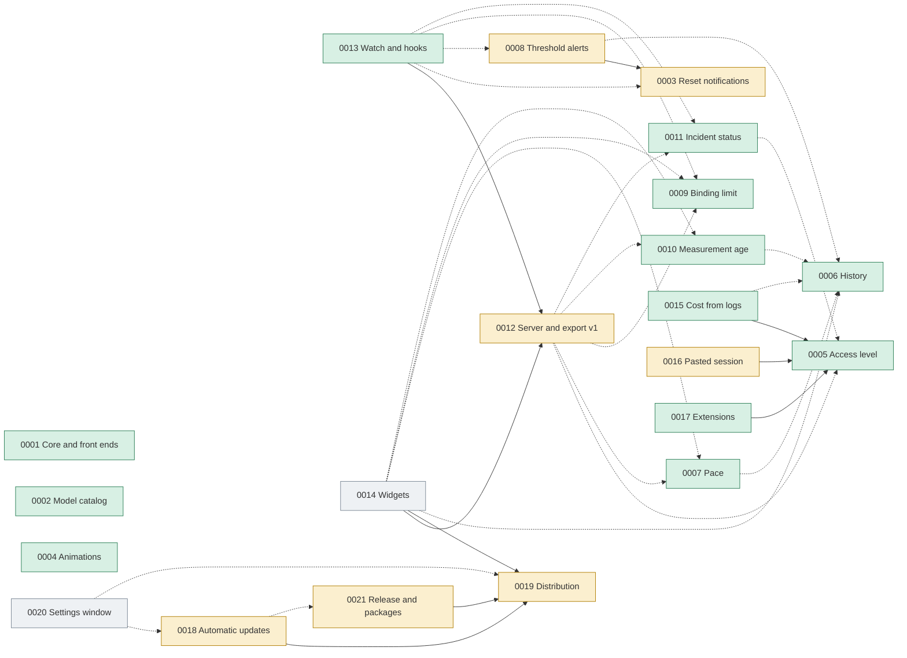

# Plan control (PRDs)

This file is the living index of `docs/plans`: it shows what has been implemented, what is in progress and how the plans depend on one another. Update it **in the same commit** that changes a plan's status.

| Field | Value |
|---|---|
| Last updated | 2026-10-23 |
| Cuotai version at that date | 0.75.3 |
| Plans | 21 (12 implemented, 7 in progress, 2 proposed) |

## 1. How to maintain it

- **Possible statuses:** `Proposed` (written, no code), `In progress` (part of the RFs delivered), `Implemented` (all RFs delivered and verified), `Superseded` or `Cancelled` (with the reason in the Notes column).
- **Terminology:** "RF" (from the Portuguese *requisito funcional*) means functional requirement. The acronym is kept so references in code, commits and plans stay stable.
- **When delivering an RF:** record the version and the commit in the plan itself, in the "Implementation status" section (as in PRD 0002); then update this file's row and the "Delivered by version" table (section 3).
- **Commit traceability:** the commit that delivers an RF carries the footer `Refs: PRD 0006 RF2` (one line per requirement). When PRD 0019 RF7 is implemented, `CHANGELOG.md` becomes the source of these deliveries and section 3 of this file points to it.
- **Strong dependency** means the plan cannot be delivered without the other (the cited RF must exist). **Weak dependency** means it works without the other, but is better with it.
- New plans get the next free number and enter here in the same change.
- **Language:** plans are written in English (see `AGENTS.md`).

## 2. Current situation

| ID | Plan | Status | Delivered | Depends on (strong) | Depends on (weak) | Notes |
|---|---|---|---|---|---|---|
| [0001](0001_core-support-for-graphical-frontends.md) | Core support for graphical front ends | Implemented | 0.7.x | — | — | Foundation of the desktop app and the descriptor contract. |
| [0002](0002_on-demand-model-catalog.md) | On-demand model catalog | Implemented | RF1 to RF6, 0.8.0 to 0.14.0 | — | — | After delivery, every provider except Alibaba Cloud started trying to list models (commit `a5c3d1f`). |
| [0003](0003_quota-reset-notifications.md) | Quota reset notifications | In progress | RF1 (0.24.0), RF2, RF3 partial (0.41.0), RF4 (0.44.0) | — | — | RF1: the pure `resets::upcoming` planner and `Account::key` (provider slug + name, reused by 0012 RF1.1) in the core. RF2: core `resets::plan` and `Ledger` (`notified.json`, digests and dates, 8 days), desktop `Notifier` and backend timer. RF3: Settings → Notifications (off by default), per-account bell, permission request, test notification and the next notice in the tray. RF4: `cuotai --notify` (off by default) reuses `resets::plan` for a header banner, one `BEL` and OSC 9 on iTerm2/WezTerm/Ghostty only, per session with no persistence; `--once`/`--json`/`--history` reject the flag. **Owner-blocked (RF3):** smoke on the packaged macOS app with a human granting and denying the system permission and a real notice arriving with the window hidden; Windows and Linux when available. Reused by 0008. |
| [0004](0004_animations-and-visual-effects.md) | Animations and visual effects | Implemented | RF1 (0.17.0, `4c89fad`), RF2 (0.18.0, `d5d3274`), RF3 (0.19.0, `251b5bc`), RF4 (0.20.0) | — | — | Motion tokens, dashboard effects, dialogs, tray and the TUI animation engine. |
| [0005](0005_usage-access-level.md) | Usage access level | Implemented | RF1, RF2 (0.33.0), RF3 (0.34.0), RF4 (0.35.0), RF5 (0.35.1) | — | — | Prerequisite of 0015, 0016 and 0017. RF1 and RF2 delivered in the core: `access::describe` (level, credential class, plan, scope, `metered`, evidence with `verified_on`, localized summary/hint/risk/reason) for the 36 providers and their switching modes, exhaustive on `Provider`, with `access.*` texts in `en-US`/`es`. RF3: the TUI wizard and the desktop dialog show the level in the picker, the credential notes under the credential help, the cost warning from the descriptor (`Provider::cost_advisory` removed) and a "Save anyway" confirmation for `Unavailable`, all from `account_edit::draft_access`. RF4: TUI and desktop cards and details show "level · summary" and the core's `UsageAccess::explain` (an `Unavailable` reason, a changed undocumented interface with its reference) in place of the generic failure; `UsageAccess` serializes for `export::v1`, where it enters as `access` with 0012 RF1.1; `--json` unchanged. RF5: `docs/providers.md` carries the usage access matrix (level, credential, plan, scope, evidence per provider and mode) generated from `access::describe` by a core test that fails on drift with regeneration instructions (`CUOTAI_REGENERATE_DOCS=1`); the new-provider guides in `AGENTS.md`, `docs/architecture.md` and `CONTRIBUTING.md` list the access descriptor as mandatory. |
| [0006](0006_local-measurement-history.md) | Local measurement history | Implemented | RF1, RF3 (0.37.0), RF2, RF4 (0.38.0), RF6 (0.39.0), RF5 (0.40.0) | — | — | Foundation of 0007 (projection), 0008, 0010 and 0014. RF1 and RF3: `history::HistoryStore` (private `history.sqlite3`, WAL, versioned schema, digests only, `NULL` for missing values) and the network-free `latest`, `series`, `windows` and `bounds`. RF2: `Monitor::with_history` records every `Ready` reading from a worker thread with a bounded queue (dropped readings and storage failures shown as warnings), compacting repeats within 15 minutes; wired into the TUI, the desktop and `--once`/`--json`, it also restores the last reading as stale on opening (0010 RF2.3) and feeds the recent slope of the pace (0007 RF1.5). RF4: retention (90 days, 7 to 365 via `--history-days` or `desktop.json`), hourly reduction after 7 days keeping each window's peak, a 64 MiB ceiling with a visible warning, CSV/JSON export and per-account or total erasure with confirmation in Settings → History. RF6: core `HistoryStore::account_history` / `MetricHistory` (points, windows, trend, sparkline levels) and `HistoryRange`; TUI details sparkline per metric over 24 h, 7 d or 30 d (`1`/`2`/`3`) degrading to minimum, maximum and last on narrow terminals; `cuotai --history [ACCOUNT] [--history-days N] [--json]` with exit 0/2/1. RF5: the Tauri command `account_history(index, generation, range, metric_key)` returns the core's placed `MetricHistory::chart` (bucket peaks, end point, resets) and window instances, refused as `stale` for another generation; the desktop details draw a compact area chart per metric (24 h, 7 d, 30 d) with an equivalent screen-reader table, an explained empty state and reduced motion respected; Settings → History adds the recording switch (`Monitor::set_history_recording`, `desktop.json`) and the size on disk (`HistoryStore::size_on_disk`). |
| [0007](0007_pace-until-reset.md) | Pace until the reset | Implemented | RF1, RF2 (0.23.0), RF3 (0.31.0), RF4 (0.32.0) | — | 0006 | RF1 and RF2 delivered: `pace::assess` and its localized labels in the core; `pace::Point` is the sample 0006 RF3 returns. Without history it uses the average since the start of the window. RF3: the desktop shows the pace under the card bar, per metric in the details (expected mark over the bar) and in the tray, with an on-by-default switch in Settings → Appearance. RF4: the TUI cards show a stage icon per eligible metric, the details a pace line per metric, and `--once` a `Ritmo:` line; `--json` is unchanged and pace enters `export::v1` with 0012. |
| [0008](0008_usage-threshold-alerts.md) | Usage threshold alerts | In progress | RF1 (0.42.0), RF2, RF3 partial (0.43.0), RF4 (0.45.0) | 0003 (RF2 and RF3) | 0006 | Reuses 0003's deliverer, permission and preferences. RF1: the pure `alerts::evaluate` in the core (thresholds 10–99%, 75 and 90 by default, exhaustion and recovery, once per window instance with the 2-minute drift, the highest of several, 5-point hysteresis, no notice of a past crossing on the first reading unless the previous recorded reading is at most 10 minutes older and still below it) and `AlertState` (digests and dates). RF2: the state persisted in 0003's `notified.json` (8 days), the desktop backend judging every report the cycle applies (the restored 0006 reading as the first `prev`), one notification per account and refresh, at most one per minute with the excess grouped, `alerts::notice` texts. RF3: Settings → Notifications "Usage alerts" (off by default), threshold chips 10–99, exhaustion and recovery switches in `desktop.json`, 0003's permission request, test button and bell reused, per-metric mute in the details, highlighted card, tray and details. RF4: `cuotai --notify` also judges every report the TUI's cycle applies with `alerts::evaluate` (core defaults, session-only `AlertState`) and shows the `alerts::notice` text in 0003's header banner with the same single `BEL` and OSC 9, at most one alert pass per minute; `--once`/`--json`/`--history` still reject the flag. **Owner-blocked (RF3):** smoke on the packaged macOS app with a human granting and denying the system permission, a real alert with the window hidden and preferences surviving a restart; Windows and Linux when available. |
| [0009](0009_binding-limit-indicator.md) | Binding limit indicator | Implemented | RF1, RF4 (0.22.0), RF2 (0.26.0), RF3 (0.27.0) | — | — | `metrics::binding` and its localized summary in the core, read by the desktop (ring, list, card chip, highlighted metric, opt-in "most restrictive first" order) and by the TUI (card leads with the binding metric, details marker) and `--once` (one summary line per account). Consumed by 0007, 0012 and 0014; 0012 RF1.1 adds it to `export::v1`. |
| [0010](0010_measurement-age-and-stale-reading.md) | Measurement age and stale reading | Implemented | RF1 (0.21.0), RF2 (0.25.0), RF3 (0.28.0), RF5 (0.29.0), RF4 (0.30.0) | — | 0006 | RF1 and RF2 delivered in the core: `freshness::age`/`assess` and the per-account last valid reading (`RefreshCycle::last_good_report`). RF3: the desktop shows the age and freshness on cards, tray, menu and icon tooltip, and the preserved reading as stale with the failure cause. RF5: the TUI cards and details and `--once` show the relative age (details also in UTC and local time) and the preserved reading marked `(desatualizada)`; `--json` unchanged. RF4: optional, display-only "Recharging" group on the desktop (Settings → Appearance, off by default) with the return time. RF2.3 holds per session only until 0006 RF2 persists the reading and loads it on opening (the plan's own "without history" branch). |
| [0011](0011_provider-incident-status.md) | Provider incident status | Implemented | RF1 (0.46.0), RF2, RF3 (0.47.0), RF4 (0.48.0), RF5 (0.49.0) | — | 0005 | Core verified-source registry: exhaustive 36-provider mapping, 17 scoped public sources and 19 explicit `None`, Statuspage v2 and verified native AWS/Google formats, anonymized captures and boundary tests; source/terms audit in `docs/providers.md`. Core status client: opt-in `IncidentMonitor` (off by default) on the `Monitor`'s HTTP client and semaphore, credential-free identified requests, 5 s timeout, 1 MiB cap, per-URL 5-minute cache with coalescing and stale fallback, normalized scoped states with sanitized incident title/start/link; failed queries during an incident gain an explanatory note (plus wait-before-reauthenticating for authentication) without changing `Status`. RF4: Settings → Privacy opt-in switch (off by default, `desktop.json`) with the explanation and the queried domains; card badge and "Open status page" through the allow-listed `open_external`; details, tray popover and an outage dot on the tray icon. RF5: TUI/CLI opt-in with `--status` or `CUOTAI_STATUS=1`, `--no-status` overriding both; card badge, details status block and a `--once` line; `--json` unchanged; `incident` in `export::v1`. Owner decision: opt-in, off until enabled; `--no-status` remains an override. |
| [0012](0012_local-http-server-and-export-contract.md) | Local HTTP server and `export::v1` contract | In progress | RF1 (0.36.0), RF2, RF3 (0.50.0), RF4 (0.51.0), RF5 partial (0.52.0) | — | 0005, 0007, 0009, 0010, 0011 | The `v1` contract is additive: new fields enter as the plans are delivered. RF1 delivered in the core: `export::v1::Export::from_cycle` with key, class, current report, age, freshness, the preserved `last_good` reading with `stale` (0010), `binding` (0009), `pace` per metric (0007), `access` (0005) and, since 0.49.0, the provider's `incident` (0011 RF5). Redacted notes and `source`, e-mail only with "include identity", `null` for missing values; `docs/export-v1.md`, a JSON Schema and a reference output guarded by tests. Owner decision: the server is off by default, loopback only, suggested port 6738. RF2 and RF3 delivered in the core: `serve::LocalServer` behind the `serve` feature (off by default), `httparse`, port 6738 (IANA-unassigned, checked) with fallback to the next nine, `GET`-only `/health`, `/v1/snapshot`, `/v1/accounts/{key}` and `/v1/limits` from the front end's cycle without queries (`503` + `Retry-After` before data), JSON with `no-store`, bounded connections, sizes and time; loopback bind unless an explicit flag plus token, loopback `Host` only, browser `Origin` refused unless "allow browsers", optional bearer token in the OS vault, access log without headers or query. RF4: `cuotai --serve [--port N] [--token-file FILE]` in the foreground without a TUI or terminal over a headless refresh cycle (no query per request), loopback only, explicit `--port` without fallback, URL on stdout and the access log on stderr, clean `SIGINT`/`SIGTERM` shutdown, exit 0/2 (no healthy account until shutdown)/1 (local error, invalid arguments included); `--json-v1` prints the `Export`; `--once`/`--json` unchanged. RF5: desktop Settings → Integration (off by default, `serve` in `desktop.json`): switch, exact port (6738 by default, no fallback), token generated into the OS vault, copied without display, renewed and revoked, "allow browsers" behind its warning, effective address; served from the app's own cycle (a feed published on every state change, no second cycle); state, bind errors and a port held by another Cuotai server (core `serve::is_cuotai_server`) in Settings and a main-window banner. **Owner-blocked (RF5):** the acceptance smoke on the packaged app in the owner's profile with the token in the login Keychain (turn on, `curl` with the token, revoke, turn off); the debug binary, the core vault and a real Keychain round trip were verified locally. |
| [0013](0013_watch-and-event-hooks.md) | `watch` and event hooks | Implemented | RF1 (0.53.0), RF2 (0.54.0), RF3 (0.55.0), RF4 (0.56.0) | 0012 (RF1) | 0003, 0008, 0009, 0011 | Hooks run user commands; consent is mandatory. RF1: the pure core `events::diff` over two consecutive `export::v1` accounts with an in-memory `EventState` (restart = new baselines): eleven stable edge events reusing `alerts::evaluate` (0008), the new `resets::passed` (0003), the binding metric (0009) and the provider status (0011); the first reading is a baseline, `usage_updated` at most once per 600 s per account, failures as a category only (deadlines now `query.timeout`, told apart from `offline`); `docs/events.md`. RF2: `cuotai --watch [--interval S] [--events list] [--jsonl]` over the core's new `headless::Driver` (shared with `--serve` in one process) and `watch::Watcher`: NDJSON or readable lines, `--interval` 60–86 400 s rejected below (never adjusted) with per-account intervals and the 300 s Bedrock floor kept, clean `SIGINT`/`SIGTERM`/`SIGHUP`, exit 0/2/1. RF3: `cuotai --watch --hooks` with the core `hooks` module: `hooks.toml` next to the accounts' TOML (argument-vector commands, no shell, unknown keys rejected), off by default and run only after a typed terminal confirmation of the exact commands kept as a SHA-256 of the rules per file (any change asks again; without a terminal a local error before any query), the event on stdin and in `CUOTAI_*` variables, `env_clear` plus `PATH`/`HOME`/`LANG`, the temporary directory as cwd, a 10 s (≤ 60 s) timeout that kills, 16 KiB of output, 4 at once with a 64-run queue that drops the oldest and warns, failures isolated from the cycle, and a payload-free `runs.log`. RF4: desktop Settings → Integration → Hooks (off by default): a rule editor saved through the core `hooks::Document` over the revision read, the exact-command confirmation dialog sharing the CLI's consent, the confirmed rules run over the app's own cycle (no query), a **Test** sample (`sample: true`) and the latest runs from `runs.log`; changed files stop the rules and ask again. |
| [0014](0014_system-widgets.md) | System widgets (macOS) | Implemented (partial) | RF1, RF4, RF5 (0.71.0); RF2.1/RF2.3 and RF3.1 owner-blocked | 0012 (RF1), 0019 | 0006, 0007, 0009, 0010 | Core `widget_snapshot` (atomic, `0600`, 256 KiB cap), the desktop publisher and Settings → Widgets delivered; the WidgetKit sources are written and type-checked, but the `.appex` packaging/signing and the app group wait for the Apple developer account (PRD 0019). |
| [0015](0015_estimated-cost-from-local-logs.md) | Estimated cost from local logs | Implemented | RF1, RF2 (0.57.0), RF3 (0.58.0), RF4 (0.59.0) | 0005 | 0006 | Never reads conversation content. RF4: core `cost::summarize`/`Scanner::summary` give every front end one `CostSummary` (per source today, yesterday and the span, by day and by model, state and an explained note); desktop "Local usage" block on every Claude and ChatGPT / Codex card (or a card of its own), details with an accessible bar chart and tables, Settings → Local cost directories and price table; TUI details section and `cuotai --cost [--days N] [--json]`; `local_cost` in `export::v1`. RF1 and RF2: core `cost` module, off by default, with per-source consent recorded as the digest of the `Disclosure` (exact directories, purpose, only numbers extracted) in a private `settings.json`; Claude Code and Codex CLI adapters behind a `Source` trait (formats confirmed against ccusage and openai/codex) that extract only time, model, token counts and a session digest, invalid lines counted, no access as a state; the incremental `cost.sqlite3` index (per-file control, growth, truncation and rotation, request dedup) filled by a bounded, low-priority background `CostWorker` that pauses in energy-saving mode; period and 120-day retention; turning off or erasing removes everything derived. Surfaces: `cuotai --cost-sources/--cost-enable/--cost-disable/--cost-erase/--cost-scan/--cost-period/--cost-retention-days` and the desktop's Settings → Local cost. RF3: an embedded per-model table of API prices in USD per million tokens with its effective date and source, overridden model by model by the user's manual `pricing.json` (owner decision: no download; an invalid file is ignored as a whole), the pure `cost::estimate` (total of the priced part, per model, tokens, unknown share, tables used; unknown models never zero; exact integer sums rounded half up) and the "estimate at API prices, not a charge" notice; `cuotai --cost-prices [--json]` lists the prices in effect. RF4 (display, `--cost`, `local_cost`) pending. |
| [0016](0016_user-pasted-session.md) | User-pasted session | In progress | RF1 (0.60.0), RF2, RF3 (0.61.0), RF4 (0.62.0), RF5 partial (0.63.0) | 0005 | — | Alternative to automatic cookie import, which the project does not adopt; owner decision: manual paste only. RF1: core `user_session` descriptors (cookie names, hosts, delivery) for Xiaomi MiMo and Alibaba Coding/Token Plan, `[accounts.session]` with a `credential_ref` and the stored slots, the session in the `TokenStore` vault entry keyed by reference, provider and slot, read by queries through `Credentials`; `session_env` keeps working and the TUI wizard (F3 twice) and the desktop dialog ("Move to the vault" twice) migrate it with explicit consent. RF2 and RF3: `user_session::reduce` keeps only the accepted cookies of a `Cookie:` line, list, inspector table or cURL (fragments reassembled, errors naming cookies only), the TUI "Colar sessão" step and the desktop "Web session" box paste (masked), preview, test (`Monitor::test_session`) and save it, replacing the same vault entry; `providers::send_session` sends it only over HTTPS to its declared hosts and never through a redirect, a rejected session reads "session expired or revoked", and a known expiry reaches `Report::session_expires_at`, the cards ("expires in N days") and an `AlertKind::SessionExpiring` alert under 3 days. RF4: `user_session::notice`/`paste_notice` put the `UserSession` level and the "full login session" warning on the cards (TUI and desktop), the TUI details and both paste steps, and `user_session::stage_forget` behind "Forget this session" (TUI summary F5 twice, desktop dialog button twice) deletes the vault entry and the reference, restored when the save is refused; `docs/providers.md` and `docs/oauth.md` describe the flow, what is stored and discarded, and the risks. Removing an account does not delete its session entry yet (the docs say to forget it first). RF5: the Xiaomi MiMo and Alibaba Coding/Token Plan adapters read every session through its descriptor (`providers::web_session`), from the vault or from the `session_env`-style variable kept as an alternative, refusing a session without its required cookies before any request; Alibaba reports say which source answered; field help, hints and guidance point to the paste first; the `docs/providers.md` matrix lists the vault session; an `access` test ties every `UserSession` interface to a descriptor (RF5.2). **Owner-blocked (RF5):** a live Alibaba Coding Plan and Qwen Cloud Token Plan console session to confirm that the reduced cookie set (`login_aliyunid_*`, `csrf`, `cna`, `sec_token`) is enough before any of them is marked required; CodexBar sends the whole console cookie jar. |
| [0017](0017_manifest-and-script-extensions.md) | Manifest and script extensions | Implemented | RF1 (0.64.0), RF2 (0.65.0), RF2.4, RF3, RF4 (0.66.0), RF5 (0.67.0) | 0005 | — | Core-managed extension accounts now have consent, integrity/revocation, shared runner/backoff, safe lifecycle states and isolated refreshes; TUI and desktop list/manage/test/enable/disable/create/remove extensions, cards show `Extension`, and `docs/extensions.md` plus three-locale lifecycle/card tests and CLI smoke cover the flow. |
| [0018](0018_automatic-updates.md) | Automatic updates for the desktop app | In progress | RF1.1, RF1.4, RF2, RF3, RF4.3 (0.74.0); RF1.2, RF1.3, RF4.1, RF4.2 (0.75.0); reviewer hardening across RF1–RF4 (0.75.1) | 0019 (RF2 and RF3) | 0019 (RF7) | Daily signed-update check with consent, Settings → Updates and About in four languages, and desktop install-source detection for supported path proofs; 0.75.1 restricts artifact URLs to this repository's HTTPS releases, retains cancelled/verified updates through the restart gate and repairs preference/package guidance. The production signed release, cross-OS update smoke, live package-manager installs, normal winget ownership marker and `release` environment protection remain open or owner-blocked. |
| [0019](0019_packaging-and-distribution.md) | Packaging, license, changelog and distribution | In progress | RF1 (0.17.2), RF7.1 to RF7.3 and RF7.6 (`CHANGELOG.md`, no bump), RF2 partial (0.27.1), RF3 superseded and delivered via 0021 RF1–RF4 (0.68.0), RF5 and RF6 (0.69.0, docs/CI, no bump), RF7.3 draft, RF7.4, RF7.5, RF7.7 and RF7.8 (0.69.0), RF4 superseded and delivered via 0021 RF5 (0.70.0) | — | — | Prerequisite of 0014 and 0018. RF2 is still owner-blocked for hosted proof. RF6.2's SBOM-attachment proof waits for a real published release (owner). The desktop About -> What's new screen remains open (RF7.7). |
| [0020](0020_settings-window-redesign.md) | Settings window redesign | Proposed | — | — | 0018, 0019 | Usability and design of settings: a dedicated window with a sidebar of seven pages, rows with short descriptions, apply-at-once, search and live sync. Replaces the 12-section popup dialog; no new settings or preference changes. |
| [0021](0021_release-pipeline-and-package-managers.md) | Release pipeline and package-manager publishing | In progress | RF1–RF4 (0.68.0, hardened in 0.75.1–0.75.3); RF5.1–RF5.7, RF7.2, RF7.3 and RF8.2 (0.70.0); RF8.1 partial (0.74.0/0.75.1, with 0018); RF9.2 and RF9.5 (0.75.2, hardened in 0.75.3); RF9.3 and RF9.4 (repository operations, no product version bump); RF6, RF8.1 completion and RF8.3 pending | 0019 (RF2, RF7.1 to RF7.3) | 0018, 0019 (RF7.5) | The monthly/manual RF9.3 workflow hashes byte-stable Homebrew, winget-source and Scoop policy documents against a reviewed baseline, verifies every semantic GitHub Action pin through official APIs, treats missing comments/tags and failed checks honestly, and paginates all open issues before deduplicating its review issue. Normal winget ownership still needs a durable installer marker. |

## 3. Delivered by version

[`CHANGELOG.md`](../../CHANGELOG.md) is the full record of every version (PRD 0019, RF7). Since 0.69.0 the RF7.8 CI check (`cargo xtask changelog-check`) compares the two sources on every push. Only versions with evidence in the repository enter (the PRDs' status tables and the commits that raise the version).

| Version | Plan | Requirements delivered |
|---|---|---|
| 0.7.x | 0001 | All RFs (core support for graphical front ends). |
| 0.8.0 | 0002 | RF1 (shareable configuration path), first part. |
| 0.9.0 | 0002 | RF2 (per-account model contract in the core). |
| 0.10.0 | 0002 | RF3 (SQLite persistence and manual sync). |
| 0.11.0 | 0002 | RF4 (verified adapters and the provider matrix). |
| 0.12.0 | 0002 | RF5 (Models section in the TUI). |
| 0.13.0 | 0002 | RF6 (Models section in the desktop app). |
| 0.14.0 | 0002 | RF1 (completion: TOML choice in the desktop app and different-files warning). |
| 0.17.0 | 0004 | RF1 (motion foundation: tokens, reduced motion and incremental dashboard update). |
| 0.17.1 | — | No plan requirement: security update (`rustls` 0.23.46 and `yoke-derive` 0.8.4). |
| 0.17.2 | 0019 | RF1 (license, `CONTRIBUTING.md`, `SECURITY.md`, issue templates, `deny.toml`; RF1.4 partial). |
| 0.18.0 | 0004 | RF2 (desktop dashboard effects: counting, level highlight, FLIP, exit, skeleton and micro-interactions). |
| 0.18.1 | — | No plan requirement: HTTPS-only transport guard for every credential-bearing request (providers and OAuth), prompted by the CodeQL code-scanning alerts. |
| 0.19.0 | 0004 | RF3 (dialog open/close motion with focus return, tray entrance and ring continuity, theme and language cross-fade). |
| 0.20.0 | 0004 | RF4 (TUI effects: animated bars with 1/8 cells, class blink, braille spinner, screen wipe, `--no-animations` and SSH/`TERM=dumb` opt-out). |
| 0.21.0 | 0010 | RF1 (core measurement age and `Fresh`/`Aging`/`Stale` freshness, clock-adjusted age reads zero). |
| 0.22.0 | 0009 | RF1 and RF4 (core binding metric: exhausted with the latest return or tightest remaining fraction, `binding_ratio`/`cmp_binding`, localized summary in `en-US`/`es`). |
| 0.23.0 | 0007 | RF1 and RF2 (core pace: expected use at a uniform pace, ±5-point `Reserve`/`OnPace`/`Ahead`/`Exhausted` stages with a tone, linear exhaustion projection from recent samples or the window average, localized labels in `en-US`/`es`). |
| 0.24.0 | 0003 | RF1 (core reset planner: eligibility, used/exhausted/always filters, lead time, same-minute grouping, 2-minute drift identity, stable account key). |
| 0.25.0 | 0010 | RF2 (core last valid reading per account: kept on non-auth failures with its original age, replaced on success, discarded on authentication failure or account edit, carried by moves and removals; per session until 0006). |
| 0.26.0 | 0009 | RF2 (desktop binding limit: tray ring and list "blocked until", card chip and highlighted metric, opt-in "most restrictive first" order from the core's `cmp_binding` that never rewrites the manual order). |
| 0.27.0 | 0009 | RF3 (TUI card leads with the binding metric, details marker and summary line, `--once` per-account summary line; `--json` and exit codes unchanged). |
| 0.27.1 | 0019 | RF2 partial (CI workflow on push and pull request for Linux, macOS and Windows with fmt, Clippy and the tests of both workspaces, `cargo deny`, pinned actions and read-only token; Windows icon and test manifest for the desktop build; per-OS coverage in `docs/architecture.md`; green hosted run pending on the owner). |
| 0.28.0 | 0010 | RF3 (desktop measurement age: relative age with Fresh/Aging/Stale icon and text on cards, tray tiles and rows, details and tray menu; icon tooltip with the oldest reading; preserved reading dimmed and still with a "Stale · N min ago" badge and the failure cause, removed by the next success). |
| 0.29.0 | 0010 | RF5 (TUI and CLI measurement age: relative age on cards, details with UTC and local time, `--once` headings; a failure with a preserved reading shows the old metrics still and marked `(desatualizada)` with their original age; `--json` unchanged). |
| 0.30.0 | 0010 | RF4 (desktop "Recharging" group: optional in Settings → Appearance, off by default; exhausted or blocked accounts in a collapsible section with "Returns …"/"Return unknown"; the manual order holds inside each group and the TOML order is never rewritten). |
| 0.31.0 | 0007 | RF3 (desktop pace: `get_view` carries each eligible metric's core `Pace` and texts plus the tightest metric with a pace; card line, per-metric details with the expected-consumption mark and projected exhaustion time, tray tooltip and list; "Show consumption pace" in Settings → Appearance, saved in `desktop.json`, on by default). |
| 0.32.0 | 0007 | RF4 (TUI and CLI pace: stage icon per eligible metric on the cards, a pace line per metric in the details with the outlook and expected use, a `Ritmo:` line under each eligible metric in `--once`; `--json` unchanged). |
| 0.33.0 | 0005 | RF1 and RF2 (core usage access descriptor: `access::describe` per account with `Official`/`Undocumented`/`Derived`/`Unavailable`, credential class, plan requirement, scope, `metered`, verified evidence and a mandatory reason for `Unavailable`; `access.*` ids in the `en-US`/`es` core catalogs, none in the desktop catalogs). |
| 0.34.0 | 0005 | RF3 (TUI wizard and desktop dialog: level label per provider in the picker, credential hint/risk/plan/reason under the credential help, the per-query cost warning derived from the descriptor, and an explicit "Save anyway" before saving an `Unavailable` account; texts from the core in pt, en-US and es). |
| 0.35.0 | 0005 | RF4 (TUI and desktop cards and details: discreet level and summary, the reason of an `Unavailable` account and "the interface may have changed" with its reference for an `Undocumented` schema mismatch in place of the generic failure; serializable descriptor for `export::v1`; `--json` unchanged). |
| 0.35.1 | 0005 | RF5 (generated `docs/providers.md` usage access matrix verified against `access::describe` by a drift test; access descriptor listed as a mandatory step in the new-provider guides). |
| 0.36.0 | 0012 | RF1 (core `export::v1` contract built from the `RefreshCycle` without queries: key, class, current report, age and freshness, preserved stale reading, binding metric, pace per metric and access descriptor; redacted notes and source, e-mail only with "include identity", `null` for missing values; `docs/export-v1.md`, JSON Schema and reference-output tests). |
| 0.37.0 | 0006 | RF1 and RF3 (core measurement history: private `history.sqlite3` in WAL with a busy timeout, versioned forward-migrated schema, idempotent per account, metric and time, isolated by configuration and account-identity digests, `NULL` for missing values, removed accounts marked for pruning, storage errors exposed; network-free `latest` with the original time, `series`, `windows` with reset detection and `bounds`). |
| 0.38.0 | 0006 | RF2 and RF4 (recording from the refresh off its critical path with a bounded queue, 15-minute compaction and visible warnings, in the TUI, the desktop and `--once`/`--json`; last reading restored as stale on opening (0010 RF2.3) and recent-slope pace (0007 RF1.5); 90-day retention configurable from 7 to 365 days, hourly reduction keeping window peaks, 64 MiB ceiling, CSV/JSON export and confirmed erasure). |
| 0.39.0 | 0006 | RF6 (TUI details sparkline per metric over 24 h, 7 d or 30 d with keys `1`/`2`/`3`, blanks for gaps and a minimum/maximum/last text fallback on narrow terminals; `cuotai --history [ACCOUNT] [--history-days N] [--json]` printing each metric's series, summary and window instances without queries, exit 0/2/1; core `HistoryStore::account_history`, `MetricHistory` and `HistoryRange`). |
| 0.40.0 | 0006 | RF5 (desktop details: a compact area chart per metric over 24 h, 7 d or 30 d with the last point, reset markers, gaps, an equivalent screen-reader table, an explained empty state and reduced motion respected, from the generation-guarded Tauri command `account_history`; Settings → History recording switch and size on disk; core `MetricHistory::chart`, `Monitor::set_history_recording` and `HistoryStore::size_on_disk`). |
| 0.41.0 | 0003 | RF2 (backend-scheduled reset notices: core `resets::plan` with the 10-minute missed window and one grouped notice per account, `ResetEvent::notice` texts, `Ledger` in `notified.json`; desktop `Notifier` over `tauri-plugin-notification` 2.7.0 and `run_notices` with `sleep_until`) and RF3 partial (Settings → Notifications, per-account bell, permission request with guidance, test notification, next notice in the tray menu, tooltip and popover; the packaged-app permission smoke waits for the owner). |
| 0.42.0 | 0008 | RF1 (core threshold evaluator: `alerts::evaluate` over the previous and new readings with an injected clock, capped quotas only, thresholds 10–99% with 75/90 by default, exhaustion always evaluated, once per window instance with the 2-minute `resets_at` tolerance, only the highest of several, re-armed 5 points below or by a new window, `Recovered` after a notified exhaustion, no burst on the first reading; `AlertState` with digests and dates). |
| 0.43.0 | 0008 | RF2 (usage alerts persisted with 0003's `notified.json`, judged by the desktop backend after each report the refresh cycle applies, one notification per account per refresh and at most one per minute, `alerts::notice` texts in pt-BR/en-US/es) and RF3 partial (Settings → Notifications usage alerts with threshold chips, exhaustion and recovery switches, 0003's permission, test and bell reused, per-metric mute, highlighted card, tray and details; the packaged-app permission smoke waits for the owner). |
| 0.44.0 | 0003 | RF4 (TUI `--notify`, off by default: the core planner on the loop's 1 s tick over the current or last valid reading, a header banner kept for an hour, one `BEL` per pass, OSC 9 only on iTerm2, WezTerm and Ghostty outside tmux/screen, once per session and never for a reset before the session opened; `--once`/`--json`/`--history` reject the flag). |
| 0.45.0 | 0008 | RF4 (TUI `--notify` usage alerts: every report the TUI's refresh cycle applies judged by `alerts::evaluate` against the reading it replaces, with the core defaults and a session-only state; the `alerts::notice` text in the header banner, one `BEL` per pass and OSC 9 on iTerm2/WezTerm/Ghostty, one line per account, at most one alert pass per minute, removed accounts forgotten, no persistence and no query; `--once`/`--json` unchanged). |
| 0.46.0 | 0011 | RF1 (pure `incidents::source`, verified public endpoints/formats/use policies and exact component selectors, shared platform URLs, explicit `None` for unverified sources, anonymized real fixtures and a per-provider table test; source matrix and exclusions in `docs/providers.md`; no status polling or frontend changes yet). |
| 0.47.0 | 0011 | RF2, RF3 (core `IncidentMonitor`: opt-in, off by default, shared HTTP client and query semaphore, identified credential-free requests with a 5 s timeout and 1 MiB cap, per-URL 5-minute cache with single-flight coalescing and stale fallback, all five formats normalized per scope with sanitized incident title/start/link, queried only for configured providers; `note.incident.ongoing`/`note.incident.auth_wait` on failed queries during a `Degraded`-or-worse incident without changing `Status`; no frontend change yet). |
| 0.48.0 | 0011 | RF4 (desktop provider status: Settings → Privacy switch, off by default, explaining the public requests and listing the domains of the configured providers; card badge with tone, icon and the core's state text plus "Open status page" through the allow-listed `open_external`; full status in the details; tray popover rows, tiles and a footer chip; a red outage dot on the tray icon for a partial outage or worse; core `IncidentState::label`, `StatusSource::host`, `Monitor::status_domains` and `incidents::is_status_link`). |
| 0.49.0 | 0011 | RF5 (TUI and CLI provider status: opt-in `--status`/`CUOTAI_STATUS=1`, off by default, `--no-status` overriding both; card badge on the top border for an incident, maintenance or an unreadable page, the full status in the details, a `Status do provedor:` line in `--once` beside the RF3 notes; `--json` unchanged; `export::v1` gains `incident`). |
| 0.50.0 | 0012 | RF2 and RF3 (core `serve::LocalServer` behind the off-by-default `serve` feature: loopback on port 6738 with fallback to the next nine, `GET`-only `/health`, `/v1/snapshot`, `/v1/accounts/{key}` and `/v1/limits` read from the front end's refresh cycle without provider queries, `503` with `Retry-After` before the first reading, JSON with `Cache-Control: no-store`, bounded connections, head, URL and time; non-loopback bind only with an explicit flag and a token, loopback `Host` against DNS rebinding, browser `Origin`/`Sec-Fetch-Site` refused and no CORS unless "allow browsers", optional bearer token generated by Cuotai in the OS vault, no secrets in answers or the access log). |
| 0.51.0 | 0012 | RF4 (`cuotai --serve [--port N] [--token-file FILE]`: the core's local server in the foreground without the TUI or a terminal, over a headless refresh cycle like the dashboard's, never querying per request; default port 6738 with fallback, explicit `--port` exact, bearer token from a file, address on stdout and access log on stderr, clean `SIGINT`/`SIGTERM` shutdown with the port closed, exit 0, 2 when no account was healthy until shutdown, 1 for local errors including invalid arguments; `--json-v1` prints the full `export::v1`; `--once`/`--json` unchanged). |
| 0.52.0 | 0012 | RF5 partial (desktop Settings → Integration: the local server off by default, loopback on exactly the chosen port (6738 by default), served from the app's own refresh cycle without a second cycle or per-request queries; token generated into the OS vault, copied without display, renewed and revoked, a missing or refused token keeps it off; "allow browsers" behind its confirmed warning; effective address, bind errors and a conflict with another Cuotai server such as `cuotai --serve` (core `serve::is_cuotai_server`) shown in Settings and a main-window banner; the packaged-app smoke with the owner's Keychain waits for the owner). |
| 0.53.0 | 0013 | RF1 (core event engine: pure `events::diff` over two consecutive `export::v1` accounts with an in-memory `EventState`; `quota_threshold_crossed`, `quota_exhausted`, `quota_recovered` from `alerts::evaluate`, `quota_reset` from the new `resets::passed`, `account_blocked`/`account_unblocked` from the binding metric, `refresh_failed`/`refresh_recovered`/`auth_required`, `provider_incident`, `usage_updated` at most once per 600 s; the first reading is a baseline and a persisting condition never repeats; payloads with `schema`, account, metric, current and previous values and only a failure category, never credentials, URLs, notes or raw messages; deadlines reported as `query.timeout`; `docs/events.md`). |
| 0.54.0 | 0013 | RF2 (`cuotai --watch [--interval S] [--events list] [--jsonl]`: the core's refresh cycle without the TUI through the new `headless::Driver`, shared with `--serve` in the same process so a reading is queried once; `watch::Watcher` compares each export with the previous one and emits the selected events (`--events`, payload names, unknown ones rejected); `--jsonl` writes one NDJSON payload per line flushed at once with messages on stderr, otherwise one readable `Event::summary` line per transition in `CUOTAI_LANG`; `--interval` 60–86 400 s, smaller rejected, accounts with their own interval keep it and AWS Bedrock never below 300 s; clean `SIGINT`/`SIGTERM`/`SIGHUP` shutdown, exit 0, 2 when an account's latest reading failed, 1 for local errors; tested against `wiremock` with an accelerated clock, a binary test with a fake `bl` and a `jq` smoke). |
| 0.55.0 | 0013 | RF3 (`cuotai --watch --hooks`: core `hooks::Hooks` reads `hooks.toml` beside the accounts' TOML with argument-vector commands; `hooks::Consent` keeps the SHA-256 of the confirmed rules per file and is the only way to the `Confirmed` set `hooks::Runner` needs; the CLI lists the exact commands and asks for a typed confirmation in a terminal, a local error without one; hooks get the event on stdin and in `CUOTAI_EVENT`/`CUOTAI_ACCOUNT`/`CUOTAI_PROVIDER`/`CUOTAI_METRIC`, an environment of `PATH`/`HOME`/`LANG` only, the temporary directory as cwd, a timeout that kills, 16 KiB of captured output, at most 4 at once and a bounded queue that drops the oldest with a warning; every run goes to a payload-free `runs.log`) |
| 0.56.0 | 0013 | RF4 (desktop Settings → Integration → Hooks, off by default: rule editor over core `hooks::Document` with revision check and kept comments, confirmation dialog with the core's exact listing shared with `cuotai --watch --hooks`, the confirmed rules run on the app's own refresh cycle without queries, **Test** with `Rule::sample` (`sample: true`), latest runs from `RunLog::latest`, a changed file stops the rules with a main-window banner). |
| 0.57.0 | 0015 | RF1 and RF2 (local cost sources and index, off by default: per-source consent by the digest of the exact disclosure in `cuotai --cost-enable` and Settings → Local cost; Claude Code and Codex CLI adapters extracting only time, model, token counts and a session digest, invalid lines counted, no access as a state; the incremental private `cost.sqlite3` with growth, truncation and rotation, a bounded low-priority background scan that pauses in energy-saving mode, period, 120-day retention, and complete removal by turning a source off or erasing). |
| 0.58.0 | 0015 | RF3 (local cost prices and computation: embedded per-model API price table in USD per million tokens with effective date and source, the user's manual `pricing.json` overriding it model by model and ignored as a whole when invalid, `cuotai --cost-prices [--json]`, the pure `cost::estimate` with unknown models never priced at zero, exact sums rounded half up and the "estimate at API prices, not a charge" notice). |
| 0.59.0 | 0015 | RF4 (local cost display: core `CostSummary` with today, yesterday and the saved period or `--days N`, by day and by model, unknown prices never zero; desktop "Local usage" block in the same place on every account of the tool or a card of its own, details with an accessible bar chart and its table plus a table per model, Settings → Local cost directories (a new list turns the source off and erases its data) and price table; TUI account details section; `cuotai --cost [--days N] [--json]` with exit 0/2/1; `local_cost` in `export::v1` for `--json-v1`, `--serve` and the desktop's local server). |
| 0.60.0 | 0016 | RF1 (core `UserSession` credential: per-provider `user_session` descriptors with cookie names, hosts and delivery; `[accounts.session]` with a random `credential_ref` and the stored slots, validated and never shared; the session in the OAuth `TokenStore` vault, development SQLite included, under a key bound to reference, provider and slot, read by queries through `Credentials`; `session_env` accounts unchanged, migrated to the vault only after an explicit confirmation in the TUI wizard and the desktop dialog, with rollback when the TOML save fails; the value never in the TOML, `Debug`, errors or reports). |
| 0.61.0 | 0016 | RF2 and RF3 (guided paste reduced by the core to the descriptor's cookies from a `Cookie:` line, list, inspector table or cURL, numbered fragments reassembled and errors naming cookies only; TUI wizard paste step and desktop dialog paste box, masked, cleared on close, with a read-only test query; the paste stored in the account's existing vault entry; sessions sent only over HTTPS to their declared hosts and never through a redirect; "session expired or revoked; paste a new one" on rejection; known expiry on the cards and a near-expiry usage alert). |
| 0.62.0 | 0016 | RF4 (the `UserSession` level and the "full login session" risk warning from the core on the TUI and desktop cards, the TUI details and both paste steps, in pt-BR, en-US and es; "Forget this session" on the TUI wizard summary and in the desktop dialog, two steps, deleting the account's vault entry and its reference with the session restored when the save is refused; the flow, what is stored and discarded, and the risks in `docs/providers.md` and `docs/oauth.md`). |
| 0.63.0 | 0016 | RF5 partial (Xiaomi MiMo, Alibaba Coding Plan and Alibaba Token Plan read their sessions through the `UserSession` descriptor from the vault or the kept `session_env` variable, with the required cookies checked before any request and messages naming only cookies or the variable; vault or variable named in Alibaba notes; guidance, field help and the `UserSession` hint point to the paste first; the `docs/providers.md` matrix shows the vault session; RF5.2 evidence rule enforced by an `access` test; live confirmation of the Alibaba cookie names owner-blocked). |
| 0.64.0 | 0017 | RF1 (`extensions::discover` over `<data dir>/cuotai/extensions/<id>/manifest.toml` with field validation, a command confined to the extension's folder, rejections with localized reasons and duplicate ids rejected; `Discovery::catalog` with "Extension: {name}", the `Extension` access level and its warning, kept out of the account editors until RF3 and RF4). |
| 0.65.0 | 0017 | RF2 partial (`extensions::output::check` against the schema-1 output contract with size, count, number, date, name and unit limits, markup cleaning and truncation, `source = "extension:<id>"`, invalid outputs as `Error` reports with the `invalid_output` failure category and field-only violations, a non-`ready` status never trusted beyond a plain error; RF2.4 `--extension-check` moves to RF3 and RF4). |
| 0.66.0 | 0017 | RF2.4, RF3 and RF4 (approved extension execution through the bounded, no-shell runner with manifest argv, extension-directory working directory, closed stdin, reduced environment allowlist, output/concurrency/time/process-tree limits and no claim of OS sandboxing; explicit consent with command/directory/environment/interval disclosure; SHA-256 manifest and executable digests with reapproval after changes; `cuotai --extension-check` normalized output and violations; network and file access remain unrestricted by Cuotai). RF5 remains pending. |
| 0.67.0 | 0017 | RF5 (core Manager/Consent/Runner extension-account integration with exact disclosure, consent/integrity/revocation, shared runner/backoff, lifecycle/error states and refresh isolation; TUI and desktop lifecycle actions and `Extension` cards; extension documentation, three-locale tests and real CLI smoke). |
| 0.68.0 | 0021; 0019 | 0021 RF1–RF4 (deterministic tag/version gate and dry run; cross-platform artifacts; honest signing/checksum/provenance/SBOM state; draft-to-verified release and public verification). PRD 0019 RF3 is superseded and delivered through these requirements; RF5–RF8 and package-manager publishing remain pending. |
| 0.69.0 | 0019 | RF5 (platform support matrix in `docs/platforms.md`, per-OS TUI smoke test in CI with a no-network fixture, localized-explanation audit) and RF6 (`docs/release-policy.md`: versioning, support and reproducibility; RF6.2 partial — SBOM-attachment proof waits for a real release); docs/CI part without a version bump of its own. RF7.3 (`changelog-draft`), RF7.4 (CI changelog check and pull-request gate), RF7.5 (release/updater notes from the shared parser), RF7.7 (core `changelog::entries()`, TUI What's new, `cuotai --changelog`; desktop screen open) and RF7.8 (plan-link check). |
| 0.70.0 | 0021; 0019 | 0021 RF5.1–RF5.7 (one `package-manifests` renderer for the Homebrew cask/formula, winget, Scoop and AUR manifests, per-channel validation and opt-in channel jobs that can never fail the release; RF5.4 partial — crates.io token and first publication are owner actions), RF7.2 and RF7.3 (README installation section, `packaging/README.md`), RF8.2 (uninstall keeps user data, proven in CI). PRD 0019 RF4 is superseded and delivered through 0021 RF5. |
| 0.71.0 | 0014 | RF1 (core widget snapshot: compact `export::v1` subset, atomic `0600` write, 256 KiB deterministic truncation, stale keeps the original age, unavailable never borrows data), RF2.2, RF4 (Settings → Widgets in three languages, off by default, delete on disable), RF5.1 (`widget.json` for Waybar/GNOME/KDE), RF3.2–RF3.5 partial (WidgetKit sources type-checked; `.appex` packaging, app group and signing owner-blocked). |
| 0.71.1 | 0014 | Build fix: the macOS-only app-group constant of the widget snapshot compiles only on macOS, restoring the Windows and Linux desktop builds (RF2.1). |
| 0.74.0 | 0018; 0021 | Desktop in-app updater (0018 RF1.1, RF1.4, RF2, RF3, RF4.3 with 0021 RF8.1 partial): `tauri-plugin-updater` 2.14.0 pinned with the public key in `tauri.conf.json` and no capability permission (the web UI only calls shell commands); a daily check on opening and every 24 h that sends nothing but the version, OS and architecture, off by preference, environment, build key or a detected package-manager path (zero requests proven by a counting server); a notice with the release notes in the window and the tray, download with progress and cancel, a localized failure with the manual link, a restart that stops the cycle and is blocked during a login; Settings → Updates and About in pt-BR/en-US/es; HTTPS-only endpoint and a certificate failure as an error; `docs/updater-security.md` with the key custody, leak and loss procedures. Open or owner-blocked: normal winget ownership needs a durable marker, plus the production signed release, cross-OS smoke, live package-manager installs and environment protection. |
| 0.75.0 | 0018; 0021 | Updater artifacts from the release pipeline (0018 RF1.2, RF1.3, RF4.1, RF4.2 with 0021 RF2): `xtask updater-manifest` renders one multi-platform `latest.json` with a deterministic generic owner per architecture; updater signatures are produced where each artifact's bytes are final — the macOS archive after notarization, the Windows installers after Authenticode, the Linux packages while bundling through the release-time `tauri.updater.conf.json` overlay; the Linux build jobs joined the `release` environment, which they were missing; a run without the key still bundles and reports the updater as unavailable. |
| 0.75.1 | 0018; 0021 | Updater hardening (0018 RF1–RF4; 0021 RF1–RF4 and RF8.1 partial): one signing record carries both platform/checksum and detached updater proofs; unsigned dispatch and partially signed tag paths remain distinct; branch rehearsals use a secretless environment; artifact URLs are restricted to this repository's HTTPS releases; cancellation and the restart/login gate retain pending verified bytes; persisted dates, Scoop boundaries, Linux guidance, the preference switch and real TLS/four-locale coverage are corrected. Normal winget ownership remains pending on a durable installer/receipt marker. |
| 0.75.2 | 0021 | RF9.2 and RF9.5 (least-privilege workflow permissions and step-owned environment secrets; fork-safe triggers; routine dispatch preflight plus explicit full artifact rehearsal; bounded optional matrix, Cargo caches and timeouts; early required-credential gate; fixture-tested `cargo xtask workflow-check` in CI and release preflight). |
| 0.75.3 | 0021 | RF9.2 and RF9.5 hardening: both secretless dispatch modes avoid production credential evaluation, tag pushes retain the required-credential gate, and `workflow-check` rejects dynamic whole-secret-context expressions while accepting owned named secret references. Also updates `ctutils` to 0.4.4 to resolve RUSTSEC-2026-0385. RF9.3 repository operations landed afterwards without a product version bump: a monthly/manual, byte-stability-gated policy-hash and action-release monitor with one fully paginated, deduplicated review issue. |

## 4. Dependency graph

Solid arrows are strong dependencies; dashed ones, weak. The arrow points from a plan to what it depends on.

### What each plan unblocks

| Plan | Unblocks (strong) | Benefits (weak) |
|---|---|---|
| 0003 | 0008 | 0013 |
| 0005 | 0015, 0016, 0017 | 0011, 0012 |
| 0006 | — | 0007, 0008, 0010, 0014, 0015 |
| 0007 | — | 0012, 0014 |
| 0008 | — | 0013 |
| 0009 | — | 0012, 0013, 0014 |
| 0010 | — | 0012, 0014 |
| 0011 | — | 0012, 0013 |
| 0012 | 0013, 0014 | — |
| 0019 | 0014, 0018 | — |

## 5. Suggested delivery order

The waves respect the strong dependencies; within each wave the order is by priority (impact against competitors, according to the 2026-10-19 market analysis).

| Wave | Plans | Why |
|---|---|---|
| 0 (under way) | 0003 | Infrastructure reused by the others (0004 is done). |
| 1 (no dependencies) | 0019 (RF1: license, done), 0006, 0007, 0009, 0005, 0012, 0011, 0020 | They unblock almost everything; 0006 and 0007 close the biggest gap against competitors (history and pace). |
| 2 | 0008, 0010, 0018, 0013, 0016, 0015, 0017, 0021 | They depend on items from wave 0 or 1. |
| 3 | 0014 | Depends on 0012's contract and 0019's pipeline, plus an Apple developer account. |

Critical path of distribution: **0019 → 0018**. Critical path of integrations: **0012 → 0013 and 0014**. Critical path of alerts: **0003 → 0008**.

## 6. Decisions for the project owner

| Decision | Affects | Notes |
|---|---|---|
| ~~Repository license~~ | 0019 (RF1) | **Decided on 2026-10-19: `MIT OR Apache-2.0`**, holder "Cuotai contributors". |
| ~~Documentation language~~ | 0019 (RF1.4) | **Decided on 2026-10-19: English** for the README, `docs/`, plans, commits, pull requests and issues. Done: every plan, PRD 0004 included, is in English. |
| Apple developer account and Developer ID certificate | 0014, 0018, 0019, 0021 | Needed for notarization and for widgets (*app group*). |
| Windows Authenticode certificate | 0019, 0021 | Without it, the installer ships unsigned, declared in the release notes. |
| ~~Cookie policy~~ | 0016 | **Decided on 2026-10-21: manual paste only**; Cuotai never imports cookies from browsers (recorded with PRD 0016 RF1 in 0.60.0). |
| ~~Local server on by default or not~~ | 0012 | **Decided on 2026-10-20: off by default, loopback only**, suggested port 6738 (checked for conflicts when RF2 is implemented). |
| ~~Reset notices on by default or not~~ | 0003 (RF3) | **Decided on 2026-10-20: off by default**; nothing is notified until the user turns on Settings → Notifications (delivered in 0.41.0). |
| ~~Provider status on by default or not~~ | 0011 | **Decided on 2026-10-20: opt-in, off until enabled**, with `--no-status` as an override; RF1 only registers verified sources, without making requests. |

## 7. History of this file

| Date | Change |
|---|---|
| 2026-10-19 | Control created with PRDs 0001 to 0019. |
| 2026-10-19 | Changelog added as a requirement (PRD 0019, RF7); new "Delivered by version" section and the `Refs:` footer in commits. |
| 2026-10-19 | PRD 0019 RF1 delivered in 0.17.2 (`MIT OR Apache-2.0` license); documentation-language decision (English) recorded. |
| 2026-10-19 | PRD 0004 RF2 delivered in 0.18.0. |
| 2026-10-19 | Documentation and plans translated to English (except PRD 0004); plan files renamed to English slugs; commits are written in English from now on. |
| 2026-10-19 | PRD 0004 RF3 delivered in 0.19.0. |
| 2026-10-19 | PRD 0004 RF4 delivered in 0.20.0; plan 0004 implemented. |
| 2026-10-19 | PRD 0004 translated to English; every plan is now in English. |
| 2026-10-19 | `CHANGELOG.md` created with the reconstructed history from 0.1.0 to 0.20.0 (PRD 0019 RF7.1 to RF7.3 and RF7.6). |
| 2026-10-19 | PRD 0010 RF1 delivered in 0.21.0; plan 0010 in progress. |
| 2026-10-19 | PRD 0009 RF1 and RF4 delivered in 0.22.0; plan 0009 in progress. |
| 2026-10-19 | PRD 0007 RF1 and RF2 delivered in 0.23.0; plan 0007 in progress. |
| 2026-10-19 | PRD 0003 RF1 delivered in 0.24.0; plan 0003 in progress. |
| 2026-10-19 | PRD 0010 RF2 delivered in 0.25.0 (per session until PRD 0006 RF2 persists the reading); plan 0010 in progress. |
| 2026-10-19 | PRD 0009 RF2 delivered in 0.26.0; plan 0009 in progress (RF3 pending). |
| 2026-10-19 | PRD 0009 RF3 delivered in 0.27.0; plan 0009 implemented. |
| 2026-10-19 | PRD 0019 RF2 delivered as partial in 0.27.1 (CI workflow; the green GitHub run on three systems and the failing Clippy pull request wait for the owner to push); plan 0019 stays in progress. |
| 2026-10-20 | PRD 0010 RF3 delivered in 0.28.0; plan 0010 stays in progress (RF4 and RF5 pending). |
| 2026-10-20 | PRD 0010 RF5 delivered in 0.29.0; plan 0010 stays in progress (RF4 pending). |
| 2026-10-20 | PRD 0010 RF4 delivered in 0.30.0; plan 0010 implemented. |
| 2026-10-20 | PRD 0007 RF3 delivered in 0.31.0; plan 0007 stays in progress (RF4 pending). |
| 2026-10-20 | PRD 0007 RF4 delivered in 0.32.0; plan 0007 implemented. |
| 2026-10-20 | PRD 0005 RF1 and RF2 delivered in 0.33.0; plan 0005 in progress (RF3 to RF5 pending). |
| 2026-10-20 | PRD 0005 RF3 delivered in 0.34.0; plan 0005 stays in progress (RF4 and RF5 pending). |
| 2026-10-20 | PRD 0005 RF4 delivered in 0.35.0; plan 0005 stays in progress (RF5 pending). |
| 2026-10-20 | PRD 0005 RF5 delivered in 0.35.1; plan 0005 implemented. |
| 2026-10-20 | PRD 0012 RF1 delivered in 0.36.0; plan 0012 in progress (RF2 to RF5 pending); local server decision recorded (off by default, loopback only, port 6738). |
| 2026-10-20 | PRD 0006 RF1 and RF3 delivered in 0.37.0; plan 0006 in progress (RF2 and RF4 to RF6 pending). |
| 2026-10-20 | PRD 0006 RF2 and RF4 delivered in 0.38.0 (with PRD 0010 RF2.3 restart survival and the PRD 0007 recent slope wired); plan 0006 stays in progress (RF5 and RF6 pending). |
| 2026-10-20 | PRD 0006 RF6 delivered in 0.39.0; plan 0006 stays in progress (RF5 pending). |
| 2026-10-20 | PRD 0006 RF5 delivered in 0.40.0; plan 0006 implemented. |
| 2026-10-20 | PRD 0003 RF2 and RF3 (partial: packaged-app permission smoke owner-blocked) delivered in 0.41.0; plan 0003 stays in progress (RF4 pending); reset notices off by default. |
| 2026-10-20 | PRD 0008 RF1 delivered in 0.42.0; plan 0008 in progress (RF2 to RF4 pending). |
| 2026-10-20 | PRD 0008 RF2 and RF3 (partial: packaged-app permission smoke owner-blocked) delivered in 0.43.0; plan 0008 stays in progress (RF4 pending). |
| 2026-10-20 | PRD 0003 RF4 delivered in 0.44.0 (TUI `--notify`); plan 0003 stays in progress only for the owner-blocked RF3 packaged-app smoke. |
| 2026-10-20 | PRD 0008 RF4 delivered in 0.45.0 (TUI usage alerts with `--notify`); plan 0008 stays in progress only for the owner-blocked RF3 packaged-app smoke. |
| 2026-10-20 | PRD 0011 RF1 delivered in 0.46.0 (verified public incident source registry and component scope audit); plan 0011 in progress, RF2–RF5 pending; opt-in/off-by-default decision recorded. |
| 2026-10-20 | PRD 0011 RF2 and RF3 delivered in 0.47.0 (opt-in core status client, cache and failure correlation); plan 0011 in progress, RF4–RF5 pending. |
| 2026-10-20 | PRD 0011 RF4 delivered in 0.48.0 (desktop badges, tray indicator and Settings → Privacy opt-in); plan 0011 in progress, RF5 pending. |
| 2026-10-20 | PRD 0011 RF5 delivered in 0.49.0 (TUI/CLI incident display, opt-in `--status`/`CUOTAI_STATUS` with the `--no-status` override, `incident` in `export::v1`); plan 0011 implemented. |
| 2026-10-20 | PRD 0012 RF2 and RF3 delivered in 0.50.0 (core loopback server with Host/Origin/token security behind the `serve` feature, off by default; port 6738 conflict check recorded); plan 0012 stays in progress (RF4 and RF5 pending). |
| 2026-10-20 | PRD 0012 RF4 delivered in 0.51.0 (`cuotai --serve`, `--port`, `--token-file`, exit codes 0/2/1 and `--json-v1`); plan 0012 stays in progress (RF5 pending). |
| 2026-10-20 | PRD 0012 RF5 delivered as partial in 0.52.0 (desktop Settings → Integration local server, off by default; the packaged-app smoke with the owner's Keychain token is owner-blocked); plan 0012 stays in progress only for that smoke. |
| 2026-10-21 | PRD 0013 RF1 delivered in 0.53.0 (core event engine `events::diff`, in-memory baselines, failure categories and `query.timeout`); plan 0013 in progress (RF2–RF4 pending). |
| 2026-10-21 | PRD 0013 RF2 delivered in 0.54.0 (`cuotai --watch` with `--interval`, `--events` and `--jsonl` over the core's `headless::Driver`, shared with `--serve`); plan 0013 in progress (RF3–RF4 pending). |
| 2026-10-21 | PRD 0013 RF3 delivered in 0.55.0 (`cuotai --watch --hooks` with `hooks.toml`, mandatory confirmation by a hash of the rules, isolated environment, limits and the run log); plan 0013 in progress (RF4 pending). |
| 2026-10-21 | PRD 0013 RF4 delivered in 0.56.0 (desktop Settings → Integration hooks editor, confirmation dialog, test sample and run log); plan 0013 implemented. |
| 2026-10-21 | PRD 0015 RF1 and RF2 delivered in 0.57.0 (local cost sources with per-source consent, Claude Code and Codex CLI adapters and the incremental `cost.sqlite3` index with its background scan); plan 0015 in progress (RF3 and RF4 pending). |
| 2026-10-21 | PRD 0015 RF3 delivered in 0.58.0 (embedded price table, manual `pricing.json` override per the owner's decision, `cuotai --cost-prices` and the pure `cost::estimate`); plan 0015 in progress (RF4 pending). |
| 2026-10-21 | PRD 0015 RF4 delivered in 0.59.0 (desktop cards, details and Settings → Local cost directories and prices, TUI details section, `cuotai --cost`, `local_cost` in `export::v1`); plan 0015 implemented. |
| 2026-10-21 | PRD 0016 RF1 delivered in 0.60.0 (core `UserSession` credential, vault storage and the consented `session_env` migration in the TUI and the desktop); plan 0016 in progress (RF2–RF5 pending); cookie policy decided: manual paste only. |
| 2026-10-21 | PRD 0016 RF2 and RF3 delivered in 0.61.0 (guided paste with minimal extraction, test query, in-place replacement, host and redirect guard, rejection message, expiry on cards and in the alerts); plan 0016 stays in progress (RF4–RF5 pending). |
| 2026-10-21 | PRD 0016 RF4 delivered in 0.62.0 (`UserSession` level and risk warning on cards and paste steps, "Forget this session" removing the vault entry, flow and risks documented); plan 0016 stays in progress (RF5 pending). |
| 2026-10-21 | PRD 0016 RF5 delivered as partial in 0.63.0 (the three session providers read their sessions through the `UserSession` descriptor, with `session_env` kept as an alternative, and the providers matrix shows the vault session); plan 0016 stays in progress only for the owner's live Alibaba session that must confirm the cookie names. |
| 2026-10-21 | PRD 0017 RF1 delivered in 0.64.0 (manifest discovery and validation in the core, rejections with reasons, the "Extension: {name}" catalog entry with the `Extension` access level, kept out of the account editors until RF3 and RF4 can run extensions); plan 0017 moves to in progress. |
| 2026-10-21 | PRD 0017 RF2 delivered as partial in 0.65.0 (the output contract checked in the core, the `invalid_output` failure category, notes cleaned and truncated, `source = "extension:<id>"`); RF2.4 `--extension-check` moves to RF3 and RF4, which bring the runner; plan 0017 stays in progress. |
| 2026-10-21 | PRD 0017 RF2.4, RF3 and RF4 delivered in 0.66.0 (the approved bounded runner, process-tree timeout, reduced environment allowlist, explicit consent and manifest/executable digests, plus `cuotai --extension-check`; no OS sandbox is claimed and network/file access remains unrestricted); plan 0017 stays in progress with RF5 pending. |
| 2026-10-21 | PRD 0017 RF5 delivered in 0.67.0 (core-managed extension accounts with exact disclosure, consent/integrity/revocation, shared runner/backoff, lifecycle/error states and refresh isolation; TUI and desktop lifecycle actions and `Extension` cards; extension documentation, three-locale tests and real CLI smoke); plan 0017 implemented. |
| 2026-10-21 | PRD 0020 added (settings window redesign, with current and proposed images). |
| 2026-10-21 | PRD 0021 added (release pipeline and package-manager publishing); it supersedes PRD 0019 RF3 and RF4. |
| 2026-10-21 | PRD 0021 RF1–RF4 delivered in 0.68.0 (validated tag/version gate and safe dry run, cross-platform artifact matrix, honest signing/checksum/provenance/SBOM state, draft-to-verified release and public verification); RF5–RF8 remain pending, and PRD 0019 RF3 is superseded by this delivery. |
| 2026-10-22 | PRD 0019 RF5.1–RF5.3 and RF6.1–RF6.2 delivered (docs and CI, no version bump): `docs/platforms.md`, `docs/release-policy.md`, and the per-OS TUI smoke test in CI. |
| 2026-10-22 | PRD 0019 RF7.3 (draft generator), RF7.4, RF7.5, RF7.7 and RF7.8 delivered in 0.69.0 (shared changelog parser, TUI What's new, `cuotai --changelog`, CI `changelog-check`/gate); the desktop What's new screen remains open. |
| 2026-10-22 | PRD 0021 RF5.1–RF5.7, RF7.2, RF7.3 and RF8.2 delivered in 0.70.0 (package-manager channels rendered from the verified manifest, opt-in and owner-gated); PRD 0019 RF4 is superseded by this delivery. |
| 2026-10-22 | PRD 0014 RF1, RF2.2, RF4, RF5.1 and RF3.2–RF3.5 delivered in 0.71.0 (widget snapshot, desktop publisher, Settings → Widgets, type-checked WidgetKit sources); RF2.1/RF2.3 and RF3.1 stay owner-blocked on the Apple developer account and signing. |
| 2026-10-22 | 0.71.1 fixes the widget app-group constant gating (Windows/Linux desktop build). |
| 2026-10-22 | PRD 0018 RF1.1, RF1.4, RF2, RF3 and RF4.3 with PRD 0021 RF8.1 partial delivered in 0.74.0 (desktop in-app updater: daily consent-based check, Settings → Updates and About in three languages, supported install-source path detection, HTTPS-only endpoint, and `docs/updater-security.md`); normal winget ownership needs a durable marker, while the production signed release, cross-OS update smoke, live package-manager installs and `release` environment protection stay owner-blocked, so plan 0018 is in progress. |
| 2026-10-22 | The updater's release side (0018 RF1.2, RF1.3, RF4.1, RF4.2 with 0021 RF2) lands in 0.75.0: one multi-platform `latest.json`, updater signatures at the point where each artifact's bytes are final, and the Linux build jobs joined the `release` environment. |
| 2026-10-22 | 0.75.1 hardens PRD 0018 RF1–RF4 with PRD 0021 RF1–RF4 and RF8.1 partial: duplicate-free dual-proof signing, safe rehearsal environment routing, repository-bound HTTPS artifact downloads, retained cancel/restart state, honest package guidance, sanitized preferences and real TLS/four-locale tests. Normal winget ownership remains pending on a durable installer/receipt marker. |
| 2026-10-22 | PRD 0021 RF9.4 delivered as documentation without a version bump: the release runbook now gives executable GitHub/channel/crates.io/winget rollback commands with verification, records what already-downloaded updater bytes do, and links the exact one-key transition and Apple/Windows/Sigstore credential-rotation procedures. |
| 2026-10-22 | PRD 0021 RF9.2 and RF9.5 delivered in 0.75.2: least-privilege workflow scopes and step-owned secrets, fork-safe triggers, bounded opt-in builds with explicit optional targets, Cargo caches/timeouts, a cheap routine dispatch plus explicit full artifact rehearsal, early required-credential gating, and the fixture-tested `workflow-check` CI guard. |
| 2026-10-23 | 0.75.3 hardens PRD 0021 RF9.2 and RF9.5: secretless dispatch never evaluates production updater credentials, pushed tags retain the required-credential gate, and the workflow guard rejects dynamic whole-secret-context expressions; `ctutils` 0.4.4 resolves RUSTSEC-2026-0385. |
| 2026-10-23 | PRD 0021 RF9.3 delivered without a product version bump: the monthly/manual external-rules workflow compares reviewed Homebrew, winget and Scoop hashes, verifies semantic GitHub Action pins with official APIs, preserves failed checks as `could_not_check`, and opens or refreshes one review issue. |
| 2026-10-23 | PRD 0021 RF9.3 hardened without a product version bump: missing/malformed action release comments and unresolved tags can no longer pass as clean, issue lookup covers every page, and the unstable rendered winget page was replaced by the official raw Markdown source with a two-fetch byte-stability gate. |
