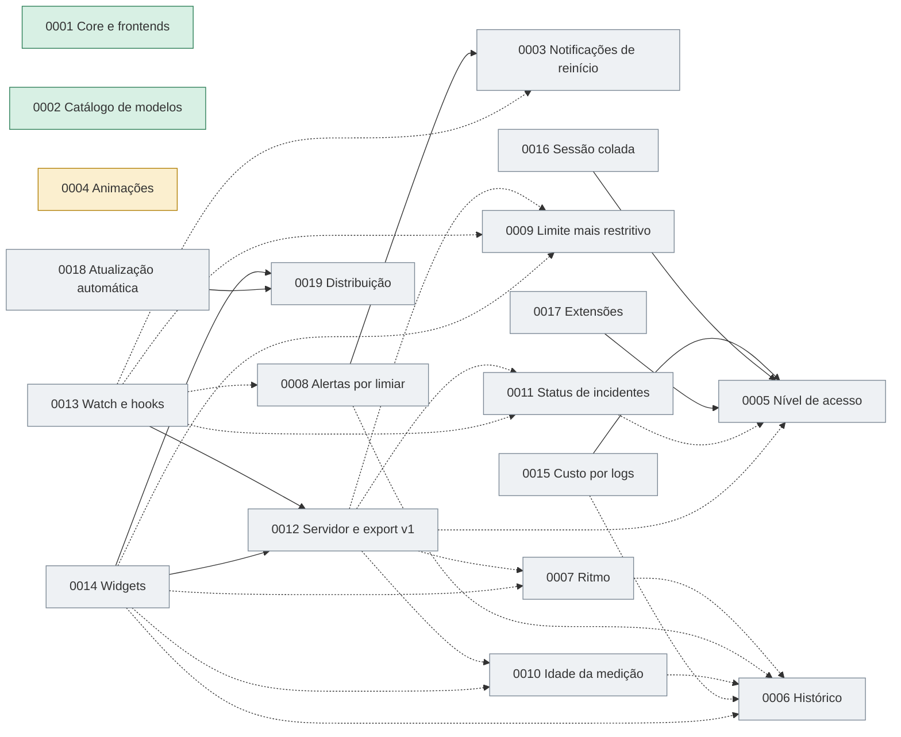

# Controle dos planos (PRDs)

Este arquivo é o índice vivo de `docs/plans`: mostra o que já foi implementado, o que está em andamento e como os planos dependem uns dos outros. Atualize-o **no mesmo commit** que muda o status de um plano.

| Campo | Valor |
|---|---|
| Última atualização | 2026-10-19 |
| Versão do Cuotai na data | 0.17.2 |
| Planos | 19 (2 implementados, 2 em andamento, 15 propostos) |

## 1. Como manter

- **Status possíveis:** `Proposto` (escrito, sem código), `Em andamento` (parte dos RFs entregue), `Implementado` (todos os RFs entregues e verificados), `Substituído` ou `Cancelado` (com o motivo na coluna Observações).
- **Ao entregar um RF:** registre no próprio plano, na seção "Estado da implementação" (como no PRD 0002), a versão e o commit; depois atualize a linha deste arquivo e a tabela "Entregas por versão" (seção 3).
- **Rastreio por commit:** o commit que entrega um RF traz o rodapé `Refs: PRD 0006 RF2` (uma linha por requisito). Quando o PRD 0019 RF7 estiver implementado, o `CHANGELOG.md` passa a ser a fonte dessas entregas e a seção 3 deste arquivo aponta para ele.
- **Dependência forte** significa que o plano não pode ser entregue sem o outro (o RF citado precisa existir). **Dependência fraca** significa que funciona sem o outro, mas fica melhor com ele.
- Planos novos recebem o próximo número livre e entram aqui na mesma alteração.

## 2. Situação atual

| ID | Plano | Status | Entregue | Depende de (forte) | Depende de (fraca) | Observações |
|---|---|---|---|---|---|---|
| [0001](0001_core-suporte-frontends-graficos.md) | Core com suporte a frontends gráficos | Implementado | 0.7.x | — | — | Base do desktop e do contrato de descritores. |
| [0002](0002_catalogo-modelos-sob-demanda.md) | Catálogo de modelos sob demanda | Implementado | RF1 a RF6, 0.8.0 a 0.14.0 | — | — | Depois da entrega, todos os provedores exceto Alibaba Cloud passaram a tentar listar modelos (commit `2ae1e79`). |
| [0003](0003_notificacoes-reinicio-quota.md) | Notificações de reinício de quota | Proposto | — | — | — | Define `Notifier`, permissão e `notified.json`, reaproveitados pelo 0008. |
| [0004](0004_animacoes-efeitos-visuais.md) | Animações e efeitos visuais | Em andamento | RF1 (0.17.0, commit `6725548`) | — | — | RF2 a RF4 pendentes; há trabalho local não commitado em `apps/desktop/ui/js/motion.js`. |
| [0005](0005_nivel-de-acesso-ao-consumo.md) | Nível de acesso ao consumo | Proposto | — | — | — | Pré-requisito dos 0015, 0016 e 0017. |
| [0006](0006_historico-local-de-medicoes.md) | Histórico local de medições | Proposto | — | — | — | Base de 0007 (projeção), 0008, 0010 e 0014. |
| [0007](0007_ritmo-ate-o-reset.md) | Ritmo até o reset | Proposto | — | — | 0006 | Sem histórico usa a média desde o início da janela. |
| [0008](0008_alertas-de-consumo-por-limiar.md) | Alertas de consumo por limiar | Proposto | — | 0003 (RF2 e RF3) | 0006 | Reusa entregador, permissão e preferências do 0003. |
| [0009](0009_limite-mais-restritivo.md) | Indicador do limite mais restritivo | Proposto | — | — | — | Consumido por 0007, 0012 e 0014. |
| [0010](0010_idade-da-medicao-e-leitura-desatualizada.md) | Idade da medição e leitura desatualizada | Proposto | — | — | 0006 | Sem o 0006 a leitura preservada vale só na sessão. |
| [0011](0011_status-de-incidentes-dos-provedores.md) | Status de incidentes dos provedores | Proposto | — | — | 0005 | Exige fontes públicas verificadas por provedor. |
| [0012](0012_servidor-http-local-e-contrato-de-exportacao.md) | Servidor HTTP local e contrato `export::v1` | Proposto | — | — | 0005, 0007, 0009, 0010, 0011 | O contrato `v1` é aditivo: campos novos entram conforme os planos forem entregues. |
| [0013](0013_watch-e-hooks-de-eventos.md) | `watch` e hooks de eventos | Proposto | — | 0012 (RF1) | 0003, 0008, 0009, 0011 | Hooks executam comandos do usuário; consentimento obrigatório. |
| [0014](0014_widgets-do-sistema.md) | Widgets do sistema (macOS) | Proposto | — | 0012 (RF1), 0019 | 0006, 0007, 0009, 0010 | Exige conta de desenvolvedor Apple; protótipo de empacotamento primeiro. |
| [0015](0015_custo-estimado-por-logs-locais.md) | Custo estimado por logs locais | Proposto | — | 0005 | 0006 | Nunca lê conteúdo das conversas. |
| [0016](0016_sessao-colada-pelo-usuario.md) | Sessão colada pelo usuário | Proposto | — | 0005 | — | Alternativa à importação automática de cookies, que o projeto não adota. |
| [0017](0017_extensoes-por-manifesto-e-script.md) | Extensões por manifesto e script | Proposto | — | 0005 | — | Extensão nunca recebe credenciais do Cuotai. |
| [0018](0018_atualizacao-automatica.md) | Atualização automática do desktop | Proposto | — | 0019 (RF2 e RF3) | 0019 (RF7) | Exige par de chaves de assinatura do atualizador do Tauri. As notas da versão vêm do `CHANGELOG.md`. |
| [0019](0019_empacotamento-e-distribuicao.md) | Licença, empacotamento, changelog e distribuição | Em andamento | RF1 (0.17.2) | — | — | Pré-requisito dos 0014 e 0018. RF1 entregue: licença `MIT OR Apache-2.0`, `CONTRIBUTING.md`, `SECURITY.md`, modelos de *issue* e `deny.toml`. O RF7 cria o `CHANGELOG.md` e o vínculo versão ↔ requisito. |

## 3. Entregas por versão

Enquanto o `CHANGELOG.md` não existe (PRD 0019, RF7), esta tabela é o controle do que cada versão entregou em termos de requisitos de plano. Só entram versões com evidência no repositório (tabelas de estado dos PRDs e commits que elevam a versão). Versões sem requisito de plano (correções, dependências, ajustes) serão cobertas pelo changelog retroativo (RF7.6).

| Versão | Plano | Requisitos entregues |
|---|---|---|
| 0.7.x | 0001 | Todos os RFs (core com suporte a frontends gráficos). |
| 0.8.0 | 0002 | RF1 (caminho de configuração compartilhável), primeira parte. |
| 0.9.0 | 0002 | RF2 (contrato de modelos por conta no core). |
| 0.10.0 | 0002 | RF3 (persistência SQLite e sincronização manual). |
| 0.11.0 | 0002 | RF4 (adaptadores verificados e matriz dos provedores). |
| 0.12.0 | 0002 | RF5 (seção Modelos na TUI). |
| 0.13.0 | 0002 | RF6 (seção Modelos no desktop). |
| 0.14.0 | 0002 | RF1 (conclusão: escolha do TOML no desktop e aviso de arquivos diferentes). |
| 0.17.0 | 0004 | RF1 (base de movimento: tokens, movimento reduzido e atualização incremental do painel). |
| 0.17.1 | — | Sem requisito de plano: atualização de segurança (`rustls` 0.23.46 e `yoke-derive` 0.8.4). |
| 0.17.2 | 0019 | RF1 (licença, `CONTRIBUTING.md`, `SECURITY.md`, modelos de *issue*, `deny.toml`; RF1.4 parcial). |

## 4. Grafo de dependências

Setas sólidas são dependências fortes; tracejadas, fracas. A seta aponta do plano para aquilo de que ele depende.

### O que cada plano desbloqueia

| Plano | Desbloqueia (forte) | Beneficia (fraca) |
|---|---|---|
| 0003 | 0008 | 0013 |
| 0005 | 0015, 0016, 0017 | 0011, 0012 |
| 0006 | — | 0007, 0008, 0010, 0014, 0015 |
| 0007 | — | 0012, 0014 |
| 0008 | — | 0013 |
| 0009 | — | 0012, 0013, 0014 |
| 0010 | — | 0012, 0014 |
| 0011 | — | 0012, 0013 |
| 0012 | 0013, 0014 | — |
| 0019 | 0014, 0018 | — |

## 5. Ordem sugerida de entrega

As ondas respeitam as dependências fortes; dentro de cada onda a ordem é de prioridade (impacto frente aos concorrentes, segundo a análise de mercado de 2026-10-19).

| Onda | Planos | Por quê |
|---|---|---|
| 0 (em curso) | 0003, 0004 | Já iniciados ou com infraestrutura reaproveitada pelos demais. |
| 1 (sem dependências) | 0019 (RF1: licença), 0006, 0007, 0009, 0005, 0012, 0011 | Desbloqueiam quase tudo; 0006 e 0007 fecham a maior lacuna frente aos concorrentes (histórico e ritmo). |
| 2 | 0008, 0010, 0018, 0013, 0016, 0015, 0017 | Dependem de itens da onda 0 ou 1. |
| 3 | 0014 | Depende do contrato do 0012 e do pipeline do 0019, além de conta de desenvolvedor Apple. |

Caminho crítico de distribuição: **0019 → 0018**. Caminho crítico de integrações: **0012 → 0013 e 0014**. Caminho crítico de alertas: **0003 → 0008**.

## 6. Decisões pendentes do dono do projeto

| Decisão | Afeta | Observação |
|---|---|---|
| ~~Licença do repositório~~ | 0019 (RF1) | **Decidida em 2026-10-19: `MIT OR Apache-2.0`**, titular "Cuotai contributors". |
| Migração da documentação para inglês | 0019 (RF1.4), `docs/` e `docs/plans/` | Regra no `AGENTS.md`. Falta traduzir `docs/*.md`, `apps/desktop/README.md` e os PRDs. |
| Conta de desenvolvedor Apple e certificado Developer ID | 0014, 0018, 0019 | Necessária para notarização e para widgets (*app group*). |
| Certificado Authenticode do Windows | 0019 | Sem ele, o instalador sai sem assinatura, declarado nas notas da versão. |
| Política de cookies | 0016 | Recomendação: manter a colagem manual e não importar cookies de navegadores. |
| Servidor local ligado por padrão ou não | 0012 | Recomendação: desligado por padrão, somente em loopback. |

## 7. Histórico deste arquivo

| Data | Alteração |
|---|---|
| 2026-10-19 | Criação do controle com os PRDs 0001 a 0019. |
| 2026-10-19 | Changelog incluído como requisito (PRD 0019, RF7); nova seção "Entregas por versão" e rodapé `Refs:` nos commits. |
| 2026-10-19 | PRD 0019 RF1 entregue em 0.17.2 (licença `MIT OR Apache-2.0`); decisão de idioma da documentação (inglês) registrada. |
