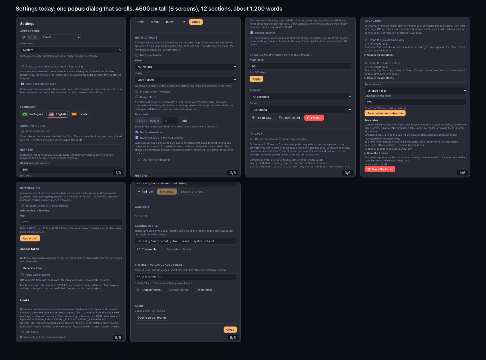
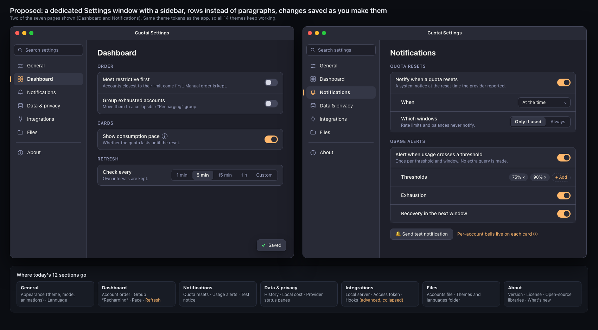

# PRD 0020 — Settings window redesign

| Field | Value |
|---|---|
| ID | 0020 |
| Status | In progress |
| Owner | Desktop (`apps/desktop`): usability and design |
| Consumers | `apps/desktop/ui` (new `settings.html`), `apps/desktop/src-tauri` (window, menu, capabilities) |
| Depends on | none |
| Benefits from | PRD 0018 (an Updates page), PRD 0019 RF7.7 (What's new in About) |
| Extended by | PRD 0025 (Menu bar page, Advanced group, display mode, first-run defaults), PRD 0022 (UI refresh visuals) |
| Date | 2026-10-21; amended 2026-10-23 (review item SET-01: preferences move to `desktop.json`; RF2.1 superseded by `docs/design-system.md` DS-CMP-SEG-5) |

> **Note on terminology:** "RF" (from the Portuguese *requisito funcional*) means functional requirement; the acronym is kept so references stay stable.

## Implementation status (2026-10-25)

| RF | Version | Delivery |
|---|---|---|
| RF1 | 0.80.0 | Delivered. `settings.html` opens in its own window (label `settings`, `src-tauri/src/settings_window.rs`), created on demand, destroyed on close, single instance (a second request focuses it), not modal; 860 × 640 by default, minimum 640 × 460, centered over the main window the first time and restored to its last size and position afterwards (`desktop.json` `settings_window`, dropped when its title bar would be off every screen). Entry points: the gears of the main window and the tray popover, the tray menu, the macOS app menu "Settings…" with `⌘,`, `Ctrl+,` in the windows elsewhere, the serve and hooks banners (Integrations page) and the cost "open settings" links (Local cost page); the `open_settings` command takes `page` and `anchor` (plain tokens only), and the window reads them once through `settings_target`. macOS uses the overlay title bar; Windows and Linux the native frame; the title follows the interface language (`set_settings_title`). `capabilities/default.json` adds the window to the existing grant and nothing else. The browser demo opens `settings.html?page=…&anchor=…` in one named window. The old in-window dialog and its `open-settings` event are gone. Shell tests cover the page/anchor tokens, the single instance with a new target, centering, off-screen restore and the stored geometry. As the minimum of RF7.1, the window broadcasts `settings-changed` and the main window and tray repaint as the old dialog made them; the `localStorage` mirrors reached them by `storage` events until RF7.2 (vNEXT) moved the preferences into `desktop.json`. |
| RF2 | 0.80.0 | Delivered except as noted. One registry (`ui/js/settings/registry.js`: page id, icon, label key, order, sections) drives the sidebar per DS-CMP-SEG-5: General, Dashboard, Alerts, Data & privacy, the collapsible Advanced group (Integrations, Local cost, Files, its open state remembered) and About at the bottom; one module per page, loaded only when shown. The 12 sections of the old dialog (and Updates) map as in the RF2.5 table: theme, mode, animations and language → General; order, the "Recharging" group, pace and the refresh interval → Dashboard; notices and alerts → Alerts; history and status pages → Data & privacy; local server, hooks and widgets → Integrations; local cost → Local cost; accounts file and themes folder → Files; About and Updates → About. Each page opens with its title and the former sections as groups (a small-caps label over one card); the current page has an accent bar and a heavier label and is remembered; arrow keys, `Home` and `End` move between sidebar entries and focus moves to the page title on a page change. `scripts/test-settings-window-ui.mjs` checks the order, the navigation and that each of the 61 controls of the old dialog renders on its page in the four catalogs. Extensions page (vNEXT): Settings › Advanced › Extensions (`settings/extensions.js`) mounts the same manager as the main-window dialog (`mountExtensions` in `extensions-dialog.js`: list, consent, secrets, overrides, folder and guide), which keeps its entry point; the parity checklist lists it and the row has search keywords in the four catalogs; removing an extension's account asks the main window. Not yet: the Menu bar page (PRD 0025 RF4) is PRD 0025's; account management in Dashboard (DS-CMP-SEG-5) is PRD 0025; the 8-row limit and the sub-pages of deep content (RF2.2, RF2.3) came with RF3–RF5 (vNEXT); search over collapsed Advanced pages is RF6. |
| RF3 | vNEXT | Delivered. `ui/js/settings/rows.js` builds every setting as one row (label, at most one short description, the control on the right, an ⓘ popover, a full-width body and the row's own error line) and holds the component set: switch (a native check box with `role="switch"`, so the bindings keep `checked`/`change`), membership check (hook events), segmented control (radiogroup with arrow keys and a select-like `value`/`change`), select, number field with unit, button row, path, disclosure and sub-page. Dependent rows are indented and disabled, not hidden, while their parent is off (reset notices, usage alerts, widgets). Destructive actions (erase history, erase the cost index, delete widget data, revoke the token) use the danger style in their own row or group at the end and keep their confirmations. The Updates switch uses the same row. The path row shows its actions as buttons beside it rather than in one menu. RF2.2/RF2.3 with it: no page shows more than 8 rows before a disclosure or sub-page; the hook rules, the cost directories and the price table open as sub-pages inside the window, with a back button and `Esc`. |
| RF4 | vNEXT | Delivered. Switches, segmented controls and selects save on change; a polite "Saved" toast (bottom corner, `role="status"`, 4 s, paused on hover or focus, one at a time) confirms. The refresh interval, history retention, cost retention, server port and widget count save on `Enter` or blur, with the row's own Apply and Revert shown only while the value is unsaved; every page-level Apply/Save button is gone (period and retention of local cost now save separately). A refused value shows the core's message in its row, returns to the saved value and keeps focus. The hook rules keep their Save/Discard bar, sticky at the bottom of the sub-page, and leaving the sub-page or the page with unsaved rules asks first. Persistence, commands and every safety confirmation are unchanged. |
| RF5 | vNEXT | Delivered. Help paragraphs moved behind ⓘ popovers (`Esc` closes them first); the server's connection details, the status-page domains, history export and erase, the widget file location and the paths of the files and folder sit in disclosures whose open state is remembered; the browsers warning shows only while browsers are allowed. Labels were shortened to at most four words and stale keys removed in the four catalogs. `scripts/test-settings-window-ui.mjs` checks, per catalog: no raw check box, at most 8 rows shown per page, descriptions within 90 characters, labels within four words (a source name counts as one), at most 150 words per page and 450 across the pages before any disclosure (about 360–395 today). |
| RF6 | vNEXT | Delivered. A search field tops the sidebar (`/` and `⌘F`/`Ctrl+F` focus it, `Esc` clears it, then leaves it) and filters **rows** by label, description and a per-row keyword list (`settings.kw.<row>` in the four catalogs), ignoring case and accents. The index (`ui/js/settings/search.js`) is read from the markup the pages draw with `row()`, and a page whose rows depend on the shell's state exports `searchHtml()` (local cost, integrations) built from the same functions, so a row cannot exist without being searchable; `scripts/test-settings-search-ui.mjs` fails when a row has no keywords or a keyword key matches no row, in every catalog. Results replace the page area grouped by page; choosing one opens the page, opens any disclosure or sub-page holding the row and highlights it for 1.5 s (no fade when motion is reduced or off); no match shows "No matching settings" with a button to clear the field. Advanced pages are searched whether the group is open or not. |
| RF7 | vNEXT | Delivered. `desktop.json` is the single source of the theme, light/dark mode, language, animations, account order and the "Recharging" group (new keys `theme`, `theme_mode`, `sort`, `group_recharging`, `migrations`; the language is the `locale` key notices already used). One command, `set_preference` (the language keeps `set_locale`), validates and saves, and the shell broadcasts `settings-changed` with the key; each window re-reads `get_settings`, applies only what differs and repaints, so no `storage` event moves these preferences any more (the browser demo uses a `BroadcastChannel`). On the first launch the one-time `migrate_local_storage` copies each old `localStorage` value that `desktop.json` lacks (a value already there wins, invalid ones are dropped) and records `migrations.local_storage = 1`. Deviation, on purpose: `localStorage` is kept as a **render mirror**, rewritten from `desktop.json` on every boot and change, so the inline `<head>` script can paint the right theme and language before the first IPC answer (the same arrangement animations and pace already had); it is a cache, never read as a source after the migration, so the "clear the migrated keys" step is not done. RF7.3 already held: opening or closing settings does not reload the main window. |
| RF8 | vNEXT | Delivered. The sidebar is a navigation landmark with `aria-current="page"`, the search field a `role="search"` region labelled and tied to the content it filters, the content labelled by its page title; arrow keys, `Home` and `End` move between pages; `Esc` closes a popover, then the sub-page, then the window (`close_settings_window`, never while a field is being edited or a dialog is open) and `Ctrl+W` closes it (`⌘W` is the macOS menu item). Below 720 px the sidebar is an icon rail with a tooltip per page (the labels stay in the accessibility tree and the search opens over the content while focused); below 560 px it becomes a page selector above the content and rows with wide controls stack under their label; switches keep their side. A row's error line carries a warning glyph besides its text. The contrast and lint tools named in RF8.5/RF9 are the real ones under `apps/desktop/tools/`: `contrast.py`, `contrast_gate.py` (strict, against `contrast-baseline.txt`), `lint_ui.py` and `lint_theme.py`; CI runs the last three on Linux. CI also runs the browser-demo overflow check (languages and 200 % zoom sizes) on macOS, and an advisory axe-core pass (`ui-shots/a11y.mjs`) and open/render-time probes (`ui-shots/perf.mjs`: Settings open under 300 ms, interactions within one 16 ms frame). |
| RF9 | vNEXT | Delivered. Group cards use `--radius-lg` and only theme tokens (a test rejects literal colors in `settings.css`); the sidebar is 220 px on `--surface`, the content 640 px at most on `--bg`, rows 52 px at least. Page changes cross-fade in `--motion-base`, disclosures open in `--motion-fast` and the highlight fades with the same tokens, all 0 ms when motion is reduced or off. Visual pass in the browser demo: Dracula, GitHub (light), Windows 98 and CRT at the default size, at 660 px (rail) and at 500 px (selector). |
| RF10 | vNEXT | Delivered. The old dialog and its `open-settings` event were removed with RF1 (a test keeps it gone); the parity checklist (`CONTROLS` in `registry.js`, 61 controls) is walked by `scripts/test-settings-window-ui.mjs` in the four catalogs, and every page module stays under 300 lines (checked by the same test). `desktop.json` keeps every earlier key and value; rolling back to a version before RF7.2 finds the keys the migration copied still in `localStorage` (they are mirrored, not cleared), so the six choices survive a rollback. |
| RF11 | vNEXT | Delivered. "Adding a setting" in `apps/desktop/README.md` lists the steps (page, row with label/description/keyword keys, component, command, the four catalogs, the parity checklist) and the 8-row and new-page rules of RF11.2. |

## 1. Context

Settings is a single `<dialog>` (`ui/js/settings.js`, 843 lines) opened over the main window. Every feature added since 0.17 put its own section in that dialog, and it now holds 12 sections in one column. Measured on the demo build (0.66.0, Portuguese):

| Measure | Today |
|---|---|
| Sections in one popup | 12 (Appearance, Language, Account order, Refresh, Notifications, History, Privacy, Local cost, Integration, Accounts file, Themes and languages folder, About) |
| Height of the scrolling content | about 4,600 px, six screens of the popup |
| Visible text | about 1,200 words, most of it explanatory paragraphs under each control |
| Controls that need a separate **Apply**/**Save** button | refresh interval, history retention, price table and retention, server port, hook rules |
| Layout | one flat list; a check box and a paragraph per setting; no hierarchy between a theme choice and an access-token procedure |
| Window | a modal popup that covers the dashboard, so a change cannot be seen where it takes effect |

*The six screens of the current dialog, side by side.*

The growth was incremental: the plans for reset notices and alerts (0003, 0008), history (0006), status pages (0011), the local server and hooks (0012, 0013) and local cost (0015) each appended a block, and none could be placed without moving the others.

The desktop already has what a better design needs: 14 themes with a token contract, three interface languages, a Tauri multi-window setup (`main`, `tray`), a native menu item and a tray button that open settings, and a core that owns every validation, so the interface only has to present the results.

## 2. Problem

- **Too much on one page.** Finding "Run hooks" or "Port" means scrolling through unrelated sections. There is no navigation, no search and no way to know how long the page is.
- **Too much text.** Each control carries a paragraph. People read none of it, and the one sentence that matters (for example, that a token is never shown) is buried.
- **Mixed importance.** Common choices (theme, language, refresh interval) sit in the same flat list as rare, technical ones (local server port, price table, hook rules).
- **Inconsistent saving.** Some controls save on change and others need a button, and the user cannot tell which is which.
- **A popup is the wrong container.** It blocks the dashboard, it cannot stay open while the user checks the effect, and it limits width, so every new feature makes it longer instead of wider or deeper.

## 3. Goals

- Make any setting reachable in at most **two clicks** (page, then the row) or one search.
- Cut the visible text by at least half without removing information: the detail moves behind disclosures, not out of the product.
- Give settings **its own window** with a sidebar of pages, in the style users already know from Windows 11 Settings and macOS System Settings.
- One predictable rule for saving: a change applies at once and says so.
- Keep every existing setting, every safety confirmation and every privacy disclosure (PRDs 0008, 0011, 0012, 0013, 0015).

## 4. Non-goals

- New settings, new preferences or any change to `desktop.json`, the TOML or core contracts. This is a redesign of presentation and navigation. *Superseded by PRD 0025 for the preferences listed in its §7, and by RF7.2 (2026-10-23, review item SET-01) for moving the `localStorage` preferences into `desktop.json`.*
- A TUI settings screen.
- A theme editor or an import/export of preferences.
- Platform-specific forks of the interface: one layout serves macOS, Windows and Linux (see the owner decision in section 8).
- Changing what the dashboard shows. Only where the choices are made changes.

## 5. Functional requirements

### RF1 — A dedicated Settings window (high priority; prerequisite)

- **RF1.1** A second regular window, label `settings`, loading `settings.html`, created **on demand** (not at startup) and destroyed on close. Default size 860 × 640, minimum 640 × 460, resizable, centered over the main window the first time and restoring its last size and position afterwards.
- **RF1.2** Single instance: opening settings while it is open focuses it. It is **not modal**: the dashboard stays usable and visible, so a theme, order or refresh change can be seen in the main window while the settings window is open.
- **RF1.3** Entry points keep working and all open the same window: the native menu item (with the platform shortcut: `⌘,` on macOS, `Ctrl+,` elsewhere), the tray popover button, the gear in the main window and the "open settings" buttons inside other screens (for example the cost view). The command accepts an optional **page** and **anchor** so a link can land on the right row (for example the cost sources).
- **RF1.4** Window chrome follows the platform: macOS uses the overlay title bar with the traffic lights already used by the main window; Windows and Linux use the native frame. The window title is "Settings" in the interface language. `capabilities/default.json` lists the new window and nothing more is granted to it than the main window already has.
- **RF1.5** The browser demo (no Tauri) can open `settings.html` directly, so the interface keeps being smoke-tested without the shell.
- **Acceptance criterion:** from every entry point the same single window opens, focused; closing and reopening restores size, position and the last page; the main window stays interactive while it is open; the Tauri shell test for the command covers the page and anchor parameters.

### RF2 — Navigation and information architecture (high priority)

- **RF2.1** *Superseded on 2026-10-23 by `docs/design-system.md` DS-CMP-SEG-5 (see RF2.5); the table below is kept as the original plan.* A left **sidebar** of seven pages, in this order, with an icon and a one- or two-word label each, and **About** separated at the bottom:

  | Page | Holds (today's section) |
  |---|---|
  | General | Appearance (theme, light/dark mode, animations) and Language |
  | Dashboard | Account order, group "Recharging", consumption pace and the Refresh interval |
  | Notifications | Quota-reset notices and usage alerts, with the test notice |
  | Data & privacy | History, Local cost and the provider status pages |
  | Integrations | Local server (address, port, token, browsers) and Hooks |
  | Files | Accounts file and the themes-and-languages folder |
  | About | Version, license, open-source libraries and, when present, What's new and Updates |

- **RF2.5** **Sidebar per DS-CMP-SEG-5 (2026-10-23).** Order: **General**, **Dashboard**, **Menu bar**, **Alerts**, **Data & privacy**, a collapsible **Advanced** group (**Integrations**, **Local cost**, **Extensions**, **Files**), then **About** separated at the bottom. Each entry is icon + one- or two-word label; the Advanced group is a disclosure whose open state is remembered, and its pages are reachable by search while it is collapsed.

  | Page | Holds (today's section) |
  |---|---|
  | General | Appearance (theme, light/dark mode, animations), Language and "Show the recommended setup again" (PRD 0025 RF6.4) |
  | Dashboard | Accounts (list, add, edit, remove, order), group "Recharging", consumption pace and its unit (PRD 0024 RF1.3), display mode (PRD 0025 RF9) and the Refresh interval |
  | Menu bar | PRD 0025 RF4 (style, colored variant, accounts and order, live preview) |
  | Alerts | Quota-reset notices, usage alerts, predictive warnings (PRD 0024), extra usage (PRD 0023), with the test notice |
  | Data & privacy | History, the provider status pages and local-tool detection (PRD 0027 RF6.5) |
  | Advanced › Integrations | Local server (address, port, token, browsers) and Hooks |
  | Advanced › Local cost | Local cost sources, directories, prices and retention |
  | Advanced › Extensions | Extension list, consent and secrets (PRDs 0017 and 0028 RF7) |
  | Advanced › Files | Accounts file and the themes-and-languages folder |
  | About | Version, license, open-source libraries, What's new and Updates (PRD 0018) |

  The parity checklist of RF10.2 maps to this table; where this plan says "seven pages" it now means the DS-CMP-SEG-5 list.
- **RF2.2** Each page opens with its title and **groups** of rows (a small-caps group label over one rounded card). A page holds at most 8 rows before the extra rows go into a disclosure (RF5.2). The selected page is marked by an accent bar and a heavier label, and it is remembered between openings.
- **RF2.3** Deep content (the hook rule editor, the price table, the directory pickers of the cost sources) opens as a **second level inside the window** (a sub-page with a back button, or a sheet), never as another popup stacked over the window.
- **RF2.4** The page list lives in one registry (page id, icon, label key, order). Adding a page is one registry entry plus its module; no page is a hard-coded block of the shell.
- **Acceptance criterion:** all 12 sections of the current dialog map to a page in the RF2.5 table (parity checklist in RF10); every page is reachable from the sidebar with the keyboard; the last page is restored.

### RF3 — Row anatomy and shared components (high priority)

- **RF3.1** Every setting is a **row**: the label and one short description on the left, the control on the right, rows separated by a hairline inside a group card. A row is built by one shared component, not hand-written HTML per setting.
- **RF3.2** A small component set, styled only with theme tokens: **switch** (replaces every check box), **segmented control** (two to five exclusive choices: mode, language, refresh presets, "Only if used / Always"), **select** (longer lists: theme, history account), **number field with unit** (days, port, seconds), **chips** (alert thresholds), **button row** (an action such as "Send test notification"), **path row** (a truncated path with **Change…**, **Use default** and **Reveal** in one menu) and **disclosure** (a collapsible group).
- **RF3.3** **Dependent rows** (for example "When" under "Notify when a quota resets") are indented and visually attached to their parent, and are disabled, not hidden, while the parent is off, so the structure stays stable.
- **RF3.4** Destructive actions (erase history, erase the price index, revoke the token) sit in a clearly separated group at the end of their page, use the danger style and keep today's confirmation.
- **Acceptance criterion:** no page contains a raw `<input type="checkbox">`, an inline paragraph longer than one line or hand-written row markup; the components render correctly in the four reference themes (Dracula, GitHub light, Win98 and CRT).

### RF4 — Apply at once, with feedback (high priority)

- **RF4.1** Switches, segmented controls and selects **save on change**. A brief "Saved" confirmation appears in the window (bottom corner, announced politely to screen readers) and disappears by itself.
- **RF4.2** Fields that need validation (port, retention days, thresholds, custom refresh seconds) save on **Enter or when the field loses focus**. While the value is changed and unsaved, the row shows its own small **Apply** and **Revert**; there is no page-level Apply button anywhere.
- **RF4.3** Validation and every error message come from the core, as today. A failed save shows the message **inside the row** (not at the bottom of the section), returns the control to its saved value and keeps focus there.
- **RF4.4** The hook rule editor, a multi-field draft, keeps an explicit **Save rules / Discard** bar, which stays visible while the sub-page scrolls and warns when leaving with unsaved changes.
- **Acceptance criterion:** every old **Apply**/**Save** button is gone or replaced by the rules above (the hook rules keep their own bar); a forced error (a port in use, retention out of range) appears in its row and restores the previous value.

### RF5 — Less text and progressive disclosure (high priority)

- **RF5.1** **Copy budget.** A row's label is at most 4 words and its description at most **90 characters on one line**; a page shows at most **150 words** before any disclosure; the whole window shows at most **450 words** across all pages. The interface test counts them in the three languages.
- **RF5.2** **Disclosures.** Anything technical or rare is collapsed by default: the cost-source directories and the price table, the status-page domain list, the server port, token and browser access, history export and erase, the path of the accounts file. The disclosure label says what is inside ("Connection details"), and its open state is remembered.
- **RF5.3** **Info popovers.** A long explanation moves behind an **ⓘ** button on the row: it opens a short popover (keyboard and screen-reader accessible, closes with `Esc`), and the full text is still present in the interface. Warnings that apply only to a state (for example "web pages can read your usage") appear **only in that state**, next to the control that causes them.
- **RF5.4** **Writing rules.** Sentence case, no trailing periods in labels, the user's task as the label ("Notify when a quota resets", not "Quota reset notification toggle"), no explanation of how the feature is built. The rewritten strings exist in Portuguese, English and Spanish; keys of strings that disappear are removed from the catalogs.
- **Acceptance criterion:** the word counts of RF5.1 hold in the three languages; every removed paragraph is either shortened to the description limit or moved to an info popover or disclosure (listed in the migration table, RF10).

### RF6 — Search (medium priority)

- **RF6.1** A search field at the top of the sidebar (`⌘F` / `Ctrl+F` and `/` focus it) filters **rows**, not pages, by label, description and a keyword list, in the active language.
- **RF6.2** Results replace the page area, grouped by page, each showing the row's label and its page. Selecting a result goes to the page, expands any disclosure that contains the row and highlights the row for about 1.5 seconds (no animation with reduced motion).
- **RF6.3** An empty search shows a short "No matching settings" state with the suggestion to clear the field. The index is built from the same row definitions as the pages, so a row cannot exist without being searchable.
- **Acceptance criterion:** searching "port", "retention", "token", "tema" (in Portuguese) and "sound" finds the right rows or the empty state; a row inside a collapsed disclosure is found and revealed.

### RF7 — Live sync with the other windows (high priority)

- **RF7.1** A change made in the settings window reaches the main and tray windows **immediately**, without a restart: theme and mode, language, animations, account order, grouping, pace display, refresh interval and the rest. The shell broadcasts one event (`settings-changed`, with the key that changed) and each window re-reads what it needs.
- **RF7.2** *Amended on 2026-10-23 (review item SET-01).* Preferences that today live in `localStorage` of the main window (theme, mode, language, animations, account order, grouping) move to `desktop.json`, which becomes their **single source**: every window reads them from the shell and writes them through one command, and the RF7.1 `settings-changed` event carries the change, so no storage-event synchronization is needed. On the first launch of the delivering version, a **one-time migration** copies each value found in `localStorage` into `desktop.json` when the file has no value for that key, records `migrations.local_storage = 1`, and then clears the migrated `localStorage` keys; a value already in `desktop.json` wins. Unknown or invalid values are dropped with the default kept.
- **RF7.3** Opening settings does not reload or re-render the main window, and closing it leaves the main window's scroll, focus and filter untouched.
- **Acceptance criterion:** with both windows open, switching theme, language, order and the refresh interval in settings changes the main window and the tray popover at once; a manual check confirms that the dashboard scroll position survives; migration tests: `localStorage` values reach `desktop.json` once, an existing `desktop.json` value wins, a second launch migrates nothing, invalid values fall back to defaults.

### RF8 — Accessibility, keyboard and size (high priority)

- **RF8.1** The sidebar is a navigation landmark: arrow keys move between pages, `Enter` opens, the current page is exposed with `aria-current="page"`. The content region is labelled by the page title; focus moves to the title when the page changes.
- **RF8.2** Every control has a programmatic label and description (`aria-labelledby`/`aria-describedby` from the row), switches use `role="switch"`, status messages use `role="status"`/`role="alert"` as today, and the visible focus ring is never removed.
- **RF8.3** Full keyboard operation: `Tab` order follows reading order, `Esc` closes a popover first and the window second, `⌘W`/`Ctrl+W` closes the window.
- **RF8.4** Responsive: below 720 px of width the sidebar collapses to an icon rail with tooltips; below 560 px it becomes a page selector above the content. The interface stays usable at 200% text zoom and respects reduced motion (page changes are instant).
- **RF8.5** Contrast follows the theme contract (`apps/desktop/tools/contrast.py` computes the ratios and `contrast_gate.py` fails CI on any regression against `contrast-baseline.txt`; `lint_ui.py` rejects literal colors); no meaning is carried by color alone (an error also has an icon and text).
- **Acceptance criterion:** a keyboard-only pass reaches and changes every setting; the accessibility tree shows the landmarks and roles above; the layout holds at 640 px and at 200% zoom with no horizontal scroll. Full validation needs a manual pass with a screen reader.

### RF9 — Look: tokens, themes and platform feel (medium priority)

- **RF9.1** The window uses only theme tokens (`--bg`, `--surface`, `--surface-2`, `--border`, `--fg`, `--fg-muted`, `--accent`, radius and motion tokens), so every one of the 14 themes and every user theme works. The sidebar uses `--surface`, the content `--bg`, group cards `--surface` with `--border`, switches `--accent`.
- **RF9.2** Layout proportions come from the two reference systems: a sidebar of about 220 px with icon plus label, content with a maximum readable width (about 640 px) centered in wider windows, group cards with rounded corners from `--radius-lg`, 52 px minimum row height, a single column. The retro themes (Win98, CRT) keep their own radius and borders through the same tokens.
- **RF9.3** Motion is short and uses the motion tokens: a page change cross-fades in `--motion-base`, a disclosure expands in `--motion-fast`, the "Saved" toast fades. Nothing animates when motion is reduced or off.
- **Acceptance criterion:** screenshots of every page in Dracula, GitHub light, Win98 and CRT (and a user theme) show no clipped text, readable contrast and the same structure; the theme lint (`apps/desktop/tools/lint_theme.py`) and the UI lint (`apps/desktop/tools/lint_ui.py`) still pass.

### RF10 — Migration and parity (high priority)

- **RF10.1** The old settings dialog is **removed** when the window ships (no second copy to maintain). The `open-settings` event and the dialog code are deleted, and the entry points of RF1.3 are repointed.
- **RF10.2** A **parity checklist** lists every control of the current dialog (every button, switch, field and selector across the 12 sections) with its new page, row and component. A smoke test walks the checklist and fails when a control is missing or unreachable. Safety behaviors move unchanged: the cost-source consent, the server browser-access confirmation, the hooks consent, the history erase confirmation and the status-page disclosure.
- **RF10.3** Existing `desktop.json` preferences keep their keys and values. *Amended on 2026-10-23:* the RF7.2 `localStorage` preferences are migrated once into `desktop.json`; rolling back to a version before the migration finds the cleared `localStorage` and falls back to defaults for those six choices (documented in the changelog), while every `desktop.json` preference stays intact.
- **RF10.4** The page modules are split by page (`ui/js/settings/<page>.js`, each under about 300 lines) with the shared row/components in one module, replacing the 843-line file. Business rules stay in the core and the shell commands; the page modules only present and call them.
- **Acceptance criterion:** the parity test passes with 100% of controls mapped; `node --check` passes on every module; the old `settings.js` dialog and its CSS are gone; the existing shell and core tests still pass.

### RF11 — How a new setting is added (low priority)

- **RF11.1** A short guide in `apps/desktop/README.md` (or `docs/`): choose the page; define the row (label key, description key, keywords, component, command); respect the RF5 copy budget; add it to the parity checklist.
- **RF11.2** A page with more than 8 rows must split a group into a disclosure or a sub-page. A new page needs a registry entry and a decision recorded in this plan or its successor.
- **Acceptance criterion:** adding a sample row only touches the page module, the three locale catalogs and the checklist.

## 6. Non-functional requirements

- **Performance:** the window opens in under 300 ms on the reference machine and loads only the module of the current page; closing it frees the webview.
- **Security and privacy:** no new network request and no new capability. Tokens, paths of secrets and credentials are still never rendered; the access token stays copy-only.
- **Internationalization:** every string in Portuguese, English and Spanish; user language packs keep overriding the catalogs; long Spanish and Portuguese labels must not clip at the minimum width.
- **Consistency with the product:** the existing tone, terminology and theme contract stay; the dashboard behavior is untouched.

## 7. Order of execution and verification

1. **RF1 and RF7:** the window, the entry points, the page and anchor parameters and the cross-window sync, with the shell and the old pages' content hosted as they are. Nothing is lost at this point.
2. **RF3 and RF4:** the row and component set, the apply-at-once rules and the in-row feedback.
3. **RF2 and RF5:** the sidebar, the RF2.5 pages moved one at a time (General and Dashboard first, then Alerts, Data & privacy, the Advanced pages and About), each rewritten to the copy budget.
4. **RF6, RF8 and RF9:** search, accessibility and the visual pass over the reference themes.
5. **RF10 and RF11:** parity test, removal of the old dialog, the guide.

At each step: `cargo fmt`, `clippy -D warnings`, the workspace and desktop tests, `node --check` on every module, and a smoke test of the changed pages in the browser demo and in the Tauri app on macOS, in the four reference themes and three languages. Each delivered RF raises the version according to `AGENTS.md`, updates this plan's status, `0000_control.md` and the changelog.

The requirement is only delivered when every setting of today is reachable from the new window in at most two clicks or one search, no page needs a vertical scroll of more than one and a half screens at the default size, the visible text meets the copy budget in the three languages, every control saves with the rules of RF4, and the old popup is gone.

## 8. Decisions for the project owner

| Decision | Recommendation |
|---|---|
| Windows 11 look, macOS look, or one layout | **One layout** (sidebar of pages plus grouped rows), which both systems share, drawn with the theme tokens and the native title bar of each platform. Two forks double the work and the 14 themes already set the colors and radii. |
| Window or popup | **Window**, as the project owner indicated on 2026-10-21: non-modal, single instance, restoring size and position. |
| Single page for rarely used items (Integrations, Files) | Keep them as sidebar pages but collapsed inside (disclosures), so the common path stays short. |
| Name of the page "Data & privacy" | Alternative: split into "History" and "Privacy". Recommendation: keep one page until it exceeds the 8-row rule. |

## 9. Reference mockup

*Two of the original seven pages (Dashboard and Notifications; the sidebar is now DS-CMP-SEG-5, RF2.5) and the map from today's 12 sections to the new pages. Rendered with the app's own Dracula tokens; it is a design reference, not an implementation.*
