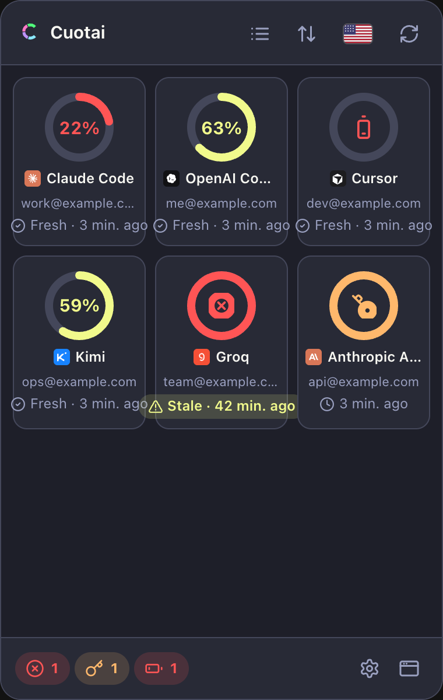
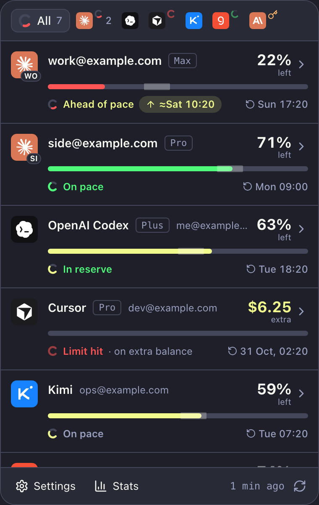
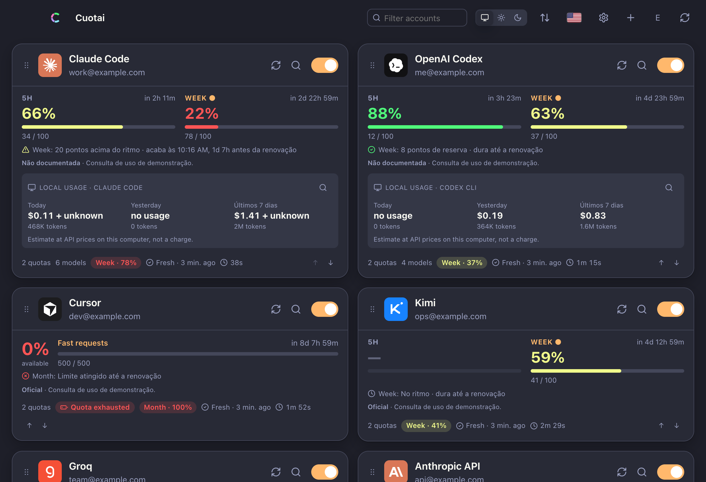
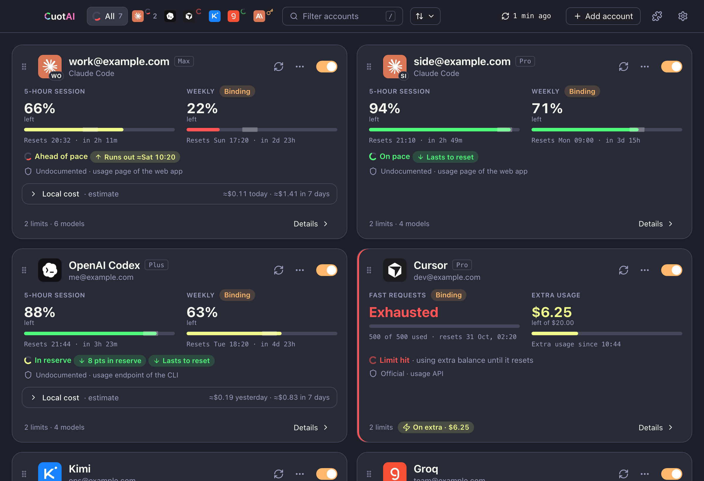

# PRD 0022 — UI refresh and design-system adoption

| Field | Value |
|---|---|
| ID | 0022 |
| Status | In progress |
| Owner | desktop (`apps/desktop/ui`: tray popover, main window, dialogs, settings window; `apps/desktop/src-tauri`: tray icon, theme default handoff; `apps/desktop/tools`: contrast gate, screenshot pipeline), TUI (`crates/cuotai-tui`: color rules only) |
| Consumers | every desktop screen; PRDs 0023–0028, 0032, 0035 and 0036, whose desktop visuals are built from the components this PRD ships; `docs/gui-features.md`, `docs/themes.md`, `README.md` screenshots |
| Depends on | PRD 0020 (RF1, RF2: the settings window and its sidebar registry) for RF9; none for the other RFs |
| Benefits from | PRD 0024 (RF1: time chips from core keys) for RF4; PRD 0025 (RF9: display mode behavior) for RF8; PRD 0029 (RF3: optional account name) for RF3; PRD 0026 (RF4, RF5), 0027 (RF3), 0028 (RF1, RF2) and 0023 (RF7) for the new-feature surfaces of RF10; PRD 0034 (RF7) for RF14 |
| Extends | PRD 0004 (motion is reduced to DS §7; a static change marker and a polite `aria-live` region replace the motion cues; the TUI respects `NO_COLOR`), PRD 0020 (visuals of the settings window), PRD 0011 RF4.2 (the menu-bar outage dot becomes template-compatible, with PRD 0025 RF3.1) |
| Normative source | [`docs/design-system.md`](../design-system.md) (rule IDs `DS-*`); this PRD adopts it and records where the mockups proved a rule needs amending |
| Mockups | "Before": [`assets/0022/before/`](assets/0022/before/INVENTORY.md) (54 screenshots of 0.71.x). "After": [`assets/0022/after/`](assets/0022/after/AFTER.md) (71 static renders, reproducible from `after/src/`) |
| Date | 2026-10-23 |

> **Note on terminology:** "RF" (from the Portuguese *requisito funcional*) means functional requirement; the acronym is kept so references stay stable. "Tray" or "popover" is the 380 × 600 px window opened from the menu-bar/system-tray icon; "menu bar" is the icon itself (macOS status item, Windows and Linux tray icon). "De/Para" (Portuguese for "from/to") is the before → after pairing of section 9.

## Implementation status (2026-10-23)

| RF | Version | Delivery |
|---|---|---|
| RF1 | — | Proposed. |
| RF2 | — | Proposed. |
| RF3 | — | Proposed. |
| RF4 | — | Proposed. |
| RF5 | — | Proposed. |
| RF6 | — | Proposed. |
| RF7 | — | Proposed. The logotype itself shipped in 0.79.0 (`wordmark()`); this RF moves it out of the tray overview header (owner decision 2026-10-23). |
| RF8 | — | Proposed. |
| RF9 | — | Proposed. |
| RF10 | — | Proposed. |
| RF11 | — | Proposed. |
| RF12 | — | Proposed. |
| RF13 | — | Proposed. |
| RF14 | — | Proposed. |
| RF15 | — | Proposed. The Cuotai theme shipped in 0.76.0; Dracula is still `DEFAULT_THEME`. |
| RF16 | — | Proposed. |
| RF17 | vNEXT | RF17.1, RF17.2, RF17.4, RF17.6 and RF17.7 delivered: the tray subscribes to cached updater state only after every render dependency is initialized, so an already-known status renders the popover and update notice instead of blanking the tray, with a production-module regression smoke (DS-A11Y-6, DS-GOV-5); the update banner renders a localized date-only release date with the year instead of the raw ISO timestamp, with rendered four-locale coverage; Settings renders one localized Updates heading owned by the updater section, with rendered four-locale coverage; both HTML roots synchronously apply the stored or detected locale before first paint, while shared boot and runtime selection keep `lang` and rendered strings synchronized (DS-TOK-TYP-8), with an executable bootstrap and production-render smoke; the en-US remaining-share unit and its direct quota compositions say "left", with rendered four-locale coverage and UI-owned catalog parity. RF17.3, RF17.5 and RF17.8–RF17.9 remain proposed. |
| RF18 | — | Proposed. The mockup generator is committed with this PRD (`assets/0022/after/src/`). |
| RF19 | — | Proposed. |

## 1. Context

The desktop UI (`apps/desktop/ui`) grew feature by feature from 0.7 to 0.79: a donut grid in the tray, cards with several boxes in the main window, a 14-section settings dialog of 5,387 px, and the motion effects of PRD 0004 (count-up numbers, level flashes, shakes, FLIP, shimmer, ring fills). Each piece was reasonable; together they are busy, inconsistent in spacing and radius, and noisy for an app that sits in the tray all day.

`docs/design-system.md` (Draft, "normative once the UI refresh PRD adopts it") now defines tokens, color roles, 40-odd components, chart rules, wording and a strict motion policy, and records 39 owner decisions (DS §10). The current UI was photographed (`before/`, 54 shots, with an inventory of every animation) and the target was drawn as static mockups that link the real theme files, the real logo and the real provider glyphs (`after/`, 71 renders in Dracula, light mode, the Cuotai theme and four languages), checked automatically for text overflow (`after/i18n-check.json`: 0 problems on 71 pages).

Facts from the code that this PRD acts on (paths relative to `apps/desktop/`):

- **Theme default.** `ui/js/themes.js:23` `DEFAULT_THEME = "dracula"`; the inline pre-paint scripts of `ui/index.html:12` and `ui/tray.html:12` fall back to `"dracula"`; the chosen theme lives in `localStorage` (`cuotai.theme`, legacy `cuotai.darkTheme`, read in `ui/js/lib.js:528`). The Cuotai pastel theme (`ui/css/themes/cuotai.css`) shipped in 0.76.0.
- **Logotype.** `wordmark()` shipped in 0.79.0 and is drawn today in the tray overview header (`ui/js/tray.js:163`) and the main topbar.
- **Language attribute.** Both pages hard-code `<html lang="pt-BR">` until `initI18n` sets it (`ui/js/i18n.js:126`).
- **Literal colors outside themes** (DS-COL-1): `ui/css/dialog.css:13` backdrop `rgba(0, 0, 0, 0.5)`, `ui/css/dialog.css:107` `.btn.danger-btn` `#fff`, `ui/css/themes.css:114` `.logo` `#fff`, `ui/css/themes.css:303` `.flag` shadow `rgba(128, 128, 128, 0.45)`.
- **Contrast.** `tools/contrast.py --strict` (DS-COL-5..7) exists but is not run in CI. On 2026-10-23 it fails 8 of the 15 built-in themes: Catppuccin (4 pairs), macOS (5), Monokai (5), One Dark (5), Tokyo (3), Ubuntu (1), Win98 (4), Windows XP (1); Dracula, Cuotai, GitHub, CRT, Synthwave, TRON and Windows 11 pass. Muted-text failures (DS-COL-5): macOS light `--fg-muted` on `--bg` 4.29, Monokai dark `--fg-muted` on `--surface-2` 4.40, One Dark dark 4.04, Tokyo light 4.14; the rest are status roles used as text (DS-COL-7).
- **Menu-bar icon.** `src-tauri/src/lib.rs:1201` builds the tray with `icon_as_template(false)`; `tray_icon(outage)` (`lib.rs:1061`) paints a red RGBA dot (`paint_outage_dot`, `lib.rs:1039`).
- **TUI colors.** Fixed `Color::Rgb` values in nine modules (`about_view.rs`, `dashboard.rs`, `wizard.rs` and others); `NO_COLOR` is not read.

## 2. Problem

- **Too much on screen, too little hierarchy.** The tray header carries six controls, every tile repeats a fresh age, the main topbar holds eleven controls and clips at the 520 px minimum width, and settings is one long scroll.
- **Inconsistent primitives.** One-off spacings (5, 6, 9, 10, 14, 22, 26 px), five dialog widths, literal radii and literal colors bypass the theme contract, so some themes look wrong in places.
- **Motion that carries meaning or distracts.** Count-up, flashes, shakes and ring fills animate data changes, which the design system forbids (DS-MOT-1, DS-MOT-5); with reduced motion on, a change is not marked at all.
- **Honesty gaps in the visuals.** Segmented bars and donut fills, no hatch for unknown values, no "≈" on estimates, and a stale reading that only differs by a chip.
- **Accessibility gaps.** Meters have no role, several icon buttons have no accessible name, `lang` is wrong for three of four languages, and eight themes miss the 4.5:1 text contrast.
- **Language fit.** Status lines, footers and the topbar overflow in pt-BR and es (39 problems on the first overflow run of the mockups).
- **Bugs found while photographing** (RF17): a temporal-dead-zone error that blanks the tray in a browser, a raw ISO date in the update banner, a duplicate "Updates" heading, the en-US unit word "available" instead of "left", and others.

## 3. Goals

- Adopt `docs/design-system.md` in every desktop screen and change its status from Draft to normative in the same delivery (DS-GOV-1).
- Keep Cuotai's identity (DS-ID-1..8): the 15 themes, the logo and the ring, the brand tiles, typography, the "left" criterion, breadth of truth and four (later fourteen) languages.
- Ship the shared components the planned features need (meters with the pace corridor, figure block, time chips, ring glyph, monogram, density presets, extra-usage sub-row, KPI cards, charts), so PRDs 0023–0028 add data, not new visuals.
- Remove or simplify every effect listed in DS §7.2, with a static change marker and polite announcements instead.
- Make contrast, literal colors and text overflow checkable by a script, and gate the built-in themes on the strict contrast rules.
- Make the Cuotai theme the default for new installs without changing anyone's stored choice.
- Keep before/after screenshots reproducible with one command each.

## 4. Non-goals

- New data or new core behavior. Pace chips (PRD 0024 RF1), overage state (PRD 0023), statistics (PRD 0026), the catalog (PRD 0027), diagnostics (PRD 0028), the tray summary and display-mode preferences (PRD 0025) are owned by those PRDs; this PRD ships the components and renders what the core returns. Where a mockup shows a capability that does not exist yet, it is marked **new** in section 9 and is delivered by that PRD.
- The settings window itself (PRD 0020 RF1–RF8, RF10–RF11) and the menu-bar title/image logic (PRD 0025 RF1–RF3).
- New languages and their typography (PRD 0035), beyond the tokens and the `lang` fix it builds on.
- Redesigning the TUI. The TUI shares vocabulary (DS-PRI-8) and gains only color rules (RF16).
- Changing any theme's character (bevels, scanlines, radii) beyond the shadow softening and contrast fixes of RF15.
- Native widgets (PRD 0014), which follow DS-PRI-9 on their own schedule.

## 5. Functional requirements

Every RF is delivered against the mockups of section 9 and cites the DS rules it implements. A mockup and the design system disagree only where section 12 or the "amendments" list of RF19 says so; elsewhere the design system wins (AFTER.md, "where it was more specific than the coordinator note the DS wins").

### RF1 — Tokens and color roles (high priority; prerequisite)

- **RF1.1 Spacing** (DS-TOK-SPC-1, -2): add `--space-0..8` (2, 4, 8, 12, 16, 20, 24, 32 px) to `css/themes.css`; every padding, margin and gap in `css/*.css` uses them; one-off values migrate to the nearest step. Themes never redefine spacing.
- **RF1.2 Radius** (DS-TOK-RAD-1, -2): add `--radius-xs` (4 px); literal radii (`3px` in `.lc-bar`, `6px` fallbacks in `detail.css`) migrate; nested radius = outer − padding, floored at `--radius-xs`.
- **RF1.3 Type scale** (DS-TOK-TYP-1..6): add `--text-2xs` (10 px / 1.1, the unit word only), `--text-micro`, `--text-sm`, `--text-md`, `--text-base`, `--text-lg`, `--text-xl`, `--text-figure`, `--text-hero`; weights 400/500/600/650/700 only; tabular figures on every changing number; uppercase micro labels by CSS, never in catalogs.
- **RF1.4 Script stack hook** (DS-TOK-TYP-7, -9): `font-family: var(--font-ui), var(--font-script)` (and the mono equivalent) everywhere; `--font-script` defined (initially empty) in `themes.css` so PRD 0035 RF8 only adds the `:root:lang(…)` stacks; `--text-2xs` resolves to 11 px under CJK and Devanagari.
- **RF1.5 Elevation** (DS-TOK-ELV-1..4): three levels only; new `--shadow-card` (one soft layer) used only by main-window `.card`; `.card` stops using `--shadow`; no `backdrop-filter` in components (topbar `blur(12px)`, backdrop `blur(3px)` removed; theme-owned blur stays).
- **RF1.6 New color roles** (DS §3.1, §3.4): `--scrim`, `--bad-fg`, `--focus`, `--chart-neutral` and `--hatch`, with defaults derived from existing roles in `themes.css` so no theme must change; `tools/contrast.py` checks them when a theme defines them (already in its `OPTIONAL` list) and `tools/lint_theme.py` accepts them.
- **RF1.7 Dialog widths** (DS-TOK-LAY-1, -2): `--dialog-sm` 440, `--dialog-md` 560, `--dialog-lg` 680 px replace the five widths in use.
- **RF1.8 Icons** (DS-TOK-ICO-1..3): the glyphs the mockups needed (about 25, listed in AFTER.md decision 18: chevDown, chevUp, tick, chart, chartBar, info, download, puzzle, sliders, shield, plug, file, menubar, history, zap, globe, ext, more, dollar, terminal, db, arrowUp, filter, rocket, mapPin) are added to `icon()` in `js/lib.js` on the same 24-unit grid; no inline SVG in views.
- **RF1.9 Literal-color lint** (DS-GOV-4): a script `apps/desktop/tools/lint_ui.py` (Python 3, no dependencies, like the theme tools) rejects hex, `rgb()`, `rgba()`, named colors, literal durations and `@keyframes` other than `spin` in `ui/css/*.css` (except `themes.css` defaults and `css/themes/*.css`) and in `ui/js/*.js` style strings, with an allow-list limited to DS-COL-1's exceptions (provider tile colors in `js/lib.js`, `js/flags.js` artwork, the logo). It runs in CI (RF15.5).
- **Acceptance criterion:** `lint_ui.py` passes on the refreshed UI and fails on a fixture with a literal color; every reference theme (Dracula, GitHub light, Win98, CRT) renders the four main screens with the new tokens and no theme file needed a change for RF1.6.

### RF2 — Continuous meters and the pace corridor (high priority)

- **RF2.1** Every meter is one solid continuous bar of the remaining share (DS-CMP-MTR-1..4, decision 2026-10-23): 6 px in rows and cards, 4 px in compact views and the menu-bar preview; a visible sliver below 1 %; never segmented.
- **RF2.2 Pace corridor** (DS-CMP-MTR-6, -6a, -6b): on 6 px bars, a borderless translucent band of `--fg` at about 28 %, ±5 points around the expected share, at most 2 px taller than the bar, `pointer-events: none`; on 4 px bars, a 2 px tick at the exact expected share; no mark for stale, unknown, exhausted or overage meters.
- **RF2.3 States** (DS-CMP-MTR-5, -8, DS-CMP-HON-1): unknown = empty hatched track (`--hatch`) and "—"; stale = 50 % opacity with a dotted outline; exhausted = empty track with "Exhausted" in `--bad`; uncapped values get no meter.
- **RF2.4** The level fill uses the DS-ID-5 boundaries from `level()`; figures stay neutral `--fg` (DS-CMP-ROW-1a).
- **Acceptance criterion:** a fixture page renders each state (fresh good/warn/bad, pace ahead/reserve/on pace, stale, unknown, exhausted, overage) and a DOM test asserts the corridor's absence in the four no-mark states and its position at expected ± 5.

### RF3 — Rows, cards, the figure block and the monogram (high priority)

- **RF3.1 Figure block** (DS-CMP-ROW-1b, DS-TOK-TYP-6): figure on line 1 (`--text-xl`/700), unit word below at `--text-2xs` muted, right-aligned in rows with the chevron centered on the block, left-aligned in card window columns; the unit never truncates or wraps; inline units only in sub-limit rows, tables, chips and sentences.
- **RF3.2 Row anatomy** (DS-CMP-ROW-1..7): tile, title line, figure block, meter, one status line, at most one extra line (incident, stale age, or aging age; a fresh age is never repeated per row, DS-CMP-ROW-4); the whole row is one `<button aria-expanded>` (DS-TOK-HIT-2); one expanded row at a time (DS-CMP-ROW-5).
- **RF3.3 Account titles** (DS-CMP-ROW-1, decision 3; PRD 0029 RF3): with several accounts of one provider, the account label is the row title and the tile identifies the provider; an unnamed account shows the provider name alone, never a placeholder or an internal id.
- **RF3.4 Monogram** (DS-CMP-MONO-1..4): two uppercase letters on the tile's bottom-right corner only when a provider has more than one account; the user override comes from the account form (`desktop.json`, MONO-4).
- **RF3.5 Cards** (DS-CMP-CARD-1..4, DS-TOK-BRD-3): the card is the expanded row at window scale; equal heights per grid row; one state stripe at most (critical > warning > binding); local cost folded into one disclosure row marked "estimate"; foot reduced to counts plus Details; reorder arrows removed, the grip keeps a keyboard path (DS-CMP-DRAG-2).
- **Acceptance criterion:** `01`, `03`, `10`, `11` of section 9 reproduced by the real UI with the fixture of RF18 (visual review against the mockup), plus DOM tests for the multi-account title rule, the monogram's presence only with two or more accounts of a provider, and the absence of a per-row fresh age.

### RF4 — Status line and time chips (high priority)

- **RF4.1** One status line per row and card (DS-CMP-STL-1..4): leading 12 px state ring (RF5), the core's label and detail, chips, and the absolute reset time at the right (DS-MSG-8); the countdown lives in the tooltip and the expanded sub-limit row.
- **RF4.2 Overflow order** (DS-CMP-STL-5, DS-MSG-15): the line never wraps; when it does not fit, (1) the label switches to its compact form ("↑ 20 pts"), (2) the detail and the runs-out chip are dropped, (3) the returns time is compact text without a chip background, (4) the label truncates. The returns time never moves or truncates; the full text stays in the tooltip and accessible name. The fitting is a small pure function (measure, then drop) shared by tray and window, as in the mockups' `FIT` (`after/src/lib.mjs`).
- **RF4.3 Time chips** (DS-CMP-TIME-1..6): "↺" returns, "↑" runs out, "↓" in reserve, "→" on pace, "✕" exhausted, with texts from the core keys of PRD 0024 RF1 (never composed in the UI); compact form glyph + time on collapsed rows; points by default, percent per `pace.deviation_unit` (decision M). Until PRD 0024 RF1 ships, rows keep today's core pace text in the same slot.
- **Acceptance criterion:** a unit test of the fitting function with the longest strings of the four catalogs at 304 px (the tray content width) yields the DS-CMP-STL-5 steps recorded in `after/i18n-check.json`; no status line is taller than one line in any locale.

### RF5 — Ring glyph, tab rings and the alternative ring view (medium priority)

- **RF5.1** The static C-ring (DS-ID-8, DS-CMP-RING-1..6) is the account-state glyph: 12 px in status lines, 10 px as the tab badge, 16 px in the "All" tab and in notifications where the OS allows an image; always next to text; icons instead of a ring for non-quota states (key for sign-in, alert for incidents, wrench for maintenance); empty tinted track for exhausted, dotted and dim for stale.
- **RF5.2 Tab badges** (DS-CMP-TAB-2): outside the 20 px tile, top-right, 2 px gap, inside the tab target (36 px wide with a badge); never covering the logo; the state is in the tab's accessible name ("Claude, 2 accounts, 1 exhausted").
- **RF5.3** The donut grid becomes the alternative **Rings** view (DS-CMP-SHELL-5): static open C arcs, three columns, tile + title + one status line; never the default.
- **RF5.4** `animateRings` and the `.donut .arc` transition are removed (DS §7.2 item 9).
- **Acceptance criterion:** `01c` and the tab strip of `01` reproduced; no running animation after a re-render with changed values (`document.getAnimations().length === 0`).

### RF6 — Honest-data marks (medium priority)

- **RF6.1** (DS-CMP-HON-1..4, DS-PRI-4) Unknown = hatch + "—" (or "No data"), never zero; estimates and projections carry "≈" (local cost in rows, cards, KPI cards and daily bars; projected run-out times; averages); stale = dotted outline + 50 % opacity on meter, ring and figure; retro themes may set `--hatch: none` to get a plain dim track.
- **RF6.2** Charts follow the same marks (DS-CHT-3): hatched ghost columns for days without samples, gaps in lines, hatched unpriced bars.
- **Acceptance criterion:** fixture states for unknown, estimated and stale render the marks in Dracula, GitHub light, Win98 and CRT; a DOM test asserts no "0%" is rendered for an unknown metric.

### RF7 — Header, footer and shell simplification; the logotype (high priority)

- **RF7.1 Tray header = filter tabs** (DS-CMP-HEAD-2, DS-CMP-TAB-1..5): the overview header holds only the "All" tab (16 px ring + count) and one icon tab per provider; the list/grid toggle, sort, language flag and refresh-all leave it (view and sort to Settings › Dashboard, language to Settings › General); a seventh provider goes to the "More" menu (DS-CMP-TAB-4).
- **RF7.2 Tray footer** (DS-CMP-FOOT-1..4): Settings and Stats ghost buttons on the left, the age of the last completed refresh plus the refresh button on the right; no attention chips (tab badges carry attention, DS-CMP-FOOT-3); the Settings keycap stays in `aria-keyshortcuts` and the tooltip (amendment, section 12).
- **RF7.3 Logotype — owner decision 2026-10-23** (DS-ID-2, AFTER.md decision 20): the CuotAI logotype (`wordmark()`) is **not** drawn in the tray overview header, which holds the filter tabs only (they use 330–350 of the 368 usable pixels in every language). It appears in the main-window topbar (16 px) and in **drill-in headers** of the tray and windows (Stats, Settings, account details), next to the back control and the view title, and keeps the About dialog and the empty state. Today's overview placement (`tray.js:163`, shipped in 0.79.0) is removed; the "open main window" action it carried moves to the footer or the tray menu (it remains reachable by keyboard).
- **RF7.4 Main topbar** (DS-CMP-SHELL-3): logotype, filter tabs, search with `/` keycap (flexing 120–216 px), sort as an icon button with its label in the tooltip, refresh with age, "Add account" outlined, extensions, settings; theme and language switches move to Settings › General.
- **RF7.5 Narrow layout** (DS-TOK-LAY-3, DS-CMP-TAB-4): at the 520 px minimum the topbar becomes two rows (brand and four icon buttons; filter tabs and sort), search collapses to an icon; nothing is clipped (fixes RF17.3).
- **RF7.6 Add account in the tray**: the "+" leaves the tray header (DS-CMP-HEAD-2); add-account lives in the main window, Settings › Dashboard and the tray empty state (open question 1).
- **Acceptance criterion:** the tray overview header contains no element other than the tablist (DOM test) and no logotype; the Stats, Settings and details headers contain it; the main window at 520 px and 200 % zoom shows every control without horizontal scroll (DS-A11Y-7); `01`, `10`, `15` reproduced.

### RF8 — Tray views and density presets (medium priority; behavior in PRD 0025 RF9)

- **RF8.1** Three tray views (DS-CMP-SHELL-5): **List** (default), **Rings** (RF5.3) and **Compact** (one 44 px line per account: tile, 72 px continuous bar with tick, state icon, figure); chosen in Settings › Dashboard; every view shows the same accounts, order and states.
- **RF8.2** Row presets **Detailed / Standard / Minimal / Custom** (DS-CMP-DENS-1..5) are rendered by the row component from the element map that PRD 0025 RF9 stores (`rows.tray`, `rows.window`); figure and meter are never hidden; hidden elements leave no gap; Minimal shows one status by the DS-CMP-DENS-3 priority.
- **RF8.3** The live preview row (DS-CMP-PREV-1) reuses the row component, without animation.
- **Acceptance criterion:** `01c`, `01d`, `01e`, `01f` and `50-settings-display-custom` reproduced; a test renders every preset and asserts figure and meter present and the accessible name complete (shared with PRD 0025 RF9).

### RF9 — Settings window visuals and the language selector (medium priority; needs PRD 0020 RF1, RF2)

- **RF9.1** Sidebar of DS-CMP-SEG-5 (General, Dashboard, Menu bar, Alerts, Data & privacy, collapsible Advanced with Integrations, Local cost, Extensions, Files; About at the bottom) as PRD 0020 RF2 builds it and PRD 0025 RF5 orders it: about 220 px, search on top, the selected page marked by an accent bar and a heavier label; content max 640 px.
- **RF9.2** Rows with a one-line description and the control on the right, dependent rows indented and disabled until enabled (DS-CMP-DEP-1), segmented controls and switches instead of radios and check boxes (DS-CMP-SEG-1..4, DS-CMP-SW-1, DS-CMP-CHK-1..3), no Apply buttons, a "Saved" toast (DS-CMP-MSG-3).
- **RF9.3** Dashboard page visuals: tray view option cards, row presets with the "Choose what a row shows" sub-page, "Show pace as: Points / Percent" with the worked example (DS-CMP-TIME-6), the account list with grip, tile and monogram, edit, remove, enable switch and "Add account" (DS-CMP-SEG-5, owner decision 2026-10-23).
- **RF9.4** Menu bar page visuals (PRD 0025 RF4): four style cards with live previews in the monochrome template look, the "Use color in the menu bar" switch (off by default, DS-CMP-MENU-4), the ordered list with circular checks and drag handles.
- **RF9.5** Alerts page visuals: the OS notification preview with the 16 px state ring (DS-CMP-NOTIF-1, -2).
- **RF9.6 Language selector** (DS-CMP-SEL-3, PRD 0035 RF7): each option shows the flag and the endonym from `_meta.name` (Português with Brazil, English with the United States, Español with Spain, Italiano with Italy), the endonym carries its own `lang`, the flag is `aria-hidden`; white-field flags (jp, kr, id) get a 1 px `--border` hairline; the same field appears in Settings › Dashboard "Quick access". The flag shadow literal is replaced (RF17.5).
- **Acceptance criterion:** `50-settings-*` reproduced; PRD 0020's parity checklist still maps 100 % of controls; the language menu lists the four catalogs with flag and endonym in the four reference themes and announces each option in its own language.

### RF10 — Details, dialogs, messages and the new-feature surfaces (medium priority)

- **RF10.1 Details dialog** (DS-CMP-DLG-1..4): built from the shared components in the order incident, limits and forecast, reading, local cost, history, models; hidden metrics at 45 % with their show toggle (DS-CMP-SUB-2); fades in at `--motion-base`, exits instantly, keeps focus return (RF12).
- **RF10.2 Callouts** (DS-CMP-CALL-1..4): one per context; the warning tone uses a 6 % tint plus a role-colored border (owner decision 2026-10-22); critical callouts carry the core's cause and one recovery action, never a response body, URL or token (DS-MSG-9).
- **RF10.3 Banners and states** (DS-CMP-MSG-1..4, DS-CMP-STATE-1..5): the update banner is an info banner with a localized release date (fixes RF17.2), What's new disclosure, "Remind me later" ghost and one primary "Update now"; the empty state has one sentence, one primary action, popular-provider shortcuts and the config path in a muted line; skeletons are static with `aria-busy`.
- **RF10.4 Extensions dialog** (DS-CMP-LIST-1, -2): grouped list with version badge, state chip, description, id and last run; consent is kept ("Review and enable").
- **RF10.5 Surfaces for planned features** (DS §4.28): the components below are built and covered by fixtures here; the data arrives with each PRD, and a surface without data is not shown:

  | Component | DS rules | Data from |
  |---|---|---|
  | Extra-usage sub-row, "On extra · $6.25" chip, extra KPI | DS-CMP-EXTRA-1..3 | PRD 0023 RF3, RF7 |
  | Forecast callout with "Alert me" | DS-CMP-CALL-3 | PRD 0024 RF4 |
  | Stats view (KPI cards, peak bars, by-account sparklines, journal) and the reset timeline | DS-CMP-STATS-1..3, DS-CMP-KPI-1..3, DS-CMP-JRNL-1, DS-CHT-6, -7 | PRD 0026 RF4, RF5 |
  | Catalog grouped by sign-in method, "Found on this device" chip, "Other ways to connect" | DS-CMP-SRCH-1..3, DS-CMP-LIST-6, DS-CMP-CAT-1..4 | PRD 0027 RF3, RF5, RF7 |
  | "What changed" diagnostic, "Report a problem" dialog, "Verified N months ago" chip | DS-CMP-DIAG-1, DS-CMP-RPT-1, DS-CMP-VER-1 | PRD 0028 RF1, RF2, RF6 |
  | Menu-bar preview | DS-CMP-MENU-1..4, DS-CMP-PREV-1 | PRD 0025 RF1, RF4 |

- **Acceptance criterion:** `13`, `14`, `20`, `40` reproduced; each RF10.5 component renders from a fixture in the four reference themes; no surface renders with absent data.

### RF11 — Charts (medium priority)

- **RF11.1** Only the chart types of DS-CHT-1 (continuous meter, reset timeline, daily bars, area/line history, sparkline mini-bars, ring gauge in its allowed places); no pie, donut, 3D, gradients in marks, dual axes, stacked areas or animated entrances (DS-CHT-2).
- **RF11.2** Axes from zero, percent axes 0–100 with dashed gridlines at 50 and 100, mono micro tick labels, at most five time ticks (DS-CHT-4); bars with `--chart-neutral`, "Today" in `--accent`, threshold colors only for bars ≥ 100 % of a limit (DS-CHT-5); real gaps where the computer slept, dashed reset markers (DS-CHT-8, -11); shared scales across sparklines (DS-CHT-7).
- **RF11.3** Every chart has `role="img"` and an accessible label with its range, lowest, highest and last value, plus a table disclosure (DS-CHT-9, -10).
- **RF11.4** `history.js` `hist-in` wipe and `cost.js` literal radii are removed (DS §7.2 item 11, RF1.2).
- **Acceptance criterion:** `20` (daily bars and history) and `70` reproduced; tests for gap rendering, the hatched ghost column, and the accessible label text.

### RF12 — Motion reduction (high priority; extends PRD 0004)

- **RF12.1** Apply DS §7.2 in full. **Remove:** shimmer (item 3), bar width transition (4), card hover scale and shadow (6), ring arc animation and `animateRings` (9), history wipe-in (11), `countUp` (12), level-change outline flash (13), exhaustion shake (14), staggered entrance (15), exit ghost (17), `spinOnce` (18), `pulseIfDue` (19), component blur (22). **Simplify:** level color fade to `--motion-fast` or none (5), switch track and knob to `--motion-fast`/`--ease-out` without overshoot (7, 8), popover entrance to opacity only at `--motion-fast` or nothing (10), FLIP only after a user-initiated move, never after refresh or sort (16), dialogs to an opacity fade in `--motion-base` with instant exit and kept focus return (20), theme/language cross-fade at `--motion-fast`, off with reduced motion (21). **Keep:** the refresh spinner while work runs (1, 2, DS-MOT-7) and theme character (23).
- **RF12.2 Tokens** (DS-MOT-3, -4): `--motion-fast` 120 ms, `--motion-base` 180 ms, nothing above 200 ms; `--motion-slow` and `--ease-spring` become aliases and are removed once unused; `motion.js` keeps only `showDialog` (simplified), the user-move FLIP and the hidden-window guard.
- **RF12.3 Change marker** (PRD 0004 extension, DS-PRI-2): when a figure or level changes after a refresh, the row or card shows a static marker (a small `--accent` dot beside the figure, with the previous value in the tooltip) until the next refresh or until the user opens it; nothing moves. This is the cue in every motion setting, not only with reduced motion.
- **RF12.4** With reduced motion (system or Settings › Animations: Reduced/Off), the spinner becomes the static icon plus "Refreshing…" in the accessible name (DS-MOT-7, -8).
- **Acceptance criterion:** after load, refresh, sort, filter and theme change, `document.getAnimations().length === 0` once the spinner stops (DS-MOT-9, kept from PRD 0004); a source test finds no `@keyframes` besides `spin` and no `transform` transitions on data elements; the change marker appears for exactly one refresh in a fixture with a changed value.

### RF13 — Accessibility (high priority)

- **RF13.1 Meters** (DS-CMP-MTR-9): `role="meter"` (or `role="img"` where unsupported) with `aria-valuemin="0"`, `aria-valuemax="100"`, `aria-valuenow` and an `aria-valuetext` such as "22% left, resets at 19:30, ahead of pace" built from the same core texts; unknown meters omit `aria-valuenow` and say "No data".
- **RF13.2 Names** (DS-A11Y-5): every icon-only button has an `aria-label` equal to its tooltip (refresh, settings, extensions, sort, more, edit, delete, back, search); tab badges and rings are described in the owning element's name, the ring itself is `aria-hidden`.
- **RF13.3 Focus** (DS-A11Y-1, -4, -6): 2 px `--focus` outline, offset 2 px (−2 px in scrolling lists and segmented tracks), `:focus-visible` only; roving `tabindex` in tabs, segmented controls, menus and row lists; on popover open, focus lands on the first tab or the expanded row.
- **RF13.4 Announcements** (DS-A11Y-3, PRD 0004 extension): one visually hidden `role="status" aria-live="polite"` region per window announces refresh results and changed accounts once per refresh ("Claude Work: 22% left, was 31%"), paired with RF12.3's static marker; blocking failures use `role="alert"`; "Saved" toasts are polite.
- **RF13.5 Language** (DS-TOK-TYP-8; fixes RF17.6): `<html lang>` follows the active locale before first paint (RF17.6) and on every change; text in another language carries its own `lang`.
- **RF13.6 Keyboard and targets** (DS-A11Y-2, DS-TOK-HIT-1, -2): the keyboard map of DS-A11Y-2 (`Esc` layering, `⌘,`/`Ctrl+,`, `/`); targets ≥ 24 px; drag has a keyboard path (`Alt+↑/↓`).
- **Acceptance criterion:** an automated pass (the RF18 driver runs axe-style checks without network: roles, names, `lang`, contrast of rendered text) reports no violation on the reference screens; a VoiceOver pass on macOS reads a row as "provider, account, figure left, resets at time, pace" (owner smoke).

### RF14 — i18n length budgets and the pseudo-locale check (medium priority)

- **RF14.1** Components follow the truncation and wrap policy of DS-MSG-15: only account labels and names ellipsize (with `title`); figures, units, reset times and buttons never truncate; status lines yield by RF4.2; descriptions and callouts wrap.
- **RF14.2 Script** (DS-MSG-14, -16): the overflow checker of the mockups (`after/src/check.mjs`) is generalized into `apps/desktop/tools/ui-shots/check.mjs` (RF18) and run against the **real** UI in the browser demo, at the minimum sizes (tray 380 × 600, main 520 wide and 1200, settings 640 × 460) in en-US, pt-BR, es and it; it reports (a) text wider than its box with ellipsis or hidden overflow, (b) text or controls outside the window, (c) text clipped by an ancestor, (d) text spilling out of a chip, button, KPI or card, (e) overlapping text boxes, and exits non-zero on any problem not on the allowed list (account labels).
- **RF14.3 Pseudo-locale** (DS-MSG-16; coordinated with PRD 0035 RF9.4): a development-only `en-XA` catalog generated at load from en-US (+100 % up to 10 characters, +50 % up to 20, +40 % beyond, accented letters, ⟦ ⟧ wrapping) is part of the same run, so hard-coded text and concatenation show; it is never registered in release builds.
- **RF14.4 Where it runs:** as a script for every UI PR (DS-GOV-5 checklist) and as an optional CI job on macOS runners with Chrome available; the job is advisory until the refresh lands, then required for changes under `apps/desktop/ui/**`.
- **RF14.5 Catalog fixes found by the mockups:** shorter settings-search placeholder ("Buscar", "Cerca"; the accessible name stays complete), KPI figures longer than six characters step down to `--text-xl`, sub-limit headers may wrap label/figure onto two lines (AFTER.md §5 table).
- **Acceptance criterion:** the checker reports 0 problems on the refreshed screens in the four languages and `en-XA`; a fixture with a forced long string fails it.

### RF15 — Themes: Cuotai as the new-install default, softer shadows, strict contrast (high priority)

- **RF15.1 Default for new installs only (owner decision).** `DEFAULT_THEME` becomes `"cuotai"` (`js/themes.js:23`), and the pre-paint fallbacks of `index.html:12` and `tray.html:12` become `"cuotai"`. **Existing users keep their theme**, including those who never chose one and rely on today's Dracula default: before the default changes, a one-time migration writes `cuotai.theme = "dracula"` for every existing profile that has no stored theme. A profile is existing when any `cuotai.*` key is present in `localStorage` (checked in the inline pre-paint script, so there is no flash) or the shell reports that `desktop.json` or a configuration with at least one account existed before this launch (checked at boot, which corrects the rare case of cleared web storage). The migration records `theme.default_migrated` so it runs once. `themeById`'s fallback for unknown ids stays a valid theme (the new default).
- **RF15.2 Documentation** of the default: `docs/themes.md`, `ui/css/themes/README.md`, `README.md` (theme gallery and first screenshot) and `docs/gui-features.md` say Cuotai is the default for new installs and how to switch back; DS-ID-1 and AFTER.md's "Dracula as the default theme" sentence are updated.
- **RF15.3 Softer shadows** (DS-TOK-ELV-4): built-in themes with today's two-layer card shadow (Dracula, One Dark, Catppuccin, Monokai and the `themes.css` fallback) move to one soft `--shadow-card` (single layer, blur ≤ 8 px, offset ≤ 2 px, opacity ≤ 0.15 light / ≤ 0.25 dark); themes whose character is a hard outline or none (Win98, CRT, Synthwave, TRON) keep theirs; `lint_theme.py` checks the limits.
- **RF15.4 Strict contrast migration** (DS-COL-5..7, DS-GOV-4). Today's `--strict` failures are fixed theme by theme, each change limited to the failing token and kept close to the theme's published palette:

  | Theme | Failing pairs (2026-10-23) | Plan |
  |---|---|---|
  | macOS | light: `--fg-muted`/`--bg` 4.29, `--good` as text 4.42 and 3.74, `--warn`/`--bg` 4.40; dark: `--bad`/`--surface` 4.20 | Darken light `--fg-muted` and status roles one step (system gray and green variants); lighten dark `--bad` |
  | Monokai | dark: `--fg-muted`/`--surface-2` 4.40, `--bad` as text 3.93 and 4.38; light: `--warn`, `--info` on `--bg` 4.47, 4.41 | Lighten dark `--fg-muted` and `--bad`; darken light `--warn`/`--info` slightly |
  | One Dark | dark: `--fg-muted`/`--surface-2` 4.04, `--bad`/`--surface` 4.38; light: `--good` 4.27 and 4.09, `--info`/`--bg` 4.31 | Lighten dark `--fg-muted` (One Dark comment gray is the known weak point); adjust light green and blue |
  | Tokyo | light: `--fg-muted`/`--surface-2` 4.14, `--bad`/`--bg` 4.05, `--info`/`--bg` 4.31 | Darken light `--fg-muted`, `--bad`, `--info` |
  | Catppuccin | light: `--good`, `--bad` on `--bg` 4.41, 4.46; `--info` 4.34 and 4.04 | Use the Latte palette's darker accents |
  | Win98 | light: `--good` 4.09, `--warn` 4.00 | Where the classic palette cannot move, the component renders the label in `--fg` and keeps the role on the icon (DS-COL-7 escape) |
  | Ubuntu | dark: `--bad`/`--surface` 4.17 | Lighten dark `--bad` |
  | Windows XP | light: `--good`/`--bg` 4.48 | Darken light `--good` one step |

- **RF15.5 Gate:** a CI step (in the existing desktop job, Python 3 only) runs `tools/contrast.py --strict` and `tools/lint_theme.py` on every built-in theme and `tools/lint_ui.py` (RF1.9). Until RF15.4 is complete, a checked-in allow-list (`tools/contrast-baseline.txt`, theme + pair + measured ratio) lets the known failures pass and fails on any new failure or any ratio that gets worse; each fixed theme is removed from the list in the same commit; the list is empty when this PRD is delivered. User themes are not gated (the tool stays available to them).
- **Acceptance criterion:** desktop tests for the migration (existing profile without a stored theme keeps Dracula; new profile gets Cuotai; a stored choice is never changed; the migration runs once); the CI gate fails on a fixture theme with a muted text at 4.4:1; `--strict` passes for all 15 built-in themes in both modes with an empty baseline.

### RF16 — TUI color rules (low priority; extends PRD 0004 RF4)

- **RF16.1** The TUI honors `NO_COLOR` (any non-empty value): no foreground or background colors, states carried by text and the DS-PRI-8 shapes (↓ → ↑ ✕ ↺, with ASCII fallbacks).
- **RF16.2** Fixed `Color::Rgb` values (`about_view.rs`, `dashboard.rs`, `wizard.rs`, `auth_ui.rs`, `changelog_view.rs`, `extensions_view.rs`, `models_view.rs`, `motion.rs`, `ui.rs`) move to one palette module mapping the DS roles (`fg`, `fg_muted`, `accent`, `good`, `warn`, `bad`, `info`, `track`) to terminal colors, with the terminal's default foreground and background used for `fg` and `bg`, so light terminals stay readable.
- **RF16.3** TUI motion follows DS §7.2 item 24: keep the spinner, remove the label blink and the 120 ms wipe, gauge interpolation off by default.
- **Acceptance criterion:** TUI snapshot tests with `NO_COLOR=1` contain no color attributes; a source test finds `Color::Rgb` only in the palette module.

### RF17 — Fix requirements found while photographing (high priority; owner rule: bugs become requirements)

- **RF17.1 Tray temporal dead zone.** `ui/js/tray.js:25` calls `onUpdateState(() => render())` before `let models` (line 26) and `let trayView` (line 49) are initialized; `onUpdateState` invokes the callback synchronously when a status is already known (`updater.js:28-31`), so `render` throws a `ReferenceError` and blanks the tray (seen in the browser demo; latent in the app whenever the updater state is cached). Fix: declare the state before subscribing, or defer the first call. Test: a module-load test with a pre-set updater status renders the tray.
- **RF17.2 Raw ISO date in the update banner.** `updater.js:68` prints `s.date` (`2026-10-22T12:00:00Z`) verbatim. Fix: a date-only localized format with the year ("Released 22 Oct 2026", DS-MSG-8 date-only rule). Test: the banner in the four locales shows no `T`/`Z` timestamp.
- **RF17.3 Topbar clipping at 520 px.** The main topbar does not wrap and clips language, settings, add, extensions and refresh-all off-screen (`before/15-main-narrow.png`). Fix: RF7.5. Test: at 520 px every topbar control is inside the viewport.
- **RF17.4 Duplicate "Updates" heading.** `settings.js:97` writes `<h3>${te("update.title")}</h3>` and `updatesSectionHtml` (`updater.js:131`) writes it again inside the section. Fix: one heading, owned by the section (or by the settings page in PRD 0020). Test: one heading with that text per settings page.
- **RF17.5 Literal colors outside themes** (DS-COL-1): `dialog.css:13` backdrop → `--scrim`; `dialog.css:107` danger button `#fff` → `--bad-fg`; `themes.css:114` `.logo` `#fff` → stays white glyph but as a named exception token (`--tile-fg`, DS-ID-3) instead of a literal; `themes.css:303` `.flag` shadow → a 1 px `--border` hairline only on white-field flags (DS-CMP-SEL-3). Test: `lint_ui.py` (RF1.9).
- **RF17.6 Hard-coded `lang="pt-BR"`.** `index.html:2` and `tray.html:2` declare Portuguese for every user until `initI18n` runs. Fix: the pre-paint script sets `lang` from `cuotai.locale` (or the detected locale), and `i18n.js` keeps it in sync (RF13.5; same change as PRD 0035 RF8.1, whichever lands first). Test: first paint has the stored locale's `lang`.
- **RF17.7 en-US unit word.** `ui/locales/en-US.json:179` `card.available` reads "available"; the owner decision (DS §10, 2026-10-22; DS-MSG-4) is "left". Fix the catalog and any sentence that composes with it. Test: catalog test asserts "left".
- **RF17.8 Menu-bar icon is not a template image.** `lib.rs:1201` uses `icon_as_template(false)` and a red RGBA outage dot (`lib.rs:1039`), so the icon ignores the macOS light/dark menu bar. Fix with PRD 0025 RF3.1 (one change, not two): a monochrome template icon with a cut-out outage badge by default, the colored variant only when "Use color in the menu bar" is on (PRD 0025 RF3.6). This PRD owns the artwork (the C-ring mark in the template grid, DS-ID-8); PRD 0025 owns the title and style logic. Test: shell test that the default build calls `icon_as_template(true)` and that the outage state changes the template image, not its color.
- **RF17.9 `pt` without a region resolves to Portugal.** `flags.js:31` maps `pt` → `pt`; the shipped catalog is `pt-BR` (resolved by region, so not visible today), but a user pack named `pt` would show Portugal's flag. Fix: keep the mapping (Portuguese of Portugal is the language's reference flag) but document it, and let a pack set `_meta.flag` (already supported); add `ko`, `vi`, `tr`, `zh`, `hi`, `id` with PRD 0035 RF7.1. Test: `flagCountry("pt")`, `flagCountry("pt-BR")` and an explicit `_meta.flag` resolve as documented.
- **Acceptance criterion:** each sub-requirement's test exists and passes; the browser demo no longer needs the patched copy described in `before/INVENTORY.md` step 1 for the tray.

### RF18 — Reproducible screenshot pipeline (medium priority)

- **RF18.1 Mockups.** The static mockup generator stays committed under `docs/plans/assets/0022/after/src/` (Node 22+, Python 3, Chrome; no package manager): `render.sh` renders every screen of `screens.tsv`, `build.mjs` rebuilds the HTML, `check.mjs` runs the overflow check. It links the real theme files and glyphs, so a theme change re-renders consistently. It is design reference, not app code.
- **RF18.2 Real UI capture.** The method of `before/INVENTORY.md` ("How the screenshots were generated") becomes a committed, dev-only tool `apps/desktop/tools/ui-shots/`, modelled on `apps/desktop/tools/widget-shots/` (README with commands per platform, fixtures with `example.com` identities only, no network, no credential): a fixture module for the browser demo (the six accounts plus a second Claude account, local cost on, `?empty`, extensions), a static server bound to `127.0.0.1`, a DevTools-protocol driver (window size, scale 2, color scheme, reduced motion, clicks, scroll slices or full-length dialogs), and a `screens.tsv` list. One command regenerates the "before"-style set from the current tree: `sh apps/desktop/tools/ui-shots/capture.sh [names…]`.
- **RF18.3 After the refresh**, the same tool captures the real refreshed UI into `docs/plans/assets/0022/delivered/` with the same names as `after/`, so section 9 can gain a third column (mockup vs shipped) and reviewers diff them; RF14's checker runs from the same tool.
- **RF18.4** The demo fixture in `js/lib.js` already uses `alex@example.com`; the tool must not need patches to app files beyond URL switches (RF17.1 removes the last one).
- **Acceptance criterion:** on a clean checkout, `capture.sh` produces the reference screens without editing the tree; `render.sh` reproduces the committed mockups byte-for-byte in layout (pixel differences only from fonts); `xtask` privacy test passes on all fixtures.

### RF19 — Documentation and design-system status (low priority)

- **RF19.1** `docs/design-system.md` status becomes "Normative" in the delivery that completes RF1–RF13, with these amendments recorded in DS §10 (each was found by the mockups; AFTER.md "Design-system rules that proved impractical"): DS-CMP-FOOT-1 keycap in tooltip only (RF7.2); DS-CMP-FOOT-3 attention chips dropped in favor of tab badges; KPI step-down rule for long figures (DS-CMP-KPI-1); sub-limit header wrap (DS-CMP-SUB-1); the tray-view section listing List, Rings and Compact (DS-CMP-SHELL-5); the logotype placement of RF7.3 (DS-ID-2); the RF12.3 change marker (DS §7).
- **RF19.2** `docs/gui-features.md`, `docs/gui-{macos,windows,linux}.md`, `docs/themes.md` and the README tour use new screenshots captured by RF18.2 (fixture data only, never real accounts or tokens).
- **RF19.3** `CHANGELOG.md` entries per delivery, from the user's point of view ("The tray is calmer: one list, continuous bars, no animations on data").
- **Acceptance criterion:** docs link check passes; the screenshots in the docs come from the committed tool.

## 6. Non-functional requirements

- **Identity** (DS-PRI-5, DS-ID-1..8): every reference theme (Dracula, GitHub light, Win98, CRT) and the Cuotai theme render every refreshed screen correctly; retro themes keep bevels, square corners and scanlines.
- **Calm** (DS-PRI-2): an idle window has no running animation; data changes never animate.
- **Performance:** a full re-render of the tray with 12 accounts stays under 16 ms on the reference Mac (no layout thrash from the status-line fitting: one measurement pass per refresh, cached per locale and width).
- **Accessibility:** WCAG 2.2 AA (DS-PRI-6); 200 % text zoom without horizontal scroll (DS-A11Y-7).
- **i18n:** no regression in pt-BR, es and it; the RF14 check passes; drafts used by the mockups (159 per locale, listed in `after/src/i18n-usage.json`) are not real catalog strings and need native review before they ship with their PRDs.
- **Privacy:** screenshots, fixtures and mockups use RFC 2606 identities only; no response body, URL or token appears in any error UI (DS-MSG-9).
- **Offline:** no web fonts, no remote images (DS-TOK-TYP-1).
- **Compatibility:** no change to TOML, `--json`, `export::v1`; `desktop.json` and `localStorage` changes are additive (RF15.1 migration record).
- **Fix requirements (owner rule):** every bug found by this PRD's investigation is an RF17 item with a test; new ones found during delivery are added there before being fixed.

## 7. Data and contract changes

| Surface | Change | Compatibility |
|---|---|---|
| `localStorage` / `desktop.json` | `cuotai.theme = "dracula"` written once for existing profiles without a stored theme; `theme.default_migrated` record | Additive; never overwrites a stored choice |
| `css/themes.css` | new tokens (`--space-*`, `--radius-xs`, `--text-*`, `--shadow-card`, `--scrim`, `--bad-fg`, `--focus`, `--chart-neutral`, `--hatch`, `--font-script`, `--dialog-*`) with defaults | User themes keep working unchanged |
| User language packs | none (`_meta.flag` already supported) | — |
| TOML, `--json`, `export::v1`, core API | none | — |
| CI | contrast/lint gate with a shrinking baseline; advisory overflow check | New |

## 8. Surfaces

| Layer | Owns |
|---|---|
| `apps/desktop/ui` | tokens, components, views, motion, accessibility, theme default and migration, fixes RF17.1–RF17.7, RF17.9 |
| `apps/desktop/src-tauri` | template menu-bar artwork (RF17.8, with PRD 0025 RF3), the "profile existed" flag for RF15.1 |
| `apps/desktop/tools` | `lint_ui.py`, contrast baseline, `ui-shots/` capture and overflow check |
| `crates/cuotai-tui` | palette module and `NO_COLOR` (RF16) |
| `cuotai-core` | nothing new; texts come from the keys of PRDs 0024, 0023, 0026, 0027 and 0028 |
| Docs | design-system status and amendments, theme docs, screenshots |

## 9. De/Para (before → after)

Every pair links the "before" screenshot of 0.71.x (`assets/0022/before/`, inventory in [`INVENTORY.md`](assets/0022/before/INVENTORY.md)) with the mockup (`assets/0022/after/`, notes and decisions in [`AFTER.md`](assets/0022/after/AFTER.md)). Images are 2× device pixels, Dracula dark and English unless the name says otherwise. **new** marks a capability delivered by another PRD; the mockup shows the design intent.

### 9.1 At a glance

| Before | After |
|---|---|
|  |  |
|  |  |

### 9.2 Pairs

| Screen | Before | After | What changed | DS rules |
|---|---|---|---|---|
| Tray overview | [01-tray-overview](assets/0022/before/01-tray-overview.png), [03-tray-list](assets/0022/before/03-tray-list.png) | [01-tray-overview](assets/0022/after/01-tray-overview.png), [01b scrolled](assets/0022/after/01b-tray-overview-scrolled.png) | Donut grid → one hairline list: figure block with the unit below, continuous meter with pace corridor, one status line; header is the filter tabs; age and refresh in the footer; no logotype in the overview header (owner decision) | DS-CMP-ROW-1..4, ROW-1b, MTR-2, MTR-6, STL-1..5, HEAD-2, TAB-1..3, FOOT-1, -2, DS-ID-2 |
| Tray incidents | [02-tray-incidents](assets/0022/before/02-tray-incidents.png) | [02-tray-incidents](assets/0022/after/02-tray-incidents.png) | Incident is the row's single extra line in its role with icon; tab badge takes the same role | DS-CMP-ROW-4, DS-MSG-11, DS-COL-3, DS-CMP-TAB-2 |
| Expanded account | [03-tray-account-claude](assets/0022/before/03-tray-account-claude.png), [04-tray-detail-claude](assets/0022/before/04-tray-detail-claude.png), [04 end](assets/0022/before/04-tray-detail-claude-end.png) | [03-tray-account-claude-expanded](assets/0022/after/03-tray-account-claude-expanded.png) | Drill-in page → accordion row with sub-limit rows, binding chip, one forecast callout ("Alert me" **new**, PRD 0024), access and local-cost lines | DS-CMP-ROW-5, SUB-1, CALL-1..3, BADGE-2 |
| Extra usage | [05-tray-detail-cursor](assets/0022/before/05-tray-detail-cursor.png), [05 end](assets/0022/before/05-tray-detail-cursor-end.png) | [05-tray-detail-cursor-extra](assets/0022/after/05-tray-detail-cursor-extra.png) | "Exhausted" with an empty meter; extra-usage sub-row with the warning chip and a budget meter only when the cap is known (**new**, PRD 0023); orange pulse removed | DS-CMP-MTR-5, EXTRA-1, DS-COL-3, DS-MOT-5 |
| Stale reading | [06-tray-detail-groq-stale](assets/0022/before/06-tray-detail-groq-stale.png), [06 end](assets/0022/before/06-tray-detail-groq-stale-end.png) | [06-tray-groq-stale](assets/0022/after/06-tray-groq-stale.png) | Figure and meter dimmed with a dotted outline, "Stale · 42 min ago" chip, cause and retry in a callout | DS-MSG-10, DS-CMP-STATE-4, HON-1..4, DS-MOT-6 |
| Error | [07-tray-detail-error](assets/0022/before/07-tray-detail-error.png) | [07-tray-error](assets/0022/after/07-tray-error.png), [07b schema drift](assets/0022/after/07b-tray-error-schema.png), [07c report](assets/0022/after/07c-report-problem.png) | Critical callout with the core's cause and one action ("Update key"); "Auth needed" in the accent role; schema-drift diagnostic and "Report a problem" (**new**, PRD 0028) | DS-CMP-STATE-3, DS-MSG-9, DS-COL-3, DIAG-1, RPT-1, VER-1 |
| Light mode | [09-tray-overview-light](assets/0022/before/09-tray-overview-light.png), [16-main-overview-light](assets/0022/before/16-main-overview-light.png) | [09-tray-overview-light](assets/0022/after/09-tray-overview-light.png) | Same structure; contrast from theme roles | DS-COL-5..7 |
| Alternative tray views | [01-tray-overview](assets/0022/before/01-tray-overview.png) (donut grid) | [01c rings](assets/0022/after/01c-tray-rings-view.png), [01d compact](assets/0022/after/01d-tray-compact-view.png) | Donut grid becomes the optional static Rings view; new Compact view; both chosen in Settings › Dashboard | DS-CMP-SHELL-5, RING-1..3, MTR-6a, DS-CHT-2 |
| Minimal, percent and custom display | none | [01e minimal](assets/0022/after/01e-tray-minimal-view.png), [01f percent](assets/0022/after/01f-tray-percent-mode.png), [50-settings-display-custom](assets/0022/after/50-settings-display-custom.png) | Row presets with one-status Minimal; pace in percent ("34% faster than pace"); Custom element switches with live preview (**new**, PRD 0025 RF9, PRD 0024 RF1.3) | DS-CMP-DENS-1..5, TIME-2, TIME-6, PREV-1 |
| Main window | [10-main-overview](assets/0022/before/10-main-overview.png), [11-main-overview-full](assets/0022/before/11-main-overview-full.png), [12-main-incidents-full](assets/0022/before/12-main-incidents-full.png), [19-main-filter](assets/0022/before/19-main-filter.png) | [10-main-overview](assets/0022/after/10-main-overview.png), [11-main-overview-full](assets/0022/after/11-main-overview-full.png) | Topbar: logotype, filter tabs, search with `/`, sort icon, refresh with age, outlined "Add account"; cards are the expanded row at window scale with `--shadow-card`, one stripe, local cost folded; theme and language move to Settings | DS-CMP-SHELL-3, CARD-1..4, DS-TOK-ELV-4, BRD-3, DRAG-2 |
| Update banner | [13-main-update-available](assets/0022/before/13-main-update-available.png) | [13-main-update-available](assets/0022/after/13-main-update-available.png) | Info banner; "Released 22 Oct 2026" instead of the raw ISO date (RF17.2); one primary action | DS-CMP-MSG-2, BTN-4, DS-MSG-8 |
| Empty | [14-main-empty](assets/0022/before/14-main-empty.png) | [14-main-empty](assets/0022/after/14-main-empty.png) | Icon, one sentence, one primary, provider shortcuts (**new**, PRD 0027), config path muted | DS-CMP-STATE-1 |
| Narrow (520 px) | [15-main-narrow](assets/0022/before/15-main-narrow.png) | [15-main-narrow](assets/0022/after/15-main-narrow.png) | Two-row topbar, nothing clipped (RF17.3) | DS-TOK-LAY-3, DS-CMP-TAB-4, DS-A11Y-7 |
| Details | [20-detail-claude-a](assets/0022/before/20-detail-claude-a.png), [-b](assets/0022/before/20-detail-claude-b.png), [-c](assets/0022/before/20-detail-claude-c.png), [-d](assets/0022/before/20-detail-claude-d.png), [21 cursor](assets/0022/before/21-detail-cursor-a.png), [22 stale](assets/0022/before/22-detail-stale-groq-a.png), [23 error](assets/0022/before/23-detail-error.png), [24 local cost](assets/0022/before/24-detail-local-cost.png) | [20-detail-claude](assets/0022/after/20-detail-claude.png) | Shared components in a fixed order; daily bars with "Today" in accent and a hatched unpriced day; history with a real gap and dashed reset marker; no wipe-in or scale | DS-CMP-DLG-1, SUB-2, DS-CHT-3..5, -8, -10, -11, DS-MOT-3 |
| Add account: catalog | [31-account-add-default](assets/0022/before/31-account-add-default.png) | [31-account-add-catalog](assets/0022/after/31-account-add-catalog.png), [31b search](assets/0022/after/31b-account-add-catalog-search.png) | 37-option native select → searchable catalog grouped by sign-in method, "Billed per query" chip, "Found on this device" (**new**, PRD 0027) | DS-CMP-SRCH-1, LIST-6, CAT-1..4, BTN |
| Add account: form | [32-account-add-claude-a](assets/0022/before/32-account-add-claude-a.png), [-b](assets/0022/before/32-account-add-claude-b.png), [30 edit](assets/0022/before/30-account-edit-claude-a.png) | [32-account-add-claude](assets/0022/after/32-account-add-claude.png) | Segmented authentication, one callout, refresh presets, Advanced disclosure, one primary at the end | DS-CMP-SEG-1..3, CALL-1, BTN-4 |
| Extensions | [40-extensions](assets/0022/before/40-extensions.png), [41-extensions-consent](assets/0022/before/41-extensions-consent.png) | [40-extensions](assets/0022/after/40-extensions.png) | Grouped list with version badge and state chip; consent kept | DS-CMP-LIST-1, -2, BADGE-1 |
| Settings: General | [50-settings-a](assets/0022/before/50-settings-a.png) | [50-settings-general](assets/0022/after/50-settings-general.png) | One 5,387 px dialog → sidebar window page; theme and language fields with flag | DS-CMP-SEG-4, SEG-5, SW-1, MSG-3 |
| Settings: Dashboard | [50-settings-a](assets/0022/before/50-settings-a.png), [17-main-sort-menu](assets/0022/before/17-main-sort-menu.png) | [50-settings-dashboard](assets/0022/after/50-settings-dashboard.png) | Tray view cards, row presets, "Show pace as", sort, grouping, refresh interval, account list with order and enable switch | DS-CMP-SEG-5, CHK-3, DENS-4, DEP-1, TIME-6, DRAG-1..3 |
| Settings: Menu bar | none | [50-settings-menubar](assets/0022/after/50-settings-menubar.png) | Four style cards with live preview, "Colored" switch off by default, ordered account list (**new**, PRD 0025 RF4) | DS-CMP-MENU-1..4, PREV-1, CHK-1 |
| Settings: Alerts | [50-settings-b](assets/0022/before/50-settings-b.png), [50-settings-c](assets/0022/before/50-settings-c.png) | [50-settings-alerts](assets/0022/after/50-settings-alerts.png) | Notifications renamed Alerts; pace lead time and extra-usage alert (**new**, PRDs 0024, 0023); OS notification preview | DS-CMP-NOTIF-1, -2, DEP-1 |
| Settings: Advanced | [50-settings-e](assets/0022/before/50-settings-e.png) … [50-settings-h](assets/0022/before/50-settings-h.png) | [50-settings-advanced](assets/0022/after/50-settings-advanced.png) | Collapsible Advanced group (Integrations, Local cost, Extensions, Files); server status chip and copy-only token; one "Updates" heading (RF17.4) | DS-CMP-SEG-5, LIST-3, BADGE-2 |
| Language selector | [18-main-language-menu](assets/0022/before/18-main-language-menu.png) | [50-settings-general-language](assets/0022/after/50-settings-general-language.png), [14 languages](assets/0022/after/50-settings-general-language-14.png) | Flag + endonym per option in Settings › General; 14-language layout for PRD 0035 with white-field hairlines | DS-CMP-SEL-3, DS-TOK-TYP-8, DS-COL-1 |
| Stats | none | [70-stats](assets/0022/after/70-stats.png), [70b scrolled](assets/0022/after/70b-stats-scrolled.png) | Drill-in with back, title, logotype, account filter; KPI cards, peak bars, sparklines, journal, retention line (**new**, PRD 0026) | DS-CMP-STATS-1..3, KPI-1..3, JRNL-1, NAV-1, DS-CHT-5, -7 |
| Cuotai theme | [01-tray-overview](assets/0022/before/01-tray-overview.png), [10-main-overview](assets/0022/before/10-main-overview.png), [16-main-overview-light](assets/0022/before/16-main-overview-light.png) | [01 cuotai](assets/0022/after/01-tray-overview.cuotai.png), [01 cuotai light](assets/0022/after/01-tray-overview.cuotai-light.png), [10 cuotai](assets/0022/after/10-main-overview.cuotai.png), [10 cuotai light](assets/0022/after/10-main-overview.cuotai-light.png) | The pastel theme of 0.76.0 in both modes; default for new installs (RF15.1) | DS-ID-1, DS §3.4, DS-COL-5..8 |
| Languages | (English only) | pt-BR, es, it sets, e.g. [01 pt-BR](assets/0022/after/01-tray-overview.pt-BR.png), [01 es](assets/0022/after/01-tray-overview.es.png), [10 it](assets/0022/after/10-main-overview.it.png), [15 pt-BR](assets/0022/after/15-main-narrow.pt-BR.png), [70 es](assets/0022/after/70-stats.es.png) | 11 key screens × 3 locales, checked by `check.mjs` (0 problems; `i18n-check.json`, first run in `i18n-check-first-run.json`) | DS-MSG-12, DS-MSG-14..16, DS-CMP-STL-5 |
| About and libraries | [60-about-libraries-a](assets/0022/before/60-about-libraries-a.png) | not redrawn | Restyled by the shared tokens and list components only | DS-CMP-LIST-1, DS-TOK-LAY-2 |

### 9.3 What stays (identity) and what goes (motion)

Kept: the theme system, the logo and the ring as the "C", brand tiles with a white glyph, UI-font figures with tabular digits, "left" as the unit, uppercase micro labels, every piece of information of the old screens (moved into disclosures, callout lines or Details, never deleted; DS-ID-6). Removed or simplified: the 22 effects of DS §7.2 per RF12; only the refresh spinner loops.

## 10. Dependencies and sequencing

- **Strong:** PRD 0020 RF1 and RF2 before RF9 (the settings window must exist). Everything else can start now (wave 5c, after 0020's window lands; RF1, RF12, RF13, RF15 and RF17 can start in parallel with 0020).
- **With PRD 0025:** RF8 (density) renders 0025 RF9's preferences; RF9.4 is the visual of 0025 RF4; RF17.8 and 0025 RF3.1 are one change. 0025's visual work goes after or with RF1–RF4 of this PRD.
- **Before PRD 0035:** PRD 0035 RF8 builds on RF1.4 (`--font-script`), RF1.3 (`--text-2xs`) and RF13.5/RF17.6 (`lang`); its RF9 pseudo-locale is shared with RF14.3.
- **Weak:** PRD 0024 RF1 (chip texts), 0023 RF3, 0026 RF4/RF5, 0027 RF3, 0028 RF1/RF2 provide the data for RF10.5; PRD 0029 RF3 (optional name) for RF3.3; PRD 0033 RF4 rides on the card work of RF3.5.

## 11. Order of execution and verification

1. **RF17** fixes and **RF18.2** capture tool (small, unblock everything and make before/after comparable).
2. **RF1** tokens and **RF15.5** gate with the baseline; **RF15.1–RF15.3** default and shadows.
3. **RF2–RF6** components; **RF12** motion; **RF13** accessibility (each component ships accessible).
4. **RF7** shell and logotype; **RF8** views; **RF10**, **RF11** dialogs and charts.
5. **RF9** settings visuals (after PRD 0020 RF1–RF2).
6. **RF14** checker required; **RF15.4** contrast migration completed (baseline empty); **RF16** TUI; **RF19** docs and the design-system status.

At each step: `cargo fmt --all -- --check`, `cargo clippy --workspace --all-targets -- -D warnings`, `cargo test --workspace`, the desktop workspace's `cargo clippy` and `cargo test`, `node --check` on changed modules, the theme tools, `lint_ui.py`, the RF14 check, and the RF18 capture compared against the mockups in Dracula, GitHub light, Win98 and CRT (DS-GOV-5). The PRD is delivered when every reference screen matches its mockup's structure, the gate has an empty baseline and an idle window has no animations.

## 12. Risks

| Risk | Mitigation |
|---|---|
| A big-bang refresh breaks a theme or a language | Component-by-component delivery behind the same markup contract; RF14 and RF15.5 gates; the four reference themes in every review |
| Users miss the controls that left the tray header | Settings search finds them; the footer keeps refresh; a changelog line names where each moved |
| Existing users see a theme change | RF15.1 migration with a test matrix; the pre-paint check avoids a flash |
| Status-line fitting costs layout time | One measurement pass per refresh, cached per locale and width (NFR) |
| Contrast fixes alter a theme's recognizable palette | Change only failing tokens, minimal steps; DS-COL-7 escape (label in `--fg`) where a palette cannot move |
| Mockup drafts are mistaken for catalog strings | Drafts listed in `i18n-usage.json`; catalogs come from each feature PRD with native review |
| Visual drift between mockups and the shipped UI | RF18.3 delivered set beside the mockups |

## 13. Decisions and open questions

| Question | Decision or recommendation |
|---|---|
| ~~Logotype in the tray overview header~~ | **Decided by the owner on 2026-10-23:** the tray overview header holds only the filter tabs (they use 330–350 of 368 px); the logotype appears in the main-window topbar and in drill-in headers (Stats, Settings, details), plus About and the empty state (RF7.3; AFTER.md decision 20, option b without the overview). |
| ~~Default theme~~ | **Decided by the owner:** Cuotai for new installs only; existing users keep their stored or implicit Dracula (RF15.1). |
| 1. Where "Add account" lives in the tray after the "+" leaves the header | Recommend: the tray empty state and the footer's Settings entry leading to Settings › Dashboard, plus the main window; no new tray control. |
| 2. Settings keycap in the tray footer (DS-CMP-FOOT-1) | Recommend: keycap in the tooltip and `aria-keyshortcuts` only (it does not fit in es and pt-BR); amend FOOT-1 (RF19.1). |
| 3. Compact chip dates beyond one week ("↺ 31 de out., 02:20" is 18 characters) | Recommend a short numeric date in the compact form ("31/10 02:20", locale order from `Intl`), full form in the tooltip; decide with PRD 0024 RF1.5. |
| 4. Access summaries of 80–90 characters on rows | Recommend: the row shows the access level only, the summary in details and the tooltip. |
| 5. FLIP after a user move (DS §7.2 item 16) | Recommend keeping it at `--motion-base` only for drag and `Alt+↑/↓`, off with reduced motion. |
| 6. Should the RF14 overflow check be a required CI job | Recommend advisory until RF1–RF7 land, then required for `apps/desktop/ui/**` changes. |
