# Themes

The Cuotai desktop app ships 15 built-in themes. **Every theme offers both a dark and a light mode**, and the mode follows your system unless you pick one. Choose the theme in **Settings › General** and the mode (system, light, dark) with the switch there or in the top bar. The terminal dashboard has its own fixed Dracula palette.

The screenshots below are the browser demo of the interface with made-up accounts (`example.com` addresses), captured at the same window size in each theme and mode.

## Gallery

### Original

Cuotai's own theme: a gray that leans to blue, a calm lilac accent and pastel states (in light mode the states are deepened versions of the same hues so they still read as text). It is not derived from any editor or system palette, and it is the first entry in the theme picker. Its palette and contrast ratios are documented in [`apps/desktop/ui/css/themes/README.md`](../apps/desktop/ui/css/themes/README.md#the-cuotai-theme).

| Theme | Dark | Light |
|---|---|---|
| **Cuotai** |  |  |

### Editors

| Theme | Dark | Light |
|---|---|---|
| **Dracula** (default) |  | 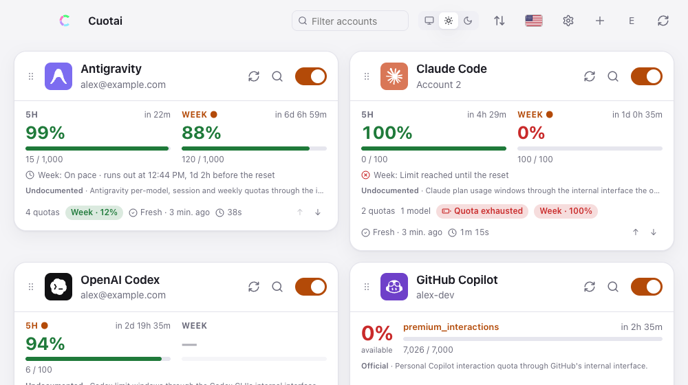 |
| **One Dark** | 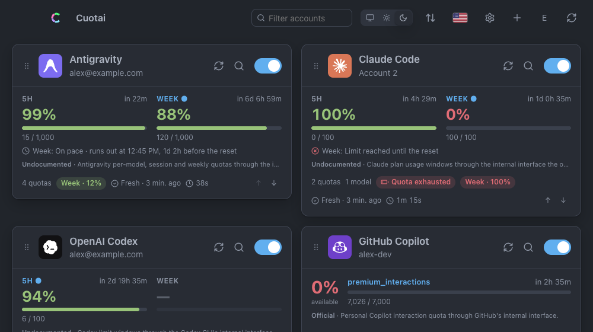 | 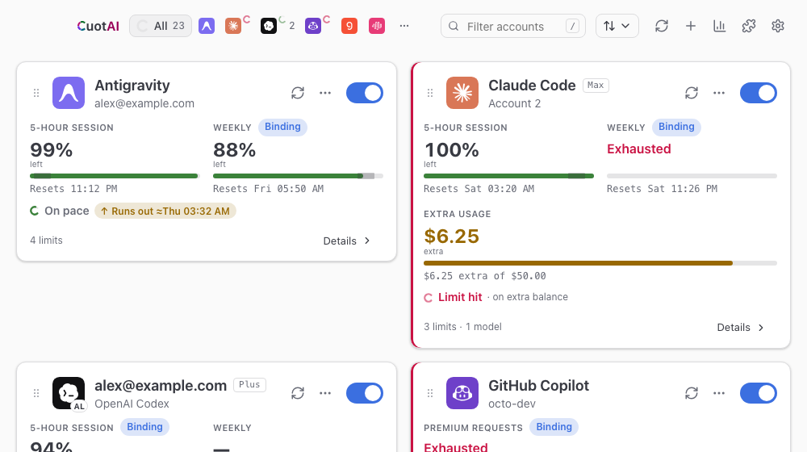 |
| **GitHub** | 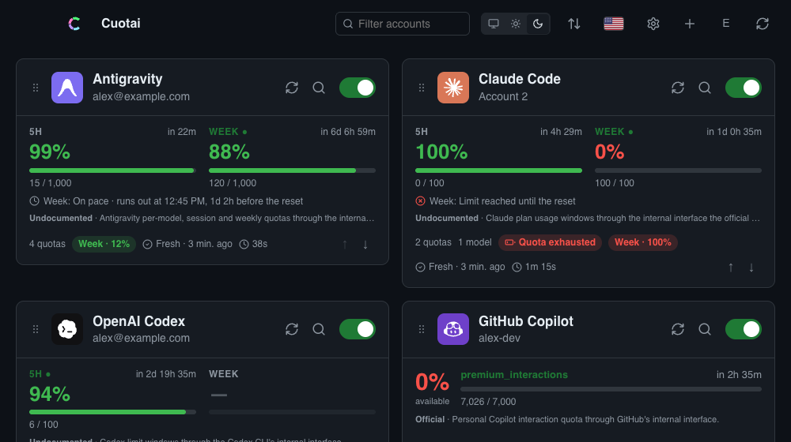 |  |
| **Catppuccin** | 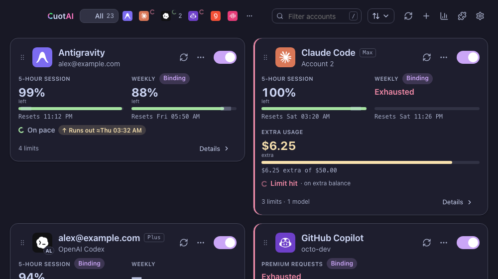 | 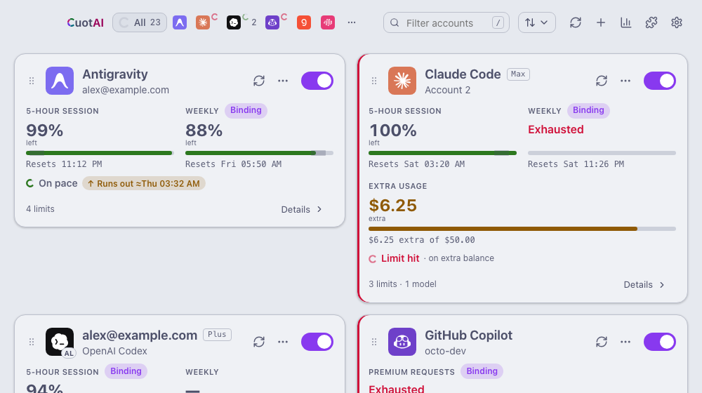 |
| **Monokai** | 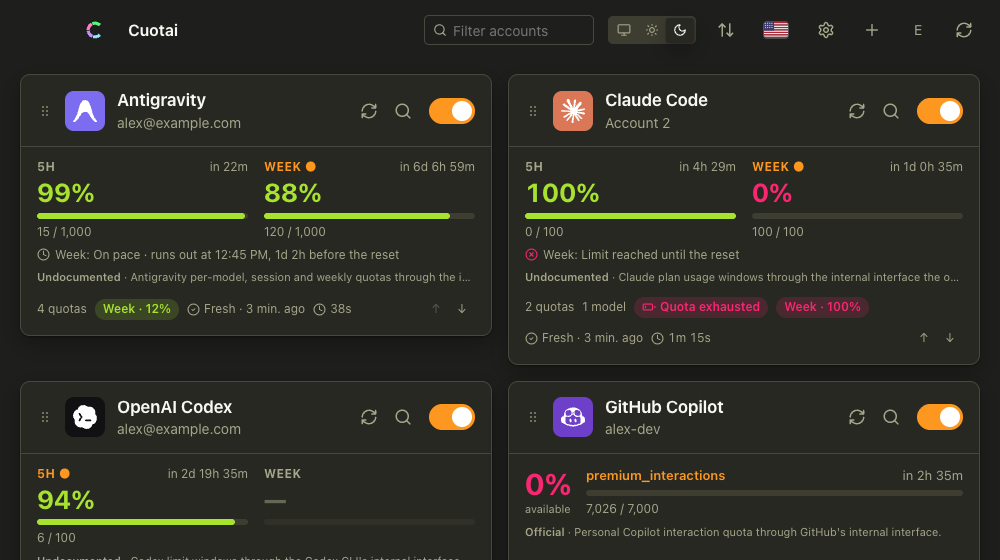 | 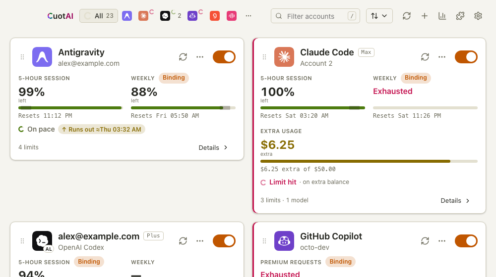 |
| **Tokyo Night** | 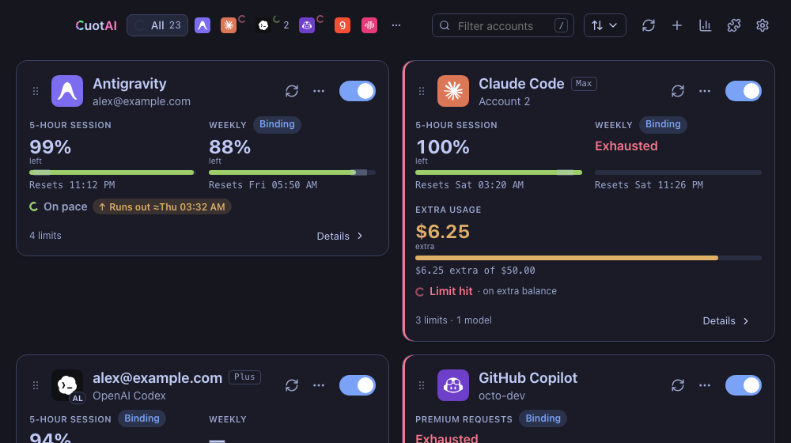 | 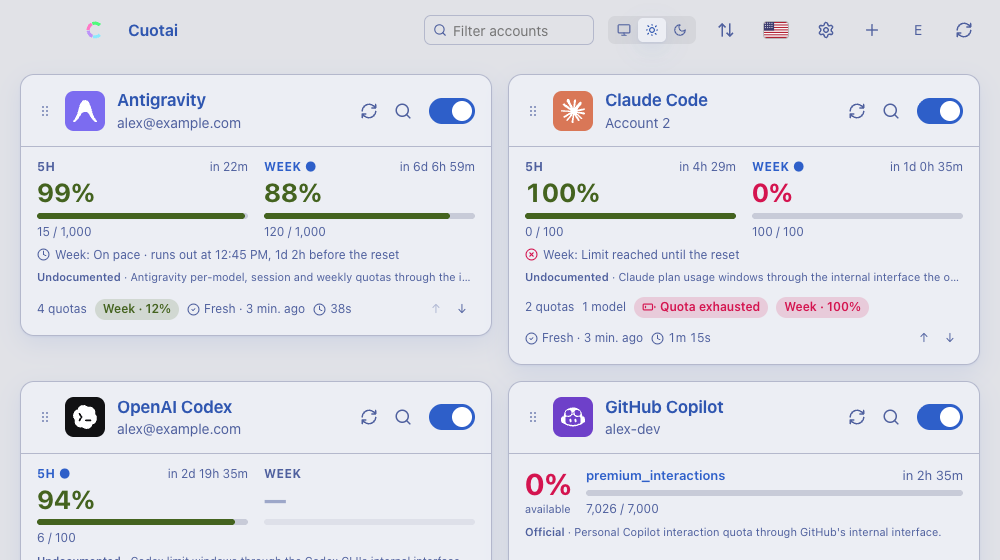 |

### Operating systems

| Theme | Dark | Light |
|---|---|---|
| **macOS** |  |  |
| **Windows 11** |  |  |
| **Windows 98** | 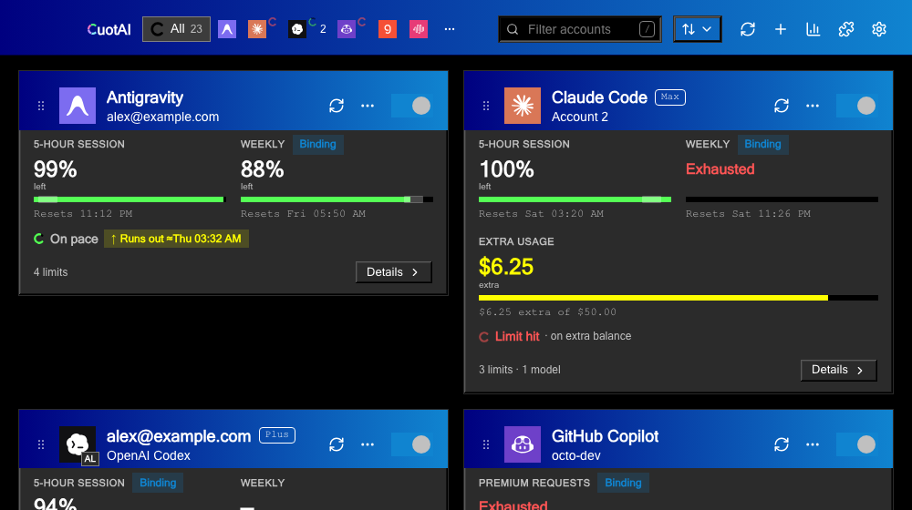 | 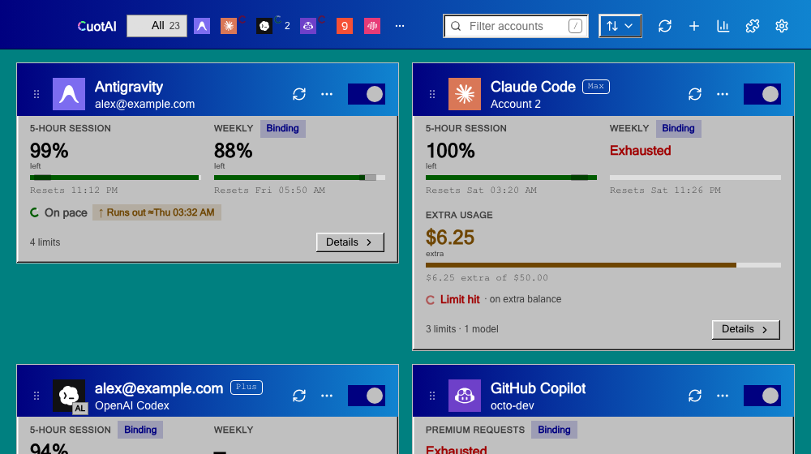 |
| **Windows XP** | 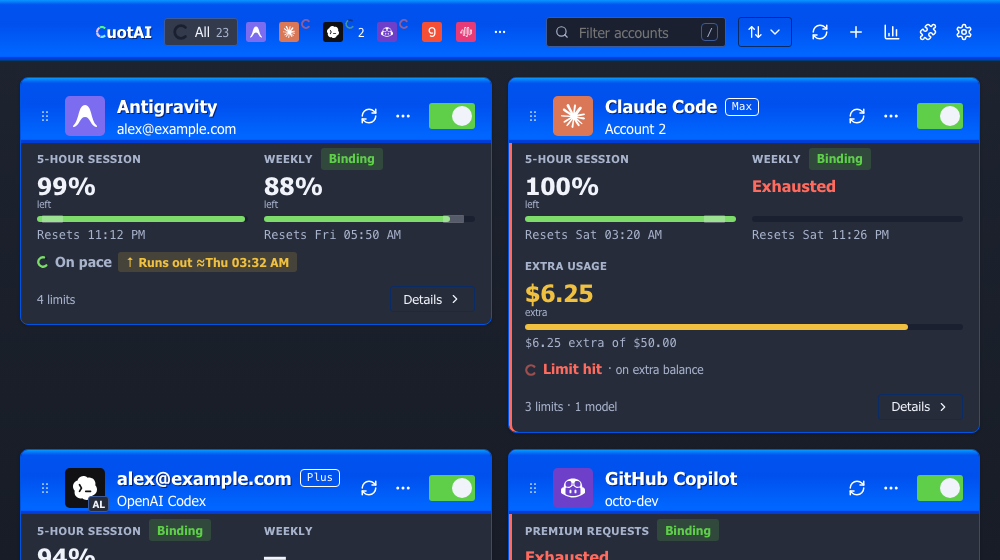 | 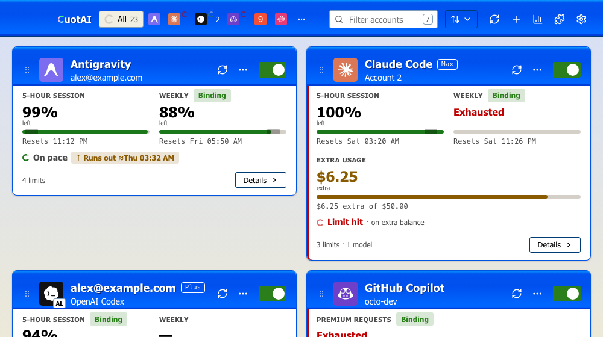 |
| **Ubuntu** |  |  |

### Retro

| Theme | Dark | Light |
|---|---|---|
| **CRT** (tube monitor) | 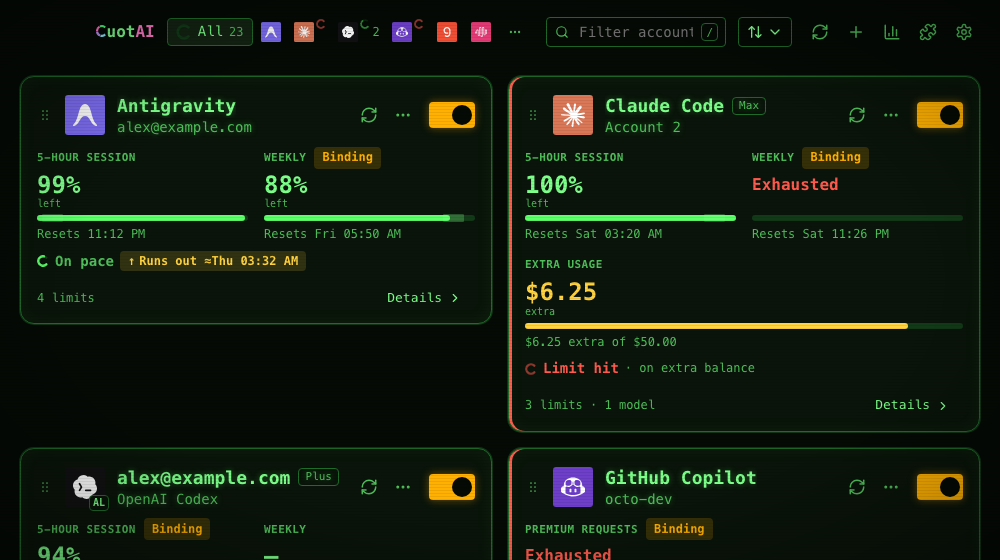 | 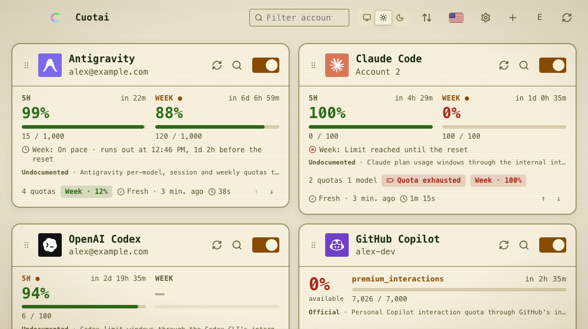 |
| **Old Terminal** (synthwave) |  | 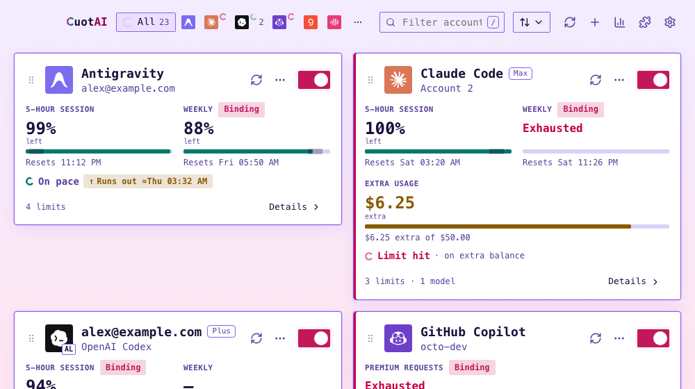 |
| **TRON** | 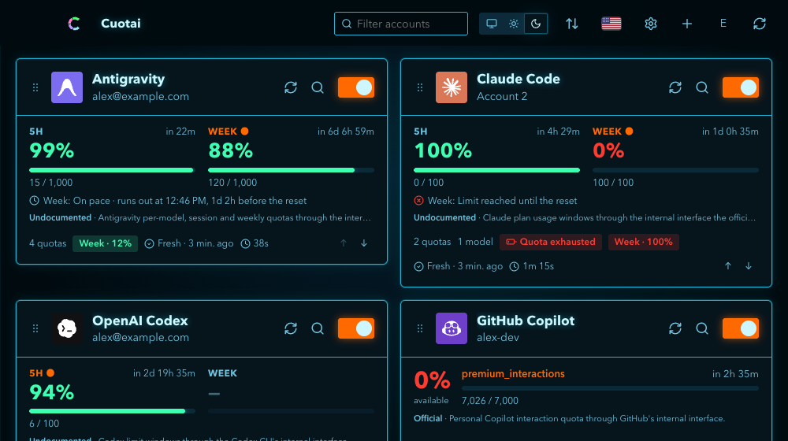 | 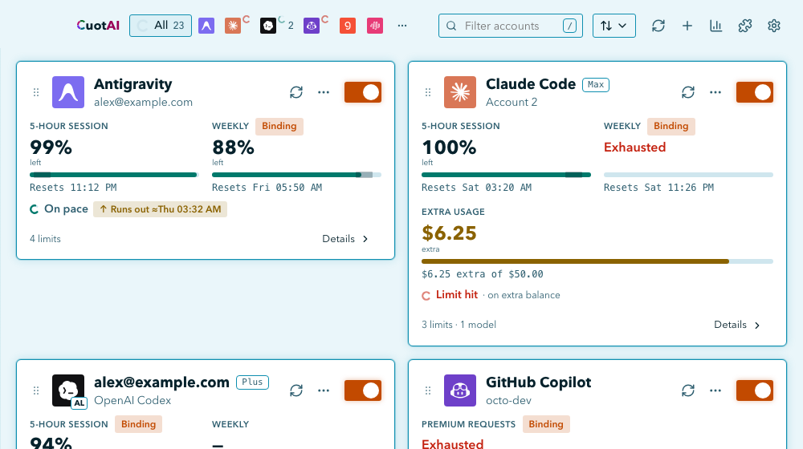 |

## Add your own theme

You can add themes without recompiling Cuotai.

1. Open the folder: `<configuration folder>/cuotai/themes/`. It is `~/Library/Application Support/cuotai/themes` on macOS, `%APPDATA%\cuotai\themes` on Windows and `~/.config/cuotai/themes` on Linux, or the `themes` folder inside the folder named by the `CUOTAI_USER_DIR` environment variable. Create it if it does not exist. (**Settings › Advanced › Files** shows the folder in use, opens it and lets you choose another.)
2. Put a file there named `<id>.css`. The id (the file name without `.css`) uses only `a-z`, `0-9` and `-`, up to 32 characters, and cannot repeat a built-in theme's id.
3. Optionally start the file with a header that names the theme and its modes: `/*! cuotai-theme {"label":"My theme","group":"custom","modes":["dark","light"]} */`. Without it the name is the id, the group is "My themes" and the modes are deduced from the selectors.
4. Restart Cuotai and pick the theme in **Settings › General**. If a file is invalid, it is ignored and the main window shows a warning with the reason.

A theme defines colors (and optionally shape, fonts and effects) as CSS variables, once per mode. A minimal theme named `ocean`:

```css
/*! cuotai-theme {"label":"Ocean","group":"custom","modes":["dark","light"]} */
:root[data-theme="ocean"][data-mode="dark"] {
  color-scheme: dark;
  --bg: #0b1a24;        --surface: #11293a;   --surface-2: #19384d;
  --border: #2b5a78;    --fg: #e6f4ff;        --fg-muted: #9cc3dc;
  --accent: #ffb454;    --accent-fg: #1b1203;
  --good: #5be3a8;      --warn: #ffd166;      --bad: #ff6b6b;   --info: #6cc8ff;
  --track: #1d3f57;
}
:root[data-theme="ocean"][data-mode="light"] {
  color-scheme: light;
  --bg: #eef6fb;        --surface: #ffffff;   --surface-2: #e2eff7;
  --border: #b6d2e3;    --fg: #0d2433;        --fg-muted: #4a6b80;
  --accent: #b45309;    --accent-fg: #ffffff;
  --good: #167a4f;      --warn: #8a6100;      --bad: #b3261e;   --info: #0b6a99;
  --track: #d3e6f1;
}
```

Rules enforced when the theme loads:

- Every selector must start with `:root[data-theme="<id>"]`.
- No `@import`, `@font-face`, other at-rules, external URLs or scripts: the app works offline, so use system fonts.
- Colors are plain `#rrggbb` values.
- A theme should offer both a dark and a light mode, with the same identity adapted to each.

The full token list (colors, shape, surfaces, effects, motion tokens), the quality rules and the contrast and lint tools used for the built-in themes are in [`apps/desktop/ui/css/themes/README.md`](../apps/desktop/ui/css/themes/README.md). A complete example is [`apps/desktop/examples/user/themes/ocean.css`](../apps/desktop/examples/user/themes/ocean.css).

## Add your own language

Languages work the same way, as one JSON file in the `locales` folder next to `themes`; see [`apps/desktop/ui/locales/README.md`](../apps/desktop/ui/locales/README.md).
