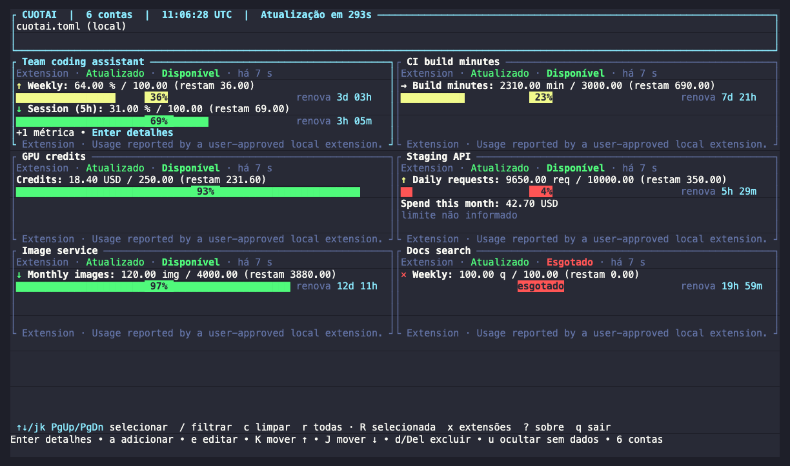
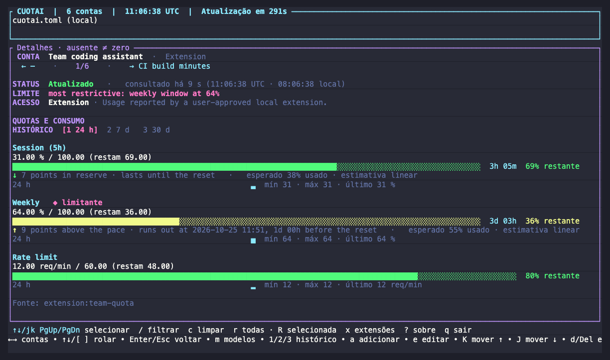

# TUI, CLI and Account Wizard Guide

The `cuotai-tui` binary provides the interactive terminal dashboard (Ratatui), single-run modes (`--once`, `--json` and `--json-v1`) for scripts and automation, a foreground local server (`--serve`) and a foreground event stream (`--watch`).

The TUI's own captions (shortcuts, frames, buttons) are shown in Portuguese. This guide quotes them as they appear on screen, with an English gloss where it helps.

<div align="center">
  
  <p><em>The dashboard: cards in two columns, each with its remaining percentage, pace icon and reset countdown. The accounts here are demo extensions on a throwaway profile, not real services.</em></p>
</div>

<div align="center">
  
  <p><em>Enter opens the details: the binding limit, the pace per metric and the recorded history (keys <code>1</code>, <code>2</code>, <code>3</code>).</em></p>
</div>

Looking for the desktop app? See the [desktop feature reference](gui-features.md). For scripting recipes (`--json`, `--serve`, `--watch`, hooks, history and cost commands) and the accounts file, see [`advanced.md`](advanced.md).

## Running

Install the `cuotai` binary from a release archive, `cargo install` or a source checkout (see [`installing.md`](installing.md#channel-status) for what is available and [`building.md`](building.md) for building). The examples below use `cargo run -p cuotai-tui --`, which you can replace with `cuotai` once it is installed. AWS Bedrock also requires AWS CLI v2 on your `PATH`.

```sh
cargo run -p cuotai-tui -- --list-providers
cargo run -p cuotai-tui
cargo run -p cuotai-tui -- --notify   # announce quota resets and usage alerts while open
cargo run -p cuotai-tui -- --status   # show the providers' public status (off by default)
```

The TUI resolves the texts delivered by the core (login labels,
fields, help, edit errors, report notes, cost warnings) against the
core catalog, using the locale set in `CUOTAI_LANG`
(RFC 5646 codes: `en-US`, `es`, `it`, `pt-BR`...). Without `CUOTAI_LANG`,
it keeps the `pt-BR` default so the chrome stays in Portuguese. The
TUI frame itself (shortcuts, menus, Ratatui's own messages) remains in
Portuguese, outside the scope of RF8.

For a single run or a local install:

```sh
cargo run -p cuotai-tui -- --config cuotai.toml --once
cargo run -p cuotai-tui -- --config cuotai.toml --json
cargo run -p cuotai-tui -- --config cuotai.toml --json-v1   # the versioned export::v1 contract
cargo run -p cuotai-tui -- --config cuotai.toml --serve [--port N] [--token-file FILE | --no-token]
cargo run -p cuotai-tui -- --config cuotai.toml --watch [--interval S] [--events LIST] [--jsonl] [--hooks]
cargo run -p cuotai-tui -- --config cuotai.toml --history [ACCOUNT] [--history-days N] [--json]
cargo run -p cuotai-tui -- --extension-check ID [--json]        # one run of an approved extension
cargo run -p cuotai-tui -- --cost-sources [--json]                   # local cost sources, no log read
cargo run -p cuotai-tui -- --cost-enable claude_code [--cost-path DIR]   # shows the disclosure, asks to confirm
cargo run -p cuotai-tui -- --cost-scan [--json]
cargo run -p cuotai-tui -- --cost [--days N] [--json]                # estimated cost: today, yesterday, the period, by model and by day
cargo run -p cuotai-tui -- --cost-prices [--json]                   # prices of the estimate, your pricing.json over the embedded table
cargo install --path crates/cuotai-tui --locked
```

### Configuration precedence and exit codes

- **Precedence:** `--config`, `CUOTAI_CONFIG`, an **existing** `./cuotai.toml`, the system configuration directory (`<OS config dir>/cuotai/config.toml`; `~/Library/Application Support/cuotai/config.toml` on macOS). The header shows the effective path and its origin (`--config`, `CUOTAI_CONFIG`, `local` or `OS default`).
- **Different-files warning:** the TUI and the desktop app record the last opened file in `<OS data dir>/cuotai/last-config-*.json` (only the normalized path and the date). If the desktop app used another file, the header shows both paths and reminds you that accounts and model caches are separate; align them with `--config` or `CUOTAI_CONFIG`.
- With no file found in interactive mode, the wizard creates `<OS config dir>/cuotai/config.toml` (the same default as the desktop app). To create a local file, pass it explicitly: `--config ./cuotai.toml`. Existing files are never migrated, merged or overwritten automatically.
- In `--once`/`--json`/`--json-v1`/`--serve`/`--watch` mode, with no file the default catalog is still used (the wizard does not open), and a missing or invalid explicit file returns an error. An invalid file is never ignored.
- HTTP queries use the default variables when present; AWS only queries after `params.profile` is configured explicitly.
- **Binding limit (`--once` and the dashboard):** `--once` opens with one line per account naming the limit that restricts it the most, chosen by the core (`Claude  bloqueada até 14:30 pela janela semanal`, `Work  mais restritiva: janela semanal em 62%`; an unknown return says so, never "now"), in `CUOTAI_LANG` and local time; accounts without one show their status. Each dashboard card leads with that metric, and the details mark it with `◆ limitante` under a `LIMITE` line while every metric stays listed. `--json` is unchanged.
- **Measurement age (`--once` and the dashboard):** each card ends its status line with the age of its reading (`há 3 min`, computed by the core from `checked_at`), the details add it to `consultado` with the time in UTC and in the local time zone, and each `--once` account heading ends with `consultado há 3 min`. When a query fails after a success, the card and the details keep the last valid metrics, still and marked `(desatualizada) há 42 min` with their original age, while the details' notes keep the cause of the failure; the next successful query removes the mark and an authentication failure drops the old values. The reading lasts for the session only; `--json` never carries it.
- **Consumption pace (`--once` and the dashboard):** each eligible metric (a quota in a 5 h, daily, weekly or monthly window with a limit and a future reset) shows how its use compares with a steady pace until the reset. On a card its label starts with a stage icon: `↓` in reserve, `→` on pace, `↑` above the pace, `✕` limit reached (the shape carries the stage; color only repeats it). The details add one line per metric, such as `↑ 6 pontos acima do ritmo · acaba às 18:49, 11h 10m antes da renovação · esperado 82% usado · estimativa linear`, and `--once` prints `Ritmo: …` under the metric. The texts follow `CUOTAI_LANG`. It is a linear estimate, not a promise: with at least 3 recorded readings in the recent span (the last 2 hours, or 10% of the window when longer) it extends their slope, otherwise the average since the window start. The pace is computed at the time of the reading (`checked_at`), never at the current clock, and only a fresh reading shows one: once a reading is aging or stale (older than 1.5× the account's refresh interval), the card and `--once` keep its age and drop the pace, as does the last reading preserved after a failed query. Windows that opened less than 5% (or 10 minutes) ago, windows that reset after the reading, rolling rate limits and metrics without a reset show no pace either. `--json` is unchanged.
- **Exit codes (`--once`, `--json` and `--json-v1`):**
  - `0`: every account refreshed successfully (`ready`)
  - `2`: results with missing configuration or an account failure
  - `1`: local error (invalid arguments or file)
- **Local server (`--serve`, PRD 0012 RF4):** serves the [`export::v1`](export-v1.md) contract read-only on `127.0.0.1:6738` (`/health`, `/v1/snapshot`, `/v1/accounts/{key}`, `/v1/limits`) in the foreground, without opening the TUI and without needing a terminal. It refreshes every account at start and then on its own interval, like the dashboard, and a request never queries a provider. It binds exactly `--port N` or 6738, never another port: a taken port is a local error (exit `1`) that names the port, says when another Cuotai server holds it and suggests `--port`. Every request needs `Authorization: Bearer <token>`: by default the token Cuotai creates on the first start in `<OS local data dir>/cuotai/serve/token` (`0600`, path announced on stderr, reused afterwards), or the one in `--token-file FILE` (with a warning when other users can read that file); `--no-token` serves without one, with a warning that any local user or program can then read your usage. The address goes alone to stdout and one line per request to stderr (no headers, no query). `SIGINT`/`SIGTERM` stop it cleanly. Exit codes: `0` when it is stopped by a signal; with `--strict-exit`, `2` when no account had a `ready` reading until the shutdown; `1` for a local error (a taken port, configuration, token, invalid argument). `HEAD` works on every route. Details in [the local server guide](local-server.md#from-the-command-line-cuotai---serve).
- **Event stream (`--watch`, PRD 0013 RF2):** keeps the same refresh cycle in the foreground, without opening the TUI and without needing a terminal, and writes one event per real transition between consecutive readings ([`events.md`](events.md)): a quota crossed 75% or 90%, ran out, recovered or reset, the account was blocked or unblocked, a query failed (with only its category) or recovered, authentication is needed, the provider status changed (with `--status`) or the usage changed (at most every 10 minutes). The first reading of each account is only its baseline. `--jsonl` writes NDJSON on stdout (one payload per line, flushed at once) with every message on stderr; without it each transition is a readable line such as `2026-10-20 14:02:11  Work (Claude): Sessão (5h): 90% usado` in local time and `CUOTAI_LANG`. `--events quota_exhausted,refresh_failed` keeps only those names; `--interval S` (60 to 86 400 s, smaller is an error, never adjusted) replaces the global `refresh_seconds` for this run, accounts with their own `refresh_seconds` keep it and AWS Bedrock never goes below 300 s. With `--serve` both share one cycle (the address then goes to stderr). `SIGINT`/`SIGTERM`/`SIGHUP` stop it cleanly. Exit codes: `0` on a signal stop, whatever the accounts' state; with `--strict-exit`, `2` when some account's latest reading had failed at shutdown; `1` for a local error.
- **Hooks (`--watch --hooks`, PRD 0013 RF3):** runs the rules of `hooks.toml`, next to the accounts' TOML, on the same events ([`events.md`](events.md#hooks-cuotai---watch---hooks)): each rule names its events, optional `provider`/`account`/`min_threshold` filters and a `command` given as an argument list (no shell). The first time, and after any change to the rules, the exact commands are listed on stderr and run only after you type the confirmation word in a terminal; without a terminal, unconfirmed hooks are a local error (exit `1`) before any query. A hook gets the event as JSON on stdin and in `CUOTAI_EVENT`/`CUOTAI_ACCOUNT`/`CUOTAI_PROVIDER`/`CUOTAI_METRIC`, an environment reduced to `PATH`, `HOME` and `LANG`, the temporary directory as working directory, a 10 s time limit by default (60 s at most) after which it is killed, and at most 16 KiB of captured output; at most 4 run at once and a full queue drops the oldest run with a warning. A failing hook is one stderr line and never stops the watch; every run is logged without the payload in `<OS local data dir>/cuotai/hooks/runs.log`. Without `--jsonl` stdout stays empty.
- **Extension check (`--extension-check ID`, PRD 0017 RF2.4):** runs the approved extension `ID` once — without a shell, with a closed stdin, in the extension's folder, with an environment reduced to `PATH`, `HOME`, `LANG` and the approved variables — and prints the normalized reading (status, metrics, notes) or the contract violations, never the raw output; `--json` emits the same as JSON. The first time, and after any change to the manifest or the program, the exact command, the directory, the requested variables and the interval are listed on stderr and it runs only after you type the confirmation word in a terminal; without a terminal, an unapproved extension is a local error. Exit codes: `0` when the reading is ready, `2` when the run failed or the output broke the contract, `1` for local errors (unknown id, declined approval).
- **`--json-v1`:** one query, then the full `export::v1` `Export` (class, age, freshness, preserved reading, binding metric, pace, access level and, with `--status`, the provider's status per account; no credentials); `--once` and `--json` are unchanged.
- **Recorded history (`--history` and the details):** `--history` prints the local measurement history of every account, or of the account named after it, without querying any provider: per metric its sample count, `mín · máx · último` summary, a 60-cell sparkline (`▁▂▃▄▅▆▇█`, blanks where nothing was recorded) and one line per window instance with its first and last value, peak and reset. `--history-days N` picks the days shown (7 to 365, default 7); `--json` emits `{from, to, days, accounts: [{account, provider, metrics: [{key, label, unit, kind, window, limit, points, windows}]}]}`. With nothing recorded it says `Sem medições registradas nos últimos N dias.` instead of failing. Exit codes: `0` when every listed account has data, `2` when one has none, `1` for a local error (unknown account, invalid days, unreadable file or history). The dashboard details show a `HISTÓRICO` line with the span (`1` 24 h, `2` 7 d, `3` 30 d) and, under each metric, `24 h  ▁▂▃…  mín 5 · máx 80 · último 40 %`; a metric with no samples in the span says `sem medições registradas`, and when the sparkline would not fit only the summary remains.
- **Local cost sources (`--cost-*`, PRD 0015 RF1/RF2):** off by default; nothing is read from the logs of Claude Code or Codex CLI until you turn a source on. `--cost-sources` lists each source (`claude_code`, `codex_cli`), whether it is on, the exact directories it reads (or would read) and its file pattern, and how many logs and invalid lines the index follows, without reading any log (`--json` for JSON). `--cost-enable SOURCE` prints the disclosure (every directory read, what for, that only the time, the model, the token counts and an anonymous session digest are extracted, and that conversation content is never read) and turns the source on only after you type the confirmation word in a terminal (without one: exit `1`); `--cost-path DIR` (repeatable) reads `DIR` instead of the defaults, which follow `CLAUDE_CONFIG_DIR` and `CODEX_HOME`. While the TUI (or the desktop app) is open, a low-priority background scan reads only what grew, within limits per cycle, and pauses in energy-saving mode; it never delays the quota refresh. `--cost-scan` reads now in the foreground and prints one line per source (logs, new requests, invalid lines ignored, or why it could not read: no logs, no access); exit `0` when every source that is on was read, `2` when none is on or one has no logs or access, `1` for local errors. `--cost-period today|last_7_days|last_30_days|current_month|all` and `--cost-retention-days N` (7 to 730, default 120) save the period shown and the index retention. `--cost-disable SOURCE` turns a source off and erases everything derived from it; `--cost-erase` erases the whole index. The preferences and the index live in `<OS local data dir>/cuotai/cost/` (`settings.json`, `cost.sqlite3`), private to your user. Showing tokens and the estimated cost arrives with `cuotai --cost` (PRD 0015 RF4).
- **Local cost prices (`--cost-prices`, PRD 0015 RF3):** lists the API prices of the local cost estimate per model in USD per million tokens (input, output, cache read, cache write) and where each comes from: the table embedded in the build (its effective date and source) or your own `pricing.json` in `<OS local data dir>/cuotai/cost/`, written by hand in the same format (`currency` `USD`, `effective` `YYYY-MM-DD`, optional `source`, and `models` with the four prices) and never downloaded. A model listed there wins over the embedded price; the rest keep it. An invalid file is ignored as a whole, with the reason, and the command exits `1` (`0` otherwise; `--json` for JSON). A dated model name uses the price of its undated name; a model in neither table has an unknown cost, never zero. No log is read.
- **Local cost estimate (`--cost`, PRD 0015 RF4.2):** reads in the foreground what grew in the logs of the sources that are on, then prints per source today, yesterday and the saved period (`--days N`: the last 1 to 730 local days instead), the breakdown by model and by day, and why a source has no numbers (off, no logs, no access, reading not finished, nothing in the period); amounts are an estimate at API prices in USD, not a charge, and a model without a price reads cost unknown. `--json` prints the core's `CostSummary` (the `local_cost` of `export::v1`). Exit `0`; `2` when no source is on or one has no logs or no access; `1` for local errors. The interactive TUI shows the same rows in a `USO LOCAL` section of the details of Claude and ChatGPT / Codex accounts, read from the index every 15 s.

## TUI keyboard and mouse shortcuts

- **Accounts:** `a` adds an account, `e` edits the selected one, `d` or `Delete` deletes the selected account (confirm with `s` to write or `n`/`Esc` to cancel).
- **Navigation:** `↑↓`/`j k` select, `PgUp/PgDn` page, `Home/End` jump to the ends, `Enter` opens the account details (`←→` switch between visible accounts in the details; `↑↓` or `[`/`]` scroll the details; `1`, `2`, `3` show the history of the last 24 hours, 7 days or 30 days; `Enter`/`Esc` go back).
- **Filter and view:** `/` filters, `Enter/Esc` end filter editing, `c` clears the filter, `u` shows or hides accounts without data (visible by default).
- **Refresh:** `r` refreshes all accounts and `R` refreshes only the selected one.
- **Models:** in the details, `m` opens the account's Models; in the wizard's Provider step, `m` lists the provider's **already configured** accounts and `Enter` opens the chosen one (with no account, it shows only the support status and guidance). The first open queries only if the provider is supported and has never been queried; afterwards it reads the cache. `/` searches locally by ID/name (separate from the account filter), `c` clears, `s` is **Sync models**, `↑↓`/`PgUp/PgDn`/`Home/End`/wheel scroll, `Esc` (or right click) goes back. The query runs in the background, does not refresh quotas, and is discarded if the account changes (edit, delete, move, reload). `r`, `R`, `--once` and `--json` never sync models.
- **Reordering:** `K`/`J` move the selected account up/down in the order persisted in `cuotai.toml` (shared with the desktop app, preserving each account's comments), without triggering any provider query.
- **About:** `?` (or the `? sobre` footer entry) opens Cuotai's version, license and repository, plus the list of open-source libraries in use, with license, the component that uses each and its repository. The list comes from `cuotai_core::about`, shared with the desktop app; only direct dependencies appear (the full inventory is in `Cargo.lock`). `↑↓`/`PgUp/PgDn`/`Home/End`/wheel scroll; `Esc`, `q`, `?`, `Enter` or right click go back.
- **Quit:** `q` or `Ctrl-C`.
- **Minimum terminal size:** dashboard `45 × 18`; wizard `60 × 20`. Dracula theme.

### Mouse support

- A click selects a card; clicking the already selected card opens its details.
- In the details, click the visible part of a single HTTPS source to open it in the browser; composite sources stay scrollable text. Right click goes back from the details.
- The mouse wheel moves through the card rows and scrolls the details, the wizard lists and the login instructions.
- The footer has clickable actions; the wizard offers `[Voltar]` (Back), `[Próximo]` (Next), `[Gravar]` (Save) and `[Cancelar]` (Cancel). The wheel never confirms a login, a save or a deletion. Mouse capture is released on exit or on panic.

## Quota dashboard

- The cards (two columns on wide terminals) keep the order of the configuration file, even when a query result changes.
- Independent queries run in parallel up to `concurrency`; during a refresh the previous data stays visible. The header shows the countdown to the next query of the selected account.
- Bars represent the **remaining** percentage; used values above 100% are preserved and only the drawing is clamped to the bar width.
- Costs and balances with no known limit show plain text values, without inventing a percentage or "unlimited". An extra balance of zero does not make a subscription that still has limited quota available count as exhausted.
- **Failures explained:** an account whose provider has no usage query in its mode (such as an AI Studio key) shows the reason on the card and at the top of `QUOTAS E CONSUMO` instead of the generic failure, and an account whose internal interface no longer matches the known schema says it may have changed and names the public contract it follows; the adapter's own notes stay under `OBSERVAÇÕES`. How each integration reads usage (its access level) is not shown in the TUI: it is documented in [`providers.md`](providers.md#usage-access-matrix). `--once` and `--json` are unchanged.
- Deleting an account removes only the configuration entry: it does not delete environment variables or Keychain entries, and it does not revoke access at the provider.

### Animations

- After a refresh, card gauges and detail bars slide from the old value to the new one (~300 ms) at 1/8-cell resolution. A class change (`Disponível`/`Esgotado`/`Sem dados`) flashes the label twice (2 flashes/s). A braille spinner (`⠋⠙⠹…`) precedes the card title while that account refreshes. Opening or closing the details, `Sobre` and `Modelos` uses a 120 ms top-down wipe.
- With `COLORTERM=truecolor` (or `24bit`) bar colours follow a red → yellow → green gradient by level; otherwise the usual red/yellow/green steps are used.
- The loop draws at ~30 fps only while an effect runs; when idle it keeps the usual pace (redraw on events and the 1 s countdown tick).
- **Off:** `--no-animations`, `CUOTAI_NO_ANIMATIONS=1` (any non-empty value except `0`), or `TERM=dumb` (always). Under SSH (`SSH_CONNECTION` or `SSH_TTY`) they are off by default; `CUOTAI_ANIMATIONS=1` turns them back on, but never overrides the opt-outs above. With animations off the screen renders exactly as before. `--once`/`--json` never animate.

### Reset notices and usage alerts (`--notify`)

- Off by default. With `--notify`, while the TUI is open, it announces each quota reset using the same planner as the desktop app (`cuotai_core::resets`): a `quota` metric of a 5 h, daily, weekly or monthly window that was used (`used > 0` or `remaining < limit`; a missing value counts as unused) reaching the `resets_at` the provider reported. `other` windows, rate limits and balances never notify; a `resets_at` drifting up to 2 minutes is the same reset.
- The notice is a yellow line at the top of the header (`14:30 · Claude: cota de 5 horas renovada (Pessoal)`, in `CUOTAI_LANG`; several accounts due together share the line, separated by ` · `) kept for an hour, plus one terminal bell (`BEL`) per pass. On iTerm2, WezTerm and Ghostty (`TERM_PROGRAM`) it also sends an OSC 9 desktop notification with the provider, account name, metric labels and the reminder that the time is the provider's; it is never sent to other terminals, inside tmux (`TMUX`) or screen (`STY`), so an unknown sequence never reaches the screen. Control characters of account names and labels are removed.
- Nothing persists: each reset is announced once per session and a reset that passed before the TUI opened (a reading restored from the history) is not announced. After a suspension, what became due at once is one notice per account, and a reset more than 10 minutes old by then is skipped. A notice never triggers a query; the new balance shows on the next refresh. It uses the account's current reading or, while its query failed, its last valid one.
- **Usage alerts** (PRD 0008 RF4): with the same flag, every refresh is judged by the desktop app's evaluator (`cuotai_core::alerts`) against the reading it replaces, with the core defaults: a `quota` metric with a positive limit reaching **75%** or **90%** of use, reaching **100%** (exhausted) or, after its exhaustion was announced, having slack again in the next window. Balances, credits, spend, usage, rate limits, uncapped metrics and missing values never alert. Each threshold is announced once per window instance (`resets_at` within 2 minutes is the same window); it re-arms only when use falls 5 points below it or a new window starts, so oscillating around it stays silent, and several thresholds crossed by one refresh announce only the highest.
- An alert joins the same header line (`14:31 · Claude: 90% da janela de 5 horas usada — Pessoal: Sessão (5h) · renova 19:00`, one item per account with its metrics when several crossed together) and rings the same single `BEL` per pass, with OSC 9 on the terminals above. Alerts arriving less than a minute after the previous one wait and go out together. The first reading of an account in the session is never news: it is compared with the last recorded reading (PRD 0006), a threshold that reading had already crossed is not announced, and nothing is when that reading is more than 10 minutes older. Nothing persists between sessions; an account removed or renamed in the wizard drops its pending alerts. No alert triggers a query.
- `--once`, `--json` and `--history` reject `--notify` and keep their output unchanged. The desktop app's notification preferences (reset lead time and filter, alert thresholds, exhaustion and recovery switches, per-account bell, muted metrics) live in `desktop.json` and do not apply here.

### Provider status (`--status`)

- Off by default (PRD 0011 RF5). `--status`, or `CUOTAI_STATUS` with any non-empty value except `0`, turns it on for the TUI, `--once` and `--json`; `--no-status` turns it off even when the flag or the variable is set, so a script can opt out of an inherited environment. With it off, Cuotai makes no status request at all.
- When on, the core reads the public status page of each configured provider that has a verified source ([list](providers.md#public-incident-source-registry)), once per page for every account and product sharing it and at most once every 5 minutes, without credentials, cookies or account data (the status sites still see your IP address and that you use the provider). The TUI asks for a reading every 30 s off the event loop; the cache answers until a page is due. Providers without a verified source never show a status, never "operational".
- **Cards:** the top border shows a badge to the right of the account name, shortened (down to its shape) so it never covers the name: `! Desempenho degradado`, `▲ Interrupção parcial`, `✕ Interrupção grave` (red), `i Em manutenção`, plus `· última leitura` when the latest read failed and the state is the previous one, or `? Página de status indisponível` when the page could not be read. An operational provider or a plain unknown state (AWS or xAI without an active event) shows nothing on the card. The shape carries the state; color only repeats it. State labels come from the core in `CUOTAI_LANG`; the rest is the TUI's Portuguese.
- **Details:** a `PROVEDOR` block under `ACESSO` with the full state (`✓ Operacional` and `? Status desconhecido` too), the active incident's title, `desde` with its start, `lido há …` or why there is no reading, and the incident or status page.
- **`--once`:** under the heading of an account whose provider is flagged, `Status do provedor: Interrupção grave · Elevated errors on Claude Code · desde 14:02 · https://status.claude.com/incidents/…`. A query that fails during an incident also carries the core's note ("O provedor informa um incidente em andamento; a falha pode não ser da sua conta.", plus the advice to wait before signing in again for authentication failures) among its notes; its status does not change.
- **`--json`:** the `Snapshot` keeps its shape; only the notes above may appear in a failed report's `notes`. The provider status is published in `export::v1` as each account's `incident` ([contract](export-v1.md)).

## Configuring an account with the wizard

On the first interactive run with no configuration file (or with an empty account list), the TUI opens the **account wizard**. You do not need to edit the TOML by hand (for manual configuration, see [`cuotai.example.toml`](../cuotai.example.toml)).

1. **Environment (optional):** for an environment credential, export the access token in the terminal that will run Cuotai (`export MY_TOKEN`). Cuotai does not load `.env` automatically. For the built-in OAuth login, see [OAuth and the vault](oauth.md).
2. **Open the wizard:** run `cargo run -p cuotai-tui`. If a configuration already exists, press `a` to add, or select an account and press `e` to edit.
3. **Provider:** select with the arrow keys and confirm with `Enter`. Providers are listed by name; those without any usage query are not offered (see [`providers.md`](providers.md#usage-access-matrix)).
4. **Account name:** enter a unique name, such as `Personal Codex`.
5. **Credential:** this step lists **Manual credential** (the name of the environment variable, or the AWS profile, depending on the provider) and each **login mode** the core offers for the provider (`Login no navegador` (browser login), `AWS SSO`, `Console Bailian`, `Importar sessão Cursor` (import Cursor session), etc. The list, labels and help come from `cuotai_core::login`, never decided by the TUI). Press **Tab** to switch between them; `Enter` moves through the selected mode's fields and `F2` starts or redoes the login of the current mode (with no provider-specific shortcut). The wizard shows `PRESENTE`/`AUSENTE` (present/absent) for variables, without revealing values.
   - Under the credential help, the core adds what the query needs, its risk ("may change without notice" for internal interfaces), any plan requirement and, when there is no usage query, the reason; they follow the selected mode.
   - Reauthenticating (F2, or **Refazer login** on the desktop) reuses the `credential_id` of the account being edited: the token is overwritten in the vault, leaving no orphaned credential. If an option that makes up the vault key changes (Kiro method/region, `client_id`, tenant, etc.), the old credential is removed automatically **after** the TOML is saved, unless another account still references it; if that cleanup fails, the state is reported as non-fatal (configuration and new credential saved, previous credential kept in the vault).
   - Modes whose login lives outside Cuotai's vault (AWS SSO, Bailian's `bl`) write only public parameters to the account (`params.profile`, `params.cli_profile`); cancelling the login step does not undo what the external CLI already wrote.
6. **Parameters:** fill in the provider-specific fields; `Enter` advances between them. Optional ones may stay empty. Copilot offers choices with `←→`, showing the organization only in `org` mode.
7. **Interval:** enter `30` to `86400` seconds for **this account** (minimum `300` s for AWS Bedrock); empty inherits the global `refresh_seconds` of the TOML (default: `300`). Accounts with their own intervals are scheduled separately. Providers billed per query (AWS) show the core's cost warning; consider `3600` seconds or more.
8. **Review:** check the account, parameters and the target file; `↑↓` scroll the summary. Only `Enter` on this step writes and applies the configuration, starting the query on the dashboard. An account whose mode has no usage query (for example Perplexity without `product = computer`) can still be saved: the first `Enter` shows its reason and turns the button into `[Gravar mesmo assim]` (save anyway), a second `Enter` saves, and any other key cancels.

`Shift+Tab` goes back while keeping the draft; `Ctrl+U` clears the field; `Backspace` deletes; `Esc` cancels without saving. Changing the provider resets the fields and the credential reference, to avoid reusing the previous provider's token.

### Atomic TOML persistence

Writing uses a temporary file and an atomic replace, with `0600` permission for new files on Unix. Edits to `[[accounts]]` tables preserve the order, the account's comments and the other parameters and settings. If the file changes externally, the wizard refuses to overwrite it and tells you to close and reopen Cuotai. On a write failure, the draft stays on the review step so you can try again.

Tokens supplied through variables remain managed externally: if you update a variable in the shell, restart Cuotai. Credentials obtained through the built-in login are recovered from the vault and renewed automatically before the query when close to expiring.
