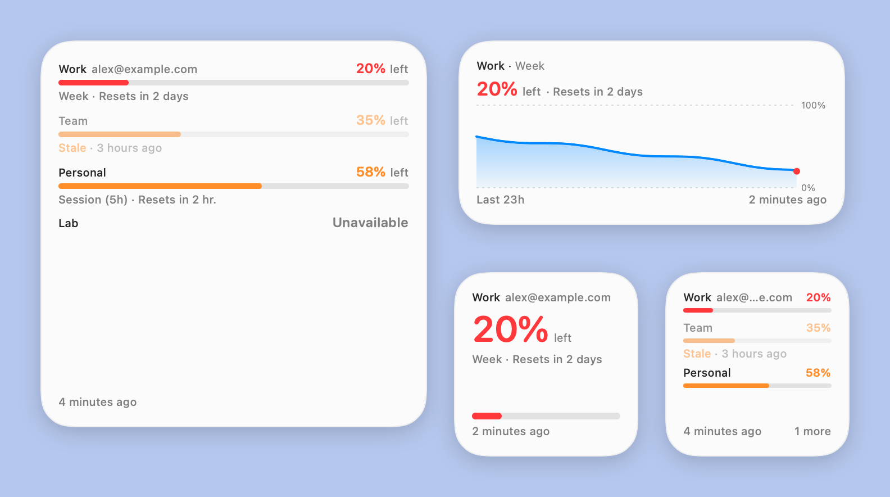
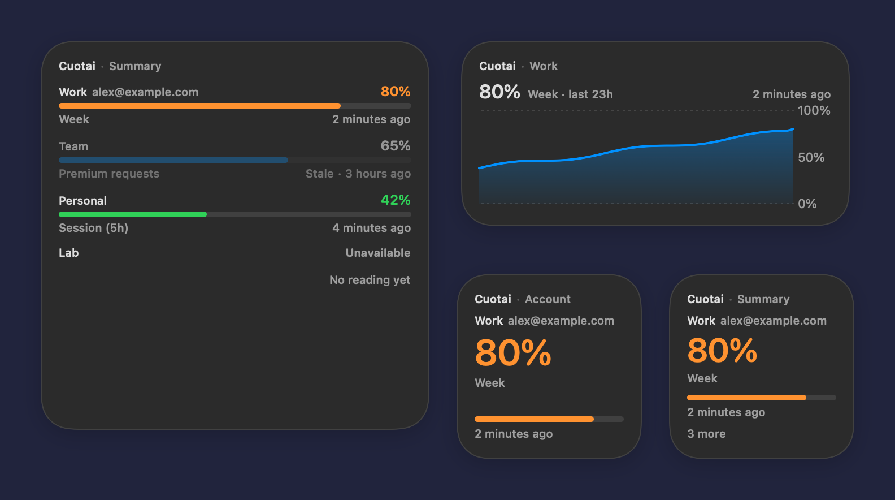

# System widgets (PRD 0014)

Cuotai publishes what it already measured into a small JSON file, `widget.json`, that system widgets and third-party integrations read. The extension never queries a provider, never reads a credential and never computes usage: it draws what `cuotai-core` has already computed (the project's rule — see [architecture.md](architecture.md)).

The file is a projection of [`export::v1`](export-v1.md) with **its own** `schema`, so the export can evolve without breaking widgets.

## Where the file lives

| System | Path | Read by |
|---|---|---|
| macOS | `~/Library/Application Support/cuotai/widget.json` | the WidgetKit extension, third-party panels and scripts |
| Windows | `%LOCALAPPDATA%\cuotai\widget.json` | third-party panels and scripts |
| Linux | `~/.local/share/cuotai/widget.json` | third-party panels and scripts (Waybar, GNOME, KDE) |

The extension is sandboxed, so `CuotaiWidgets.entitlements` gives it a read-only exception for this one file and no other. On macOS the file therefore **stays at that path when you move the data folder** (`CUOTAI_DATA_DIR` or Settings › Advanced › Files › Data folder); on Windows and Linux it follows the data folder. Settings › Advanced › Integrations › Widgets shows the path and says whether the extension reads it.

With the feature off, **no file is written and every copy is deleted** (RF2.2): the file, its `widget.json.bak`, the copy an earlier release left in a moved data folder and, on macOS, the group-container file of releases before 0.82.2. Cuotai also deletes them when it starts with the feature off. Settings › Advanced › Integrations › Widgets has a "Delete widget data" button that removes the same copies, and erasing all data removes them too.

> macOS: an *app group* needs a provisioning profile outside the App Store: without one, macOS logs that it ignores the entitlement and the extension reads nothing. Releases before 0.82.2 relied on it, so their widgets stayed empty. "Delete widget data" also removes the file those releases could leave in the group container.

## Widgets

Every image below is drawn from the same example `widget.json` ([`fixtures/widget.json`](../apps/desktop/tools/widget-shots/fixtures/widget.json), `example.com` only, no real account) by the scripts in [`apps/desktop/tools/widget-shots`](../apps/desktop/tools/widget-shots/README.md), which also explain how to regenerate them.

### macOS (WidgetKit)

<p align="center">
  
</p>

<p align="center">
  
</p>

> **Rendered, not captured.** These are the shipped SwiftUI entry views (`Sources/*.swift`) drawn off-screen with `ImageRenderer`, so the images can be regenerated without a signed `.appex` (see [Building and packaging](#building-and-packaging)). The widget background is approximated with a solid card, and the relative age is frozen at render time ("2 min, 0 secs"); on the desktop the system advances it. The e-mail appears because the example file was written with "include identity" on. 

| Widget | Family | Light | Dark |
|---|---|---|---|
| Summary | small | [png](assets/screenshots/widgets/macos-summary-small-light.png) | [png](assets/screenshots/widgets/macos-summary-small-dark.png) |
| Summary | medium | [png](assets/screenshots/widgets/macos-summary-medium-light.png) | [png](assets/screenshots/widgets/macos-summary-medium-dark.png) |
| Summary | large | [png](assets/screenshots/widgets/macos-summary-large-light.png) | [png](assets/screenshots/widgets/macos-summary-large-dark.png) |
| Account | small | [png](assets/screenshots/widgets/macos-account-small-light.png) | [png](assets/screenshots/widgets/macos-account-small-dark.png) |
| Account | medium | [png](assets/screenshots/widgets/macos-account-medium-light.png) | [png](assets/screenshots/widgets/macos-account-medium-dark.png) |
| Account, pinned account removed | small | [png](assets/screenshots/widgets/macos-account-unavailable-light.png) | [png](assets/screenshots/widgets/macos-account-unavailable-dark.png) |
| History | medium | [png](assets/screenshots/widgets/macos-history-medium-light.png) | [png](assets/screenshots/widgets/macos-history-medium-dark.png) |
| Empty state (no snapshot) | small | [png](assets/screenshots/widgets/macos-empty-small-light.png) | [png](assets/screenshots/widgets/macos-empty-small-dark.png) |

The widgets declare no accessory (Lock Screen) family.

#### What the widgets show

The face of a widget carries the information, not the app's name: an account's name, what is **left** of its quota (or what was used, if you choose so) in the level colour the app uses everywhere (green from 70% left, orange from 30%, red below or exhausted), the quota's name and when it renews. A share is rounded honestly: above nothing never reads `0%` (`< 1%`), below all of it never `100%`. One age line per widget gives the age of the oldest current reading; an old reading says its own age on its row (`Stale · 5 min ago`) and is drawn at half opacity. The age is the system's live relative text, laid out alone in a frame of a fixed width, never measured beside another view. When a widget reads a newer file it asks the other Cuotai widgets to read it too, so two widgets do not show readings of different refreshes side by side.

#### Choices

Right-click a widget and choose **Edit widget** (or the widget's own settings in the gallery):

| Choice | Widgets | Default | Why |
|---|---|---|---|
| Accounts | Summary | none chosen (every published account) | Keep the accounts you watch; an account that disappears is left out, never replaced. |
| Account | Account, History | the first published account | One account, pinned by its stable id. |
| Quota | Account | the most restrictive quota | Watch a particular window (for example the 5-hour session) instead of the binding one. |
| Order | Summary | most restrictive first | Or the order of the accounts in Cuotai (`position`). |
| Show | all | what is left | What is left (as in the app) or what was used. |
| Detail | all | detailed | Compact: Summary rows of one line, the Account widget without the other quotas, History without the axis labels and the span. |
| Hide accounts with nothing used / without data | Summary | off | Leave out idle accounts, or accounts without a reading or a plan limit. |
| Show the reset time | all | on | "Resets in 2 days" beside the quota's name, where there is room. |
| Show the age of the data | all | on | The age line; an old reading still says its own age. |
| Period | History | everything published | 6 hours, 24 hours or 7 days of the published series. |

### Linux (Waybar)

<p align="center">
  
</p>

A real screenshot: Waybar running in a headless sway session (in a container) with the example module [`cuotai-waybar.sh`](../apps/desktop/tools/widget-shots/linux/waybar/cuotai-waybar.sh). The module only reads `widget.json` with `jq` and prints Waybar's JSON protocol: the first three accounts as `text`, one line per account as `tooltip`, and a `class` after the most restrictive account (`normal`, `warning` from 75 %, `critical` from 90 %, `exhausted`, `unavailable`, or `off` when the file is absent). To use it, save the script, make it executable and add the module to your Waybar config:

```jsonc
"custom/cuotai": {
    "exec": "~/.config/waybar/cuotai-waybar.sh",
    "return-type": "json",
    "interval": 30
}
```

Read right after the example file was written, the tooltip says:

```text
Work (claude): 80% Week, 2 min ago
Team (copilot): 65% Premium requests, 3 h ago, stale
Personal (codex): 42% Session (5h), 4 min ago
Lab (gemini): unavailable
```

GNOME and KDE: Cuotai ships no GNOME Shell extension or Plasma widget, and neither desktop has a light headless capture path, so there is no image. Panel tools that run a command and show its output can run the same script and use its `text` field.

### Windows

Windows has no Cuotai widget: PRD 0014 delivers no native widget there. The app only writes `%LOCALAPPDATA%\cuotai\widget.json` for third-party tools; at-a-glance usage lives in the notification-area popover (screenshots in [gui-windows.md](gui-windows.md#notification-area)).

## Privacy

`widget.json` is the `widgets.snapshot` row of the generated inventory in [`privacy.md`](privacy.md). The file can be read by any process of the same user and by the extension. Therefore it carries **no credentials, no credential variable names, no provider notes, no response bodies and no authenticated URLs** — notes are not projected at all. The e-mail of an account appears only when Settings › Advanced › Integrations › Widgets has "include identity (e-mail)" turned on, which is off by default. On Unix the file is written `0600` (readable by its owner only); on Windows the per-user data directory provides the equivalent.

The same rules that apply to [`export::v1`](export-v1.md#what-never-appears) apply here, and `widget_snapshot` inherits the redacted fields it projects.

## Format

Produced by `cuotai_core::widget_snapshot`:

```rust
use cuotai_core::widget_snapshot::write;

// `export` is the `export::v1` the front end already builds; `max_accounts`
// is the user's limit from Settings (default 6).
write(&export, std::path::Path::new("widget.json"), 6)?;
```

### Top level

| Field | Type | Meaning |
|---|---|---|
| `schema` | integer | Always `1`. Its own version, independent of `export::v1`. |
| `schema_revision` | integer or absent | The additive revision of schema `1` (PRD 0051 RF3.1): `1` adds `locale` and each metric's `label_text` and `unit_text`; `2` adds each account's `position`. Absent in files of revision `0`. A reader ignores members it does not know. |
| `generated_at` | RFC 3339 | When the snapshot was built. |
| `accounts` | array | The published accounts, in binding order (the most restrictive first). |
| `truncated` | boolean | `true` when accounts were dropped by the user's limit or by the size cap. |
| `locale` | string or absent | The app's interface language (PRD 0034), a registry code such as `de`, `pt-BR` or `zh-CN`, so a widget draws its own texts and formats in the app's language rather than the system's. Absent when the writer did not say; the widget then keeps the system's language. |

### Account

| Field | Type | Meaning |
|---|---|---|
| `id` | string | The stable account id (PRD 0029), the same `id` as in `export::v1`. A pinned widget matches on it, so a rename keeps the pin; when the account is gone the widget shows it as unavailable and never another account. |
| `key` | string | `<provider slug>:<name>` (`claude:Work`), the same key as in `export::v1`; a rename changes it. Widgets pinned before ids still match on it. |
| `position` | integer | The account's place in the configuration (0 for the first; an aggregator's connections follow it), so a widget can list the accounts in the order you set while the file keeps the binding order. Schema revision 2; absent in older files. |
| `name`, `provider` | string | Display name (the configured name, or the provider's name for an unnamed account) and provider slug. |
| `provider_name` | string | The provider's display name (`GitHub Copilot` for `copilot`), which the account picker shows. Absent in files written before it was added. |
| `email` | string | Only when the user turned identity on; absent otherwise. |
| `state` | `ready` / `stale` / `unavailable` | `stale`: the current query failed (or is pending) and the metrics are the preserved reading. `unavailable`: nothing to show, current or preserved. |
| `checked_at` | RFC 3339 or `null` | When the reading shown was **measured**. While stale it is the original time of the preserved reading, never the time the file was written. `null` while `unavailable`. |
| `freshness` | `fresh` / `aging` / `stale` or `null` | Freshness of the reading shown; `stale` for a preserved one. |
| `binding` | object or `null` | The metric that restricts the account most (`index`, `label`, `window`, `used_ratio`, `remaining`, `resets_at`, `reason`, `blocked_until`), same shape as `export::v1` except `index`: here it is the metric's position in this file's `metrics` (always `0`, the binding metric goes first), not in the report. Recomputed over the preserved metrics while stale, so an old bar can be drawn dimmed. `null` while `unavailable`, and also when the account has no plan or rate limit: its `metrics` are then counters or credits, none of which is the account's quota, so the widgets show "No plan limit" instead of a percentage. |
| `metrics` | array | Up to **4** metrics that have a percentage (the binding one first): `label`, `label_text`, `used_fraction`, `limit`, `unit`, `unit_text`, `window`, `resets_at`, and `pace` (PRD 0007) when there is one. `label` and `unit` are the adapter's identifiers (often Portuguese, such as `Semana (7 dias) (%)` or `créditos`): match on them, never show them. `label_text` and `unit_text` are what a person reads, plain strings in the language of `locale` (English when the file has no `locale`); files of revision `0` lack them, so a reader falls back to `label` and `unit` there. The binding's `label_text` is a `Localized` object whose `fallback` is in the same language. A metric without a finite positive `limit` is never published: a percentage is not invented. `used_fraction` is within `0` and `10` (above `1` means over the limit; ten times the limit is the ceiling), and a pace's `delta_points` within `±1000`, so a reader never meets a huge or non-finite number. |
| `overage` | object or absent | Paid extra usage of the current reading (PRD 0023), same shape as `export::v1` (`state`, `spent`, `unit`, `currency`, `cap`, `cycle_ends_at`), so a widget can show "on extra". Absent while stale or unavailable and when the provider exposes no overage data. Overage amounts never appear in `metrics`. |
| `history` | array or absent | Up to **96** points of the binding metric's recent series (`taken_at`, `used_fraction`, with the same `0` to `10` range), present only while this device records history (PRD 0006). The span follows the metric's window. |
| `parent` | string or absent | Only for a connection of an aggregator account (PRD 0036, for example one connection of a 9router instance): the aggregator's key. Each connection is an item of its own (`key` = `<aggregator key>/<sub id>`, `provider` = the mapped provider), so a widget can pin it. |

### What the file never contains

- An absent value stays `null` (or the metric is left out); it never becomes `0`.
- Notes, source URLs, credentials, credential variable names, e-mails (unless identity is on) and response bodies.
- Another account's numbers: an account that failed with no earlier reading is `unavailable` with no metrics at all.
- A pace on preserved data: the pace belongs to the current reading, so a stale account has none.

### Truncation and size

Accounts are sorted by the binding metric — those with a binding first, the most restrictive (highest `used_ratio`) ahead, ties and the rest by `key`, so the order is total and deterministic. The user's limit drops the tail; if the file would still exceed **256 KiB**, accounts keep being dropped from the tail until it fits. Both steps are deterministic: the same state always produces the same file.

### Atomicity

The write is a temporary file in the same directory followed by a `rename`, with `0600` on Unix (enforced after the rename, so a pre-existing looser file does not survive). A reader therefore never sees a half-written file.

## How often it is written

Every state change of the refresh cycle (a cycle, an account, a preference) marks the snapshot dirty; a task of its own does the write. It coalesces the changes inside the window and writes **at most once every 15 seconds**, so a busy refresh never waits for a file write and never produces a write per account. While the switch is off, the task stays quiet and the file stays deleted.

## The macOS WidgetKit extension

Sources live in [`apps/desktop/widgets/macos`](../apps/desktop/widgets/macos):

| File | What it holds |
|---|---|
| `Sources/CuotaiSnapshot.swift` | The file's model and its location, the per-user data directory. |
| `Sources/WidgetViews.swift` | Shared drawing: the age in the system's relative text, dimmed bars for stale data, the empty state, the "Update Cuotai" state for a file the extension cannot read, and the layout guard every widget's root goes through. |
| `Sources/SummaryWidget.swift` | Summary: each account's binding metric (small, medium, large), with the accounts, order and filters the user chose. |
| `Sources/AccountWidget.swift` | One account pinned by an App Intent, by its stable id, with the quota the user chose; never falls back to another account. |
| `Sources/HistoryWidget.swift` | An area chart of the binding metric's series over the chosen period, only when the file carries one. |
| `Sources/WidgetOptions.swift` | The widgets' choices (App Intents), the account selection and order, and the timeline that keeps the widgets on the same file. |
| `Sources/CuotaiWidgets.swift` | The `WidgetBundle` with the three widgets. |
| `typecheck.sh` | Type-checks the sources with the Command Line Tools. |

### Type-checking without Xcode

The Command Line Tools carry the macOS SDK with WidgetKit, SwiftUI, Charts and AppIntents, so the sources compile without a full Xcode install:

```sh
apps/desktop/widgets/macos/typecheck.sh            # arm64, macOS 14 target
apps/desktop/widgets/macos/typecheck.sh x86_64-apple-macosx14.0
```

Type-checking proves the code compiles; it does not prove the bundle is packaged or signed.

### Checking the decoder and the layout

```sh
apps/desktop/tools/widget-shots/macos/render.sh --check
```

The `widgets` job of CI runs this on macOS. It compiles the shipped sources with the render harness and checks two things the type-check cannot:

- **The decoder reads what the core writes.** `crates/cuotai-core/tests/fixtures/widget/writer.json` is the writer's output for a representative set of accounts, and a core test fails when the writer's output stops matching it (regenerate with `CUOTAI_REGENERATE_FIXTURES=1 cargo test -p cuotai-core widget_snapshot`). The check decodes it, the harness fixtures and the compatibility fixtures (`crates/cuotai-core/tests/fixtures/compat/widget/`) with the shipped `WidgetSnapshot.read(from:)`: schema 1 must decode with every account, and the schema 2 file must read as unreadable, which the widgets show as "Update Cuotai" instead of the "get started" text of a missing file.
- **Every widget draws the same picture under any proposal.** macOS 27.2 lays widget content out under proposals that are not the widget's size, an unbounded width among them. A view that grows to what it is offered (a bar's track, a chart, a flexible frame, a spacer) then takes an infinite width and SwiftUI stops the extension with "view origin is invalid" before it returns a timeline, so the system keeps its grey placeholder; and content measured at its natural size draws as a thin column (0.86.3 did the first, 0.86.4 both). So every widget's root is `WidgetCanvas`: exactly the size WidgetKit gives the timeline (`TimelineProviderContext.displaySize`, else the family's size: small 164x164, medium 344x164, large 344x344 points on macOS 26 and 27), with the system's content margins applied by the view, and every bar, column and chart inside has a width computed from it. The check refuses `GeometryReader`, `Spacer`, `Grid` and infinite frames in the widget sources, then draws every widget, in each size and both schemes, under its own size and under unspecified and unbounded proposals, and fails unless each render is the widget's size and the same picture, stays inside the margins and, with data, spreads over the widget instead of a corner or a thin column. `render.sh --proposals <out-dir>` writes those renders on a card for review.

### The widget contract

macOS saves every widget a user places as its kind plus its configuration: the intent's identifier, its parameter names and the enum case identifiers they hold. A widget whose saved configuration no longer resolves draws an empty card, and no update brings it back; it has to be removed and placed again. `apps/desktop/widgets/macos/widget-contract.json` records that configuration, and it is **append-only**: a kind keeps its intent forever, and an intent, a parameter, an entity or an enum case is never renamed or removed. To change one, add a new kind or a new parameter and list it in the contract. Two checks hold it:

- `crates/cuotai-core/tests/widget_contract.rs`, in `cargo test` on every system: the Swift sources declare exactly the contract's kinds, intents, parameters, entities and cases; the extension reads the file the core writes (`widget_snapshot::MACOS_PATH`) and its sandbox exception names exactly that file; the bundle identifier extends the app's; one minimum macOS everywhere.
- `apps/desktop/widgets/macos/check-appex.sh`, which `build-appex.sh` runs on every build (CI's `widgets` job, the pre-push preflight, the release) and `smoke-desktop-macos.sh` runs again on the signed app: identifier, executable, extension point, minimum macOS, the version (the app's), both architectures with `_NSExtensionMain`, and the built App Intents metadata against the contract.

Neither can see what only a signed, installed app shows: the Developer ID signature and notarization, the sandbox at run time, or how chronod treats the running process. The live check stays the owner's (PRD 0014 §2.1).

### After an update

WidgetKit keeps the extension's process alive for days. When an update replaces the app, that process still runs the previous build, and chronod refuses everything it draws ("Bundle version did not match"), so every widget stays on the grey placeholder until the process ends (0.87.1 to 0.87.6). From 0.87.7 the app stops, when it starts, every extension process of this user that started from its own bundle before that extension was installed (`widgets::retire_stale_extension`); the system keeps the last timeline on screen and starts the installed build for the next one. A History widget placed before 0.87.0 saved the Account intent, which the History kind no longer uses, and draws an empty card: remove it and place it again.

### Building and packaging

Tauri cannot build a Swift app extension, so the release builds it beside the bundle (`desktop-macos` job of `release.yml`, steps 1 and 2) and signs it in the separate `sign-macos` job (step 3), which downloads that bundle and builds nothing:

1. `cargo tauri build` produces `Cuotai.app`.
2. `scripts/release/macos-embed-widgets.sh` runs `apps/desktop/widgets/macos/build-appex.sh`, which compiles the sources for arm64 and x86_64 with `swiftc -application-extension` and the `_NSExtensionMain` entry point Xcode gives an extension target, joins them with `lipo`, writes `Info.plist` (extension point `com.apple.widgetkit-extension`, identifier `dev.cuotai.desktop.widgets`) and the App Intents metadata the Account picker needs (`appintentsmetadataprocessor`, full Xcode), into `Cuotai.app/Contents/PlugIns/CuotaiWidgets.appex`.
3. `scripts/release/macos-sign-and-verify.sh` signs inside-out: the extension with `CuotaiWidgets.entitlements` (sandbox plus the read-only exception for the snapshot), then the app, both with the hardened runtime, then recreates the DMG. Notarization covers the extension as part of the app.
4. `smoke-desktop-macos.sh` checks that the extension is embedded, signed the way `signing-state.json` records, sandboxed, linked with `_NSExtensionMain`, able to read the snapshot, of the app's version and still within the [widget contract](#the-widget-contract) (`check-appex.sh`).

A full rehearsal has no Developer ID, so it embeds the same extension with an ad-hoc signature and the same entitlements.

A local build: `VERSION=0.0.0 scripts/release/macos-embed-widgets.sh <path/to/Cuotai.app>`, then sign as step 3.

## For third-party integrations

Read the file, watch its `generated_at` (or use the file's modification time) and respect `state`:

- `ready` — draw the binding metric with `checked_at` as the age;
- `stale` — draw it dimmed and label it as old; the age belongs to `checked_at`, which is the original measurement time;
- `unavailable` — say the account is unavailable; never substitute another account.

The local server ([PRD 0012](plans/0012_local-http-server-and-export-contract.md), [local-server.md](local-server.md)) offers the same state over HTTP for integrations that prefer polling with authentication; the file needs none.